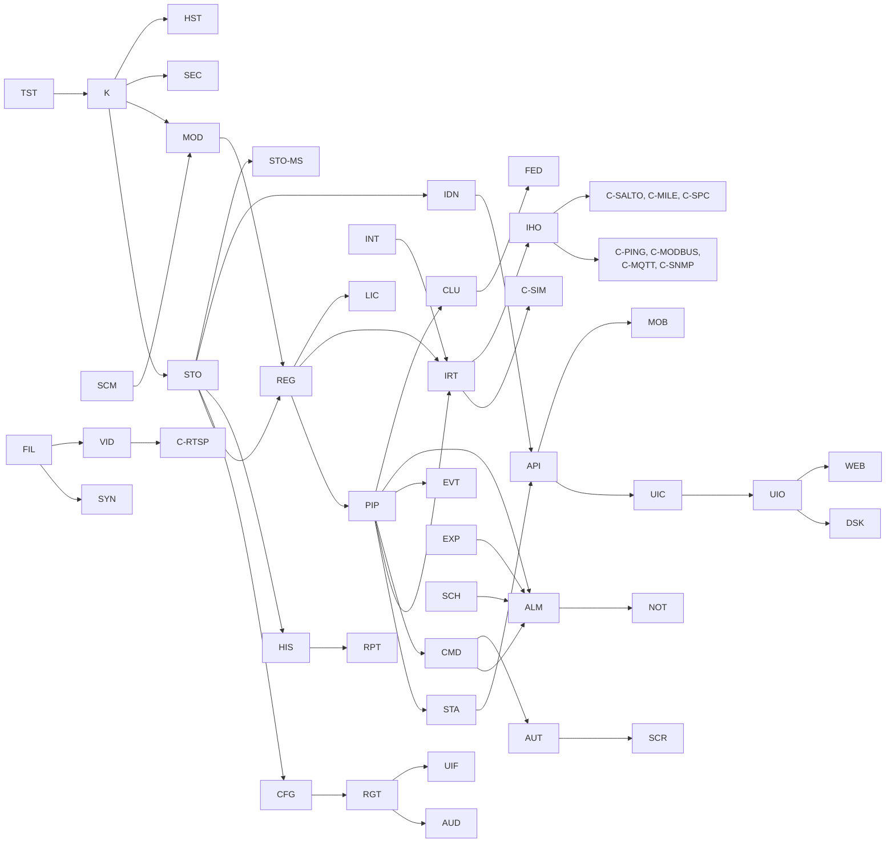

# Build Order

Watchpoint is built in **milestones**. Each milestone ends with something that runs and can
be played with, and adds to what exists without rework. Inside a milestone, tasks can run
in parallel when their dependencies are done (see [tasks.md](tasks.md)).

## 1. Spec index (ids used everywhere)

| Spec id | Module / connector | Spec file | Milestone |
|---|---|---|---|
| K | Kernel (shared primitives) | [specs/K-kernel.md](specs/K-kernel.md) | M0 |
| TST | Shared test infrastructure | [specs/TST-test-infrastructure.md](specs/TST-test-infrastructure.md) | M0 |
| SCM | JSON schemas and standard type library v0 | [specs/SCM-schemas-and-types.md](specs/SCM-schemas-and-types.md) | M0 |
| HST | Host (service executable, module loading, supervision) | [specs/HST-host.md](specs/HST-host.md) | M1 |
| STO | Storage (store interfaces, PostgreSQL provider) | [specs/STO-storage.md](specs/STO-storage.md) | M1 |
| SEC | Secrets vault | [specs/SEC-secrets.md](specs/SEC-secrets.md) | M1 |
| MOD | Model (type catalogue) | [specs/MOD-model.md](specs/MOD-model.md) | M1 |
| REG | Registry (servers, devices, locations, tags, links) | [specs/REG-registry.md](specs/REG-registry.md) | M1 |
| PIP | Pipeline (event log, partitions, ingest) | [specs/PIP-pipeline.md](specs/PIP-pipeline.md) | M1 |
| STA | Live state | [specs/STA-state.md](specs/STA-state.md) | M1 |
| INT | Integration contract and SDK | [specs/INT-integration-contract.md](specs/INT-integration-contract.md) | M1 |
| IRT | Integration runtime (packages, connections, in-process host) | [specs/IRT-integration-runtime.md](specs/IRT-integration-runtime.md) | M1 |
| C-SIM | Simulator connector | [specs/C-SIM-simulator.md](specs/C-SIM-simulator.md) | M1 |
| IDN | Identity (sign-in, tokens, sessions) | [specs/IDN-identity.md](specs/IDN-identity.md) | M1 (minimal), M3 (full) |
| API | REST API and live hub | [specs/API-api-and-live.md](specs/API-api-and-live.md) | M1 |
| UIC | UI core packages (api-client, model, i18n, ui) | [specs/UIC-ui-core.md](specs/UIC-ui-core.md) | M1 |
| UIO | UI operation side | [specs/UIO-ui-operation.md](specs/UIO-ui-operation.md) | M1–M2 |
| DSK | Desktop shell (Electron) | [specs/DSK-desktop-shell.md](specs/DSK-desktop-shell.md) | M1 |
| CMD | Commands | [specs/CMD-commands.md](specs/CMD-commands.md) | M2 |
| EVT | Events and event journal | [specs/EVT-events.md](specs/EVT-events.md) | M2 |
| EXP | Expressions (CEL) | [specs/EXP-expressions.md](specs/EXP-expressions.md) | M2 |
| SCH | Scheduling and calendars | [specs/SCH-scheduling.md](specs/SCH-scheduling.md) | M2 |
| ALM | Alarms | [specs/ALM-alarms.md](specs/ALM-alarms.md) | M2 |
| HIS | History | [specs/HIS-history.md](specs/HIS-history.md) | M2 (writer), M5 (full) |
| CFG | Configuration (drafts, publish, versions) | [specs/CFG-configuration.md](specs/CFG-configuration.md) | M3 |
| RGT | Rights, user groups, rights copy | [specs/RGT-rights.md](specs/RGT-rights.md) | M3 |
| AUD | Audit trail | [specs/AUD-audit.md](specs/AUD-audit.md) | M3 |
| MNT | Maintenance mode | [specs/MNT-maintenance.md](specs/MNT-maintenance.md) | M3 |
| UIF | UI configuration side | [specs/UIF-ui-configuration.md](specs/UIF-ui-configuration.md) | M3 |
| IHO | Isolated and remote integration hosts | [specs/IHO-integration-host.md](specs/IHO-integration-host.md) | M4 |
| C-PING | Ping / HTTP check connector | [specs/C-PING-ping.md](specs/C-PING-ping.md) | M4 |
| C-MODBUS | Modbus TCP connector | [specs/C-MODBUS-modbus.md](specs/C-MODBUS-modbus.md) | M4 |
| C-MQTT | MQTT connector | [specs/C-MQTT-mqtt.md](specs/C-MQTT-mqtt.md) | M4 |
| C-SNMP | SNMP connector | [specs/C-SNMP-snmp.md](specs/C-SNMP-snmp.md) | M4 |
| FIL | File store | [specs/FIL-files.md](specs/FIL-files.md) | M5 |
| NOT | Notifications | [specs/NOT-notifications.md](specs/NOT-notifications.md) | M5 |
| RPT | Reports | [specs/RPT-reports.md](specs/RPT-reports.md) | M5 |
| SYN | Synoptics (service + UI) | [specs/SYN-synoptics.md](specs/SYN-synoptics.md) | M6 |
| VID | Video (media gateway, streams, PTZ) | [specs/VID-video.md](specs/VID-video.md) | M6 |
| C-RTSP | Generic RTSP/ONVIF camera connector | [specs/C-RTSP-rtsp-onvif.md](specs/C-RTSP-rtsp-onvif.md) | M6 |
| WEB | Web client | [specs/WEB-web-client.md](specs/WEB-web-client.md) | M6 |
| LIC | Licensing (node side) | [specs/LIC-licensing.md](specs/LIC-licensing.md) | M7 |
| LPT | Licensing portal (company side) | [specs/LPT-licensing-portal.md](specs/LPT-licensing-portal.md) | M7 |
| AUT | Automations | [specs/AUT-automations.md](specs/AUT-automations.md) | M8 |
| SCR | Scripting (service + script host + IDE) | [specs/SCR-scripting.md](specs/SCR-scripting.md) | M8 |
| CLU | Cluster, redundancy, scale-out | [specs/CLU-cluster.md](specs/CLU-cluster.md) | M9 |
| HLT | System health | [specs/HLT-health.md](specs/HLT-health.md) | M9 |
| FED | Federation | [specs/FED-federation.md](specs/FED-federation.md) | M9 |
| MOB | Mobile app | [specs/MOB-mobile.md](specs/MOB-mobile.md) | M10 |
| PSH | Push relay (company side) | [specs/PSH-push-relay.md](specs/PSH-push-relay.md) | M10 |
| STO-MS | SQL Server storage provider and store migration | [specs/STO-MS-sqlserver.md](specs/STO-MS-sqlserver.md) | M11 |
| DEP | Installers, deployment, wpctl, updates | [specs/DEP-deployment.md](specs/DEP-deployment.md) | M11 |
| C-SALTO | Salto Space connector | `specs/C-SALTO-salto-space.md` — pending vendor documentation (D.06) | M12 |
| C-MILE | Milestone XProtect connector | `specs/C-MILE-milestone.md` — pending vendor documentation (D.06) | M12 |
| C-SPC | Vanderbilt SPC connector | `specs/C-SPC-vanderbilt-spc.md` — pending vendor documentation (D.06) | M12 |

Cross-module tests: [tests/integration-matrix.md](tests/integration-matrix.md) (contracts
between modules) and [tests/e2e-scenarios.md](tests/e2e-scenarios.md) (end-to-end).

## 2. Dependency graph

## 3. Milestones

### M0 — Foundations

**Goal**: an empty but correct repository: builds, tests and CI work; shared primitives and
schemas exist.

| Contains | Specs |
|---|---|
| Repository skeleton, solution, build props, workspace, CI workflows, templates | README §3–§11 |
| Kernel primitives | K |
| Shared test infrastructure (builders, fakes, Testcontainers fixtures) | TST |
| JSON schemas (capability, device type, manifest) and standard types v0 (door, reader, zone, area, binary input/output, analog input) | SCM |

**Playable**: `dotnet test` and `pnpm test` run green in CI; schema validator CLI validates
type documents.

**Exit criteria**: all K, TST, SCM tests pass; CI under 10 minutes.

### M1 — First device on screen

**Goal**: start the service, have the simulator create devices whose states change, and see
them change live in the desktop client.

| Contains | Specs |
|---|---|
| Service host with module loading, NATS and supervision | HST |
| Storage module + PostgreSQL provider (configuration and state stores) | STO |
| Secrets vault (file master key; DPAPI on Windows) | SEC |
| Type catalogue | MOD |
| Registry | REG |
| Pipeline and event log | PIP |
| Live state | STA |
| Integration contract and SDK | INT |
| Integration runtime (packages folder, manifest, signature check in dev mode, in-process connections) | IRT |
| Simulator connector (doors, zones, areas, inputs, outputs, random and scripted changes) | C-SIM |
| Identity minimal: local users, sign-in, tokens, bootstrap admin | IDN (part 1) |
| REST API + live hub (devices, servers, locations, states, connections) | API |
| UI core packages | UIC |
| UI operation: device explorer, device page (read-only), connection banner | UIO (part 1) |
| Desktop shell: window, sign-in, connection profile | DSK (part 1) |

**Playable demo**:
1. `docker compose -f deploy/dev/compose.yml up` (PostgreSQL + Timescale) and run the host.
2. Sign in as the bootstrap admin from the desktop app.
3. Add a "Simulator" connection with 20 doors and 10 zones (from a temporary admin endpoint
   or a seeded configuration file — the configuration UI arrives in M3).
4. Watch door states change in the explorer and on the device page.
5. Kill the service, restart it: states come back (snapshot + replay).

**Exit criteria**: e2e scenarios E-001…E-004 pass (see [tests/e2e-scenarios.md](tests/e2e-scenarios.md)).

### M2 — Act and react

**Goal**: commands with results, events, alarms with lifecycle, history of what happened.

| Contains | Specs |
|---|---|
| Commands (lifecycle, priority queues, verification, group commands) | CMD |
| Events and event journal | EVT |
| Expressions (CEL subset) | EXP |
| Calendars and time triggers | SCH |
| Alarms (rules, default rules from types, lifecycle, procedures basic, escalation) | ALM |
| History writer (events, alarms, commands, property changes) and basic queries | HIS (part 1) |
| UI operation: alarm console, alarm details, procedures, event journal, command buttons with inline status, command journal, sounds | UIO (part 2) |

**Playable demo**: simulator door forced → High alarm pops up with sound → operator
acknowledges → door closes → alarm resolved → close with report. Operator opens a door →
"sent → succeeded → verified". Simulator configured to refuse a command → readable reason.

**Exit criteria**: E-010…E-016 pass.

### M3 — Configure safely, many users

**Goal**: real configuration from the client, multi-user with rights, audit.

| Contains | Specs |
|---|---|
| Configuration service (drafts, validation, publish, versions, rollback, import/export) | CFG |
| Rights, user groups, template users, rights-copy tool | RGT |
| Audit trail | AUD |
| Identity full (LDAP, MFA TOTP/WebAuthn, lockout, session management, break-glass) | IDN (part 2) |
| Maintenance mode | MNT |
| UI configuration side: integrations and connection wizard, discovery, devices, locations, tags, links, alarm rules and procedures, users/groups/rights with copy tool, system settings | UIF |

**Playable demo**: admin creates operator template, copies it to a group, operator signs in
and only sees Building A; configurator edits rules in a draft and publishes; maintenance
mode locks operators out while the configurator keeps working.

**Exit criteria**: E-020…E-028 pass.

### M4 — Real protocols

**Goal**: supervise real equipment through generic protocols; isolated hosts.

| Contains | Specs |
|---|---|
| Isolated integration host (local process) and remote host pairing | IHO |
| Ping/HTTP, Modbus TCP, MQTT, SNMP connectors | C-PING, C-MODBUS, C-MQTT, C-SNMP |
| Connector conformance suite applied to all connectors | INT §12 |

**Playable demo**: ping your own PCs, read a Modbus simulator (e.g. a free Modbus slave
simulator) and an MQTT broker (Mosquitto), alarms on thresholds; kill an isolated host →
restarted automatically, devices stale then back.

**Exit criteria**: E-030…E-034; conformance suite green for 5 connectors.

### M5 — History, reports, notifications

| Contains | Specs |
|---|---|
| History full (retention, compression, aggregates, archive, privacy purge) | HIS (part 2) |
| File store | FIL |
| Notifications (e-mail, webhooks, SMS provider, GSM modem) | NOT |
| Reports (templates, PDF/XLSX/CSV, scheduled) | RPT |

**Playable demo**: alarm → e-mail to on-call; daily shift report arrives by e-mail as PDF.

**Exit criteria**: E-040…E-044.

### M6 — See it: synoptics, video, web

| Contains | Specs |
|---|---|
| Synoptics editor and viewer | SYN |
| Video module and media gateway | VID |
| Generic RTSP/ONVIF camera connector (test with any IP camera or an RTSP test server) | C-RTSP |
| Web client | WEB |

**Playable demo**: import a floor plan, drag doors and cameras onto it, alarm on a door →
plan pulses, camera live in the alarm details, same in a browser.

**Exit criteria**: E-050…E-056.

### M7 — Licensing

| Contains | Specs |
|---|---|
| Node licensing (footprint, verify, quotas, restricted mode, requests online/offline) | LIC |
| Licensing portal (accounts, orders, review queue, issuance) | LPT |

**Exit criteria**: E-060…E-064.

### M8 — Automate

| Contains | Specs |
|---|---|
| Automations engine and editor | AUT |
| Scripting: script host, API, IDE, test mode | SCR |

**Exit criteria**: E-070…E-075.

### M9 — Never down: cluster, health, federation

| Contains | Specs |
|---|---|
| Cluster (leases, fencing, failover, roles, placement, rolling upgrade) | CLU |
| System health dashboard | HLT |
| Federation | FED |

**Exit criteria**: E-080…E-088 (including failover under load).

### M10 — On the go

| Contains | Specs |
|---|---|
| Mobile app | MOB |
| Push relay | PSH |

**Exit criteria**: E-090…E-093.

### M11 — Fit any IT, ship it

| Contains | Specs |
|---|---|
| SQL Server provider, store mapping, `wpctl storage migrate` | STO-MS |
| Installers, images, setup wizard, updates, backups, `wpctl` | DEP |

**Exit criteria**: E-100…E-105; provider certification suite green on PostgreSQL and SQL Server.

### M12 — Vendor integrations

| Contains | Specs |
|---|---|
| Salto Space, Milestone XProtect, Vanderbilt SPC connectors | C-SALTO, C-MILE, C-SPC |

Specs for M12 are completed when vendor documentation is available.

## 4. Writing order of the specs

Specs are written in the order of the table in §1. A milestone's specs are complete before
its tasks are opened as GitHub issues.
