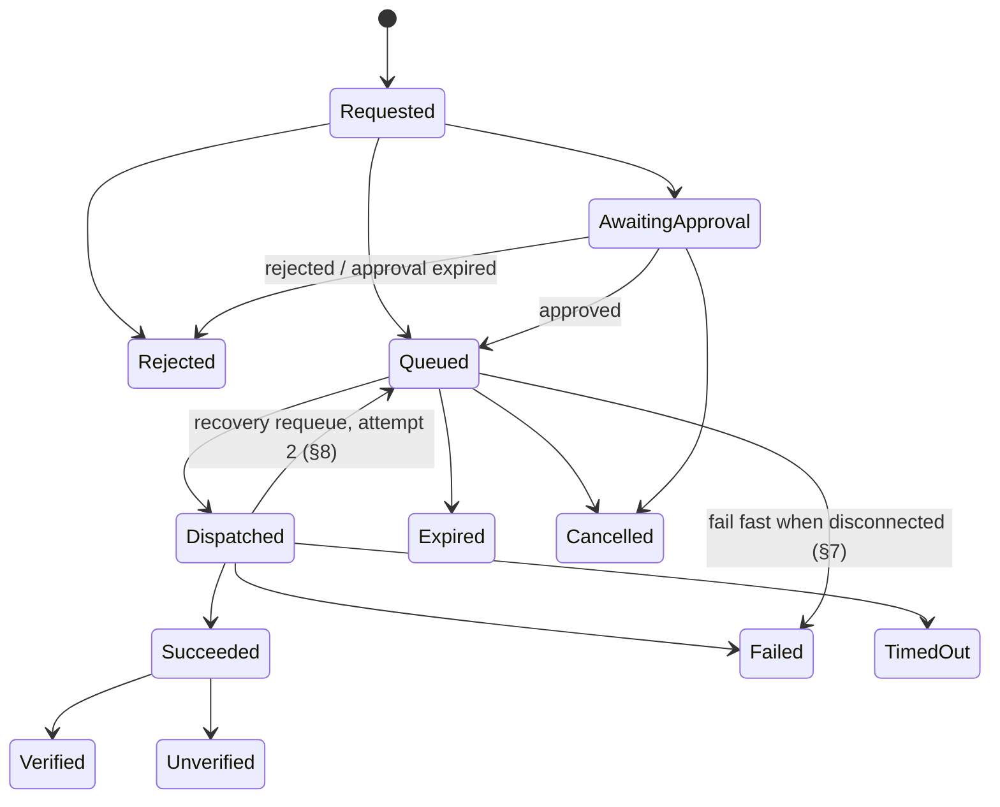

# CMD — Commands

| | |
|---|---|
| Spec id | CMD |
| Projects | `src/service/Watchpoint.Commands` |
| Milestone | M2 |
| Tasks | T2.01 (§4–§6), T2.02 (§7–§8), T2.03 (§9–§10), T2.04 (§11) |
| Design docs | [Commands](../../docs/modules/commands.md) |

## 1. Purpose and scope

Typed commands from users, automations, scripts, alarm actions and federation links to
devices: validation, authorisation hooks, risk safeguards (confirmation, reason, step-up,
four-eyes), durable lifecycle in the event log, priority queues per connection, per-device
serialisation, dispatch to connectors, results, verification of the expected effect, group
commands, journal and live updates.

Not in scope: rights rules (RGT provides `ICommandAuthorizer`; until M3 a fallback applies),
UI (UIO §10), connector execution (IRT channel).

## 2. Dependencies

| Uses | Used by |
|---|---|
| K, MOD (definitions, risk, argument validation), REG (targets, selectors), STA (verification state, availability), PIP (records, subscriber, dispatcher), IRT (`IConnectionCommandChannel`), IDN (step-up tokens), STO (state snapshots) | API/UIO, ALM (actions), AUT, SCR, FED, HIS (history), RGT (authorizer) |

## 3. Project layout

```
Watchpoint.Commands/
├── Contracts/
│   ├── Command.cs, CommandState.cs, CommandIssuer.cs, CommandPriority.cs
│   ├── CommandRequest.cs              request, targets, CommandAccepted, AvailableCommand
│   ├── ICommandService.cs             request, cancel, approve, reject, query
│   ├── ICommandAuthorizer.cs          hook implemented by RGT (+ CommandAuthorization, CommandConstraints)
│   ├── CommandRecords.cs              record kinds and bodies
│   └── CommandErrors.cs
├── Internal/
│   ├── CommandValidator.cs            §5 steps 2–10, priority rules
│   ├── CommandService.cs              ICommandService: idempotency, records by posted work, approvals, groups (T2.01 part)
│   ├── CommandProcessor.cs            state machine applied per partition, approval expiry, 60 s retention
│   ├── CommandStateMachine.cs         allowed transitions
│   ├── CommandSubscriber.cs           IPartitionSubscriber (Order 200), delegates to the processor (+ verification, T2.03)
│   ├── PendingCommandStore.cs         per partition, snapshot kind "command"; PendingCommandSnapshot.cs
│   ├── CommandDirectory.cs            node-wide view: active commands, 24 h read cache, idempotency keys
│   ├── ICommandPartitions.cs          posted work on the target's partition, waiting for the records to be applied
│   ├── FallbackCommandAuthorizer.cs   M2 rights before RGT; Seams.cs: step-up (IDN), connections (IRT)
│   ├── Dispatch/ConnectionDispatcher.cs, PriorityCommandQueue.cs, DeviceLocks.cs
│   ├── Groups/GroupCommandCoordinator.cs
│   ├── Verification/Verifier.cs
│   └── Live/CommandsTopic.cs, ApprovalsTopic.cs
├── CommandsModule.cs
└── CommandsLog.cs                     event ids 2400–2499
```

## 4. Model

```csharp
public enum CommandPriority { Critical = 0, High = 1, Normal = 2, Background = 3 }

public enum CommandState
{
    Requested, Rejected, AwaitingApproval, Queued, Dispatched, Succeeded, Failed, TimedOut,
    Expired, Cancelled, Verified, Unverified
}
// Terminal: Rejected, Failed, TimedOut, Expired, Cancelled, Verified, Unverified,
//           and Succeeded when the command has no expected effect.

public abstract record CommandIssuer
{
    public sealed record User(UserId UserId, SessionId SessionId, ClientKind ClientKind, string? WorkstationId) : CommandIssuer;
    public sealed record Automation(AutomationId AutomationId, AutomationRunId RunId, UserId IdentityId, bool LifeSafety = false) : CommandIssuer;
    public sealed record Script(ScriptId ScriptId, UserId IdentityId) : CommandIssuer;
    public sealed record AlarmAction(AlarmId AlarmId, AlarmRuleId RuleId, UserId IdentityId) : CommandIssuer;
    public sealed record Federation(FederationLinkId LinkId, string RemoteUser, UserId IdentityId) : CommandIssuer;
}

public sealed record Command
{
    public required CommandId Id { get; init; }
    public string? ClientCommandId { get; init; }            // idempotency key from the issuer (≤ 64 chars)
    public CommandId? GroupId { get; init; }
    public required DeviceId Target { get; init; }
    public required CommandPath Path { get; init; }           // "openable.open"
    public required IReadOnlyDictionary<string, WpValue> Arguments { get; init; }  // validated, defaults applied
    public required CommandIssuer Issuer { get; init; }
    public string? Reason { get; init; }
    public required Risk EffectiveRisk { get; init; }
    public required CommandPriority Priority { get; init; }
    public required TimeSpan Timeout { get; init; }
    public DateTimeOffset? NotBefore { get; init; }
    public required DateTimeOffset ExpiresAt { get; init; }   // default: RequestedAt + 5 min (+ approval window if four-eyes)
    public ExpectedEffect? Verification { get; init; }
    public CommandApproval? Approval { get; init; }
    public RecordCorrelation Correlation { get; init; } = new();
    public required CommandState State { get; init; }
    public required DateTimeOffset RequestedAt { get; init; }
    public DateTimeOffset? QueuedAt { get; init; }
    public DateTimeOffset? DispatchedAt { get; init; }
    public DateTimeOffset? CompletedAt { get; init; }
    public DateTimeOffset? VerifiedAt { get; init; }
    public int Attempt { get; init; } = 1;
    public CommandFailure? Failure { get; init; }
}

public sealed record CommandApproval(UserId? ApprovedBy, DateTimeOffset? ApprovedAt, DateTimeOffset RequestExpiresAt);
public sealed record CommandFailure(FailureCategory Category, string MessageKey, IReadOnlyDictionary<string, string?> Args,
    string? VendorCode);   // MessageKey: "errors.<code>" or a package key "packages.<id>.<key>"; Args as invariant-culture text
```

Every issuer exposes `Identity` (the user, or the identity an automation, script, alarm action or federation
link runs under): the authorizer evaluates it and idempotency keys belong to it. A rejected command (approval
refused or expired) carries its reason as `Failure` with category `RefusedBySystem` and key
`errors.commands.approval.rejected` (arg `reason`) or `errors.commands.approval.expired`.

Priority defaults: user commands `High`; commands of effective risk `Critical` or issued by a
fire/evacuation automation flagged `lifeSafety` → `Critical`; automations/scripts `Normal`;
housekeeping `Background`. Issuers may lower but only `commands.priority.critical` permission
holders and life-safety automations may raise to `Critical`. Federation users default to `High` like local users.
A raise that is not allowed (to `Critical` without the right, or any other raise above the default) is ignored:
the default applies, the request is not refused.

## 5. Request and validation (T2.01)

```csharp
public interface ICommandService
{
    Task<Result<CommandAccepted>> RequestAsync(CommandRequest request, CancellationToken ct);
    Task<Result> CancelAsync(CommandId id, CommandIssuer actor, CancellationToken ct);
    Task<Result> ApproveAsync(CommandId id, UserId approver, SessionId session, CancellationToken ct);
    Task<Result> RejectAsync(CommandId id, UserId approver, string reason, CancellationToken ct);
    Result<Command> Get(CommandId id);                                   // active (in memory) or recent (24 h cache); else commands.command.not_found
    IReadOnlyList<AvailableCommand> GetAvailable(DeviceId device, CommandIssuer who);
}

// The rights hook (step 6), implemented by RGT (RGT §6.1); synchronous: RGT evaluates in memory.
public interface ICommandAuthorizer
{
    CommandAuthorization Authorize(CommandIssuer issuer, Device device, CommandDefinition command, Risk effectiveRisk,
        IReadOnlyDictionary<string, WpValue> arguments, DateTimeOffset now);
    bool CanApprove(UserId approver, Command command, DateTimeOffset now);   // commands.approve on the command's scope
}
public sealed record CommandAuthorization { bool Allowed; Error? Denial; CommandConstraints Constraints; }   // Allow(c) / Deny(error)
public sealed record CommandConstraints(bool ReasonRequired = false, bool StepUpRequired = false, bool ApprovalRequired = false,
    IReadOnlySet<ClientKind>? AllowedClientKinds = null, bool MayRaiseToCritical = false);

public sealed record CommandRequest(CommandTargetSpec Target, CommandPath Path, JsonElement Arguments,
    CommandIssuer Issuer, string? Reason, string? StepUpToken, string? ClientCommandId,
    CommandPriority? Priority, DateTimeOffset? NotBefore, TimeSpan? Timeout, RecordCorrelation? Correlation);

public abstract record CommandTargetSpec
{
    public sealed record Device(DeviceId Id) : CommandTargetSpec;
    public sealed record Devices(IReadOnlyList<DeviceId> Ids) : CommandTargetSpec;             // ≤ 5,000 → group
    public sealed record Selector(DeviceQuery Query) : CommandTargetSpec;                       // resolved now → group
}

public sealed record CommandAccepted(CommandId Id, bool IsGroup, CommandState State, int TargetCount);

public sealed record AvailableCommand(CommandPath Path, ParameterSchema Parameters, Risk EffectiveRisk,
    bool RequiresReason, bool RequiresStepUp, bool RequiresApproval, bool Batchable);
```

Validation order (single target; group: per child, see §10). First failure → command
**Rejected** (a `command.rejected` record is still written for audit, except for idempotent
duplicates):

| # | Check | Error |
|---|---|---|
| 1 | Idempotency: `(issuer user/identity, ClientCommandId)` seen in the last 24 h → return the existing command (no new record) | — |
| 2 | Device exists, enabled, not orphaned | `commands.target.not_found` / `.disabled` / `.orphaned` |
| 3 | Command exists in the device type and capability not unsupported | `model.command.not_found` / `commands.not_supported` |
| 4 | Arguments valid (MOD `ValidateArguments`, defaults applied) | `model.value.*` field errors |
| 5 | Effective risk = max(definition risk, `riskByArgument`, site overrides by type/location/tag — configured in CFG, M3) | — |
| 6 | Authorisation: `ICommandAuthorizer.AuthorizeAsync(issuer, device, path, args, now)` → allowed + constraints (reason required, step-up required, approval required, client kinds allowed) | `common.forbidden`, `commands.outside_schedule`, `commands.client_kind_not_allowed` |
| 7 | Reason: required for `Critical`, and when constraints say so (≤ 500 chars) | `commands.reason.required` |
| 8 | Step-up: required for `Critical` when site setting `Commands:StepUpForCritical` (default true) or constraints say so; token validated by IDN, bound to the session, unused | `identity.stepup.required` / `.invalid` |
| 9 | Connection exists for the device's server (state is checked at dispatch, not here) | `commands.connection.missing` |
| 10 | Not expired; `NotBefore` ≤ now + 24 h | `commands.not_before.too_far` |

**M2 fallback authorizer** (before RGT): administrators may run everything (and raise to `Critical`);
other users may run `Normal` and `Sensitive` commands (judged on the effective risk); unknown or disabled
identities nothing; nobody needs approval; only administrators may approve; constraints: reason for Critical
(required by step 7 itself).

Notes on the checks (T2.01):

- Step 1 runs before validation and again, atomically, when the records are written; only accepted commands hold
  a key (a rejected request can be retried with the same key). `ClientCommandId` longer than 64 characters →
  `common.validation.failed` (`/clientCommandId`).
- Step 4: MOD drops members the schema does not declare, so only declared parameters reach the command and its
  records (CMD-U-027: no definition declares personal data; event payloads are the only place MOD marks it). Field
  paths are prefixed `/arguments`. JSON numbers are culture-invariant; MOD argument schemas carry no units.
- Step 7 also limits a given reason to 500 characters (`common.validation.failed`, `/reason` `common.value.too_long`),
  for requests and for `RejectAsync`, where a reason is required.
- Step 8 applies to interactive users (`CommandIssuer.User`); a proof is checked by IDN (`ValidateStepUp`: bound to the
  session, unexpired) and used once: CMD remembers used proofs for a day (`identity.stepup.invalid` on reuse).
- `Timeout` ≤ 0 → `common.validation.failed` (`/timeout`); `ExpiresAt` = max(now, `NotBefore`) + `DefaultExpiry`
  (+ `ApprovalWindow` with four-eyes); `Approval.RequestExpiresAt` = now + `ApprovalWindow`.
- Approve/reject (in this order): `commands.command.not_found`, `commands.approval.not_pending`,
  `commands.approval.self_forbidden` (approver = requester identity), `commands.approval.expired` (window passed),
  `common.forbidden` (`ICommandAuthorizer.CanApprove`). `command.approved` queues the command.
- Groups (T2.01 part of §10): targets deduplicated, more than 5,000 → `commands.group.too_large`; group risk and the
  once-for-the-group reason and step-up are decided before any child exists (failure → the request is refused,
  no record); children are then requested one by one with `GroupId` (reason and step-up not asked again). The
  `commandGroup.*` records, the issuer's visible scope for selectors, batching and progress are T2.03.

After validation: `RequiresApproval` → state `AwaitingApproval` (record `command.awaitingApproval`)
else `Queued` (record `command.queued`).

## 6. Lifecycle records (event log)

All command records are appended to the **target device's partition** (`WP_LOG`), so they are
ordered with the device's observations. Kinds and bodies:

| Kind | Body (besides envelope `dev`, `corr.command`) |
|---|---|
| `command.requested` | full `Command` at request time (arguments included; personal data none) |
| `command.rejected` | `{ id, error: { code, args, fields? }, path?, issuer?, reason?, groupId? }` — a request refused by validation has no `command.requested` record, so its rejection names what was requested; the rejection of a recorded command (approval expired) carries `id` and `error` only |
| `command.awaitingApproval` | `{ id, requestExpiresAt }` |
| `command.approved` / `command.approvalRejected` | `{ id, by, reason? }` |
| `command.queued` | `{ id, priority }` |
| `command.dispatched` | `{ id, attempt, nodeId }` |
| `command.succeeded` | `{ id, durationMs }` |
| `command.failed` | `{ id, failure }` |
| `command.timedOut` | `{ id }` |
| `command.expired` / `command.cancelled` | `{ id, by? }` |
| `command.verified` / `command.unverified` | `{ id, observed: WpValue?, afterMs }` |

HIS reads these records as JSON without the commands module (HIS §5). `command.requested` and the first state record are appended in the same batch. The
`CommandSubscriber` (Order 200) applies records to the in-memory `PendingCommandStore` of the
partition (state machine below); terminal commands leave the store after 60 s (kept in a 24 h
read cache for `Get`; history has the rest).

Every update of a command (request, cancel, approve, reject; dispatch outcomes in T2.02) runs as posted work on
the target's partition (`IPartitionDispatcher`, PIP §7.3): it reads the pending store, emits the records, and the
worker appends them and hands them to the subscribers before it runs anything else of the partition. Updates of one
command are therefore serialised (two concurrent cancels: one succeeds, the other is `commands.cancel.too_late`), and
`RequestAsync`/`CancelAsync`/`ApproveAsync`/`RejectAsync` complete once their records are in the log and applied.
Approval expiry runs in `OnTick`: an `AwaitingApproval` command past `RequestExpiresAt` gets
`command.rejected { id, error: commands.approval.expired }`.



Invalid transitions (e.g. a late `succeeded` after `timedOut`), and records of commands the partition does not
know, are ignored with log 2420 and counted (`watchpoint.commands.transitions.ignored`) — the first terminal
outcome wins.

Snapshots: `PendingCommandStore` items persisted via `IStateStore` (consumer `commands`, kind
`command`) by the same snapshot cadence as STA (CMD registers with STA's snapshotter
infrastructure: `ISnapshotParticipant`), and recovered through the PIP recovery handshake.
T2.01 provides the participant's two operations (`PendingCommandSnapshot.Collect`/`Restore`, one item per command
with the full `Command` as JSON; restoring also restores the idempotency keys); STA's snapshotter (T1.12) wires it,
and the subscriber reports its recovery checkpoint from then on (until then no replay is requested).

## 7. Dispatch (T2.02)

- One `ConnectionDispatcher` per connection on the node running that connection (M1–M8: the
  only node). It owns a `PriorityCommandQueue` (four FIFO lanes by priority) fed by
  `command.queued` / `command.approved` records (the subscriber posts the command id to the
  dispatcher of the target's connection) and on recovery from the pending store.
- Dispatch loop:
  1. Take the highest-priority command whose device is **not locked** (per-device lock:
     one in-flight command per device) and whose `NotBefore` has passed; skip (leave queued)
     commands of locked devices.
  2. If `ExpiresAt` passed → `command.expired`.
  3. Check connection status: not `Connected`/`Degraded` → keep queued until expiry, unless
     `Commands:FailFastWhenDisconnected` (default **true** for user commands): then
     `command.failed` with `ConnectionDown` immediately (operators must know now), key
     `errors.commands.connection.down` (arg `state`). The setting applies to commands of people (issuer `User` or
     `Federation`); automations, scripts and alarm actions always wait until expiry (or the connection comes back).
     A connection about to run (`Configured` before the `Connections` start-up phase, `Starting`) is not down: its
     commands wait, so commands requeued by the recovery (§8, which runs before the connections start) are dispatched
     once it is up.
  4. Append `command.dispatched` (awaited, durable), lock device, call
     `IConnectionCommandChannel.ExecuteAsync` with `Deadline = now + Timeout` and the
     command's priority.
  5. Map the result: `Succeeded` → `command.succeeded`; `Failed` → `command.failed` with the
     connector's category and message (key `packages.<packageId>.<key>`, vendor code kept); `NotSupported` →
     `command.failed(NotSupported)` key `errors.commands.not_supported`; deadline reached (also when the connector
     ignores its cancellation, or returns `Timeout`) → `command.timedOut`, a later connector result is dropped; the
     connector throwing → `command.failed(InternalError)` key `errors.commands.connector.failed` (log 2413).
     A command whose device (or server) was deleted while queued → `command.failed(InvalidState)` key
     `errors.commands.target.not_found`.
  6. Unlock device; continue.
- Concurrency: up to `Commands:MaxInFlightPerConnection` (default 8) commands in flight per
  connection (the connector's `RequestGate` also limits).
- Cancellation: `CancelAsync` on Queued/AwaitingApproval → `command.cancelled`; on Dispatched →
  refused (`commands.cancel.too_late`).

## 8. Recovery and failover (T2.02)

- After recovery, commands found in `Queued` are requeued; in `AwaitingApproval` keep waiting
  (expiry still applies).
- The subscriber does not feed the dispatchers while the partition replays (`PartitionContext.IsRecovering`);
  `OnRecoveryCompleted` runs these rules as posted work on the recovered pending store.
- Commands found in `Dispatched` without outcome (node crashed during the call): if the command
  definition is `Idempotent` and `Attempt == 1` → requeued with `Attempt = 2`
  (`command.queued` record with attempt); otherwise `command.failed` with category `Conflict` and
  key `errors.commands.outcome_unknown` ("The outcome is unknown after a restart; check the device
  state").

## 9. Verification (T2.03)

- When `command.succeeded` is applied and the command has `Verification`
  (`expectedEffect`), the subscriber registers a watcher `(device, property, expected, deadline =
  succeededAt + within)`.
- On each `property` record of that device/property: value matches (`equals` / `in`) → append
  `command.verified` (via `PartitionContext.Emit`), remove watcher.
- On `OnTick` past deadline → `command.unverified`.
- The current state is also checked immediately at success time (the effect may already be
  visible before the result arrives).
- Verification failures can raise alarms through ALM rules on `command.unverified` records.

## 10. Group commands (T2.03)

- A request with `Devices` or `Selector` creates a **group**: `GroupId` = new command id; the
  selector is resolved once (REG query with the issuer's visible scope) → device ids (≤ 5,000,
  else `commands.group.too_large`).
- Group effective risk = one level above the highest child risk (normal → sensitive, sensitive →
  critical, critical stays critical). Reason, step-up and approval are evaluated **once** for the
  group.
- Group record `commandGroup.requested { groupId, path, args, issuer, count, targets[] }` in
  `WP_SYS`; then one child command per device (children carry `GroupId`), validated individually
  (a child failing validation is `Rejected` with its reason; others continue).
- Batch dispatch: when the command definition is `Batchable` and the connection supports batch,
  the dispatcher groups queued children of the same group and connection into batches of up to
  `Commands:BatchSize` (100) and calls `ExecuteBatchAsync`; results mapped per child.
- `GroupCommandCoordinator` maintains counters per group (`total, succeeded, failed, timedOut,
  verified, unverified, rejected, pending`) and publishes `commandGroup.progress` (WP_SYS) at most
  every 500 ms and `commandGroup.completed` when all children are terminal.
- "Retry failed": `POST /command-groups/{id}/retry` creates a new group with the failed children.

## 11. API and live (T2.04)

| Method and path | Permission | Description |
|---|---|---|
| `POST /api/v1/commands` | per command (authorizer) | Body `{ target: { deviceId } \| { deviceIds: [] } \| { selector: {…} }, command: "openable.open", arguments: {…}, reason?, stepUpToken?, clientCommandId, priority?, notBefore?, timeout? }` → `202 { id, isGroup, state, targetCount }` or 4xx with the rejection error (a `Rejected` command still gets an id in the response body for traceability) |
| `GET /api/v1/commands/{id}` | issuer, approvers, `commands.viewAll` | Command with full lifecycle |
| `GET /api/v1/commands?mine=true&device=&state=&from=&to=&group=&limit=&cursor=` | own; others need `commands.viewAll` | Recent (24 h cache) — older from HIS (`/history/commands`) |
| `POST /api/v1/commands/{id}/cancel` | issuer or `commands.cancelAny` | |
| `POST /api/v1/commands/{id}/approve` | `commands.approve` + scope, approver ≠ requester | |
| `POST /api/v1/commands/{id}/reject` | same | `{ reason }` |
| `GET /api/v1/devices/{id}/commands` | authenticated | `AvailableCommand[]` for the caller |
| `GET /api/v1/command-groups/{id}`, `POST /api/v1/command-groups/{id}/retry` | issuer | Group with counters and children summary |

Live topics:

| Topic | Filter | Items |
|---|---|---|
| `commands` | `{ "mine": true }` \| `{ "deviceIds": [...] }` \| `{ "all": true }` (permission `commands.viewAll`) | Command DTO on every transition (not coalesced) |
| `approvals` | `{}` | Pending approval requests the user may approve |
| `commandGroups` | `{ "ids": [...] }` | Group progress |

## 12. Settings

| Key | Default |
|---|---|
| `Commands:DefaultExpiry` | `PT5M` |
| `Commands:ApprovalWindow` | `PT5M` |
| `Commands:FailFastWhenDisconnected` | true |
| `Commands:MaxInFlightPerConnection` | 8 |
| `Commands:BatchSize` | 100 |
| `Commands:StepUpForCritical` | true |
| `Commands:IdempotencyWindow` | `P1D` |

## 13. Errors

`commands.target.not_found` / `disabled` / `orphaned`, `commands.not_supported`,
`commands.outside_schedule`, `commands.client_kind_not_allowed`, `commands.reason.required`,
`commands.connection.missing`, `commands.not_before.too_far`, `commands.group.too_large`,
`commands.cancel.too_late`, `commands.approval.self_forbidden`, `commands.approval.expired`,
`commands.approval.not_pending`, `commands.outcome_unknown`, `commands.connection.down`, `commands.connector.failed`,
`commands.command.not_found` (no active command and
none finished in the last 24 h), plus connector failure messages. Failure message key (not an error):
`errors.commands.approval.rejected` (arg `reason`). Codes of other modules returned as they are:
`common.forbidden`, `common.validation.failed`, `model.command.not_found`, `model.type.not_found`,
`model.document.invalid` (with `model.value.*` field errors), `identity.stepup.required`, `identity.stepup.invalid`.

## 14. Observability

| EventId | Level | Message |
|---|---|---|
| 2401 | Information | Command {CommandId} {Path} on {DeviceId} by {Issuer}: {State} |
| 2410 | Warning | Command {CommandId} failed: {Category} {VendorCode} |
| 2411 | Warning | Command {CommandId} timed out after {TimeoutMs} ms |
| 2412 | Warning | Command {CommandId} not verified |
| 2413 | Warning | Command {CommandId}: the connector threw instead of returning a result |
| 2420 | Debug | Ignored late transition {Kind} for command {CommandId} in state {State} |
| 2430 | Information | Group {GroupId} completed: {Counters} |
| 2440 | Error | Command dispatch of connection {ConnectionId} failed |

Metrics: `watchpoint.commands.requests` (counter by `path`, `outcome`),
`watchpoint.commands.latency` (histogram ms requested→terminal, by `path` and terminal `state`),
`watchpoint.commands.queue` (gauge by `connection`, `priority`, T2.02), `watchpoint.commands.verification`
(counter by `result`), `watchpoint.commands.transitions.ignored` (counter by `kind`). Request outcomes:
`accepted`, `rejected`, `duplicate`.

## 15. Tests

Unit: `tests/service/Watchpoint.Commands.Tests` (fake connection channel, fake log, TestClock).
Integration: `Watchpoint.IntegrationTests/Commands` (simulator connection).

| Id | Layer | Test |
|---|---|---|
| CMD-U-001 | U | Valid request → Requested + Queued records in the device partition |
| CMD-U-002 | U | Idempotent duplicate returns existing command, no new records |
| CMD-U-003 | U | Unknown/disabled/orphaned device rejected with codes |
| CMD-U-004 | U | Command not in type → `model.command.not_found`; unsupported optional capability → `commands.not_supported` |
| CMD-U-005 | U | Argument validation errors returned as field errors; defaults applied |
| CMD-U-006 | U | Effective risk from riskByArgument |
| CMD-U-007 | U | Authorizer denial → Rejected with `common.forbidden` and record written |
| CMD-U-008 | U | Outside schedule / client kind constraints |
| CMD-U-009 | U | Reason required for Critical |
| CMD-U-010 | U | Step-up required and validated (bound to session, single use) |
| CMD-U-011 | U | Fallback authorizer behaviour before RGT |
| CMD-U-012 | U | Approval required → AwaitingApproval |
| CMD-U-013 | U | Self-approval forbidden |
| CMD-U-014 | U | Approve → Queued; reject → Rejected with reason |
| CMD-U-015 | U | Approval expiry → Rejected (`commands.approval.expired`) |
| CMD-U-016 | U | Priority defaults per issuer kind and risk |
| CMD-U-017 | U | Raising to Critical requires permission or life-safety automation |
| CMD-U-018 | U | NotBefore too far rejected |
| CMD-U-019 | U | Expiry default 5 min (+ approval window) |
| CMD-U-020 | U | State machine: every allowed transition |
| CMD-U-021 | U | Late transitions ignored and counted |
| CMD-U-022 | U | Terminal commands leave the pending store after 60 s; `Get` still works from cache |
| CMD-U-023 | U | Command records serialise with envelope correlation |
| CMD-U-024 | U | Group request rejected outright when the group validation fails (reason/step-up) |
| CMD-U-025 | U | Cancel queued/awaiting → Cancelled; dispatched → too late |
| CMD-U-026 | U | Available commands for user reflect authorizer constraints |
| CMD-U-027 | U | Arguments never contain personal data (definitions check) |
| CMD-U-028 | U | Reason length limit |
| CMD-U-029 | U | Correlation (alarm/automation) propagated to records |
| CMD-U-030 | U | Snapshot participant serialises pending store and restores it |
| CMD-U-031 | U | Dispatcher takes highest priority first |
| CMD-U-032 | U | Per-device serialisation: second command on same device waits; other devices proceed |
| CMD-U-033 | U | Max in-flight per connection |
| CMD-U-034 | U | Fail fast when disconnected (default) |
| CMD-U-035 | U | Keep queued when fail-fast disabled; expires later |
| CMD-U-036 | U | NotBefore respected |
| CMD-U-037 | U | Dispatched record durable before the connector call |
| CMD-U-038 | U | Result mapping: succeeded / failed with category and message / not supported |
| CMD-U-039 | U | Deadline → TimedOut; late connector success ignored |
| CMD-U-040 | U | Connector exception → Failed(InternalError) |
| CMD-U-041 | U | Recovery requeues Queued commands in priority order |
| CMD-U-042 | U | Recovery: Dispatched + idempotent + attempt 1 → requeued attempt 2 |
| CMD-U-043 | U | Recovery: Dispatched non-idempotent → Failed outcome_unknown |
| CMD-U-044 | U | Recovery keeps AwaitingApproval with expiry |
| CMD-U-045 | U | Queue lanes FIFO within a priority |
| CMD-U-046 | U | Locked device commands skipped without blocking the lane |
| CMD-U-047 | U | Dispatcher survives connection restart (queued commands wait) |
| CMD-U-048 | U | Metrics recorded per outcome |
| CMD-U-049 | U | Commands for deleted device during queue → Failed target missing |
| CMD-U-050 | U | Fairness across priorities under load (Background still progresses when no higher work) |
| CMD-U-051 | U | Verification registered on success with expected effect |
| CMD-U-052 | U | Property record matching → Verified |
| CMD-U-053 | U | Already in expected state at success → Verified immediately |
| CMD-U-054 | U | Deadline via tick → Unverified |
| CMD-U-055 | U | `in` expectation |
| CMD-U-056 | U | No expected effect → Succeeded terminal |
| CMD-U-057 | U | Group from ids and from selector (with visible scope) |
| CMD-U-058 | U | Group too large rejected |
| CMD-U-059 | U | Group risk one level higher |
| CMD-U-060 | U | Child validation failures don't block others |
| CMD-U-061 | U | Batch dispatch chunks per connection and maps results |
| CMD-U-062 | U | Non-batchable group dispatched individually under limits |
| CMD-U-063 | U | Group counters and progress throttled to 500 ms |
| CMD-U-064 | U | Group completed record |
| CMD-U-065 | U | Retry failed creates a new group of failed children |
| CMD-I-001 | I | End-to-end open door on simulator → Succeeded → Verified records in the log |
| CMD-I-002 | I | Simulator refusal → Failed with package message key resolvable in en/fr/ar |
| CMD-I-003 | I | Simulator timeout mode → TimedOut at deadline |
| CMD-I-004 | I | Node crash during dispatch → recovery per §8 |
| CMD-I-005 | I | 1,000-door group (campus profile) → batched, all verified, progress events |
| CMD-I-006 | I | Disconnected connection → fail fast |
| CMD-I-007 | I | Pending commands snapshot persisted and restored |
| CMD-I-008 | I | Priority under load: Critical command dispatched before 500 queued Background commands |
| CMD-I-009 | I | API POST /commands with Idempotency via clientCommandId |
| CMD-I-010 | I | API approval flow with two users |
| CMD-I-011 | I | Live `commands` topic delivers every transition in order |
| CMD-I-012 | I | `GET /devices/{id}/commands` for admin vs non-admin (fallback authorizer) |
| CMD-I-013 | I | Group API and retry |
| CMD-I-014 | I | Cancel via API |
| CMD-I-015 | I | Command records consumed by HIS into history (with T2.13) |

## 16. Tasks

| Task | Sections | Tests |
|---|---|---|
| T2.01 | §4–§6 | CMD-U-001…CMD-U-030 |
| T2.02 | §7, §8 | CMD-U-031…CMD-U-050, CMD-I-001 (up to `Succeeded`), CMD-I-002, CMD-I-003, CMD-I-006, CMD-I-008 |
| T2.03 | §9, §10 | CMD-U-051…CMD-U-065, CMD-I-001 (`Verified`), CMD-I-005 |

CMD-I-004 and CMD-I-007 need the pending store to survive a restart (STA's snapshotter wiring of
`PendingCommandSnapshot`, §6): they belong to T1.12.
| T2.04 | §11 | CMD-I-009…CMD-I-015 |
