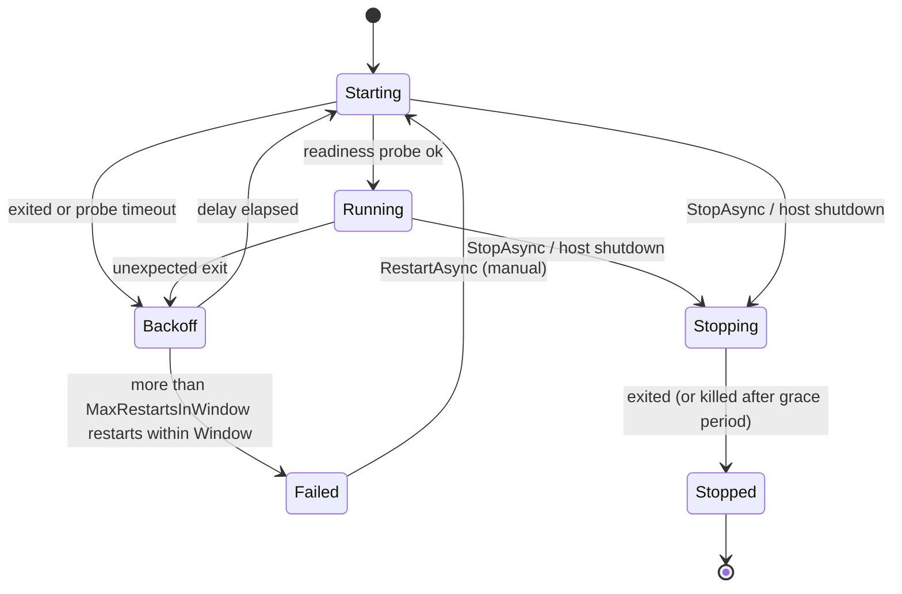

# HST — Host (Service Executable, Modules, Supervision)

| | |
|---|---|
| Spec id | HST |
| Projects | `src/service/Watchpoint.Host` (executable `watchpoint`), `src/service/Watchpoint.Hosting` (module abstractions, supervisor), `deploy/dev/` |
| Milestone | M1 |
| Tasks | T1.01 (§4–§6), T1.02 (§7–§9) |
| Design docs | [Core runtime §1](../../docs/modules/core-runtime.md#1-the-service), [Technology stack §4](../../docs/architecture/technology-stack.md#4-processes-on-a-node) |

## 1. Purpose and scope

The Host is the **one process the operating system starts**. It:

- reads node settings, configures logging, metrics and tracing;
- discovers and starts **modules** in a defined order, then exposes the HTTP endpoints;
- runs as a Windows service, a systemd service or a container process;
- **supervises helper processes** (NATS, later go2rtc, integration hosts, script host);
- loads a **development seed** in development mode.

Not in scope: business logic of modules; installers (DEP); cluster membership (CLU).

## 2. Dependencies

| Uses | Used by |
|---|---|
| K, ASP.NET Core, Microsoft.Extensions.Hosting.WindowsServices, Microsoft.Extensions.Hosting.Systemd, Serilog (+ sinks Console, File, Async), OpenTelemetry (+ Prometheus exporter, OTLP exporter) | Every module (implements `IWatchpointModule`); IRT, VID, SCR use the supervisor |

## 3. Project layout

```
Watchpoint.Hosting/                  (referenced by modules)
├── IWatchpointModule.cs
├── ModuleContext.cs
├── StartupPhase.cs, IStartupTask.cs, IShutdownTask.cs
├── NodeSettings.cs                  (bound options; validated)
├── NodePaths.cs                     data/log/package folders per OS
├── Supervision/
│   ├── ProcessSpec.cs
│   ├── ISupervisor.cs, Supervisor.cs
│   ├── SupervisedProcess.cs         state machine per child
│   ├── ReadinessProbes.cs
│   └── ChildProcessJanitor.cs       pid files, leftover cleanup, Windows Job Object
└── HostingLog.cs                    event ids 1100–1199

Watchpoint.Host/
├── Program.cs
├── ModuleCatalog.cs                 static list of modules compiled into the product
├── StartupOrchestrator.cs
├── Nats/NatsProcessSpecFactory.cs   generates nats.conf and ProcessSpec
├── Dev/DevSeedStartupTask.cs
└── appsettings.json, appsettings.Development.json

deploy/dev/
├── compose.yml                      PostgreSQL+TimescaleDB, NATS (JetStream) for developers
├── watchpoint.dev.json              node settings for local development
└── seed/sample-site.json            development seed (see §9)
```

## 4. Node settings

Sources, later overriding earlier: `appsettings.json` (shipped defaults) →
`<config folder>/watchpoint.json` (installation) → environment variables `WATCHPOINT__…`
(double underscore = section separator) → command line `--Section:Key=value`.

| Key | Type | Default | Validation |
|---|---|---|---|
| `Node:Id` | uuid | generated at first start and written back to `watchpoint.json` | v7 uuid |
| `Node:Name` | string | machine name | NameRules |
| `Node:Roles` | list | `["front","integration","pipeline","history","media"]` | subset of CLU roles |
| `Node:Environment` | enum | `Production` | `Production`, `Development` |
| `Paths:Data` | path | Windows `C:\ProgramData\Watchpoint`, Linux `/var/lib/watchpoint`, container `/var/lib/watchpoint` | writable at start |
| `Paths:Logs` | path | `<Data>/logs` (Linux: `/var/log/watchpoint`) | writable |
| `Paths:Packages` | path | `<Data>/integrations` | |
| `Paths:Binaries` | path | folder of the executable + `/bin` | contains helper binaries in production |
| `Http:Urls` | list | Production `https://0.0.0.0:8443`; Development `http://localhost:5080` | valid URLs |
| `Http:Certificate:Path` / `:Password` | path / secret ref | generated site certificate (SEC, from T1.05; self-signed placeholder before) | file exists |
| `Management:Urls` | list | `http://127.0.0.1:9464` (metrics, health) | loopback by default |
| `Database:*` | section | see STO §8 | |
| `Nats:Mode` | enum | `Bundled` | `Bundled`, `External` |
| `Nats:Url` | url | `nats://127.0.0.1:4222` | |
| `Nats:Port` | int | 4222 | 1–65535 |
| `Nats:StorePath` | path | `<Data>/nats` | |
| `Logging:MinimumLevel` | enum | `Information` | Serilog levels |
| `Logging:Overrides` | map | `{ "Microsoft.AspNetCore": "Warning" }` | |
| `Logging:RetainedFileCount` | int | 31 | 1–365 |
| `Telemetry:Otlp:Endpoint` | url | empty (disabled) | |
| `Dev:SeedFile` | path | empty | only honoured when `Node:Environment = Development` |
| `Shutdown:Timeout` | duration | `PT30S` | PT5S–PT5M |

Settings are bound to `NodeSettings` (options pattern) and validated at start with
`ValidateOnStart()`. Invalid settings → the process logs `HST1101` with all problems and
exits with code **78** (`EX_CONFIG`), so service managers do not restart-loop silently.

`NodePaths` creates missing folders and sets permissions: owner = service account, no
access for other users (Linux mode `0750`, Windows ACL: SYSTEM, Administrators, service
account).

## 5. Module system

### 5.1 Contract

```csharp
public interface IWatchpointModule
{
    string Name { get; }                                // "Registry"
    void ConfigureServices(IServiceCollection services, ModuleContext context);
    void MapEndpoints(IEndpointRouteBuilder endpoints) { }   // optional
}

public sealed class ModuleContext
{
    public required NodeSettings Node { get; init; }
    public required IConfiguration Configuration { get; init; }   // full configuration root
    public required NodePaths Paths { get; init; }
    public required bool IsDevelopment { get; init; }
}

public enum StartupPhase
{
    Infrastructure = 0,   // secrets, storage connections, NATS connection
    Schema        = 10,   // database migrations
    Catalogue     = 20,   // type catalogue, permission catalogue
    Configuration = 30,   // load configuration version into memory
    Recovery      = 40,   // state snapshot + log replay
    Runtime       = 50,   // pipelines, engines, background services
    Edge          = 60,   // HTTP endpoints accept traffic (readiness true)
    Connections   = 70    // start integration connections
}

public interface IStartupTask
{
    StartupPhase Phase { get; }
    int Order => 0;                       // within a phase, ascending
    string Name { get; }
    Task ExecuteAsync(CancellationToken ct);   // throwing = fatal start-up failure
}

public interface IShutdownTask
{
    StartupPhase Phase { get; }           // executed in descending phase order
    string Name { get; }
    Task ExecuteAsync(CancellationToken ct);
}
```

Modules register startup and shutdown tasks with
`services.AddStartupTask<T>()` / `AddShutdownTask<T>()`.

### 5.2 Module catalogue

`ModuleCatalog.All` is a **static, ordered list** compiled into the host (no reflection
scanning of folders — modules are product code, not plugins):

```csharp
public static readonly IWatchpointModule[] All =
[
    new KernelModule(), new SecretsModule(), new StorageModule(), new ModelModule(),
    new RegistryModule(), new PipelineModule(), new StateModule(), new IdentityModule(),
    new IntegrationRuntimeModule(), new ApiModule(),
    // M2+: new CommandsModule(), new EventsModule(), new AlarmsModule(), ...
];
```

### 5.3 Startup orchestration

`StartupOrchestrator` is an `IHostedLifecycleService` whose startup execution runs after
Kestrel starts listening (in `StartedAsync` via an unblocked background task), ensuring HTTP
health endpoints can serve 503 readiness responses while waiting for dependencies (e.g. database):

1. Group tasks by phase; run phases in ascending order; inside a phase run tasks by `Order`
   **sequentially** (determinism first; parallelism can be added per phase later).
2. Log `HST1110` before each task and `HST1111` after with duration.
3. A throwing task → log `HST1112` (critical) with the exception, then stop the host with
   exit code **70** (`EX_SOFTWARE`).
4. After `Edge`, mark readiness (§6.2), send `READY=1` via `ISystemdNotifier`, and log
   `HST1120 Node ready in {Duration}`.
5. `Connections` phase runs after readiness (connections can take long; they report their
   own health).

Shutdown (`StoppingAsync`): run `IShutdownTask`s in descending phase order, each with the
remaining budget of `Shutdown:Timeout`; tasks exceeding it are abandoned with `HST1131`.

## 6. Hosting and endpoints

### 6.1 Process hosting

- `Program.cs` builds a `WebApplication`:
  - `builder.Host.UseWindowsService(o => o.ServiceName = "Watchpoint")` (no-op when not a
    Windows service);
  - `builder.Host.UseSystemd()` (no-op when not under systemd; enables `sd_notify` watchdog
    while suppressing premature ready so `READY=1` is sent explicitly after `Edge`);
  - Kestrel on `Http:Urls` (HTTP/1.1 + HTTP/2; HTTP/3 off in v1), max request body 10 MB
    (larger uploads use dedicated endpoints with their own limits), request header timeout
    30 s.
  - Until `Edge` phase is reached, non-health endpoints return 503 (`Service Unavailable`),
    while `/health/live` returns 200 and `/health/ready` returns 503 with reasons.
  - Management endpoints on `Management:Urls` through a second Kestrel endpoint filtered
    with `RequireHost` (only `/health/*` and `/metrics` respond there).
- Exit codes: 0 normal, 70 start-up task failure, 78 invalid settings, 75 (`EX_TEMPFAIL`)
  when a required dependency (database) stayed unreachable for 5 minutes at start.
- Windows service recovery actions (set by the installer, DEP): restart after 10 s, 30 s,
  60 s. systemd unit: `Restart=always`, `RestartSec=5`, `WatchdogSec=60`.

### 6.2 Health

| Endpoint | Meaning | Checks |
|---|---|---|
| `GET /health/live` | Process is alive | Always 200 unless the host is shutting down |
| `GET /health/ready` | Node can serve clients | Tag `ready`: database reachable, NATS connected, startup completed (phase ≥ Edge), not draining |
| `GET /health/details` | JSON detail of every check (management port only) | All checks with status, duration, description |

Response for `/health/ready`: `200 {"status":"ready"}` or `503 {"status":"notReady","reasons":["database"]}`.

### 6.3 Logging and telemetry

- Serilog configured from `Logging:*`: async console sink (JSON in containers, text
  otherwise), rolling file sink `<Logs>/watchpoint-.log` (JSON lines, daily, size limit
  100 MB per file).
- Enrichers: `NodeId`, `NodeName`, `Module` (from logger category prefix
  `Watchpoint.<Module>`), `TraceId`, `SpanId`.
- Redaction: a Serilog destructuring policy and enricher drop properties whose names match
  `(?i)(password|secret|token|apikey|authorization|cookie)` and replace them with `"***"`.
- OpenTelemetry: metrics (`Watchpoint.*` meters, ASP.NET Core, runtime, process) exported
  on `/metrics` (Prometheus format, management port); traces exported to OTLP if
  `Telemetry:Otlp:Endpoint` is set.

## 7. Process supervisor

### 7.1 Contract

```csharp
public sealed record ProcessSpec
{
    public required string Name { get; init; }                 // "nats"
    public required string Executable { get; init; }           // absolute path
    public IReadOnlyList<string> Arguments { get; init; } = [];
    public IReadOnlyDictionary<string, string> Environment { get; init; } = Empty;
    public string? WorkingDirectory { get; init; }
    public ReadinessProbe Readiness { get; init; } = ReadinessProbe.None;
    public RestartPolicy Restart { get; init; } = RestartPolicy.Default;
    public TimeSpan StopGracePeriod { get; init; } = TimeSpan.FromSeconds(10);
    public string LogCategory { get; init; } = "Watchpoint.Child";   // child stdout/stderr lines logged here
    public ResourceLimits? Limits { get; init; }                     // used by IHO/SCR (M4/M8)
}

public abstract record ReadinessProbe
{
    public static readonly ReadinessProbe None;
    public sealed record Tcp(string Host, int Port, TimeSpan Timeout) : ReadinessProbe;
    public sealed record Http(Uri Url, TimeSpan Timeout) : ReadinessProbe;   // expects 2xx
    public sealed record StdoutLine(string Contains, TimeSpan Timeout) : ReadinessProbe;
}

public sealed record RestartPolicy(TimeSpan InitialDelay, TimeSpan MaxDelay, double Multiplier,
                                   int MaxRestartsInWindow, TimeSpan Window)
{
    public static readonly RestartPolicy Default = new(TimeSpan.FromSeconds(1),
        TimeSpan.FromSeconds(60), 2.0, MaxRestartsInWindow: 10, Window: TimeSpan.FromMinutes(10));
}

public interface ISupervisor
{
    Task<ISupervisedProcessHandle> StartAsync(ProcessSpec spec, CancellationToken ct);
    IReadOnlyCollection<ISupervisedProcessHandle> Processes { get; }
}

public interface ISupervisedProcessHandle
{
    string Name { get; }
    SupervisedProcessState State { get; }       // see 7.2
    int? Pid { get; }
    int RestartCount { get; }
    DateTimeOffset? LastStartedAt { get; }
    string? LastExitReason { get; }
    event EventHandler<SupervisedProcessState>? StateChanged;
    Task StopAsync(CancellationToken ct);       // graceful then kill
    Task RestartAsync(CancellationToken ct);
}
```

### 7.2 State machine (per supervised process)



Delay for restart n (n ≥ 1): `min(InitialDelay × Multiplier^(n-1), MaxDelay)` with ±20 %
jitter. A process that stayed `Running` for more than `Window` resets its restart count.

### 7.3 Platform behaviour

| Concern | Windows | Linux |
|---|---|---|
| Children die with the host | All children are assigned to a **Job Object** with `JOB_OBJECT_LIMIT_KILL_ON_JOB_CLOSE` | Children started in a new process group; on host start, `ChildProcessJanitor` reads `<Data>/run/<name>.pid` files and kills leftover processes whose executable path matches |
| Graceful stop | Send `CTRL_BREAK_EVENT` to the child's console group (children started with `CREATE_NEW_PROCESS_GROUP`); NATS handles it | `SIGTERM` |
| Hard kill after grace | `TerminateProcess` | `SIGKILL` |
| Output | stdout/stderr read line by line; each line logged at Information (stderr at Warning) with property `Child` = name; lines longer than 8 KB truncated |
| Pid file | `<Data>/run/<name>.pid` written after start, removed after stop | same |

### 7.4 Bundled NATS (`Nats:Mode = Bundled`)

`NatsProcessSpecFactory` writes `<Data>/nats/nats.conf` at every start:

```
listen: 127.0.0.1:4222
server_name: <NodeId>
jetstream { store_dir: "<Data>/nats/store", max_memory_store: 256MB, max_file_store: <computed: 20% of free disk, min 10GB> }
authorization { token: "<token>" }
max_payload: 4MB
```

- The token is 32 random bytes (base64url) stored in `<Data>/nats/token` (permissions
  owner-only) until SEC exists, then moved into the vault (SEC §9 migration step).
- Executable: `<Paths:Binaries>/nats-server(.exe)`; readiness: TCP probe on the port, then
  the NATS client connection used by PIP succeeds.
- `Nats:Mode = External` (development compose, clusters): the host does not start NATS and
  connects to `Nats:Url` with the token from settings/vault.

## 8. Development stack (`deploy/dev/compose.yml`)

```yaml
services:
  postgres:
    image: timescale/timescaledb:<pinned>-pg17
    environment: { POSTGRES_PASSWORD: watchpoint, POSTGRES_USER: watchpoint, POSTGRES_DB: watchpoint }
    ports: ["5432:5432"]
    volumes: [pgdata:/var/lib/postgresql/data]
  nats:
    image: nats:<pinned>
    command: ["-js", "-sd", "/data", "--auth", "devtoken"]
    ports: ["4222:4222", "8222:8222"]
    volumes: [natsdata:/data]
volumes: { pgdata: {}, natsdata: {} }
```

`deploy/dev/watchpoint.dev.json` sets `Node:Environment=Development`, `Nats:Mode=External`,
`Nats:Token=devtoken`, database to the compose PostgreSQL, `Dev:SeedFile=deploy/dev/seed/sample-site.json`.
Developers run: `docker compose -f deploy/dev/compose.yml up -d` then
`dotnet run --project src/service/Watchpoint.Host -- --config deploy/dev/watchpoint.dev.json`.

## 9. Development seed

`DevSeedStartupTask` (phase `Configuration`, order 1000; only if Development and the
configuration store is empty) reads the seed file and creates objects through the modules'
**public contracts** (never direct SQL), in this order: site, locations, tags, users,
connections (with settings and secrets), then asks IRT to run discovery and import all
devices for connections flagged `"autoImport": true`.

```json
{
  "site": { "name": "Dev site", "timeZone": "Europe/Paris" },
  "locations": [
    { "key": "hq", "name": "HQ", "kind": "site" },
    { "key": "a", "parent": "hq", "name": "Building A", "kind": "building" },
    { "key": "a0", "parent": "a", "name": "Floor 0", "kind": "floor" }
  ],
  "users": [ { "login": "admin", "password": "Dev-Admin-1!", "administrator": true } ],
  "connections": [
    {
      "package": "watchpoint.integration.simulator",
      "serverType": "sim.server",
      "name": "Simulator",
      "location": "a0",
      "settings": { "profile": "office", "doors": 20, "zones": 10, "areas": 2, "seed": 42 },
      "secrets": {},
      "autoImport": true
    }
  ]
}
```

Seed failures are logged (`HST1140`) and do not stop the node. The seed file schema is
`schemas/dev-seed.schema.json` (validated before applying).

## 10. Errors

| Code | Kind | When |
|---|---|---|
| `host.settings.invalid` | Validation | Settings validation failed (start-up only, logged) |
| `host.process.not_found` | NotFound | Supervisor asked about an unknown process |
| `host.process.executable_missing` | Unprocessable | Executable path does not exist |

## 11. Observability

| EventId | Level | Message template |
|---|---|---|
| 1101 | Critical | Invalid node settings: {Problems} |
| 1102 | Information | Node {NodeId} ({NodeName}) starting, version {Version}, environment {Environment} |
| 1110 | Information | Startup task {Task} (phase {Phase}) starting |
| 1111 | Information | Startup task {Task} completed in {DurationMs} ms |
| 1112 | Critical | Startup task {Task} failed |
| 1120 | Information | Node ready in {DurationMs} ms |
| 1130 | Information | Shutdown task {Task} completed in {DurationMs} ms |
| 1131 | Warning | Shutdown task {Task} abandoned after timeout |
| 1150 | Information | Child {Name} started with pid {Pid} |
| 1151 | Warning | Child {Name} exited unexpectedly with code {ExitCode}; restart {Attempt} in {DelayMs} ms |
| 1152 | Error | Child {Name} failed: {Restarts} restarts within {Window} |
| 1153 | Information | Child {Name} stopped |
| 1154 | Warning | Killed leftover process {Pid} for child {Name} |
| 1140 | Error | Development seed failed at {Step}: {Error} |

Metrics (`Watchpoint.Host`):

| Instrument | Type | Unit | Tags |
|---|---|---|---|
| `watchpoint.host.startup.duration` | histogram | ms | `task` |
| `watchpoint.host.child.restarts` | counter | `{restarts}` | `child` |
| `watchpoint.host.child.state` | observable gauge | — | `child`, `state` (1 for current) |

## 12. Security

- Service runs as a dedicated low-privilege account (installer); the host refuses to start
  as root/Administrator in Production unless `--allow-elevated` is passed (logged warning) —
  check `Environment.IsPrivilegedProcess`.
- Management port bound to loopback by default; binding it elsewhere logs a warning.
- NATS bound to loopback in Bundled mode; token never logged.
- Development seed only in Development; refuses to run otherwise (`HST1140` + skip).

## 13. Tests

Unit: `tests/service/Watchpoint.Hosting.Tests`. Integration: `Watchpoint.IntegrationTests/Host`.

| Id | Layer | Test | Given / When / Then |
|---|---|---|---|
| HST-U-001 | U | Settings defaults per OS | Empty config on Linux → `Paths:Data=/var/lib/watchpoint`; on Windows → `C:\ProgramData\Watchpoint` (OS abstraction injected) |
| HST-U-002 | U | Settings precedence | appsettings < watchpoint.json < env < command line for `Node:Name` |
| HST-U-003 | U | Invalid settings collected | `Nats:Port=0`, bad URL → validation lists both problems |
| HST-U-004 | U | Node id generated and persisted | No `Node:Id` → generated v7, written to `watchpoint.json` once; second start reads it |
| HST-U-005 | U | Phases run in order | Tasks registered out of order across phases → executed by phase then `Order` |
| HST-U-006 | U | Tasks in a phase run sequentially | Two tasks with delays (TestClock) → second starts after first completes |
| HST-U-007 | U | Failing task stops start-up | Task in phase Schema throws → later phases not run; exit code 70 requested |
| HST-U-008 | U | Readiness flips after Edge | Before Edge `/health/ready` 503; after 200 |
| HST-U-009 | U | Connections phase after readiness | Readiness true before Connections tasks start |
| HST-U-010 | U | Shutdown order descending | Shutdown tasks run Edge → … → Infrastructure |
| HST-U-011 | U | Shutdown timeout abandons slow task | Task exceeding budget → abandoned, log 1131, next tasks still run |
| HST-U-012 | U | Redaction enricher | Log with property `Password`, `apiKey` → rendered `***` |
| HST-U-013 | U | Module enricher | Logger category `Watchpoint.Registry.Internal.X` → property `Module=Registry` |
| HST-U-014 | U | Elevated process refused in Production | `IsPrivilegedProcess=true` → exit requested with log; with flag → warning only |
| HST-U-015 | U | Dev seed skipped outside Development | Production + SeedFile → not executed |
| HST-U-016 | U | Restart delay computation | n=1..8 → 1,2,4,8,16,32,60,60 s (±20 % jitter bounds) |
| HST-U-017 | U | Restart window → Failed | 11 exits within 10 min → state Failed, log 1152 |
| HST-U-018 | U | Long run resets restart count | Running 11 min then exit → restart count 1 |
| HST-U-019 | U | Readiness probe timeout → Backoff | TCP probe never succeeds within timeout → Backoff |
| HST-U-020 | U | Stop is graceful then kill | Fake process ignoring SIGTERM → killed after grace period |
| HST-U-021 | U | Output lines logged with child name | stdout "hello", stderr "oops" → Information / Warning entries with `Child` |
| HST-U-022 | U | Long lines truncated | 20 KB line → logged 8 KB + marker |
| HST-U-023 | U | NATS config generation | Settings → nats.conf content (snapshot) with loopback, store path, token from file |
| HST-U-024 | U | NATS token file created owner-only | First start → file exists, 32 bytes entropy, permissions 0600 (Linux) |
| HST-U-025 | U | Seed document validated | Invalid seed (unknown location key) → validation error, nothing applied |
| HST-I-001 | I | Host starts with compose infrastructure | PostgreSQL + NATS containers, Development settings → `/health/ready` 200 within 30 s |
| HST-I-002 | I | Host reports not ready without database | Database unreachable → `/health/ready` 503 with reason `database`; exit 75 after 5 min (shortened via setting in test) |
| HST-I-003 | I | Management endpoints only on management port | `/metrics` on 9464 → 200; on main port → 404 |
| HST-I-004 | I | systemd notify | Run under a fake `NOTIFY_SOCKET` → receives `READY=1` after Edge |
| HST-I-005 | I | Bundled NATS starts and restarts | Real `nats-server` binary in test image; kill it → restarted, PIP connection recovers |
| HST-I-006 | I | Children die with the host (Windows CI job, nightly) | Kill host process → nats-server gone within 5 s (Job Object) |
| HST-I-007 | I | Leftover cleanup (Linux) | Stale pid file pointing to running nats-server → killed at start, log 1154 |
| HST-I-008 | I | Dev seed creates site, users, simulator connection | Development + seed → admin can sign in; simulator devices visible via registry contract |

## 14. Tasks

| Task | Sections | Tests |
|---|---|---|
| T1.01 | §4, §5, §6, §10, §11 (host part), §12 | HST-U-001…HST-U-015, HST-I-001…HST-I-004 |
| T1.02 | §7, §8, §9, §11 (supervisor part) | HST-U-016…HST-U-025, HST-I-005…HST-I-008 |

Note: HST-I-008 needs IRT, C-SIM and IDN; it is implemented in T1.02 but enabled when those
tasks are merged (marked `[Trait("requires","T1.16,T1.17,T1.18")]`).
