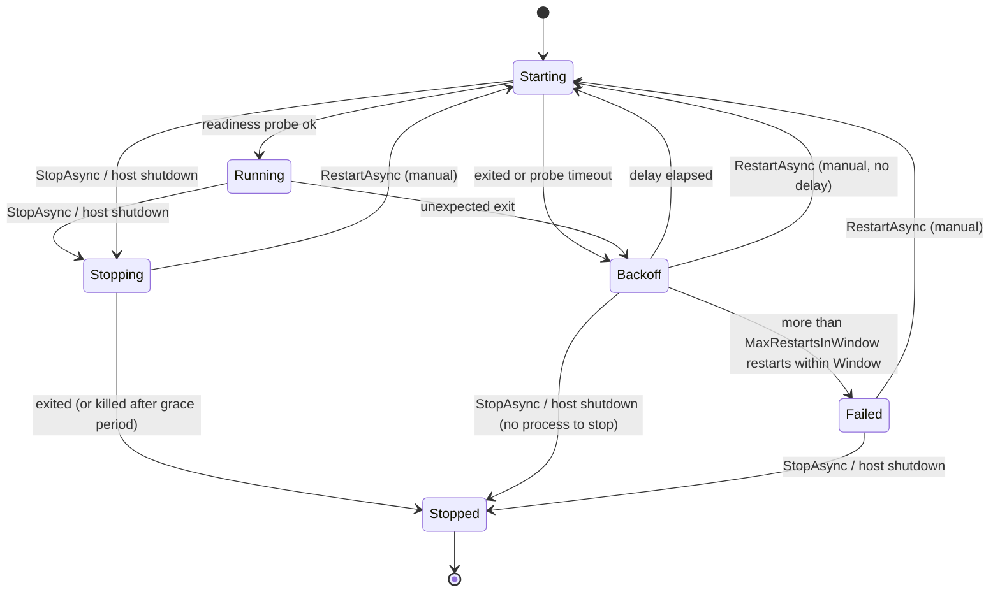

# HST — Host (Service Executable, Modules, Supervision)

| | |
|---|---|
| Spec id | HST |
| Projects | `src/service/Watchpoint.Host` (executable `watchpoint`), `src/service/Watchpoint.Hosting` (module abstractions, supervisor), `deploy/dev/` |
| Milestone | M1 |
| Tasks | T1.01 (§4–§6), T1.02 (§7–§9) |
| Design docs | [Core runtime §1](../../docs/modules/core-runtime.md#1-the-service), [Technology stack §4](../../docs/architecture/technology-stack.md#4-processes-on-a-node) |

## 1. Purpose and scope

The Host is the **one process the operating system starts**. It:

- reads node settings, configures logging, metrics and tracing;
- discovers and starts **modules** in a defined order, then exposes the HTTP endpoints;
- runs as a Windows service, a systemd service or a container process;
- **supervises helper processes** (NATS, later go2rtc, integration hosts, script host);
- loads a **development seed** in development mode.

Not in scope: business logic of modules; installers (DEP); cluster membership (CLU).

## 2. Dependencies

| Uses | Used by |
|---|---|
| K, ASP.NET Core, Microsoft.Extensions.Hosting.WindowsServices, Microsoft.Extensions.Hosting.Systemd, Serilog (+ sinks Console, File, Async), OpenTelemetry (+ Prometheus exporter, OTLP exporter) | Every module (implements `IWatchpointModule`); IRT, VID, SCR use the supervisor |

## 3. Project layout

```
Watchpoint.Hosting/                  (referenced by modules)
├── IWatchpointModule.cs
├── ModuleContext.cs
├── StartupPhase.cs, IStartupTask.cs, IShutdownTask.cs
├── NodeSettings.cs                  (bound options; validated)
├── NodePaths.cs                     data/log/package folders per OS
├── Supervision/
│   ├── ProcessSpec.cs
│   ├── ISupervisor.cs, Supervisor.cs
│   ├── SupervisedProcess.cs         state machine per child
│   ├── ReadinessProbes.cs
│   ├── ChildOutputPump.cs           bounded capture of stdout/stderr
│   ├── ChildProcessJanitor.cs       pid files, leftover cleanup, Windows Job Object
│   └── UnixChildProcess.cs, WindowsChildProcess.cs   platform launchers (§7.3)
└── HostingLog.cs                    event ids 1100–1199

Watchpoint.Host/
├── Program.cs
├── ModuleCatalog.cs                 static list of modules compiled into the product
├── StartupOrchestrator.cs
├── Nats/NatsProcessSpecFactory.cs   generates nats.conf and ProcessSpec; BundledNatsStartupTask, NatsClientCheck
├── Dev/DevSeedStartupTask.cs        DevSeedReader (schema + references), IDevSeedStep per section
└── appsettings.json, appsettings.Development.json

deploy/dev/
├── compose.yml                      PostgreSQL+TimescaleDB, NATS (JetStream) for developers
├── watchpoint.dev.json              node settings for local development
└── seed/sample-site.json            development seed (see §9)
```

## 4. Node settings

Sources, later overriding earlier: `appsettings.json` (shipped defaults) →
`<config folder>/watchpoint.json` (installation) → environment variables `WATCHPOINT__…`
(double underscore = section separator) → command line `--Section:Key=value`.

| Key | Type | Default | Validation |
|---|---|---|---|
| `Node:Id` | uuid | generated at first start and written back to `watchpoint.json` | v7 uuid |
| `Node:Name` | string | machine name | NameRules |
| `Node:Roles` | list | `["front","integration","pipeline","history","media"]` | subset of CLU roles |
| `Node:Environment` | enum | `Production` | `Production`, `Development` |
| `Site:Id` | uuid | generated at first start and written back to `watchpoint.json` (T1.18s) | v7 uuid; names the installation as a whole: shared by every node of a site (copied by `wpctl cluster join`, M9), forms the access token issuer (IDN §6.2) |
| `Paths:Data` | path | Windows `C:\ProgramData\Watchpoint`, Linux `/var/lib/watchpoint`, container `/var/lib/watchpoint` | writable at start |
| `Paths:Logs` | path | `<Data>/logs` (Linux: `/var/log/watchpoint`) | writable |
| `Paths:Packages` | path | `<Data>/integrations` | |
| `Paths:Binaries` | path | folder of the executable + `/bin` | contains helper binaries in production |
| `Http:Urls` | list | Production `https://0.0.0.0:8443`; Development `http://localhost:5080` | valid URLs |
| `Http:Certificate:Path` / `:Password` | path / secret ref | generated site certificate (SEC, from T1.05; self-signed placeholder before) | file exists |
| `Management:Urls` | list | `http://127.0.0.1:9464` (metrics, health) | loopback by default |
| `Database:*` | section | see STO §8 | |
| `Nats:Mode` | enum | `Bundled` | `Bundled`, `External` |
| `Nats:Url` | url | `nats://127.0.0.1:4222` | |
| `Nats:Port` | int | 4222 | 1–65535 |
| `Nats:StorePath` | path | `<Data>/nats` | |
| `Nats:Token` | secret | empty | External mode only (the bundled server generates its own); never logged; the development token `devtoken` is refused outside Development |
| `Logging:MinimumLevel` | enum | `Information` | Serilog levels |
| `Logging:Overrides` | map | `{ "Microsoft.AspNetCore": "Warning" }` | |
| `Logging:RetainedFileCount` | int | 31 | 1–365 |
| `Telemetry:Otlp:Endpoint` | url | empty (disabled) | |
| `Dev:SeedFile` | path | empty | only honoured when `Node:Environment = Development` |
| `Shutdown:Timeout` | duration | `PT30S` | PT5S–PT5M |

Settings are bound to `NodeSettings` (options pattern) and validated at start with
`ValidateOnStart()`. Invalid settings → the process logs `HST1101` with all problems and
exits with code **78** (`EX_CONFIG`), so service managers do not restart-loop silently.
A module validates its own section in `ConfigureServices` and throws
`Watchpoint.Hosting.InvalidSettingsException(module, problems)` on a problem; the host treats it
exactly like invalid node settings (`HST1101`, exit 78). The `Site:Id` row is the only setting the
Registry site record must agree with: REG creates the site row with this id (REG R1).

`NodePaths` creates missing folders and sets permissions: owner = service account, no
access for other users (Linux mode `0750`, Windows ACL: SYSTEM, Administrators, service
account).

## 5. Module system

### 5.1 Contract

```csharp
public interface IWatchpointModule
{
    string Name { get; }                                // "Registry"
    void ConfigureServices(IServiceCollection services, ModuleContext context);
    void MapEndpoints(IEndpointRouteBuilder endpoints) { }   // optional
}

public sealed class ModuleContext
{
    public required NodeSettings Node { get; init; }
    public required IConfiguration Configuration { get; init; }   // full configuration root
    public required NodePaths Paths { get; init; }
    public required bool IsDevelopment { get; init; }
}

public enum StartupPhase
{
    Infrastructure = 0,   // secrets, storage connections, NATS connection
    Schema        = 10,   // database migrations
    Catalogue     = 20,   // type catalogue, permission catalogue
    Configuration = 30,   // load configuration version into memory
    Recovery      = 40,   // state snapshot + log replay
    Runtime       = 50,   // pipelines, engines, background services
    Edge          = 60,   // HTTP endpoints accept traffic (readiness true)
    Connections   = 70    // start integration connections
}

public interface IStartupTask
{
    StartupPhase Phase { get; }
    int Order => 0;                       // within a phase, ascending
    string Name { get; }
    Task ExecuteAsync(CancellationToken ct);   // throwing = fatal start-up failure
}

public interface IShutdownTask
{
    StartupPhase Phase { get; }           // executed in descending phase order
    string Name { get; }
    Task ExecuteAsync(CancellationToken ct);
}
```

Modules register startup and shutdown tasks with
`services.AddStartupTask<T>()` / `AddShutdownTask<T>()`.

### 5.2 Module catalogue

`ModuleCatalog.All` is a **static, ordered list** compiled into the host (no reflection
scanning of folders — modules are product code, not plugins):

```csharp
public static readonly IWatchpointModule[] All =
[
    new KernelModule(), new SecretsModule(), new StorageModule(), new ModelModule(),
    new RegistryModule(), new PipelineModule(), new StateModule(), new IdentityModule(),
    new IntegrationRuntimeModule(), new ApiModule(),
    // M2+: new CommandsModule(), new EventsModule(), new AlarmsModule(), ...
];
```

Target list. Today (`src/service/Watchpoint.Host/ModuleCatalog.cs`) the catalogue holds `Storage`, `Model`,
`Registry`, `Pipeline`, `Identity` and `IntegrationRuntime`; each task adds its module in this order.

### 5.3 Startup orchestration

`StartupOrchestrator` is an `IHostedLifecycleService` whose startup execution runs after
Kestrel starts listening (in `StartedAsync` via an unblocked background task), ensuring HTTP
health endpoints can serve 503 readiness responses while waiting for dependencies (e.g. database):

1. Group tasks by phase; run phases in ascending order; inside a phase run tasks by `Order`
   **sequentially** (determinism first; parallelism can be added per phase later).
2. Log `HST1110` before each task and `HST1111` after with duration.
3. A throwing task → log `HST1112` (critical) with the exception, then stop the host with
   exit code **70** (`EX_SOFTWARE`).
4. After `Edge`, mark readiness (§6.2), send `READY=1` via `ISystemdNotifier`, and log
   `HST1120 Node ready in {Duration}`.
5. `Connections` phase runs after readiness (connections can take long; they report their
   own health).

Storage (`StorageModule`, first module in the catalogue): `Infrastructure` task `StorageWait`
(`IStorageStartup.WaitForDatabasesAsync`) and `Schema` task `StorageMigrations` (`MigrateAsync`);
`StorageStartupException.ExitCode` becomes the exit code (75 database unreachable for
`Database:StartupWait`, 78 invalid storage settings, 70 otherwise).

Shutdown (`StoppingAsync`): run `IShutdownTask`s in descending phase order, each with the
remaining budget of `Shutdown:Timeout`; a task still running when its budget ends is abandoned
with `HST1131` and the next tasks still run (with a cancelled token once the budget is spent).

## 6. Hosting and endpoints

### 6.1 Process hosting

- `Program.cs` builds a `WebApplication`:
  - `builder.Host.UseWindowsService(o => o.ServiceName = "Watchpoint")` (no-op when not a
    Windows service);
  - systemd: `UseSystemd()` is **not** used (its lifetime sends `READY=1` when the host has
    started, before `Edge`). `StartupOrchestrator` sends `READY=1` after `Edge` and
    `STOPPING=1` when shutdown begins, through `SystemdNotifier` (no-op without
    `NOTIFY_SOCKET`). The hosted service `SystemdWatchdog` sends `WATCHDOG=1` right away and
    then every `WATCHDOG_USEC / 2` (`TimeProvider`) when `NOTIFY_SOCKET` and `WATCHDOG_USEC`
    are set and `WATCHDOG_PID`, if present, is the current pid (log 1121); otherwise it does
    nothing;
  - Kestrel on `Http:Urls` (HTTP/1.1 + HTTP/2; HTTP/3 off in v1), max request body 10 MB
    (larger uploads use dedicated endpoints with their own limits), request header timeout
    30 s.
  - Until `Edge` phase is reached, non-health endpoints return 503 (`Service Unavailable`),
    while `/health/live` returns 200 and `/health/ready` returns 503 with reasons.
  - Management endpoints on `Management:Urls` through a second Kestrel endpoint filtered
    with `RequireHost` (only `/health/*` and `/metrics` respond there).
- Exit codes: 0 normal, 70 start-up task failure, 78 invalid settings, 75 (`EX_TEMPFAIL`)
  when a required dependency (database) stayed unreachable for 5 minutes at start.
- Windows service recovery actions (set by the installer, DEP): restart after 10 s, 30 s,
  60 s. systemd unit: `Restart=always`, `RestartSec=5`, `WatchdogSec=60`.

### 6.2 Health

| Endpoint | Meaning | Checks |
|---|---|---|
| `GET /health/live` | Process is alive | Always 200 unless the host is shutting down |
| `GET /health/ready` | Node can serve clients | Tag `ready`: database reachable, NATS connected, startup completed (phase ≥ Edge), not draining |
| `GET /health/details` | JSON detail of every check (management port only) | All checks with status, duration, description |

Response for `/health/ready`: `200 {"status":"ready"}` or `503 {"status":"notReady","reasons":["database"]}`.
Reasons: `database` when the `storage` check (STO §6.4) is unhealthy, `startup` before `Edge` or while
draining, otherwise the name of the failing `ready` check. Messages before Serilog is configured
(elevation, invalid settings, node id) go through a console bootstrap `ILogger`, never `Console.*`.

### 6.3 Logging and telemetry

- Serilog configured from `Logging:*`: async console sink (JSON in containers, text
  otherwise), rolling file sink `<Logs>/watchpoint-.log` (JSON lines, daily, size limit
  100 MB per file).
- Enrichers: `NodeId`, `NodeName`, `Module` (from logger category prefix
  `Watchpoint.<Module>`), `TraceId`, `SpanId`.
- Redaction: a Serilog destructuring policy and enricher drop properties whose names match
  `(?i)(password|secret|token|apikey|authorization|cookie)` and replace them with `"***"`.
- OpenTelemetry: metrics (`Watchpoint.*` meters, ASP.NET Core, runtime, process) exported
  on `/metrics` (Prometheus format, management port); traces exported to OTLP if
  `Telemetry:Otlp:Endpoint` is set.

## 7. Process supervisor

### 7.1 Contract

```csharp
public sealed record ProcessSpec
{
    public required string Name { get; init; }                 // "nats"
    public required string Executable { get; init; }           // absolute path
    public IReadOnlyList<string> Arguments { get; init; } = [];
    public IReadOnlyDictionary<string, string> Environment { get; init; } = Empty;
    public string? WorkingDirectory { get; init; }
    public ReadinessProbe Readiness { get; init; } = ReadinessProbe.None;
    public RestartPolicy Restart { get; init; } = RestartPolicy.Default;
    public TimeSpan StopGracePeriod { get; init; } = TimeSpan.FromSeconds(10);
    public string LogCategory { get; init; } = "Watchpoint.Child";   // child stdout/stderr lines logged here
    public LogLevel StandardErrorLevel { get; init; } = LogLevel.Warning;   // Information for children that log to stderr (nats-server)
    public ResourceLimits? Limits { get; init; }                     // used by IHO/SCR (M4/M8)
}

public abstract record ReadinessProbe
{
    public static readonly ReadinessProbe None;
    public sealed record Tcp(string Host, int Port, TimeSpan Timeout) : ReadinessProbe;
    public sealed record Http(Uri Url, TimeSpan Timeout) : ReadinessProbe;   // expects 2xx
    public sealed record StdoutLine(string Contains, TimeSpan Timeout) : ReadinessProbe;
}

public sealed record RestartPolicy(TimeSpan InitialDelay, TimeSpan MaxDelay, double Multiplier,
                                   int MaxRestartsInWindow, TimeSpan Window)
{
    public static readonly RestartPolicy Default = new(TimeSpan.FromSeconds(1),
        TimeSpan.FromSeconds(60), 2.0, MaxRestartsInWindow: 10, Window: TimeSpan.FromMinutes(10));
}

public interface ISupervisor
{
    Task<ISupervisedProcessHandle> StartAsync(ProcessSpec spec, CancellationToken ct);
    IReadOnlyCollection<ISupervisedProcessHandle> Processes { get; }   // start order; stopped processes removed
}

public interface ISupervisedProcessHandle
{
    string Name { get; }
    SupervisedProcessState State { get; }       // see 7.2
    int? Pid { get; }
    int RestartCount { get; }
    DateTimeOffset? LastStartedAt { get; }
    string? LastExitReason { get; }
    event EventHandler<SupervisedProcessState>? StateChanged;
    Task StopAsync(CancellationToken ct);       // graceful then kill
    Task RestartAsync(CancellationToken ct);
}
```

Rules of the contract:

- `StartAsync` completes when the child is `Running` for the first time or `Failed` (the caller checks
  `State`); cancelling `ct` before that stops the child (killed without grace) and throws. It throws
  `SupervisorException` (`host.process.executable_missing`) when the executable does not exist, and
  `InvalidOperationException` for a name already supervised or after shutdown began. `Name` is
  `^[a-z0-9][a-z0-9._-]{0,63}$` (it names the pid file). `Limits` is refused (`NotSupportedException`) until T4.01.
- `StopAsync` is final (`Stopped` is terminal, the handle leaves `Processes`); it never hangs: graceful signal,
  kill after `StopGracePeriod`, and a process that survives the kill is given up after 5 s (event 1157).
  Cancelling `ct` skips the rest of the grace period (immediate kill) instead of abandoning the child.
- `RestartAsync` works from `Running`, `Starting`, `Backoff` and `Failed`, resets the restart count and completes
  when the child is `Running` again; concurrent calls join the same restart. On a stopped process it throws
  `host.process.not_found`; if the child fails again, `host.process.failed`.
- Shutdown (`Supervisor.StopAllAsync`, shutdown task in phase `Infrastructure`, so after every module): children
  are stopped one by one, last started first. Disposing the supervisor, and the process-exit hook, kill what is left.
- `StateChanged` is raised for every transition, in order, by the single loop that owns the state of a child.

### 7.2 State machine (per supervised process)



`Failed` is always entered through `Backoff` (no delay). A start that fails (the process cannot be created) and a
probe timeout (the child is then stopped: graceful, then kill) count like an exit.

Delay for restart n (n ≥ 1): `min(InitialDelay × Multiplier^(n-1), MaxDelay)` with ±20 %
jitter (applied after the cap). A process that stayed `Running` for more than `Window` resets its restart count;
so does a manual restart. `RestartCount` is the number of restarts since that reset (it drives the delay);
`Failed` is decided on the exits within the sliding `Window`.

### 7.3 Platform behaviour

| Concern | Windows | Linux |
|---|---|---|
| Children die with the host | All children are assigned to a **Job Object** with `JOB_OBJECT_LIMIT_KILL_ON_JOB_CLOSE` right after they are started | Children started in a new process group (`posix_spawn` with `POSIX_SPAWN_SETPGROUP`; `System.Diagnostics.Process` cannot); on host start (and before a child of the same name is started), `ChildProcessJanitor` reads `<Data>/run/<name>.pid` files and kills leftover processes whose executable path matches (a reused pid running something else is left alone) |
| Graceful stop | Send `CTRL_BREAK_EVENT` to the child's console group (children started with `CREATE_NEW_PROCESS_GROUP`, sharing the host's console); NATS handles it. Without a console window (Windows service, CI runner) the signal cannot be delivered: the child is killed at once. This is the case verified in CI; delivery of `CTRL_BREAK` with a console is implemented but **not covered by tests**. The kill fallback is acceptable for NATS: acknowledged JetStream writes survive a kill (ADR-001 §5.5) | `SIGTERM` to the process group |
| Hard kill after grace | `TerminateProcess` (process tree) | `SIGKILL` to the process group; descendants left in the group when the child exits are killed too |
| Output | stdout/stderr read line by line; each line logged at Information (stderr at `StandardErrorLevel`, default Warning) with property `Child` = name (event 1156); lines longer than 8 KB (8,192 characters) truncated with a marker. The pipes are always drained; at most 1,024 lines per child wait for the logger, further lines are dropped and counted (event 1155) | same |
| Pid file | `<Data>/run/<name>.pid` (pid, then executable path) written after start, removed after stop | same |

**Known limitation — Linux, host killed (`SIGKILL`, crash):** nothing in the host can run, so the children
survive until the platform or the next start removes them; there is no watchdog process (decided in T1.02).
Production runs under systemd, and the next start cleans up. Under systemd the unit's control group is cleaned when the main process dies, and in a
container the children die with PID 1; elsewhere (a developer's terminal) the janitor kills them at the next start.
`PR_SET_PDEATHSIG` is not used: it is bound to the *thread* that created the child, and .NET thread-pool threads
come and go, which would kill healthy children. DEP sets `KillMode=mixed` in the unit so that `systemctl stop`
signals the host only and the host stops its children in order.

### 7.4 Bundled NATS (`Nats:Mode = Bundled`)

`NatsProcessSpecFactory` writes `<Data>/nats/nats.conf` at every start:

```
listen: 127.0.0.1:<Nats:Port>
server_name: "<NodeId>"
jetstream { store_dir: "<Nats:StorePath>/store", max_memory_store: 256MB, max_file_store: <bytes: 20% of free disk, min 10GB> }
authorization { token: "<token>" }
max_payload: 4MB
```

- The token is 32 random bytes (base64url) stored in `<Data>/nats/token` (permissions
  owner-only) until SEC exists, then moved into the vault (SEC §9 migration step). `nats.conf` holds the
  token, so it is owner-only too (as is the folder); both are replaced atomically. The token is never passed on
  the command line or in the environment.
- Executable: `<Paths:Binaries>/nats-server(.exe)`. Before the start the host runs `nats-server --version`
  (10 s limit) and refuses a version below **2.12** (ADR-001) or an unreadable one
  (`host.nats.version_unsupported`); a missing binary is `host.process.executable_missing`. Both stop the start-up.
- Readiness: TCP probe on the port (30 s), then a NATS client connects with the token and JetStream answers
  (30 s) — `BundledNatsStartupTask`, phase `Infrastructure`, order 0. PIP gets URL and token from the
  `NatsEndpoint` registered by the host (both modes).
- The server's log (stderr) is logged at Information in category `Watchpoint.Child.Nats`.
- `Nats:Mode = External` (development compose, clusters): the host does not start NATS and
  connects to `Nats:Url` with the token from settings/vault.

## 8. Development stack (`deploy/dev/compose.yml`)

```yaml
services:
  postgres:
    image: timescale/timescaledb:<pinned>-pg17
    environment: { POSTGRES_PASSWORD: watchpoint, POSTGRES_USER: watchpoint, POSTGRES_DB: watchpoint }
    ports: ["127.0.0.1:5432:5432"]
    volumes: [pgdata:/var/lib/postgresql/data]
  nats:
    image: nats:<pinned>
    command: ["-js", "-sd", "/data", "-m", "8222", "--auth", "devtoken"]
    ports: ["127.0.0.1:4222:4222", "127.0.0.1:8222:8222"]
    volumes: [natsdata:/data]
volumes: { pgdata: {}, natsdata: {} }
```

`deploy/dev/watchpoint.dev.json` sets `Node:Environment=Development`, `Nats:Mode=External`,
`Nats:Token=devtoken`, database to the compose PostgreSQL, `Dev:SeedFile=deploy/dev/seed/sample-site.json`.
Developers run: `docker compose -f deploy/dev/compose.yml up -d` then
`dotnet run --project src/service/Watchpoint.Host -- --config deploy/dev/watchpoint.dev.json`.

Images are pinned by digest; the pins (with the nats-server release checksums used by the tests) are listed in
`deploy/versions.env` and must equal those of the test fixtures (HST-I-010). Ports are published on loopback
only: the credentials above are development defaults, not secrets. `watchpoint.dev.json` has a fixed `Node:Id`
(nothing is written back to the tracked file) and keeps its data in `.watchpoint-dev/` (git-ignored).

The development credentials are refused outside Development (fail closed, HST-U-044): `Nats:Token = devtoken`
fails settings validation (exit 78), `PasswordDev` fails storage settings validation (STO §9, exit 78), the seed
is not applied (`HST1140`), and a seed step asked to run anyway returns `host.seed.not_development`.

## 9. Development seed

`DevSeedStartupTask` (phase `Configuration`, order 1000; only if Development and the
configuration store is empty) reads the seed file and creates objects through the modules'
**public contracts** (never direct SQL), in this order: site, locations, tags, users,
connections (with settings and secrets), then asks IRT to run discovery and import all
devices for connections flagged `"autoImport": true`.

```json
{
  "site": { "name": "Dev site", "timeZone": "Europe/Paris" },
  "locations": [
    { "key": "hq", "name": "HQ", "kind": "site" },
    { "key": "a", "parent": "hq", "name": "Building A", "kind": "building" },
    { "key": "a0", "parent": "a", "name": "Floor 0", "kind": "floor" }
  ],
  "users": [ { "login": "admin", "password": "Dev-Admin-1!", "administrator": true } ],
  "connections": [
    {
      "package": "watchpoint.integration.simulator",
      "serverType": "sim.server",
      "name": "Simulator",
      "location": "a0",
      "settings": { "profile": "office", "doors": 20, "zones": 10, "areas": 2, "seed": 42 },
      "secrets": {},
      "autoImport": true
    }
  ]
}
```

Optional `"tags": [ { "family": "criticality", "key": "high", "name": "High" } ]`; a user may have a
`"displayName"`. Unknown properties are rejected.

Seed failures are logged (`HST1140`) and do not stop the node. The seed file schema is
`schemas/dev-seed.schema.json`; the document is validated before anything is applied: the schema, then the
references (unique keys, a parent declared before its children, a single root, known location keys) —
error `host.seed.invalid` with the JSON paths. Logs name paths and codes, never values (the seed holds passwords).

Each section is applied by an `IDevSeedStep` (one per section, registered by the host for the modules it
composes), in the order above. "Store empty" means no step reports existing data (`HasDataAsync`; the users step:
none of the seed's logins exists); otherwise nothing is applied (event 1142). A section without a step is skipped
with a warning (event 1141). T1.02 delivers the `users` step (IDN); the steps for site, locations and tags (REG)
and for connections and import (IRT) come with T1.16. The Registry module is already in the host's module
catalogue (T1.09/T1.10); only its seed steps are missing.

## 10. Errors

| Code | Kind | When |
|---|---|---|
| `host.settings.invalid` | Validation | Settings validation failed (start-up only, logged) |
| `host.process.not_found` | NotFound | Supervisor asked about an unknown process |
| `host.process.executable_missing` | Unprocessable | Executable path does not exist |
| `host.process.failed` | Unavailable | A child did not reach `Running`: too many restarts within the window |
| `host.nats.version_unsupported` | Unprocessable | Bundled nats-server older than 2.12 or version unreadable (args `found`, `minimum`) |
| `host.seed.not_development` | Forbidden | A seed step was asked to run outside Development |
| `host.seed.invalid` | Validation | Development seed fails the schema or its references (field errors: JSON paths; `host.seed.reference_unknown`) |

## 11. Observability

| EventId | Level | Message template |
|---|---|---|
| 1101 | Critical | Invalid node settings: {Problems} |
| 1102 | Information | Node {NodeId} ({NodeName}) starting, version {Version}, environment {Environment} |
| 1103 | Critical | Refusing to start as a privileged process (root/Administrator) in Production without --allow-elevated |
| 1104 | Warning | Running as a privileged process (root/Administrator) in Production (--allow-elevated) |
| 1105 | Warning | Could not persist Node:Id to {Path} |
| 1110 | Information | Startup task {Task} (phase {Phase}) starting |
| 1111 | Information | Startup task {Task} completed in {DurationMs} ms |
| 1112 | Critical | Startup task {Task} failed |
| 1120 | Information | Node ready in {DurationMs} ms |
| 1121 | Information | systemd watchdog enabled, ping every {IntervalMs} ms |
| 1130 | Information | Shutdown task {Task} completed in {DurationMs} ms |
| 1131 | Warning | Shutdown task {Task} abandoned after timeout |
| 1132 | Error | Shutdown task {Task} failed with exception |
| 1150 | Information | Child {Name} started with pid {Pid} |
| 1151 | Warning | Child {Name} exited unexpectedly ({Reason}) with code {ExitCode}; restart {Attempt} in {DelayMs} ms |
| 1152 | Error | Child {Name} failed: {Restarts} restarts within {Window} |
| 1153 | Information | Child {Name} stopped |
| 1154 | Warning | Killed leftover process {Pid} for child {Name} |
| 1155 | Warning | Child {Name} output: {Dropped} lines dropped (logging slower than the child) |
| 1156 | Information / `StandardErrorLevel` | {Child}: {Line} (category = `ProcessSpec.LogCategory`) |
| 1157 | Error | Child {Name} (pid {Pid}) could not be killed |
| 1158 | Warning | Pid file of child {Name} could not be read, written or removed |
| 1159 | Critical | Supervision of child {Name} stopped on an internal error |
| 1160 | Error | StateChanged handler of child {Name} failed |
| 1161 | Information | Bundled NATS server {Version} ready at {Url} (pid {Pid}) |
| 1141 | Warning | Development seed section {Section} skipped: no module of this node handles it |
| 1142 | Information | Development seed not applied: {Section} already has data |
| 1143 | Information | Development seed {Path} applied: {Sections} |
| 1140 | Error | Development seed failed at {Step}: {Error} |

Metrics (`Watchpoint.Host`):

| Instrument | Type | Unit | Tags |
|---|---|---|---|
| `watchpoint.host.startup.duration` | histogram | ms | `task` |
| `watchpoint.host.child.restarts` | counter | `{restarts}` | `child` |
| `watchpoint.host.child.state` | observable gauge | — | `child`, `state` (1 for the current state, 0 for the others) |

## 12. Security

- Service runs as a dedicated low-privilege account (installer); the host refuses to start
  as root/Administrator in Production unless `--allow-elevated` is passed (logged warning) —
  check `Environment.IsPrivilegedProcess`.
- Management port bound to loopback by default; binding it elsewhere logs a warning.
- NATS bound to loopback in Bundled mode; token never logged.
- Development seed only in Development; refuses to run otherwise (`HST1140` + skip).

## 13. Tests

Unit: `tests/service/Watchpoint.Hosting.Tests`. Integration: `Watchpoint.IntegrationTests/Host`.

| Id | Layer | Test | Given / When / Then |
|---|---|---|---|
| HST-U-001 | U | Settings defaults per OS | Empty config on Linux → `Paths:Data=/var/lib/watchpoint`; on Windows → `C:\ProgramData\Watchpoint` (OS abstraction injected) |
| HST-U-002 | U | Settings precedence | appsettings < watchpoint.json < env < command line for `Node:Name` |
| HST-U-003 | U | Invalid settings collected | `Nats:Port=0`, bad URL → validation lists both problems |
| HST-U-004 | U | Node id generated and persisted | No `Node:Id` → generated v7, written to `watchpoint.json` once; second start reads it |
| HST-U-005 | U | Phases run in order | Tasks registered out of order across phases → executed by phase then `Order` |
| HST-U-006 | U | Tasks in a phase run sequentially | Two tasks with delays (TestClock) → second starts after first completes |
| HST-U-007 | U | Failing task stops start-up | Task in phase Schema throws → later phases not run; exit code 70 requested |
| HST-U-008 | U | Readiness flips after Edge | Before Edge `/health/ready` 503; after 200 |
| HST-U-009 | U | Connections phase after readiness | Readiness true before Connections tasks start |
| HST-U-010 | U | Shutdown order descending | Shutdown tasks run Edge → … → Infrastructure |
| HST-U-011 | U | Shutdown timeout abandons slow task | Task exceeding budget → abandoned, log 1131, next tasks still run |
| HST-U-012 | U | Redaction enricher | Log with property `Password`, `apiKey` → rendered `***` |
| HST-U-013 | U | Module enricher | Logger category `Watchpoint.Registry.Internal.X` → property `Module=Registry` |
| HST-U-014 | U | Elevated process refused in Production | `IsPrivilegedProcess=true` → exit requested with log; with flag → warning only |
| HST-U-015 | U | Dev seed skipped outside Development | Production + SeedFile → not executed |
| HST-U-016 | U | Restart delay computation | n=1..8 → 1,2,4,8,16,32,60,60 s (±20 % jitter bounds) |
| HST-U-017 | U | Restart window → Failed | 11 exits within 10 min → state Failed, log 1152 |
| HST-U-018 | U | Long run resets restart count | Running 11 min then exit → restart count 1 |
| HST-U-019 | U | Readiness probe timeout → Backoff | TCP probe never succeeds within timeout → Backoff |
| HST-U-020 | U | Stop is graceful then kill | Fake process ignoring SIGTERM → killed after grace period |
| HST-U-021 | U | Output lines logged with child name | stdout "hello", stderr "oops" → Information / Warning entries with `Child` |
| HST-U-022 | U | Long lines truncated | 20 KB line → logged 8 KB + marker |
| HST-U-023 | U | NATS config generation | Settings → nats.conf content (snapshot) with loopback, store path, token from file |
| HST-U-024 | U | NATS token file created owner-only | First start → file exists, 32 bytes entropy, permissions 0600 (Linux) |
| HST-U-025 | U | Seed document validated | Invalid seed (unknown location key) → validation error, nothing applied |
| HST-I-001 | I | Host starts with compose infrastructure | PostgreSQL + NATS containers, Development settings → `/health/ready` 200 within 30 s |
| HST-I-002 | I | Host reports not ready without database | Database unreachable → `/health/ready` 503 with reason `database`; exit 75 after 5 min (shortened via setting in test) |
| HST-I-003 | I | Management endpoints only on management port | `/metrics` on 9464 → 200; on main port → 404 |
| HST-I-004 | I | systemd notify | Run under a fake `NOTIFY_SOCKET` with `WATCHDOG_USEC=2000000` → receives `READY=1` after Edge and `WATCHDOG=1` pings |
| HST-I-005 | I | Bundled NATS starts and restarts | Real `nats-server` binary (official release archive, pinned by version and SHA-256, downloaded by the test; Linux and Windows CI jobs); version check; client with token connects, without it is refused; kill it → restarted, the same client connection recovers and the acknowledged message is still there (publishes carry a JetStream message id, so a retried publish is stored once: the stream holds exactly the two messages); shutdown leaves no process and no pid file |
| HST-I-006 | I | Children die with the host (Windows CI job, every push) | Host process with bundled NATS; kill the host only → nats-server gone within 5 s (Job Object) |
| HST-I-007 | I | Leftover cleanup (Linux) | Host process with bundled NATS killed (`SIGKILL`): nats-server and its pid file stay; next host start on the same data folder → leftover killed, log 1154, fresh server running |
| HST-I-008 | I | Dev seed creates site, users, simulator connection | Development + seed → admin can sign in; simulator devices visible via registry contract |

Added by T1.02 (state machine and platform behaviour in detail):

| Id | Layer | Test | Given / When / Then |
|---|---|---|---|
| HST-U-028 | U | Start and stop lifecycle | Start → Running, pid file, log 1150; stop → `Starting, Running, Stopping, Stopped`, pid file removed, log 1153, handle removed; restart of a stopped process → `host.process.not_found` |
| HST-U-029 | U | Crash during start | Exit before ready → Backoff; not restarted 1 ms before the delay, restarted at the delay; log 1151 with code, attempt, delay |
| HST-U-030 | U | Start failure retried | Launcher throws → Backoff → next attempt runs |
| HST-U-031 | U | Stop while starting | `Starting, Stopping, Stopped`; no restart, no 1151 |
| HST-U-032 | U | Stop during Backoff or Failed | → Stopped without a process; the cancelled back-off timer starts nothing |
| HST-U-033 | U | Manual restart | From Running (three concurrent calls = one restart), Backoff (no delay, count reset) and Failed |
| HST-U-034 | U | Concurrent stop and restart calls | 16 parallel calls, 25 rounds → Stopped exactly once, only legal transitions, every child stopped once and released |
| HST-U-035 | U | Stop never hangs | Cancelled token → killed at once; unkillable child → given up after the kill timeout, log 1157 |
| HST-U-036 | U | Start errors and cancelled start | Missing executable → `host.process.executable_missing`; bad name, relative path, limits, duplicate name refused; cancelled start kills the child and frees the name |
| HST-U-037 | U | Shutdown order | `StopAllAsync` stops last started first, then refuses starts; disposing kills leftovers without grace |
| HST-U-038 | U | Chatty child, bounded memory | Blocked logger, 5,000 lines → stream read to the end, at most capacity + 1 lines kept, rest counted in 1155 |
| HST-U-039 | U | Leftover cleanup rules | Pid file + same executable → killed, 1154; reused pid, dead pid, own pid, garbage → not killed; files removed; cleanup before a start of the same name |
| HST-U-040 | U | Readiness probes | None; Tcp (retries per interval); Http (503 then 2xx); StdoutLine (timeout, then match) |
| HST-U-041 | U | Child metrics | Restart counter and state gauge per child |
| HST-U-042 | U | NATS binary location and version check | `--version` parsing; < 2.12 or unreadable → `host.nats.version_unsupported`; missing binary → `host.process.executable_missing` |
| HST-U-043 | U | Seed applied in order, once, never fatal | Section order; section without step → 1141; existing data → 1142, nothing applied; failing/throwing step and missing file → 1140, node continues |
| HST-U-044 | U | Development seed and credentials refused outside Development | Production: seed task applies nothing (1140), users step returns `host.seed.not_development`; `watchpoint.dev.json` with `Node:Environment=Production` → `Nats:Token` invalid, `PasswordDev` rejected by storage (exit 78) before any connection |
| HST-U-046 | U | Site id generated once, persisted and validated | First start: `Site:Id` generated (v7) and written back next to `Node:Id`; second start reads it; a non-v7 id fails validation |
| HST-U-047 | U | Module with invalid settings stops the start | `IdentityModule.BindSettings` with a valid context → settings; an invalid or unknown `Identity:*` key, or no `Site:Id` → `InvalidSettingsException` naming the key and code, never the value |
| HST-U-045 | U | Ready line printed at once is not missed | Child whose stdout already holds the `StdoutLine` text when it starts → Running (the probe is registered before the output is read), 50 rounds |
| HST-I-009 | I | Real child process (Linux) | Own process group; 20,000 lines drained; environment, working directory, stderr; child ignoring SIGTERM with a descendant → both killed after the grace period; exit code reported |
| HST-I-010 | I | Development stack pinned and consistent | Compose images pinned by digest and equal to the test fixtures and `deploy/versions.env`; loopback ports; dev settings valid; sample seed valid |

### 13.1 T1.01 follow-up: systemd watchdog

Unit tests in `tests/service/Watchpoint.Hosting.Tests/SystemdWatchdogTests.cs`; HST-I-004
above also covers the watchdog end to end.

| Id | Layer | Test | Given / When / Then |
|---|---|---|---|
| HST-U-026 | U | Watchdog pings every half interval | `WATCHDOG_USEC=60000000` (FakeTimeProvider, fake notifier) → `WATCHDOG=1` at start, then every 30 s; none after stop |
| HST-U-027 | U | Watchdog disabled without settings or other pid | No `NOTIFY_SOCKET`, no/invalid `WATCHDOG_USEC`, or `WATCHDOG_PID` ≠ current pid → no ping; no `WATCHDOG_PID` → enabled |

## 14. Tasks

| Task | Sections | Tests |
|---|---|---|
| T1.01 | §4, §5, §6, §10, §11 (host part), §12 | HST-U-001…HST-U-015, HST-U-026, HST-U-027, HST-I-001…HST-I-004 |
| T1.02 | §7, §8, §9, §11 (supervisor part) | HST-U-016…HST-U-025, HST-U-028…HST-U-045, HST-I-005…HST-I-007, HST-I-009, HST-I-010; HST-I-008 written (enabled by T1.16) |

Note: HST-I-008 needs IRT, C-SIM and IDN; it is implemented in T1.02 but enabled when those
tasks are merged (marked `[Trait("requires","T1.16,T1.17,T1.18")]`). T1.17 and T1.18 are merged; what is
missing is T1.16 (connection manager) together with the seed steps for site, locations and tags (REG) and for
connections and import (IRT); the Registry module is already in the catalogue. Until then the test is skipped; **T1.16 enables it** (removes the
`Skip`, adds the missing seed steps) and lists it among its tests.
