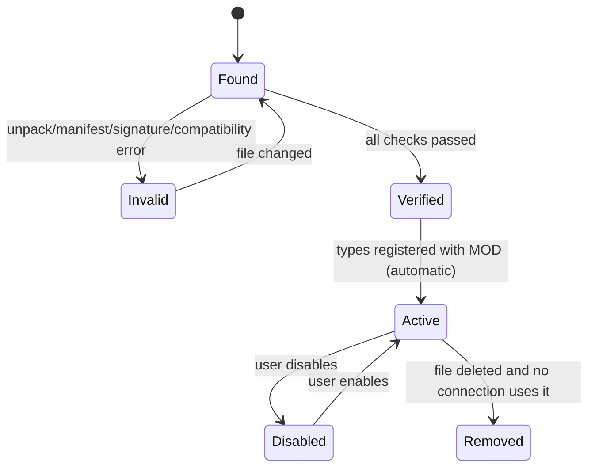

# IRT — Integration Runtime (Packages, Connections, In-Process Hosting)

| | |
|---|---|
| Spec id | IRT |
| Projects | `src/service/Watchpoint.Integrations` |
| Milestone | M1 (in-process), M4 (isolated/remote hosts via IHO, package upgrades) |
| Tasks | T1.15 (§4–§6), T1.16 (§7–§10), T4.09 (§11) |
| Design docs | [Integrations](../../docs/modules/integrations.md) |

## 1. Purpose and scope

- Discover integration **packages** in folders, verify their signatures and manifests,
  register their types with MOD, load their code in isolated load contexts.
- Manage **connections** (configured connector instances): settings, secrets, lifecycle,
  state machine, watchdog, inventory reconciliation, command execution.
- Implement the **connector context** (INT §7) on top of PIP, REG, SEC and STO.

Not in scope: isolated and remote host processes (IHO, M4 — this spec defines the
`IConnectionHost` abstraction they implement), command queues and lifecycle (CMD).

## 2. Dependencies

| Uses | Used by |
|---|---|
| K, HST, STO, SEC, MOD, REG, PIP, INT (Abstractions), SCM (manifest reader), NSec (Ed25519, MIT) | CMD (command channel), API, UIF, VID (video provider), HLT, CLU (placement), LIC (feature keys) |

## 3. Project layout

```
Watchpoint.Integrations/
├── Contracts/
│   ├── PackageInfo.cs, PackageState.cs, PackageJson.cs, IPackageCatalog.cs, IPackageWatcher.cs
│   ├── IntegrationsOptions.cs, IntegrationsServiceCollectionExtensions.cs
│   ├── Connection.cs (model, state, status, requests), IConnectionManager.cs (+ IConnectionCommandChannel,
│   │   IConnectionAdmission, IConnectionsLifecycle), ConnectionsOptions.cs, ConnectionEndpoints.cs,
│   │   EndpointResults.cs (problem details, loopback-only filter)                       (T1.16)
│   ├── ConnectionSettingsSchema.cs
│   └── IntegrationErrors.cs
├── Internal/
│   ├── Packages/PackageWatcher.cs, FolderChangeSource.cs, PackageUnpacker.cs, PackageVerifier.cs,
│   │            SignatureVerifier.cs, TrustedKeys.cs, ConnectorCodeChecker.cs, PackageCatalog.cs,
│   │            PackageLoadContext.cs, PackageLoadContextPool.cs, SharedAssemblies.cs,
│   │            PackageProblems.cs, PackageSeams.cs
│   ├── IntegrationsMetrics.cs, PackageScanHealthCheck.cs
│   ├── Connections/ConnectionManager.cs (also the watchdog timer), ConnectionRuntime.cs (state machine
│   │               per connection), InventoryCoordinator.cs, ConnectionStateRecorder.cs, LazyServices.cs (T1.16)
│   ├── Hosting/ConnectionHost.cs (IConnectionHost, InProcessHost)                      (T1.16)
│   ├── Context/ConnectorContext.cs, ConnectorContextFactory.cs, ObservationSink.cs, DeviceMap.cs,
│   │           ConnectionStore.cs, RequestGate.cs, ConnectorServices.cs (secrets, scheduler, HTTP, metrics,
│   │           logging), InboundEndpoints.cs (+ the inbound HTTP router)               (T1.16)
│   └── Storage/IntegrationsDbContext.cs, ConnectionStorage.cs (+ Postgres subclass, migrations)
├── Contracts/PackageEndpoints.cs  the package endpoints (§10), mapped by the host module
└── IntegrationLog.cs              event ids 1800–1949 (IHO: 1950–1999)

The host module (`Watchpoint.Host/Modules/IntegrationRuntimeModule.cs`) registers the services, the
start-up task (phase `Catalogue`, order 10) and maps the endpoints. Test helpers that build packages
(signed with a test key, connectors compiled at test time, the simulator staged from its build output)
live in `tests/service/Watchpoint.Integrations.Testing`.
```

## 4. Packages

### 4.1 Folders

| Folder | Purpose |
|---|---|
| `<install>/integrations-builtin/` | Packages shipped with the product (simulator, ping, Modbus, MQTT, SNMP from M4); read-only |
| `Paths:Packages` (default `<Data>/integrations/`) | Packages installed by users (`.wpkg` files or unpacked folders) |
| `<Data>/integrations/.cache/<packageId>/<version>/` | Unpacked, verified copies used for loading |

`PackageWatcher` scans both folders at start (phase `Catalogue`, order 10) and watches the
user folder (`FileSystemWatcher` + a 30 s periodic rescan as safety net; changes debounced
2 s). Uploads through the API (§10) write into the user folder.
Names starting with a dot (`.cache`, upload temp files) and `dev-keys/` are never packages. A file
another process still writes (locked, or unreadable) is retried after the next quiet period, never
declared invalid. Lost watcher events (buffer overflow) trigger a full rescan. A rescan verifies only
sources whose fingerprint (size, last write, file count) changed; the manifest SHA-256 identifies the
content, so a rewritten file with the same content changes nothing. A second file providing an id and
version already present is `Invalid` (`irt.package.version_conflict`); a changed file under a version
that connections run on is refused the same way and the loaded version stays.

### 4.2 Package states



```csharp
public enum PackageState { Found, Invalid, Verified, Active, Disabled, Removed }

public sealed record PackageInfo(PackageId Id, SemVersion Version, PackageState State,
    string Vendor, string Category, string Source /* builtin | user */, string? FilePath,
    IReadOnlyList<ConnectorInfo> Connectors, LicenceRequirement Licence,
    IReadOnlyList<string> Platforms, string Isolation, IReadOnlyList<DocumentProblem> Problems,
    bool SignedByDevelopmentKey, DateTimeOffset DiscoveredAt);

public sealed record ConnectorInfo(string ServerType, IReadOnlyList<string> Features,
    string SupportedVendorVersions, bool HasLocator);

public interface IPackageCatalog
{
    IReadOnlyList<PackageInfo> List();
    Result<PackageInfo> Get(PackageId id, SemVersion version);
    Result<PackageInfo> GetLatestActive(PackageId id);
    Task<Result<PackageInfo>> InstallAsync(Stream wpkg, string fileName, UserId actor, CancellationToken ct);
    Task<Result> SetEnabledAsync(PackageId id, SemVersion version, bool enabled, UserId actor, CancellationToken ct);
    Result<ConnectionSettingsSchema> GetSettingsSchema(PackageId id, SemVersion version, string serverType);
    event EventHandler<PackageChangedEventArgs>? Changed;
}
```

### 4.3 Verification steps (in order; first failure → `Invalid` with problem codes)

1. **Unpack** (`.wpkg` = zip): reject entries with absolute paths, `..`, symlinks, total size
   > 500 MB, > 10,000 files, compression ratio > 100 (zip bomb). Unpack to a temp folder, then
   move into the cache.
2. **Read manifest** (`manifest.json`, SCM §5.3) and the package `types/`, `i18n/`, `symbols/`.
3. **Signature** (§4.4).
4. **File hashes**: every file listed matches its SHA-256; no unlisted files (except
   `manifest.json`, `signature.sig`).
5. **Compatibility**: `contract` range satisfied by the runtime (`^1.0`), `minWatchpointVersion`
   ≤ product version, current platform in `platforms`.
6. **Library validation**: SCM `ILibraryValidator` on the package documents together with the
   standard library and other active packages.
7. **Code check** (once per version, in a throw-away collectible load context): each
   connector class exists, is public, non-abstract, implements `IConnector`, has a public
   parameterless constructor and a `[Connector(serverType)]` attribute matching the
   manifest. The context is unloaded afterwards.

### 4.4 Signature format

`signature.sig` (JSON):

```json
{ "alg": "Ed25519", "keyId": "wp-release-2026", "signature": "<base64 of 64 bytes>" }
```

The signed message is the exact bytes of `manifest.json`. Because the manifest lists every
file's SHA-256, the signature covers the whole package. `TrustedKeys` contains the public keys
embedded in the product (release keys, with validity dates) and, **only when
`Node:Environment = Development`**, development keys from `<Data>/integrations/dev-keys/*.pub`.
Packages signed with a development key show `SignedByDevelopmentKey = true` (red badge in
clients, HLT warning). Unsigned packages are always `Invalid` (`irt.package.unsigned`), even
in Development (developers sign with a dev key using `wppack`).

The release keys are the `TrustedKeys.EmbeddedReleaseKeys` list; the verification code is complete
(release key, validity dates, signature), but **the list is empty until the release process adds the
first key** (key ceremony, `wppack` signing; tracked with T6.x release engineering). Until then every
package is `untrusted_key` outside Development, which is the intended fail-closed behaviour.
Development keys are read from `dev-keys/<keyId>.pub` (base64 of the 32-byte public key; the key id is
the file name). A package whose id starts with `watchpoint.` (first-party, exempt from MOD's `vendor.`
namespace rule) is accepted with a development key **only from the builtin folder**; from the user
folder it is `Invalid` (`irt.package.reserved_id`).

### 4.5 Activation

`Verified` → MOD `RegisterPackageAsync` with the package's documents → `Active`. Several
versions of the same package may be active at the same time (connections pin a version).
Disabling a package version stops its connections (state `Disabled` by package) and keeps
types registered (devices keep working as definitions).

**Until T4.01 (isolated host) only builtin packages run outside Development.** Connectors run in-process
until M4 (ADR-003) and an in-process connector can stop the node. Outside Development a package becomes
`Active` only if it is builtin or signed by a release key (§4.4); development keys are trusted only in
Development and `TrustedKeys.EmbeddedReleaseKeys` is empty, so in production builds every user or vendor
package is refused (`irt.package.untrusted_key`) until T4.01 ships release keys with isolation. Do not plan a pilot with a third-party package before M4 (2026-11 review, D14).

## 5. Load contexts

```csharp
internal sealed class PackageLoadContext : AssemblyLoadContext
{
    // isCollectible: true. One instance per (package, version) per host process.
    // Load(AssemblyName): shared assemblies → null (fallback to Default context);
    //                     otherwise resolve with AssemblyDependencyResolver(<cache>/lib/<main>.dll).
    // LoadUnmanagedDll(name): <cache>/native/<rid>/<name> (rid = current RuntimeInformation.RuntimeIdentifier family).
}
```

**Shared assemblies** (always loaded from the host so types are identical across the
boundary): `Watchpoint.Kernel`, `Watchpoint.Integration.Abstractions`, `NodaTime`,
`Microsoft.Extensions.Logging.Abstractions`, `System.*` and `Microsoft.*` framework
assemblies. A package shipping its own copy of a shared assembly gets a warning
(`irt.package.shared_assembly_shadowed`) and the host's copy is used.

Packages must ship `<MainAssembly>.deps.json` (produced by `dotnet publish`); `wppack`
enforces it.

In-process connections of a package version share one load context. Unloading happens
when no connection uses it (best effort; collectible contexts may stay alive if references
leak — HLT reports load contexts not collected after 5 minutes).

Limits measured by spike T0.11 ([ADR-003](../decisions/ADR-003-connector-isolation.md)): an
unhandled exception on a connector-owned thread, a stack overflow or a native abort **terminates the
node process** — load contexts isolate types, not faults. The in-process host logs the owning
package/connection from `AppDomain.UnhandledException` (load context name) before the process ends.
A connector thread that hangs cannot be stopped: the connection goes `Faulted` and HLT asks for a
service restart. Shared assemblies must expose no static events, caches or registries reachable from
package code (they root the load context and prevent unloading).

## 6. Data (`wp_integrations` schema)

| Table | Columns | Keys |
|---|---|---|
| `packages` | id text, version text, state text, source text, file_path text null, problems jsonb, signed_by_dev bool, enabled bool, discovered_at, updated_at | PK (id, version) |
| `connections` | id uuid, name jsonb (LocalizedName), package_id text, package_version text, server_type text, settings jsonb, secrets jsonb (`{ fieldId: secretId }`), location_id uuid, host_mode text (`inProcess` \| `isolated` \| `remote`), host_id uuid null, enabled bool, auto_import bool, describe_interval interval, protocol_trace_until timestamptz null, row_version bigint, created_at, updated_at | PK id; index (package_id, package_version) |
| `connection_store` | connection_id uuid, key text, value bytea, updated_at | PK (connection_id, key); FK connection_id ON DELETE CASCADE |
| `connection_events` | id bigint identity, connection_id uuid, at timestamptz, state text, reason jsonb (`{ key, args }`) | PK id, index (connection_id, at) — two transitions can share a millisecond; retained 30 days (purged daily by the watchdog) — used by the connection *Health* timeline |

## 7. Connections (T1.16)

### 7.1 Model and contract

```csharp
public sealed record Connection(ConnectionId Id, LocalizedName Name, PackageId PackageId, SemVersion PackageVersion,
    string ServerType, JsonElement Settings, IReadOnlyDictionary<string, SecretId> Secrets, LocationId LocationId,
    HostMode HostMode, HostId? HostId, bool Enabled, bool AutoImport, TimeSpan DescribeInterval,
    DateTimeOffset? ProtocolTraceUntil, long Version);
public enum HostMode { InProcess, Isolated, Remote }

public enum ConnectionState { Configured, Disabled, Starting, Connected, Degraded, Reconnecting, Faulted, Stopping }

// Reason: a Kernel Message — a connector's reason is qualified (ConnectorMessage.ToMessage → "packages.<packageId>.<key>"),
// the runtime's own reasons are "irt.connection.<reason>" (faulted, initializeRefused, reconnectTimeout, flooding, restart,
// settingsChanged, packageDisabled, packageUnavailable, hungCommand, deleted, shutdown).
public sealed record ConnectionStatus(ConnectionId Id, ConnectionState State, Message? Reason,
    DateTimeOffset Since, int RestartCount, DateTimeOffset? LastConnectedAt, ConnectionCounters Counters);
public sealed record ConnectionCounters(long ObservationsAccepted, long ObservationsRejected,
    long UnknownDevices, long CommandsSucceeded, long CommandsFailed, double CommandLatencyP95Ms);

public interface IConnectionManager
{
    IReadOnlyList<Connection> List();
    Result<Connection> Get(ConnectionId id);
    ConnectionStatus GetStatus(ConnectionId id);
    Task<Result<ConnectionId>> CreateAsync(NewConnection request, ChangeContext ctx, CancellationToken ct);
    Task<Result> UpdateAsync(ConnectionId id, ConnectionUpdate update, long expectedVersion, ChangeContext ctx, CancellationToken ct);
    Task<Result> DeleteAsync(ConnectionId id, bool deleteDevices, ChangeContext ctx, CancellationToken ct);
    Task<Result> StartAsync(ConnectionId id, CancellationToken ct);       // also sets Enabled = true
    Task<Result> StopAsync(ConnectionId id, CancellationToken ct);        // sets Enabled = false
    Task<Result> RestartAsync(ConnectionId id, CancellationToken ct);
    Task<ConnectionTestResult> TestAsync(TestConnectionRequest request, CancellationToken ct);  // unsaved settings allowed
    Task<Result<InventorySnapshot>> DiscoverAsync(ConnectionId id, IProgress<DiscoveryProgress>? progress, CancellationToken ct);
    Task<Result<ReconciliationResult>> DescribeAndReconcileAsync(ConnectionId id, CancellationToken ct);
    Task<Result> SetProtocolTraceAsync(ConnectionId id, TimeSpan duration, CancellationToken ct);  // max 1 h
    Task<IReadOnlyList<ConnectionEvent>> GetEventsAsync(ConnectionId id, DateTimeOffset from, DateTimeOffset until, CancellationToken ct);
    Task<Result<IReadOnlyList<DiagnosticItem>>> GetDiagnosticsAsync(ConnectionId id, CancellationToken ct);
    event EventHandler<ConnectionStatusChangedEventArgs>? StatusChanged;   // in order per connection
}
public sealed record ConnectionUpdate(LocalizedName? Name = null, JsonElement? Settings = null,
    IReadOnlyDictionary<string, string>? SecretValues = null /* "" clears an optional field */, LocationId? LocationId = null,
    bool? Enabled = null, bool? AutoImport = null, HostMode? HostMode = null, TimeSpan? DescribeInterval = null);
    // Settings, SecretValues or HostMode → a running connector restarts with them
public sealed record TestConnectionRequest(PackageId PackageId, SemVersion? PackageVersion, string ServerType, JsonElement Settings,
    IReadOnlyDictionary<string, string> SecretValues, ConnectionId? ExistingConnection = null /* its stored secrets fill the rest */);
public sealed record ConnectionEvent(ConnectionId ConnectionId, DateTimeOffset At, ConnectionState State, Message? Reason);

public interface IConnectionsLifecycle   // the host's start-up and shutdown tasks
{
    Task LoadAsync(CancellationToken ct);      // phase Catalogue, order 20 (after the package scan, before the dev seed)
    Task ActivateAsync(CancellationToken ct);  // phase Connections: staggered starts, watchdog
    Task StopAllAsync(CancellationToken ct);   // shutdown, phase Connections (before the pipeline drains)
}

public sealed record NewConnection(LocalizedName Name, PackageId PackageId, SemVersion? PackageVersion /* null = latest active */,
    string ServerType, JsonElement Settings, IReadOnlyDictionary<string, string> SecretValues /* plain, stored to vault */,
    LocationId LocationId, bool AutoImport, bool StartNow) { public HostMode HostMode { get; init; } = HostMode.InProcess; }

public interface IConnectionCommandChannel     // used by CMD
{
    ValueTask<ConnectorCommandResult> ExecuteAsync(ConnectionId connection, ConnectorCommand command, CancellationToken ct);
    ValueTask<IReadOnlyList<ConnectorCommandResult>> ExecuteBatchAsync(ConnectionId connection, IReadOnlyList<ConnectorCommand> commands, CancellationToken ct);
    bool SupportsBatch(ConnectionId connection);
}
```

Validation on create/update (all field errors in one `common.validation.failed`): name (NameRules, `/name`);
package version `Active` (`irt.package.not_active`); server type declared (`/serverType`,
`irt.connection.server_type_unknown`); settings valid against the settings schema (SCM §4.4) → field errors with paths
`/settings/...`; secrets: declared fields only (`/secrets/<id>`, `irt.connection.secret_unknown`), required fields present
on create (`irt.connection.secret_required`) — values stored with
`ISecretVault.CreateAsync(owner = ("Integrations", connectionId))`, never in the row (it holds `{ fieldId: secretId }`);
a replaced secret is stored first and the old one deleted once the new row is committed; location exists
(`/locationId`, `irt.connection.location_unknown`); host mode
allowed by the package (`isolatedRequired` → `InProcess` refused with
`irt.connection.isolation_required`; in M1, `Isolated`/`Remote` refused with
`irt.host.unavailable` until IHO). Licence feature check is added by LIC (M7) through an
`IConnectionAdmission` hook (M1 implementation allows all). Updates take the version read (`expectedVersion`; else
`common.version.conflict`) and are serialised per connection; the row is written with an optimistic concurrency check.

### 7.2 State machine (`ConnectionRuntime`)

| From | Trigger | To | Actions |
|---|---|---|---|
| Configured | start (auto at phase `Connections` if Enabled, staggered 200 ms; or manual) | Starting | Create connector instance in its host; `InitializeAsync`; `StartAsync` |
| Starting | connector reports `Connected` | Connected | `DescribeAndReconcile` (first connect of this runtime instance, or if `DescribeInterval` elapsed); runtime calls `IStateRefresh` + `IEventCatchUp` only if the connector does **not** derive from `ConnectorBase` (base class does it) |
| Starting | `InitializeAsync` failure (Result) | Faulted (no automatic restart; reason = validation problem) | |
| Starting / Connected / Degraded | exception from connector call, or host crash | Faulted | Dispose instance; schedule restart with back-off (1 s doubling to 5 min, ±20 %) |
| Connected | reports `Degraded` | Degraded | |
| Degraded | reports `Connected` | Connected | |
| Connected / Degraded | reports `Disconnected` or `Connecting` | Reconnecting | (connector reconnects by itself) |
| Reconnecting | reports `Connected` | Connected | describe if interval elapsed |
| Reconnecting | still not connected after `Connections:FaultAfter` (default 5 min) | Faulted (connector keeps trying; state only for display/alarms) | |
| Faulted | restart timer / manual restart | Starting | New instance |
| any running | stop / settings update / package disabled / delete | Stopping | `StopAsync` with 15 s token, then `DisposeAsync`; abandoned if hung (log 1851; in-process: instance dropped, isolation recommended in UI) |
| Stopping | done | Configured or Disabled | |

Implementation rules (T1.16):

- Every operation, connector report and timer of a connection is a message of its **mailbox**, processed one at a time;
  the mailbox never awaits connector code. Connector calls run on their own tasks (`Task.Run`, so a connector blocking
  before its first `await` is bounded too), each bounded with the node's `TimeProvider`: `InitializeAsync` 30 s,
  `StartAsync` 5 s (the "hung start" of §7.3: log 1861, `Faulted`, restart with back-off), `StopAsync` 15 s then
  `DisposeAsync` 15 s. A connection never has two live instances: a new instance starts once the previous one is
  stopped or abandoned.
- `Starting` + connector reports `Connecting` stays `Starting`; `Starting` + `Disconnected` → `Reconnecting` (the
  `FaultAfter` timer runs). `Degraded` is reached from `Starting`/`Reconnecting` like `Connected`.
- A host refusal (package not active, server type gone) is like an `InitializeAsync` failure: `Faulted`, no automatic
  restart; start, restart or a settings update clears it.
- The back-off attempt resets when the connector reports `Connected`; `RestartCount` counts the restarts after faults.
  `Faulted` reached through `FaultAfter` keeps the instance (display only); its next `Connected` report clears it.
- "First connect of this runtime instance": the first connect after the node started or after a settings change.
- A stop (or restart, delete, package disable, shutdown) completes when the teardown it caused completes, even if a
  later start runs the connection again. Operations that arrive meanwhile are applied in order (desired state
  `Enabled`, restart requested, package available) once the teardown is done: nothing is lost or applied twice.

Every transition: update in-memory status, append a `connection.state` record to `WP_SYS`
(`{ connectionId, state, reason }`), insert into `connection_events`, raise `StatusChanged`.
The root server's health is reported by the connector; in addition, when the runtime moves a
connection to `Faulted`/`Stopping`/`Disabled`, it ingests `Health(Unknown, reason)` for the
connection's root servers so devices become stale (STA §6.1). These side effects run on the connection's ordered
recording queue (each step's failure is logged, 1822), never on the mailbox. `connection.state` is registered with the
log (`ILogRecordTypeRegistry`, schema 1, body `{ connectionId, state, reason }`, origin `connection`).

Settings update while running → Stopping → Starting with the new settings. Commands queued in
CMD wait (or expire) during the restart.

### 7.3 Watchdog

A timer of the manager (every 10 s, the node's `TimeProvider`) posts a check to each connection's mailbox, so a hung
connector never delays the others:

| Check | Condition | Action |
|---|---|---|
| Hung command | A command call exceeded its deadline + 30 s (the caller already got `Timeout` at the deadline; the call stays tracked until it really ends) | Log 1860; restart connection |
| Hung start | `StartAsync` not returned after 5 s (detected by the start's own timer, §7.2) | Log 1861; Faulted, restart with back-off |
| Silent connector | Connected, no health report and no observation for `Connections:SilenceTimeout` (default 30 min; the per connector type override `limits.silenceTimeout` needs the manifest schema to declare it, SCM) | Log 1862 (warning) once per silence |
| Describe interval | Connected or Degraded and `DescribeInterval` elapsed since the last describe | Describe and reconcile |
| Timeline retention | Once a day | `connection_events` older than 30 days deleted |
| Flooding | PIP flooding signal (PIP §8, `IIngestFloodingListener`) | Report fault `flooding` on root server health; status reason |

### 7.4 Inventory coordination

- `DescribeAndReconcileAsync`: calls `DescribeAsync` (timeout 5 min), converts to REG
  `InventoryReport` (type refs resolved with MOD; unknown types → reconcile warning
  `irt.inventory.type_unknown` and item skipped), calls `IInventoryReconciler.ReconcileAsync`
  with `AutoImportNew = connection.AutoImport`, default location = connection location.
- Triggers: first connect, every `DescribeInterval` (default 1 h) while connected, connector
  `ReportInventoryChanged`, manual "rediscover".
- Mapping INT → REG (owned by IRT, `InventoryCoordinator`; REG §8 keeps `InventoryReport`):

  | INT (`InventorySnapshot`) | REG (`InventoryReport`) | Rule |
  |---|---|---|
  | `Servers` / `Devices` / `IsComplete` | `Servers` / `Devices` / `IsComplete` | Copied; `IsComplete = false` never orphans missing items (REG §8) |
  | `*Item.NativeId`, `ParentNativeId`, `ServerNativeId` | same names | Copied |
  | `TypeId` + `TypeVersion` (strings) | `Type` (`TypeRef`) | Resolved with MOD; unknown → `irt.inventory.type_unknown`, item skipped |
  | `VendorName`, `VendorAttributes` | same names | Copied |
  | `UnsupportedOptionalCapabilities` (strings) | same name (`IReadOnlySet<CapabilityId>`) | Parsed; an invalid id → item skipped with the same warning |
  | `InventoryLinkItem(Kind, ToNativeId, ToServerNativeId)` | `InventoryLink(Kind, ToNativeId, ToServerNativeId)` | Copied; `Kind` is the link kind string (`cameraViews`, `memberOf`, `controls`, `powers`, `partOf`) |
- Mapping rules (T1.16): `TypeVersion` may be loose (`"1.0"`, `"1"`): an exact version is used when MOD has it,
  otherwise the latest version of that major. **An item skipped for any reason makes the report partial**
  (`IsComplete = false`), so the registry never orphans an existing server or device because the runtime could not
  map it. A snapshot that fails `InventorySnapshot.Validate` is not reconciled (`irt.inventory.invalid`, log 1831). Describes
  and reconciliations of a connection run one at a time; a reconcile failure is logged (1831), not a connector fault; an
  exception or a hang of `DescribeAsync` is.
- Device map (`IDeviceMap`) for the connector is rebuilt from REG on `Changed` events concerning
  servers/devices and after each reconciliation, off the registry's thread (requests coalesce), and pushed to the
  instance (event `Changed`).

### 7.5 Command execution (`IConnectionCommandChannel`)

- Resolves the device handle; rejects if the connection is not `Connected`/`Degraded`
  (`FailureCategory.ConnectionDown`) or the connector lacks `ICommandExecutor`
  (`NotSupported`); a device not in the device map → `Failed(InvalidState)`. A batch goes to `IBatchCommandExecutor` (deadline =
  earliest of the batch) when the connector has it and every target resolves, one by one otherwise.
- Calls the connector through `RequestGate.RunAsync(priority from command)` with a
  cancellation token cancelled at `Deadline`; maps exceptions: `OperationCanceledException` at
  deadline → `Failed(Timeout)`; other exceptions → `Failed(InternalError)` + connector fault
  handling (L4).
- Counts and measures (`ConnectionCounters`).

## 8. Connector context implementation

| Service | Implementation notes |
|---|---|
| Settings | Validated JSON with defaults (`ParameterSchema.ApplyDefaults`); `GetSettings<T>` uses the package's source-generated type info |
| Secrets | `ISecretVault.ReadAsync(secretId, owner=("Integrations", connId), purpose="connector")`; returns `ConnectorSecret` |
| Sink | Bounded buffer (`Connections:SinkBuffer`, default 50,000 items); background flusher every 50 ms (age of the oldest item) or 500 items calls `IObservationIngest.IngestAsync`, one batch at a time; maps `DeviceKey` → ids via device map (unknown → counted, dropped, log 1840 at most once a minute; an invalid path → rejected, log 1842); `FlushAsync` awaits completion of all items enqueued before the call and returns the counts since the previous flush; when the buffer is full `Report*` still accepts (spills into an overflow as large as the buffer — 2× buffer in all — after which property reports are coalesced latest-per-(target, path), keeping their place, and events and health are kept) and `FlushAsync` waits — mirrors PIP §8 so connectors never block on `Report*`. An ingest exception (only cancellation is expected, PIP §6) is logged (1841) and the batch retried after 1 s with the same ids. At stop the sink closes (L6), drains for at most 5 s, then drops the rest (1843) |
| Device map | Immutable dictionary swapped on changes; `All` excludes disabled and orphaned devices |
| Store | `connection_store` table with an in-memory write-through cache (one per connection, kept across instances); writes of a connection are serialised and the cache changes only after the row is committed; limits: key ≤ 256 characters, value ≤ 64 KB, keys + values ≤ 1 MB — a write beyond throws `InvalidOperationException` carrying `irt.store.limit` (arg `limit`: `key`, `value`, `total`) |
| Scheduler | `PollingLoop` from the SDK; registrations disposed at stop; paused when status not Connected unless `RunWhenDisconnected` |
| Gate | The runtime's own gate (`Internal/Context/RequestGate.cs`): at most `MaxConcurrency` requests at once, waiting ones start Critical > High > Normal > Background, first come first served within a priority; `MaxConcurrency` = settings `maxConcurrency` if present, else 4 (manifest `limits.maxConcurrency` once the manifest schema declares it, SCM) |
| Health | Feeds the state machine (§7.2) |
| SecureHttp | `SocketsHttpHandler` with `SslOptions.RemoteCertificateValidationCallback` implementing pin/custom-CA/system policies; never returns true on errors other than accepted pin/CA; `AllowHttp` only if the connection settings field `allowInsecureHttp` is true (logged warning on start) |
| Inbound | HTTP: routes mapped under `/integrations/{connectionId}/{**path}` on the main Kestrel endpoint (any method), auth enforced before calling the handler (shared secret header and HMAC-SHA256 — hex, optional `sha256=` prefix, or base64 — compared in constant time with the connection's secret field, which must be declared; client certificate SHA-256 pin; source CIDRs) → 401 and log 1846 otherwise, unknown path → 404, body limit 1 MB → 413, handler exception → 500 and log 1847; TCP: listener on requested port only if the manifest declares the `inboundTcp` permission and the connection settings field `inboundTcp` is true (the manifest schema has no permissions yet, SCM: until it does, no package is granted TCP); UDP arrives with M4 (C-SNMP). Registrations are released when the instance stops |
| Logging | Logger category `Watchpoint.Connector.<packageId>`; scope properties `ConnectionId`, `Package`; only the formatted, masked text is passed on (never the structured state): declared secret field names (`name=…`, `"name": "…"`) and every secret value the connection read are replaced by `***`, an exception is logged as its type and masked message; protocol trace level enabled only while `ProtocolTraceUntil > now` |
| Metrics | Instruments under meter `Watchpoint.Connector` with tags `connection`, `package`: `watchpoint.connector.requests` (+ `operation`, `success`), `watchpoint.connector.request.duration`, gauge `watchpoint.connector.gauge` (+ `name`) |

## 9. Settings

| Key | Default |
|---|---|
| `Integrations:BuiltinPath` | `<install>/integrations-builtin` |
| `Integrations:RescanInterval` | `PT30S` |
| `Connections:StartStagger` | `PT0.2S` |
| `Connections:FaultAfter` | `PT5M` |
| `Connections:SilenceTimeout` | `PT30M` |
| `Connections:SinkBuffer` | 50000 |
| `Connections:MaxRestartBackoff` | `PT5M` |

`Integrations:BuiltinPath` and `Integrations:RescanInterval` are bound by the host module
(`Watchpoint.Host/Modules/IntegrationRuntimeModule.cs`). Not settings: the watcher debounce is fixed
at 2 s (`IntegrationsOptions.Debounce`), and the product version compared with
`minWatchpointVersion` is the host assembly version (`IntegrationsOptions.ProductVersion`). The
`Connections:*` keys (durations in ISO 8601) are bound by the same module into `ConnectionsOptions` (T1.16).

## 10. API (owned by IRT)

| Method and path | Permission (M3) | Description |
|---|---|---|
| `GET /api/v1/packages` | `config.integrations.view` | Package list (`PackageInfo`) |
| `GET /api/v1/packages/{id}/versions/{version}` | same | Details incl. problems and docs index |
| `GET /api/v1/packages/{id}/versions/{version}/docs/{path}` | same | Package documentation (Markdown) |
| `GET /api/v1/packages/{id}/versions/{version}/connectors/{serverType}/settings-schema` | same | Settings schema + secrets fields + UI hints |
| `POST /api/v1/packages` (multipart, ≤ 500 MB) | `config.integrations.install` | Install `.wpkg` → verification result |
| `POST /api/v1/packages/{id}/versions/{version}/enable` / `disable` | `config.integrations.install` | |

Until the API framework and its permission filter exist (T1.19), the endpoints that change the node
(`POST`, `PATCH`, `DELETE`) are mapped only when `Node:Environment = Development` and answer only requests from a loopback
address (`127.0.0.0/8`, `::1`; others get 404 and the endpoint does not run), so a development node reachable on a network
cannot be changed from it (T1.16, package and connection endpoints); the `GET` endpoints are always mapped. Errors are
problem details with `code`, `args` and, for validation, `errors: [{ path, code }]`. In M1, `discover` runs within the
request and returns the inventory (200); the job with progress on the live topic and the diagnostics endpoints come with
the API (T1.19). The connectors' inbound route `/integrations/{connectionId}/{**path}` is always mapped (§8).
Package rows (§6) hold only verified packages; invalid ones are not persisted (the file is the source
of truth and is verified again at the next scan).
| `GET /api/v1/connections` | `config.integrations.view` (operators see status via HLT later) | List with status |
| `GET /api/v1/connections/{id}` | same | Connection + status (secrets shown as `{ "fieldId": "set" }`) |
| `POST /api/v1/connections` | `config.integrations.edit` | Create (`NewConnection`) |
| `PATCH /api/v1/connections/{id}` | same | Update (settings, secrets replacement, name, location, enabled, autoImport, hostMode) with `If-Match` |
| `DELETE /api/v1/connections/{id}?deleteDevices=true` | same | |
| `POST /api/v1/connections/{id}/start` / `stop` / `restart` | `config.integrations.operate` | |
| `POST /api/v1/connections/test` | `config.integrations.edit` | Test unsaved settings (secrets in body, not stored) |
| `POST /api/v1/connections/{id}/discover` | `config.integrations.edit` | Starts discovery job → `202` with job id; progress on live topic `jobs` |
| `POST /api/v1/connections/{id}/rediscover` | same | Describe + reconcile now |
| `GET /api/v1/connections/{id}/events?from=&to=` | `config.integrations.view` | State timeline |
| `GET /api/v1/connections/{id}/diagnostics`, `POST …/diagnostics/{actionId}` | `config.integrations.operate` | `IDiagnostics` |
| `POST /api/v1/connections/{id}/protocol-trace` | `config.integrations.operate` | `{ "duration": "PT10M" }` |

Live stream topic `connections` (API §8): status changes.

## 11. Package upgrades (T4.09)

- When a newer version of a package becomes `Active`, connections pinned to older versions
  show "update available".
- `POST /api/v1/connections/{id}/upgrade { "toVersion": "1.5.0" }`: stop → migrate settings
  (manifest `settingsMigrations`: list of JSON Patch operations per from-version range,
  applied in order) → start on the new version → health check: must reach `Connected` within
  `Upgrade:HealthWindow` (default 2 min) → otherwise **automatic rollback** (stop, restore
  previous settings and version, start) and log 1880.
- Bulk upgrade: same per connection, sequentially, stopping on the first failure.
- Old package versions become `Removed` when no connection references them and the file is
  gone; their types stay resolvable (MOD §5.2).

## 12. Errors

| Code | Kind | When |
|---|---|---|
| `irt.package.not_found` | NotFound | |
| `irt.package.unsigned` / `signature_invalid` / `untrusted_key` | Validation (package problem) | §4.4 |
| `irt.package.unsafe_archive` | Validation | §4.3 step 1 |
| `irt.package.hash_mismatch` / `file_unlisted` | Validation | §4.3 step 4 |
| `irt.package.contract_unsupported` / `product_too_old` / `platform_unsupported` | Validation | §4.3 step 5 |
| `irt.package.connector_invalid` | Validation | §4.3 step 7 (args `class`, `reason`) |
| `irt.package.not_active` | Unprocessable | Creating a connection on a non-active version |
| `irt.package.version_conflict` | Validation (package problem) | §4.1: another file already provides this id and version |
| `irt.package.unreadable` | Validation (package problem) | The source could not be read or processed (details in `reason`) |
| `irt.package.file_missing` | (warning) | §4.1: file deleted while connections use the version |
| `irt.package.reserved_id` | Validation (package problem) | §4.4: `watchpoint.*` id with a development key outside the builtin folder |
| `irt.package.file_name_invalid` | Validation | Upload file name is not `<name>.wpkg` |
| `irt.package.shared_assembly_shadowed` | (warning) | §5 |
| `irt.connection.not_found` | NotFound | (T1.16) |
| `irt.connection.isolation_required` | Validation | (T1.16) §7.1 |
| `irt.host.unavailable` | Unprocessable | (T1.16) Host mode not available (M1: isolated/remote) |
| `irt.connection.not_running` | Unprocessable | (T1.16) Discover/diagnostics on a stopped connection |
| `irt.store.limit` | Validation | (T1.16) Store size limits |
| `irt.inventory.type_unknown` | (warning) | (T1.16) §7.4 |
| `irt.inventory.invalid` | Validation | (T1.16) §7.4: the snapshot fails `InventorySnapshot.Validate` |
| `irt.connection.server_type_unknown` | Validation (field `/serverType`) | (T1.16) §7.1 |
| `irt.connection.secret_required` / `secret_unknown` | Validation (field `/secrets/<id>`) | (T1.16) §7.1 |
| `irt.connection.location_unknown` | Validation (field `/locationId`) | (T1.16) §7.1 |
| `irt.connection.not_supported` | Unprocessable | (T1.16) The connector lacks the feature (arg `feature`) |

## 13. Observability

| EventId | Level | Message |
|---|---|---|
| 1801 | Information | Package {Package}@{Version} found ({Source}) |
| 1802 | Warning | Package {Package}@{Version} invalid: {Problems} |
| 1803 | Information | Package {Package}@{Version} active |
| 1804 | Warning | Package {Package}@{Version} signed with a development key |
| 1805 | Information | Package {Package}@{Version} {State} by {Actor} |
| 1806 | Information | Package {Package}@{Version} removed |
| 1807 | Warning | Package {Package}@{Version}: file {Path} is missing but connections still use it |
| 1808 | Warning | Package folder watcher lost events for {Folder}; rescanning |
| 1809 | Debug | Package source {Path} is still being written; retrying |
| 1810 | Error | Package scan failed |
| 1811 | Warning | Package state of {Package}@{Version} could not be saved |
| 1812 | Error | A handler of the package catalogue Changed event failed |
| 1813 | Warning | Development key {File} ignored: {Reason} |
| 1814 | Warning | Package {Package}@{Version} ships its own copy of shared assembly {Assembly}; the host's copy is used |
| 1815 | Information | Package {FileName} installed by {Actor} |
| 1816 | Debug | Load context {Context} unloaded |
| 1820 (T1.16) | Information | Connection {ConnectionId} ({Name}) state {From} → {To}: {Reason} |
| 1821–1826 (T1.16) | Error/Warning | StatusChanged handler failed; state not recorded; runtime operation failed; connection created/updated/deleted by actor (Information); connection not loaded; plain HTTP allowed |
| 1831–1833 (T1.16) | Warning | Reconciliation failed; inventory item skipped (type unknown); device map not rebuilt |
| 1841–1847 (T1.16) | Warning | Ingest failed (retrying); observation rejected; buffered observations dropped at stop; store failed; secret unavailable (code only); inbound request refused; inbound handler failed |
| 1852–1853 (T1.16) | Warning | Initialisation refused; restart scheduled (delay, attempt) |
| 1830 (T1.16) | Information | Connection {ConnectionId} reconciled: {Summary} |
| 1840 (T1.16) | Warning | Connection {ConnectionId} dropped {Count} reports for unknown devices in the last minute |
| 1850 (T1.16) | Error | Connector {ConnectionId} faulted: {Exception} |
| 1851 (T1.16) | Error | Connector {ConnectionId} did not stop within timeout; instance abandoned |
| 1860–1862 (T1.16) | Warning/Error | Watchdog findings |
| 1863–1864 (T1.16) | Warning/Error | Flooding changed; watchdog check failed |
| 1880 (T4.09) | Warning | Upgrade of {ConnectionId} to {Version} rolled back: {Reason} |

Metrics (`Watchpoint.Integrations`): `watchpoint.integrations.connections` (gauge by `state`),
`watchpoint.integrations.restarts` (counter by `connection`), `watchpoint.integrations.sink.buffer`
(gauge by `connection`), `watchpoint.integrations.command.duration` (histogram by `connection`,
`outcome`), `watchpoint.integrations.packages` (gauge by `state`).

Health check (`ready`): package catalogue scan completed (connections are not part of readiness).

## 14. Security

- Only signed packages load; archive unpacking is hardened (§4.3).
- Connections can only report for their own devices (PIP) and read their own secrets (SEC owner).
- Inbound endpoints always authenticated; plain HTTP to vendors only by explicit setting.
- Package upload limited to `config.integrations.install` permission; files scanned before use.

## 15. Tests

Unit: `tests/service/Watchpoint.Integrations.Tests` (fake MOD/REG/PIP/SEC, test packages
built at test time by `tests/service/Watchpoint.Integrations.Testing`: signed `.wpkg` files with a test
key, connector assemblies compiled with Roslyn, the simulator package staged from its build output).
Integration: `Watchpoint.IntegrationTests/Integrations` (real PostgreSQL, NATS, simulator package).

| Id | Layer | Test | Given / When / Then |
|---|---|---|---|
| IRT-U-001 | U | Scan finds builtin and user packages | Two folders → both listed with sources |
| IRT-U-002 | U | Watcher picks up a new file (debounced) | Copy package → found once after 2 s |
| IRT-U-003 | U | Unpack rejects `..` path entries | → `unsafe_archive` |
| IRT-U-004 | U | Unpack rejects symlinks, too many files, too large, zip bomb ratio | each → `unsafe_archive` |
| IRT-U-005 | U | Valid signature accepted | Test key trusted → Verified |
| IRT-U-006 | U | Unsigned package invalid even in Development | → `irt.package.unsigned` |
| IRT-U-007 | U | Tampered manifest | Byte changed after signing → `signature_invalid` |
| IRT-U-008 | U | Unknown key | → `untrusted_key` |
| IRT-U-009 | U | Dev key only in Development | Production + dev key → `untrusted_key`; Development → Verified with `SignedByDevelopmentKey` |
| IRT-U-010 | U | Hash mismatch / unlisted file | → respective codes |
| IRT-U-011 | U | Contract `^2.0` unsupported | → `contract_unsupported` |
| IRT-U-012 | U | Platform unsupported | Manifest without current RID → `platform_unsupported` |
| IRT-U-013 | U | Product too old | `minWatchpointVersion` higher → error |
| IRT-U-014 | U | Library validation errors surface as problems | Type missing capability → package invalid with SCM codes |
| IRT-U-015 | U | Connector class checks | Missing class / abstract / no attribute / attribute mismatch → `connector_invalid` with reason |
| IRT-U-016 | U | Code check context unloaded | Weak reference to check context collected after GC (best effort, retried) |
| IRT-U-017 | U | Activation registers types with MOD | Verified → MOD called; state Active; `Changed` raised |
| IRT-U-018 | U | Two versions active simultaneously | 1.0 and 1.1 both Active |
| IRT-U-019 | U | Disable stops its connections | Disable 1.0 → connections on 1.0 stop with reason `packageDisabled` |
| IRT-U-020 | U | Shared assemblies resolved from host | Package with its own Kernel copy → warning; connector sees host `WpValue` type |
| IRT-U-021 | U | Private dependency isolation | Packages A and B with different versions of the same library → each gets its own |
| IRT-U-022 | U | Native library resolution by RID | `native/linux-x64/libfoo.so` loaded on linux-x64 |
| IRT-U-023 | U | Install via API path writes file and returns verification | |
| IRT-U-024 | U | Settings schema exposed with secrets fields and UI hints | |
| IRT-U-025 | U | Removed when file deleted and unused | Used version stays (state Active, file missing warning) |
| IRT-U-026 | U | Create connection validates settings | Invalid port → field error `/settings/port` |
| IRT-U-027 | U | Create stores secrets in vault with owner | Vault fake receives owner (Integrations, newId); DB stores only secret id |
| IRT-U-028 | U | Required secret missing → validation error | |
| IRT-U-029 | U | Isolation required refused in-process | |
| IRT-U-030 | U | Isolated/remote refused in M1 | → `irt.host.unavailable` |
| IRT-U-031 | U | Enabled connections start at Connections phase, staggered | 3 connections → start times 0, 200, 400 ms (TestClock) |
| IRT-U-032 | U | Starting → Connected on health report | |
| IRT-U-033 | U | First connect triggers describe and reconcile | REG reconciler called with AutoImport flag |
| IRT-U-034 | U | Initialize failure → Faulted without restart | |
| IRT-U-035 | U | Exception → Faulted, restart with back-off | Delays 1, 2, 4… ≤ 5 min |
| IRT-U-036 | U | Reconnecting → Faulted after FaultAfter | |
| IRT-U-037 | U | Settings update restarts connection | New instance gets new settings |
| IRT-U-038 | U | Stop timeout abandons instance | Connector ignoring cancellation → abandoned after 15 s, log 1851 |
| IRT-U-039 | U | State transitions recorded | `WP_SYS` record, `connection_events` row, `StatusChanged` event per transition |
| IRT-U-040 | U | Faulted/stopped connection marks root servers Unknown | Health observation ingested with reason |
| IRT-U-041 | U | Watchdog: hung command → restart | |
| IRT-U-042 | U | Watchdog: silent connector → warning only | |
| IRT-U-043 | U | Flooding signal → root server fault `flooding` | |
| IRT-U-044 | U | Describe interval triggers rediscovery | |
| IRT-U-045 | U | `ReportInventoryChanged` triggers reconcile with partial flag | |
| IRT-U-046 | U | Unknown type in inventory → warning, item skipped | |
| IRT-U-047 | U | Device map excludes disabled and orphaned devices; `Changed` raised on import | |
| IRT-U-048 | U | Sink maps keys and counts unknown devices | |
| IRT-U-049 | U | Sink auto-flush cadence | 600 reports → flush at 500 items; remaining 100 within 50 ms |
| IRT-U-050 | U | `FlushAsync` waits for prior items only | |
| IRT-U-051 | U | Sink never blocks Report when full | Ingest stalled; 120,000 reports → `Report*` returns immediately; properties coalesced beyond overflow; events kept |
| IRT-U-052 | U | Store limits | 65 KB value → `irt.store.limit`; total 1 MB enforced |
| IRT-U-053 | U | Scheduler paused when disconnected | |
| IRT-U-054 | U | Gate priority and concurrency | |
| IRT-U-055 | U | Secret accessor uses vault with owner and purpose | |
| IRT-U-056 | U | SecureHttp: pin, CA, system trust, plain HTTP rules | |
| IRT-U-057 | U | Inbound HTTP auth enforced before handler | Missing/invalid header → 401, handler not called; valid → called |
| IRT-U-058 | U | Inbound TCP requires manifest permission and setting | |
| IRT-U-059 | U | Command channel: not connected → ConnectionDown | |
| IRT-U-060 | U | Command channel: deadline → Timeout; exception → InternalError + fault | |
| IRT-I-001 | I | Builtin simulator package verified and active at start | |
| IRT-I-002 | I | Package rows persisted | `wp_integrations.packages` has state |
| IRT-I-003 | I | Upload `.wpkg` through API | 201 + Verified; invalid package → 422 with problems |
| IRT-I-004 | I | Load context isolation with two real packages | Two test packages using different versions of a NuGet library work side by side |
| IRT-I-005 | I | Connection create → start → connected → devices imported | Simulator connection with autoImport → registry devices created, states flowing |
| IRT-I-006 | I | Secrets stored encrypted and readable by connector | |
| IRT-I-007 | I | Restart node: connections restarted, cursors kept | Test connector: events numbered from its stored cursor, flushed before the cursor is saved → after a node restart, events 1…10 each once in the log |
| IRT-I-008 | I | Connection store survives restart | |
| IRT-I-009 | I | Command through channel reaches simulator | |
| IRT-I-010 | I | Stop connection → devices stale | Stop through the API → `disabled`; root server health `unknown` in the log (STA marks the devices stale; the state API comes with T1.11/T1.19) |
| IRT-I-011 | I | Inbound webhook end-to-end | Test connector registers a webhook authenticated by its secret → POST with the wrong header 401; with the secret header 204 → event in log (the simulator has no webhook mode) |
| IRT-I-012 | I | Connection events timeline API | States with reasons over a fault/restart cycle |
| IRT-U-061 | U | Upgrade migrates settings with JSON Patch | (T4.09) |
| IRT-U-062 | U | Upgrade rolls back when not connected within window | (T4.09) |
| IRT-U-063 | U | Bulk upgrade stops at first failure | (T4.09) |

## 16. Tasks

| Task | Sections | Tests |
|---|---|---|
| T1.15 | §4, §5, §6 (packages table), §10 (package endpoints), §12–§14 (package parts) | IRT-U-001…IRT-U-025, IRT-I-001…IRT-I-004 |
| T1.16 | §6 (connections tables), §7, §8, §9, §10 (connection endpoints) | IRT-U-026…IRT-U-060, IRT-I-005…IRT-I-012; enables HST-I-008 (written in T1.02, skipped: adds the dev-seed steps for site, locations, tags, connections and import, HST §9) |
| T4.09 | §11 | IRT-U-061…IRT-U-063 |
