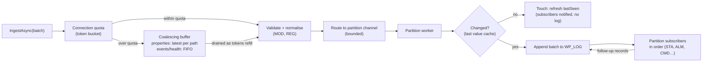

# PIP — Pipeline (Event Log, Partitions, Ingest)

| | |
|---|---|
| Spec id | PIP |
| Projects | `src/service/Watchpoint.Pipeline` |
| Milestone | M1 |
| Tasks | T1.09 (§4–§6), T1.10 (§7–§9) |
| Design docs | [Core runtime §2](../../docs/modules/core-runtime.md#2-event-pipeline), [Technology stack §2.3](../../docs/architecture/technology-stack.md#23-why-nats-jetstream-as-event-log) |

## 1. Purpose and scope

The pipeline is the single entry point of everything that happens, and the **event log**
that makes it durable:

- receives **observations** from connections (property values, device events, health);
- validates and enriches them, drops unchanged values, partitions by device;
- appends accepted records to the **event log** (NATS JetStream) **before** any effect;
- hands records, in order per device, to in-process **partition subscribers** (STA, ALM,
  CMD…) and makes them available to **log consumers** (history, other nodes, federation);
- applies back-pressure and quotas; runs a **side-effect queue** for slow work.

Not in scope: what subscribers do with records (STA, ALM, CMD…); cluster ownership of
partitions (CLU — in M1 one node owns all partitions).

## 2. Dependencies

| Uses | Used by |
|---|---|
| K, HST, MOD, REG, NATS.Net v2 client (`NATS.Client.JetStream`, Apache-2), System.IO.Hashing (XxHash32) | IRT (ingest), STA, CMD, EVT, ALM, HIS, CFG, AUT, CLU, FED, API (live fan-out through STA/ALM notifications) |

## 3. Project layout

```
Watchpoint.Pipeline/
├── Contracts/
│   ├── Observation.cs, ObservationKind.cs
│   ├── IObservationIngest.cs, IngestResult.cs
│   ├── LogRecord.cs, LogEnvelope.cs, RecordKinds.cs
│   ├── ILogRecordTypeRegistry.cs
│   ├── IPartitionSubscriber.cs, PartitionContext.cs
│   ├── IEventLogWriter.cs, IEventLogReader.cs, ILogConsumerFactory.cs
│   ├── ISideEffectQueue.cs
│   ├── Partitioning.cs
│   └── PipelineErrors.cs
├── Internal/
│   ├── Nats/NatsConnectionProvider.cs, StreamProvisioner.cs, NatsLogWriter.cs, NatsLogReader.cs, NatsConsumerFactory.cs
│   ├── Ingest/IngestService.cs, ObservationValidator.cs, ConnectionQuota.cs, CoalescingBuffer.cs
│   ├── Partitions/PartitionRouter.cs, PartitionWorker.cs, LastValueCache.cs
│   ├── SideEffects/SideEffectQueue.cs
│   └── PipelineOptions.cs
├── PipelineModule.cs
└── PipelineLog.cs                 event ids 1600–1699
```

## 4. Partitioning

```csharp
public static class Partitioning
{
    public const int PartitionCount = 64;                    // fixed forever (changing it = data migration)
    public static int Of(Guid entityId);                     // XxHash32(entityId bytes, seed 0) % 64
    public static int Of(DeviceId id) => Of(id.Value);
    public static int Of(ServerId id) => Of(id.Value);       // servers are partitioned like devices
}
```

All records about a device (or server) go to its partition. Records about alarms and
commands use the partition of their **source device** (so they are ordered with the device's
observations). Records with no device (system events, configuration) go to separate global
streams (§5.1).

## 5. Event log

### 5.1 Streams (JetStream)

| Stream | Subjects | Ordering | Retention | Content |
|---|---|---|---|---|
| `WP_LOG` | `wp.log.<pp>.<kind>` (`pp` = 00…63) | Per subject filter `wp.log.<pp>.>` | `MaxAge` = `Log:Retention` (default 7 days), `MaxBytes` = `Log:MaxBytes` (default 20 GB), discard old | Device-bound records |
| `WP_CFG` | `wp.cfg.<kind>` | Global | 30 days, 2 GB | Configuration and registry changes |
| `WP_SYS` | `wp.sys.<kind>` | Global | 30 days, 2 GB | System records (node, licence, health events not bound to a device) |

Common stream settings: file storage, `Duplicates` window 2 minutes (dedup by
`Nats-Msg-Id`), `MaxMsgSize` 1 MB, `AllowDirect` true, replicas 1 (3 in clusters, CLU),
`DenyDelete`/`DenyPurge` true. Subjects and stream names get the configured prefixes
(`Log:SubjectPrefix` default `wp`, `Log:StreamPrefix` default empty) so tests can isolate.

`StreamProvisioner` (startup phase `Infrastructure`, order 20) creates or updates the streams
idempotently and fails start-up if existing streams have incompatible subjects.

The **sequence** used everywhere is the JetStream **stream sequence** of `WP_LOG`
(`ulong`, exposed as `long`). Checkpoints are per partition: "last WP_LOG sequence applied
for partition p".

### 5.2 Envelope

Every record is a NATS message with headers and a JSON body:

| Header | Value |
|---|---|
| `Nats-Msg-Id` | record id (UUID v7) — dedup |
| `Wp-Kind` | record kind, e.g. `property`, `event`, `health`, `alarm.raised` |
| `Wp-Schema` | body schema version, integer (`1`) |
| `traceparent` | W3C trace context, if any |

Body (`LogEnvelope`, JSON profile `Log`):

```json
{
  "id": "0192…",
  "kind": "property",
  "ts": "2026-11-03T09:00:00.123Z",
  "src": "2026-11-03T09:00:00.100Z",
  "p": 17,
  "dev": "0192…",
  "srv": "0192…",
  "origin": { "type": "connection", "id": "0192…" },
  "corr": { "command": null, "alarm": null, "automationRun": null },
  "body": { … kind-specific … }
}
```

| Field | Meaning |
|---|---|
| `ts` | Received time (node clock, UTC ms) |
| `src` | Source time from the integrated system, if known |
| `p` | Partition |
| `dev` / `srv` | Device id / server id (one of them for device-bound records) |
| `origin.type` | `connection`, `user`, `system`, `automation`, `script`, `federation` |

```csharp
public sealed record LogEnvelope(Guid Id, string Kind, DateTimeOffset Ts, DateTimeOffset? Src, int P,
    DeviceId? Dev, ServerId? Srv, RecordOrigin Origin, RecordCorrelation Corr, JsonElement Body);

public sealed record LogRecord(long Sequence, LogEnvelope Envelope)
{
    public T BodyAs<T>(ILogRecordTypeRegistry registry);    // deserialise with the registered type info
}
```

### 5.3 Record kinds (M1)

| Kind | Body | Produced by |
|---|---|---|
| `property` | `{ "path": "doorPosition.position", "value": WpValue, "quality": "good", "prev": WpValue? }` | PIP ingest |
| `event` | `{ "path": "doorPosition.forced", "payload": { field: WpValue }, "severity": "alarm" }` | PIP ingest |
| `health` | `{ "connectivity": "online", "faults": ["batteryLow"], "reason": "…"? }` (full health state) | PIP ingest |
| `registry.changed` (WP_CFG) | `{ "revision": 42, "context": {…}, "changes": [{ "entity": "device", "id": "…", "kind": "updated" }] }` | REG |

Modules register further kinds (`alarm.*`, `command.*`, `config.published`…) through
`ILogRecordTypeRegistry.Register<TBody>(kind, schemaVersion, JsonTypeInfo<TBody>)`. Unknown
kinds encountered when reading are **skipped** with a debug log (forward compatibility in
mixed-version clusters).

### 5.4 Writer and reader contracts

```csharp
public interface IEventLogWriter
{
    // Appends in order; completes when JetStream acknowledged all (durable). Same-partition order preserved.
    ValueTask<IReadOnlyList<long>> AppendAsync(IReadOnlyList<LogEnvelope> records, CancellationToken ct);
    ValueTask<long> AppendGlobalAsync(LogStream stream /* Cfg | Sys */, LogEnvelope record, CancellationToken ct);
}

public interface IEventLogReader
{
    // Ordered replay of one partition from a sequence (inclusive), until the current end.
    IAsyncEnumerable<LogRecord> ReadPartitionAsync(int partition, long fromSequence, CancellationToken ct);
    IAsyncEnumerable<LogRecord> ReadGlobalAsync(LogStream stream, long fromSequence, CancellationToken ct);
    ValueTask<long> GetLastSequenceAsync(CancellationToken ct);
    ValueTask<long> GetFirstAvailableSequenceAsync(CancellationToken ct);   // after retention
}

public interface ILogConsumerFactory
{
    // Durable pull consumer (survives restarts), at-least-once, explicit ack, used by HIS and other nodes.
    ILogConsumer CreateDurable(string name, LogStream stream, IReadOnlyList<string> kindFilter,
                               LogConsumerOptions options);
}
public interface ILogConsumer : IAsyncDisposable
{
    IAsyncEnumerable<LogRecordBatch> ReadBatchesAsync(CancellationToken ct);   // up to MaxBatch records or MaxWait
}
public sealed record LogRecordBatch(IReadOnlyList<LogRecord> Records, Func<CancellationToken, ValueTask> AckAsync);
public sealed record LogConsumerOptions(int MaxBatch = 1000, TimeSpan? MaxWait = null /* 1 s */,
    TimeSpan? AckWait = null /* 60 s */, int MaxDeliver = 10);
```

Replay of a partition uses an **ordered consumer** with filter `wp.log.<pp>.>` and
`DeliverPolicy.ByStartSequence`.

## 6. Ingest contract (used by IRT)

```csharp
public enum ObservationKind { Property, Event, Health }

public sealed record Observation
{
    public required Guid Id { get; init; }                     // generated by the sink (v7); dedup key
    public required ObservationKind Kind { get; init; }
    public DeviceId? Device { get; init; }                     // exactly one of Device/Server
    public ServerId? Server { get; init; }
    public PropertyPath? Property { get; init; }               // Kind=Property
    public WpValue Value { get; init; }                        // Kind=Property
    public string? ReportedUnit { get; init; }
    public Quality Quality { get; init; } = Quality.Good;
    public EventPath? Event { get; init; }                     // Kind=Event
    public IReadOnlyDictionary<string, WpValue>? Payload { get; init; }
    public HealthReport? Health { get; init; }                 // Kind=Health
    public DateTimeOffset? SourceTime { get; init; }
    public required ConnectionId Connection { get; init; }
    public CommandId? CorrelatedCommand { get; init; }
}
public sealed record HealthReport(Connectivity Connectivity, IReadOnlyList<string> Faults, string? Reason);
// Connectivity and Quality are defined in the Kernel (K §10).

public interface IObservationIngest
{
    // Completes when every accepted observation is durable in the log (or coalesced/unchanged).
    ValueTask<IngestResult> IngestAsync(IReadOnlyList<Observation> batch, CancellationToken ct);
}

public sealed record IngestResult(int Accepted, int Unchanged, int Coalesced,
    IReadOnlyList<RejectedObservation> Rejected);
public sealed record RejectedObservation(Guid ObservationId, Error Error);
```

Batch size limit: 5,000 observations (`pipeline.batch.too_large`).

## 7. Ingest processing (T1.10)



### 7.1 Validation and normalisation (`ObservationValidator`)

For each observation, in this order; the first failure rejects it:

| Step | Rule | Error |
|---|---|---|
| 1 | Exactly one of `Device`/`Server`; fields required by `Kind` present | `pipeline.observation.malformed` |
| 2 | Target exists in REG and belongs to `Connection` (device's server's connection) | `pipeline.target.unknown` / `pipeline.target.foreign` |
| 3 | Target enabled; disabled → **dropped silently** (counted `disabled`, not an error) | — |
| 4 | Property/event exists in the type (and capability not in `UnsupportedOptionalCapabilities`) | `model.property.not_found` / `model.event.not_found` |
| 5 | Value / payload validated and normalised by MOD (incl. unit conversion) | `model.value.*` |
| 6 | `SourceTime` not more than `Ingest:MaxFutureSkew` (default 5 min) in the future; else replaced by received time and a `clockDrift` hint passed to STA (health fault raised by STA if persistent) | — |
| 7 | Health faults are known codes (MOD `health.faults` enum) | `model.value.enum_unknown` |

Rejected observations are returned in `IngestResult.Rejected`, counted per connection and
error code, and logged at most once per minute per (connection, code) (log 1620 with a
sample).

### 7.2 Change detection (`LastValueCache`, per partition worker)

- Key `(target, propertyPath)` → last appended value + quality. Initialised from STA at
  recovery (STA provides the current values to the worker before it starts).
- Property observation equal to cached value **and** quality → `Unchanged`: no log record;
  subscribers receive `OnTouched(target, path, receivedTime)` (STA updates `lastSeen`,
  clears `stale`).
- Health observation equal to current health → `Unchanged` (touch).
- Events are never deduplicated by value (each is a fact), but by `Observation.Id`
  (JetStream duplicate window) in case of resend.

### 7.3 Partition workers

- One `PartitionWorker` per owned partition (M1: all 64), each with a bounded channel
  (`Ingest:PartitionQueueCapacity`, default 10,000; `BoundedChannelFullMode.Wait`).
- Worker loop: read up to `Ingest:MaxBatch` (500) items or wait `Ingest:Linger` (2 ms) after
  the first; process change detection; build envelopes; `AppendAsync` (awaits ack); then
  call subscribers for each record **in order**; then complete the ingest callers' awaits.
- **Subscribers** (`IPartitionSubscriber`), registered by modules with an `Order`:

```csharp
public interface IPartitionSubscriber
{
    int Order { get; }                                            // STA = 100, CMD = 200, ALM = 300, AUT = 400…
    string Name { get; }
    // Called on the partition worker thread; must not do I/O; must be fast (< 1 ms typical).
    void OnRecords(PartitionContext context, IReadOnlyList<LogRecord> records);
    void OnTouched(PartitionContext context, TouchInfo touch) { }
    void OnRecoveryStarting(int partition) { }
    void OnRecoveryCompleted(int partition, long lastSequence) { }
    void OnTick(PartitionContext context) { }                     // every Ingest:TickInterval (1 s), on the worker thread
}

// Runs work on a partition's worker thread, serialised with record processing.
// Used for registry changes (STA membership updates), snapshots, timers of modules.
public interface IPartitionDispatcher
{
    ValueTask PostAsync(int partition, Func<PartitionContext, ValueTask> work, CancellationToken ct);
    ValueTask<T> InvokeAsync<T>(int partition, Func<PartitionContext, ValueTask<T>> work, CancellationToken ct);
}

public sealed class PartitionContext
{
    public int Partition { get; }
    public long CurrentSequence { get; }
    public DateTimeOffset Now { get; }
    // Follow-up records (e.g. alarm.raised) appended after this batch, in the same partition:
    public void Emit(LogEnvelope followUp);
    public void EnqueueSideEffect(SideEffect effect);
}
```

- Follow-up records emitted during a batch are appended as a new batch **before** the worker
  reads new input, so causality is preserved; follow-up depth limited to 4 (a 5th level is
  dropped with log 1640 Error — indicates a rule loop).
- Posted work items (`IPartitionDispatcher`) are queued in the worker's control queue, which
  has priority over the input channel; they may emit follow-up records like subscribers.
- `OnTick` is called every `Ingest:TickInterval` (default 1 s) when no batch is in progress
  for longer than the interval, so modules can run time-based logic (staleness, delays)
  without their own threads.
- A subscriber throwing is a bug: the exception is logged (1641 Error) with the record id, the
  subscriber is skipped for that batch, processing continues (one faulty module must not stop
  supervision); metric `watchpoint.pipeline.subscriber.errors`.

### 7.4 Recovery handshake (with STA, startup phase `Recovery`)

1. Workers are created but not started.
2. Each subscriber's module restores its own snapshot (STA §8) and reports checkpoints.
3. PIP replays each partition from `min(checkpoints of all subscribers for p) + 1` to the end,
   calling `OnRecords` only for subscribers whose checkpoint is below the record sequence.
4. `LastValueCache` is filled from STA's restored state.
5. `OnRecoveryCompleted` for all subscribers; workers start consuming new input.

If the replay start sequence is older than `GetFirstAvailableSequenceAsync` (log retention
passed), PIP logs 1650 Error and continues from the first available sequence; STA marks all
values `uncertain` until refreshed (connections resync anyway on start).

## 8. Back-pressure, quotas, coalescing

| Mechanism | Rule | Default |
|---|---|---|
| Partition queue | Bounded; when full, `IngestAsync` waits (back-pressure into the connector's sink) | 10,000 per partition |
| Connection quota | Token bucket per connection: rate `Ingest:ConnectionRate`, burst `Ingest:ConnectionBurst` | 2,000/s, burst 20,000 |
| Coalescing buffer | When the quota is exhausted: property observations stored as **latest per (target, path)** (older replaced, counted `Coalesced`); events and health appended FIFO | — |
| Flooding fault | Coalescing active for more than 10 s, or FIFO part > 100,000 items → the connection gets health fault `flooding` (via IRT) and `IngestAsync` waits until the FIFO falls below 50,000 | — |
| Events never dropped | Events and health observations are never discarded by the pipeline | — |

## 9. Side-effect queue

```csharp
public enum SideEffectClass { AlarmAction = 0, Notification = 1, Snapshot = 2, Script = 3, Webhook = 4, Background = 5 }

public sealed record SideEffect(Guid Id, SideEffectClass Class, string Kind, Func<CancellationToken, Task> Run,
    TimeSpan Timeout, int MaxAttempts = 1);

public interface ISideEffectQueue
{
    bool TryEnqueue(SideEffect effect);              // false if the class queue is full (counted, logged)
    SideEffectQueueStats GetStats();
}
```

- One bounded queue per class (`SideEffects:Capacity:<Class>`, default 10,000) with
  `SideEffects:Workers:<Class>` workers (AlarmAction 4, Notification 4, Snapshot 4,
  Script 4, Webhook 4, Background 2). Higher classes are never blocked by lower ones.
- Each run has its timeout (cancellation); failures retried up to `MaxAttempts` with
  exponential back-off (1 s, 2 s, 4 s…); final failure logged (1660) and counted.
- Guarantee: **at-most-once after durability** — effects are lost if the node stops before
  running them. Modules needing stronger guarantees persist their own work (NOT persists its
  delivery queue; CMD persists commands in the log).

## 10. Settings

| Key | Default | Range |
|---|---|---|
| `Log:Retention` | `P7D` | P1D–P90D |
| `Log:MaxBytes` | 20 GB | ≥ 1 GB |
| `Log:SubjectPrefix` | `wp` | `^[a-z0-9]{1,16}(\.[a-z0-9]{1,16})?$` |
| `Log:StreamPrefix` | empty | `^[A-Z0-9_]{0,16}$` |
| `Log:Replicas` | 1 | 1, 3, 5 |
| `Ingest:PartitionQueueCapacity` | 10000 | 100–1,000,000 |
| `Ingest:MaxBatch` | 500 | 1–5,000 |
| `Ingest:Linger` | `PT0.002S` | 0–PT0.1S |
| `Ingest:ConnectionRate` / `ConnectionBurst` | 2000 / 20000 | |
| `Ingest:MaxFutureSkew` | `PT5M` | |
| `Ingest:TickInterval` | `PT1S` | PT0.1S–PT10S |
| `SideEffects:Capacity:<Class>`, `SideEffects:Workers:<Class>` | see §9 | |

## 11. Errors

| Code | Kind | When |
|---|---|---|
| `pipeline.batch.too_large` | Validation | > 5,000 observations |
| `pipeline.observation.malformed` | Validation | Missing/contradictory fields |
| `pipeline.target.unknown` | NotFound | Device/server unknown |
| `pipeline.target.foreign` | Forbidden | Target belongs to another connection |
| `pipeline.log.unavailable` | Unavailable | JetStream not reachable / publish timeout (ingest retries internally for 30 s before surfacing) |
| `pipeline.stream.incompatible` | Internal | Existing stream configuration conflicts (start-up) |

## 12. Observability

| EventId | Level | Message |
|---|---|---|
| 1601 | Information | Streams ready: {Streams} |
| 1602 | Warning | Event log unavailable, retrying: {Reason} |
| 1610 | Information | Partition {Partition} recovered from sequence {From} to {To} ({Records} records) in {DurationMs} ms |
| 1620 | Warning | Connection {ConnectionId} rejected {Count} observations with {Code} in the last minute; sample {Sample} |
| 1630 | Warning | Connection {ConnectionId} over quota; coalescing active |
| 1631 | Error | Connection {ConnectionId} flooding: {Pending} pending events |
| 1640 | Error | Follow-up depth exceeded in partition {Partition} for record {RecordId} |
| 1641 | Error | Subscriber {Subscriber} failed on record {RecordId} |
| 1650 | Error | Replay for partition {Partition} starts after retention: wanted {Wanted}, first available {First} |
| 1660 | Warning | Side effect {Kind} ({Class}) failed after {Attempts} attempts |

Metrics (`Watchpoint.Pipeline`):

| Instrument | Type | Unit | Tags |
|---|---|---|---|
| `watchpoint.pipeline.observations` | counter | `{observations}` | `connection`, `outcome` (accepted, unchanged, coalesced, rejected, disabled) |
| `watchpoint.pipeline.records` | counter | `{records}` | `kind` |
| `watchpoint.pipeline.append.duration` | histogram | ms | — |
| `watchpoint.pipeline.partition.queue` | observable gauge | `{items}` | `partition` |
| `watchpoint.pipeline.ingest.latency` | histogram | ms | — (received → subscribers done) |
| `watchpoint.pipeline.subscriber.duration` | histogram | ms | `subscriber` |
| `watchpoint.pipeline.subscriber.errors` | counter | | `subscriber` |
| `watchpoint.pipeline.sideeffects.queue` | gauge | | `class` |
| `watchpoint.pipeline.sideeffects.failed` | counter | | `class`, `kind` |

Health check (`ready`): NATS connected and streams present.

## 13. Security

- NATS connection uses the token from SEC (`bootstrap:nats.token`), TLS when not loopback.
- Connections can only report for their own devices (step 2 in §7.1).
- Envelope bodies may contain personal data (event payloads): log retention is bounded; logs
  never print bodies (only ids and kinds).

## 14. Tests

Unit: `tests/service/Watchpoint.Pipeline.Tests` (in-memory log fake implementing
`IEventLogWriter/Reader` with sequences). Integration: `Watchpoint.IntegrationTests/Pipeline`
with real NATS (Testcontainers, scoped prefixes).

| Id | Layer | Test | Given / When / Then |
|---|---|---|---|
| PIP-U-001 | U | Partition function stable | Known UUIDs → known partitions (golden values committed in test) |
| PIP-U-002 | U | Partition distribution | 100,000 v7 ids → each partition within ±10 % of mean |
| PIP-U-003 | U | Subject naming with prefix | partition 7, kind `property`, prefix `t1.wp` → `t1.wp.log.07.property` |
| PIP-U-004 | U | Envelope JSON round-trip | All fields → same envelope |
| PIP-U-005 | U | Envelope rejects missing id/kind/ts | |
| PIP-U-006 | U | Record kind registry | Register `alarm.raised` v1 → `BodyAs` returns typed body |
| PIP-U-007 | U | Unknown kind skipped on read | Reader yields record; consumer helper skips with debug log |
| PIP-U-008 | U | Writer preserves order within partition | 100 records → sequences strictly increasing in input order |
| PIP-U-009 | U | Append completes only after ack | Fake log delays ack → AppendAsync not complete until ack |
| PIP-U-010 | U | Replay from sequence | Records 1…10 in p3, 11…20 in p5 → replay p3 from 4 yields 4…10 only |
| PIP-U-011 | U | First available sequence after retention | Fake log purges 1…5 → reports 6 |
| PIP-U-012 | U | Global streams separate | `registry.changed` via `AppendGlobalAsync(Cfg)` not visible in partition replay |
| PIP-U-013 | U | Durable consumer batch and ack | Fake: 2,500 records, MaxBatch 1,000 → 3 batches; unacked batch redelivered |
| PIP-U-014 | U | Consumer kind filter | Filter `alarm.*` receives only alarm records |
| PIP-U-015 | U | Batch size limit | 5,001 observations → `pipeline.batch.too_large` |
| PIP-U-016 | U | Stream provisioner creates three streams with settings | Fake NATS management API → expected configs |
| PIP-U-017 | U | Incompatible stream detected | Existing `WP_LOG` with other subjects → `pipeline.stream.incompatible` |
| PIP-U-018 | U | Retention and size settings applied | `Log:Retention=P3D` → MaxAge 3 days |
| PIP-U-019 | U | Dedup id header set | Envelope id = `Nats-Msg-Id` |
| PIP-U-020 | U | Trace context propagated | Activity current → `traceparent` header written and restored on read |
| PIP-U-021 | U | Malformed observation rejected | Both Device and Server set → malformed |
| PIP-U-022 | U | Unknown target rejected | → `pipeline.target.unknown` |
| PIP-U-023 | U | Foreign target rejected | Device of connection B reported by A → `pipeline.target.foreign` |
| PIP-U-024 | U | Disabled device dropped silently | Not in Rejected; counter `disabled` +1; no record |
| PIP-U-025 | U | Unknown property rejected | → `model.property.not_found` |
| PIP-U-026 | U | Unsupported optional capability rejected | Device declares `tamper` unsupported → tamper property rejected |
| PIP-U-027 | U | Value normalised by MOD | `String("open")` for enum → record body `Enum(open)`; °F converted |
| PIP-U-028 | U | Future source time replaced | Source time now+10 min → `src` = received time; clock-drift hint passed |
| PIP-U-029 | U | Unchanged property → touch only | Same value twice → one record, one `OnTouched` |
| PIP-U-030 | U | Quality change counts as change | Same value, quality good → uncertain → second record |
| PIP-U-031 | U | `prev` value included | Second change → body `prev` = first value |
| PIP-U-032 | U | Events not deduplicated by value | Two identical forced events → two records |
| PIP-U-033 | U | Health unchanged → touch | Same health twice → one record |
| PIP-U-034 | U | Subscribers called in order with records in sequence order | Two subscribers orders 100, 300 → call order, records ordered |
| PIP-U-035 | U | Follow-up records appended before new input | Subscriber emits follow-up on record 1; next input record appended after follow-up |
| PIP-U-036 | U | Follow-up depth limit | Subscriber emitting recursively → 4 levels appended, 5th dropped, log 1640 |
| PIP-U-037 | U | Faulty subscriber isolated | Subscriber throws → others still called; log 1641; metric +1 |
| PIP-U-038 | U | Partition queue back-pressure | Capacity 10, worker paused → 11th ingest awaits until worker resumes |
| PIP-U-039 | U | Quota: coalescing keeps latest per property | Rate 1/s burst 1; 100 updates of same property in 1 s → after drain, last value appended; `Coalesced` = 98 (± bucket) |
| PIP-U-040 | U | Quota: events never coalesced | 100 events over quota → all 100 appended eventually in order |
| PIP-U-041 | U | Flooding fault | FIFO > 100,000 (scaled down via options in test) → flooding fault reported to IRT hook; ingest waits until < half |
| PIP-U-042 | U | Recovery replays from minimum checkpoint | Checkpoints STA 50, ALM 40 → replay from 41; STA receives only > 50 |
| PIP-U-043 | U | Recovery after retention | Checkpoint older than first available → log 1650, continue |
| PIP-U-044 | U | Side-effect classes isolated | Background queue full and blocked → AlarmAction effects still run |
| PIP-U-045 | U | Side-effect timeout and retry | Effect hanging → cancelled at timeout; MaxAttempts 3 → 3 runs with back-off (TestClock) |
| PIP-U-046 | U | Posted work runs on the partition worker, before queued input | Post work while 100 inputs queued → work runs before them; serialised with records |
| PIP-U-047 | U | `OnTick` cadence | TestClock advancing 5 s with idle worker → 5 ticks; during a long batch ticks are not concurrent |
| PIP-I-001 | I | Streams provisioned on real NATS | Start module → three streams with expected subjects/retention |
| PIP-I-002 | I | Provisioning idempotent | Restart → no error, configs unchanged |
| PIP-I-003 | I | Append and replay one partition | 1,000 records over 4 partitions → replay of p returns its records in order |
| PIP-I-004 | I | Dedup within window | Same envelope id appended twice → one message |
| PIP-I-005 | I | Durable consumer survives restart | Consume 500 of 1,000, ack, dispose; new consumer with same name → starts at 501 |
| PIP-I-006 | I | NATS restart during append | Stop NATS container 3 s during load → appends retried, no loss, no duplicates (dedup) |
| PIP-I-007 | I | Ordering under concurrency | 64 partitions × 1,000 records ingested concurrently → per-partition order preserved |
| PIP-I-008 | I | Max message size enforced | 2 MB body → error, nothing appended |
| PIP-I-009 | I | End-to-end ingest to subscriber | Registry with 10 devices; ingest 1,000 observations → subscriber received accepted records; IngestResult counts correct |
| PIP-I-010 | I | Throughput target (CI indicative) | 50,000 property observations over 1,000 devices → ≥ 5,000/s sustained on CI runner (warn below, fail below 1,000/s) |
| PIP-I-011 | I | Latency target | p95 received → subscribers done < 50 ms at 1,000 obs/s |
| PIP-I-012 | I | Crash before ack loses nothing that was acknowledged | Kill pipeline process mid-batch (test host) → after restart, every observation whose IngestAsync completed is in the log |
| PIP-I-013 | I | Recovery handshake with real state module | Ingest, restart node, values restored and replay applied once |
| PIP-I-014 | I | Coalescing under real load | One connection at 10× quota for 30 s → events complete, properties coalesced, flooding fault raised then cleared |
| PIP-I-015 | I | Global config stream consumer | REG publishes `registry.changed` → consumer receives in order with revision |

## 15. Tasks

| Task | Sections | Tests |
|---|---|---|
| T1.09 | §4, §5, §6 (contracts), §10 (log settings), §11, §12 (log part) | PIP-U-001…PIP-U-020, PIP-I-001…PIP-I-008 |
| T1.10 | §7, §8, §9, §10 (ingest settings), §12 (ingest part), §13 | PIP-U-021…PIP-U-047, PIP-I-009…PIP-I-015 |
