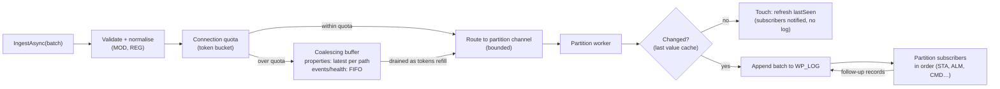

# PIP — Pipeline (Event Log, Partitions, Ingest)

| | |
|---|---|
| Spec id | PIP |
| Projects | `src/service/Watchpoint.Pipeline` |
| Milestone | M1 |
| Tasks | T1.09 (§4–§6), T1.10 (§7–§9) |
| Design docs | [Core runtime §2](../../docs/modules/core-runtime.md#2-event-pipeline), [Technology stack §2.3](../../docs/architecture/technology-stack.md#23-why-nats-jetstream-as-event-log) |

## 1. Purpose and scope

The pipeline is the single entry point of everything that happens, and the **event log**
that makes it durable:

- receives **observations** from connections (property values, device events, health);
- validates and enriches them, drops unchanged values, partitions by device;
- appends accepted records to the **event log** (NATS JetStream) **before** any effect;
- hands records, in order per device, to in-process **partition subscribers** (STA, ALM,
  CMD…) and makes them available to **log consumers** (history, other nodes, federation);
- applies back-pressure and quotas; runs a **side-effect queue** for slow work.

Not in scope: what subscribers do with records (STA, ALM, CMD…); cluster ownership of
partitions (CLU — in M1 one node owns all partitions).

## 2. Dependencies

| Uses | Used by |
|---|---|
| K, HST, MOD, REG, NATS.Net v2 client (`NATS.Client.JetStream`, Apache-2), System.IO.Hashing (XxHash32) | IRT (ingest), STA, CMD, EVT, ALM, HIS, CFG, AUT, CLU, FED, API (live fan-out through STA/ALM notifications) |

## 3. Project layout

```
Watchpoint.Pipeline/
├── Contracts/
│   ├── Observation.cs (Observation, ObservationKind), IObservationIngest.cs (with IngestResult)
│   ├── LogRecord.cs, LogEnvelope.cs, LogStream.cs, RecordKinds.cs, RecordBodies.cs, RecordCorrelation.cs, RecordOrigin.cs
│   ├── ILogRecordTypeRegistry.cs
│   ├── IPartitionSubscriber.cs (subscriber, IPartitionDispatcher, ILastValueSource, IIngestFloodingListener, IPipelineLifecycle), PartitionContext.cs
│   ├── IEventLogWriter.cs, IEventLogReader.cs, ILogConsumerFactory.cs, IEventLogSetup.cs, EventLogEndpoint.cs
│   ├── LogConsumerExtensions.cs (consumer helper), ISideEffectQueue.cs, Partitioning.cs
│   └── PipelineErrors.cs, PipelineException.cs
├── Internal/
│   ├── Log/EventLogWriter.cs, EventLogReader.cs, LogConsumer.cs, LogConsumerFactory.cs   (log logic, broker-agnostic)
│   ├── Log/ILogBroker.cs, LogEnvelopeJson.cs, LogMessageCodec.cs, LogNaming.cs, LogRecordTypeRegistry.cs, BrokerRetry.cs, Deadline.cs
│   ├── Nats/NatsConnectionProvider.cs, NatsLogBroker.cs (JetStream behind ILogBroker), StreamProvisioner.cs
│   ├── Ingest/IngestService.cs, ObservationValidator.cs, ConnectionQuota.cs, CoalescingBuffer.cs, IngestItem.cs, IIngestDirectory.cs (REG + MOD lookups)
│   ├── Partitions/PartitionRouter.cs (workers, dispatcher, recovery, lifecycle), PartitionWorker.cs, LastValueCache.cs
│   ├── SideEffects/SideEffectQueue.cs
│   ├── RegistryOutboxPublisher.cs (§5.5), PipelineMetrics.cs, PipelineLogHealthCheck.cs, PipelineJsonContext.cs
│   └── PipelineOptions.cs (Log), IngestOptions.cs (Ingest, SideEffects)
├── PipelineModule.cs
└── PipelineLog.cs                 event ids 1600–1699
```

## 4. Partitioning

```csharp
public static class Partitioning
{
    public const int PartitionCount = 64;                    // fixed forever (changing it = data migration)
    public static int Of(Guid entityId);                     // XXH32(entityId bytes, seed 0) % 64
    public static int Of(DeviceId id) => Of(id.Value);
    public static int Of(ServerId id) => Of(id.Value);       // servers are partitioned like devices
}
```

The function is part of the stored data format and never changes. `entityId bytes` are the 16
bytes of the UUID in RFC 9562 network order (the order of the hexadecimal digits in the text
form; **not** the mixed-endian layout of .NET `Guid.ToByteArray()`), so any language computes the
same partition. PIP-U-001 pins golden values computed with an independent XXH32 implementation,
e.g. `00000000-0000-7000-8000-000000000001` → 53, `ffffffff-ffff-ffff-ffff-ffffffffffff` → 42.

All records about a device (or server) go to its partition. Records about alarms and
commands use the partition of their **source device** (so they are ordered with the device's
observations). Records with no device (system events, configuration) go to separate global
streams (§5.1).

## 5. Event log

### 5.1 Streams (JetStream)

| Stream | Subjects | Ordering | Retention | Content |
|---|---|---|---|---|
| `WP_LOG` | `wp.log.<pp>.<kind>` (`pp` = 00…63) | Per subject filter `wp.log.<pp>.>` | `MaxAge` = `Log:Retention` (default 7 days), `MaxBytes` = `Log:MaxBytes` (default 20 GB), discard old | Device-bound records |
| `WP_CFG` | `wp.cfg.<kind>` | Global | 30 days, 2 GB | Configuration and registry changes |
| `WP_SYS` | `wp.sys.<kind>` | Global | 30 days, 2 GB | System records (node, licence, health events not bound to a device) |

Common stream settings: file storage, `Duplicates` window 2 minutes (dedup by
`Nats-Msg-Id`), `MaxMsgSize` 1 MB, `AllowDirect` true, replicas 1 (3 in clusters, CLU),
`DenyDelete`/`DenyPurge` true. Subjects and stream names get the configured prefixes
(`Log:SubjectPrefix` default `wp`, `Log:StreamPrefix` default empty) so tests can isolate.

`StreamProvisioner` (contract `IEventLogSetup.EnsureStreamsAsync`, run by the host in startup
phase `Infrastructure`, order 20) creates or updates the streams idempotently, `WP_CFG` and
`WP_SYS` first:

- missing stream → created;
- settings that drifted from the configuration (max age, max bytes, duplicate window, max message
  size, replicas, direct access, discard policy) → stream updated (log 1603);
- a difference JetStream cannot change — other subjects, storage type, retention policy, delete or
  purge protection off — → start-up fails with `pipeline.stream.incompatible`; the stream is not
  touched;
- JetStream **reserves** `MaxBytes` of every stream against its file store limit (`10047
  insufficient storage`; the bundled server's limit is 20 % of the free disk, min 10 GB, HST §7.4,
  less than the 24 GB the defaults ask for on most machines). When the reservation is refused the
  size is halved until it fits (never below the current size of an existing stream, floor 64 MB)
  and a warning is logged (1604); only when nothing fits does start-up fail;
- NATS not reachable → retried for `Log:AppendTimeout` (log 1602), then `pipeline.log.unavailable`.

Tests use small streams for the same reason (many scopes share one server).

The **sequence** used everywhere is the JetStream **stream sequence** of `WP_LOG`
(`ulong`, exposed as `long`). Checkpoints are per partition: "last WP_LOG sequence applied
for partition p".

### 5.2 Envelope

Every record is a NATS message with headers and a JSON body:

| Header | Value |
|---|---|
| `Nats-Msg-Id` | record id (UUID v7; for `registry.changed` a UUID v8 derived from the revision, §5.5) — dedup |
| `Wp-Kind` | record kind, e.g. `property`, `event`, `health`, `alarm.raised` |
| `Wp-Schema` | body schema version, integer (`1`) |
| `Wp-Envelope` | envelope format version, integer (`1`) |
| `traceparent` | W3C trace context, if any |

Body (`LogEnvelope`, JSON profile `Log`):

```json
{
  "id": "0192…",
  "kind": "property",
  "ts": "2026-11-03T09:00:00.123Z",
  "src": "2026-11-03T09:00:00.100Z",
  "p": 17,
  "dev": "0192…",
  "srv": "0192…",
  "origin": { "type": "connection", "id": "0192…" },
  "corr": { "command": null, "alarm": null, "automationRun": null },
  "body": { … kind-specific … }
}
```

| Field | Meaning |
|---|---|
| `ts` | Received time (node clock, UTC ms) |
| `src` | Source time from the integrated system, if known |
| `p` | Partition |
| `dev` / `srv` | Device id / server id (one of them for device-bound records) |
| `origin.type` | `connection`, `user`, `system`, `automation`, `script`, `federation` |

Rules:

- **Deterministic serialisation**: every member is written, in the order above, without
  whitespace; absent values are `null`; ids are lowercase UUIDs; times are UTC with milliseconds.
- **Forward compatibility**: readers ignore members they do not know and accept missing optional
  ones (`src`, `p`, `dev`, `srv`, `origin`, `corr`), so members can be added without a version
  change. A change readers cannot ignore increments `Wp-Envelope`; a record with a newer envelope
  version, or one that cannot be decoded (no `id`, `kind`, `ts` or `body`), is logged (1605) and
  skipped by readers and consumers — it never blocks a partition.
- **Validation before publish** (`LogEnvelope.Validate`, error `pipeline.record.invalid`): `id`,
  `kind`, `ts` present; kind = 1–4 dot-separated tokens of ASCII letters and digits, each starting
  with a lowercase letter, ≤ 64 characters, and **registered** (§5.3); `body` a JSON object; in
  `WP_LOG` a `dev` or `srv` and `p` = `Partitioning.Of(dev ?? srv)`; in the global streams `p` = 0.
- **Size**: header block + body ≤ 1 MB, checked before publish (`pipeline.record.too_large`). A
  batch is validated as a whole: one bad record and nothing of the batch is appended.

```csharp
public sealed record LogEnvelope(Guid Id, string Kind, DateTimeOffset Ts, DateTimeOffset? Src, int P,
    DeviceId? Dev, ServerId? Srv, RecordOrigin Origin, RecordCorrelation Corr, JsonElement Body);

public sealed record LogRecord(long Sequence, LogEnvelope Envelope)
{
    public int SchemaVersion { get; init; }                  // Wp-Schema
    public string? TraceParent { get; init; }                // traceparent header
    public ActivityContext? GetTraceContext();
    public T BodyAs<T>(ILogRecordTypeRegistry registry);    // deserialise with the registered type info
}
```

### 5.3 Record kinds (M1)

| Kind | Body | Produced by |
|---|---|---|
| `property` | `{ "path": "doorPosition.position", "value": WpValue, "quality": "good", "prev": WpValue? }` | PIP ingest |
| `event` | `{ "path": "doorPosition.forced", "payload": { field: WpValue }, "severity": "alarm" }` | PIP ingest |
| `health` | `{ "connectivity": "online", "faults": ["batteryLow"], "reason": "…"? }` (full health state) | PIP ingest |
| `registry.changed` (WP_CFG) | `{ "revision": 42, "context": {…}, "changes": [{ "entity": "device", "id": "…", "kind": "updated" }] }` | REG |

Modules register further kinds (`alarm.*`, `command.*`, `config.published`…) through
`ILogRecordTypeRegistry.Register<TBody>(kind, schemaVersion, JsonTypeInfo<TBody>)`. A record can
only be **appended** with a registered kind (its schema version becomes `Wp-Schema`). Kinds, or
schema versions newer than the registered one, encountered when reading are yielded by the reader
and **skipped** by the consumer helper with a debug log (1606) — forward compatibility in
mixed-version clusters (`ILogRecordTypeRegistry.CanRead`).

`registry.changed` (REG §6): one record per committed batch, in revision order. REG stores the
record in its outbox table in the transaction of the batch; the **outbox publisher** (§5.5) appends
it to `WP_CFG` with a record id derived from the revision, so a publish repeated after a crash is a
duplicate for the log. Delivery is at least once: a consumer treats `revision` as its idempotency
key (a record whose revision is at or below the last one applied is skipped). A gap in the
revisions means a record the log refused (§5.5): the consumer reads the registry again.

### 5.4 Writer and reader contracts

```csharp
public interface IEventLogWriter
{
    // Appends in order; completes when JetStream acknowledged all (durable). Same-partition order preserved.
    ValueTask<IReadOnlyList<long>> AppendAsync(IReadOnlyList<LogEnvelope> records, CancellationToken ct);
    ValueTask<long> AppendGlobalAsync(LogStream stream /* Cfg | Sys */, LogEnvelope record, CancellationToken ct);
    // Both throw PipelineException: pipeline.record.invalid / pipeline.record.too_large (nothing appended),
    // pipeline.log.unavailable (per partition a prefix of the records is stored; repeat with the same records).
}

public interface IEventLogReader
{
    // Ordered replay of one partition from a sequence (inclusive), until the current end.
    IAsyncEnumerable<LogRecord> ReadPartitionAsync(int partition, long fromSequence, CancellationToken ct);
    // Ordered replay (global sequence order) of several partitions with ONE consumer: used by recovery (§7.4).
    IAsyncEnumerable<LogRecord> ReadPartitionsAsync(IReadOnlySet<int> partitions, long fromSequence, CancellationToken ct);
    IAsyncEnumerable<LogRecord> ReadGlobalAsync(LogStream stream, long fromSequence, CancellationToken ct);
    ValueTask<long> GetLastSequenceAsync(CancellationToken ct);
    ValueTask<long> GetFirstAvailableSequenceAsync(CancellationToken ct);   // after retention
}

public interface ILogConsumerFactory
{
    // Durable pull consumer (survives restarts), at-least-once, explicit ack, used by HIS and other nodes.
    ILogConsumer CreateDurable(string name, LogStream stream, IReadOnlyList<string> kindFilter,
                               LogConsumerOptions options);
}
public interface ILogConsumer : IAsyncDisposable
{
    IAsyncEnumerable<LogRecordBatch> ReadBatchesAsync(CancellationToken ct);   // up to MaxBatch records or MaxWait
}
public sealed record LogRecordBatch(IReadOnlyList<LogRecord> Records, Func<CancellationToken, ValueTask> AckAsync)
{
    public int Delivery { get; init; }          // 1 for the first delivery of the batch
    public bool IsLastDelivery { get; init; }   // dropped if not acknowledged this time
}
public sealed record LogConsumerOptions(int MaxBatch = 1000, TimeSpan? MaxWait = null /* 1 s */,
    TimeSpan? AckWait = null /* 60 s */, int MaxDeliver = 10);

public enum LogStream { Log, Cfg, Sys }

public static class LogConsumerExtensions   // consumer helper
{
    public static Task ProcessAsync(this ILogConsumer consumer, LogProcessingOptions options,
        LogRecordHandler handler, CancellationToken ct);
}
```

Durable consumer rules (at-least-once, **in stream order**):

- JetStream consumer: durable, pull, explicit ack, `DeliverPolicy.All`, created or updated on the
  first read (idempotent; a consumer deleted meanwhile is created again). Kind filters become
  subject filters (`wp.log.*.<kind>`; `*` = one token, trailing `>` = the rest, e.g. `alarm.*`).
- A batch is returned as soon as records are available (up to `MaxBatch`); an idle consumer long-polls
  for `MaxWait` (JetStream's minimum is just above 1 s).
- `AckAsync` acknowledges every record of the batch and completes when JetStream confirmed the
  last one. **Asking for the next batch without acknowledging yields the same batch again**
  (`Delivery` + 1) from memory: nothing newer is fetched while a batch is open, so later records are
  never delivered before earlier ones. JetStream's own redelivery (`nak`, `AckWait`) is not used for
  this, because JetStream delivers newer messages before redelivered ones.
- After `MaxDeliver` deliveries without acknowledgement the batch is dropped: logged as an error
  with its sequence range (1609) and acknowledged. `MaxDeliver` is enforced by the client; the
  JetStream consumer has no delivery limit, so the server never drops a record silently.
- **Restart**: when a consumer is opened and JetStream still holds deliveries that were never
  acknowledged, the consumer is rewound to its acknowledgement floor (consumer reset API; on servers
  without it the consumer is re-created at floor + 1). Reading resumes right after the last
  acknowledged batch, in order. Records acknowledged by a lost ack may come again and are dropped by
  sequence.
- A NATS outage is retried with back-off (log 1602); the consumer resumes by itself.

`ProcessAsync` (the way modules consume): calls the handler once per record in sequence order;
skips records at or below the last applied sequence (`LogProcessingOptions.LastAppliedSequence`:
a handler that stores `LogRecord.Sequence` with its effect is idempotent across restarts) and
records this node cannot read (1606); a failing handler makes the batch come again after a
back-off, starting at the failed record (1607); a record still failing on the last delivery is
logged (1608) and skipped; the batch is acknowledged only after every record was handled, and the
acknowledgement is repeated until the log confirms it. The handler runs inside an activity that
continues the trace of the append (`traceparent`).

Replay of a partition uses an **ordered consumer** with filter `wp.log.<pp>.>` and
`DeliverPolicy.ByStartSequence`. `ReadPartitionsAsync` uses one ordered consumer with filter
`wp.log.>` when all 64 partitions are requested, otherwise one filter per partition.
A replay covers the sequences up to the last one present when it started. The end is reached when
JetStream reports no pending message for the consumer, never on an empty answer alone; after a
connection loss the replay resumes after the last record it yielded (no gap, no duplicate), and
fails with `pipeline.log.unavailable` after `Log:AppendTimeout` without progress.
Measured ([ADR-001](../decisions/ADR-001-nats-jetstream-event-log-and-leases.md)): whole-log
replay ≈ 180k records/s; a filtered replay costs about the same as scanning the whole log range
(one partition ≈ 16k records/s delivered), so recovery never runs 64 filtered consumers.

Writer rules (ADR-001, amended by T1.09):

- **One lane per partition** (and per global stream): at most one publish of a lane is in flight;
  the next record of a partition is sent only after the previous one was acknowledged. Lanes run
  concurrently (≤ 66 publishes in flight, one NATS connection for the writer). This replaces the
  window of 1,024 in-flight acks of ADR-001: with several unacknowledged publishes of **one**
  partition in flight, a lost first publish and a stored second one end up in the wrong order after
  the retry, and the log cannot be corrected (`DenyDelete`). Measured (4 vCPU, nats-server 2.15.2
  in Docker): ≈ 41,000 records/s over 64 partitions, ≈ 4,000 records/s on one partition (raw
  JetStream: 50,000 and 4,700; the unsafe window: 89,000). The 20,000 records/s budget holds as
  soon as about six partitions are active; one device is limited to 2,000/s by its quota (§8).
- After a timeout (2 s per attempt) or a connection loss the writer **re-sends the same envelope
  with the same `Nats-Msg-Id`** with back-off (50 ms doubling to 1 s) until acked (the 2 min
  duplicate window makes this exactly-once in the log; a duplicate ack carries the sequence of the
  stored record); callers are completed only on ack.
- **Nothing is buffered** in the writer: callers wait for their lane. While the log is unreachable
  an append waits at most `Log:AppendTimeout` (30 s), then fails with `pipeline.log.unavailable`.
  A caller that repeats the call must use the same record ids and do so within the duplicate
  window (`AppendTimeout` ≤ 90 s keeps the writer's own retries inside it).
- A batch is validated and encoded before the first publish (§5.2).
- M1 sends no expected-sequence headers (one owner). Fenced appends (CLU T9.01) use
  `Nats-Expected-Last-Subject-Sequence` **with** `Nats-Expected-Last-Subject-Sequence-Subject =
  wp.log.<pp>.>` (CLU §5); the lanes are what fencing needs (one awaited publish per partition).

### 5.5 Registry outbox publisher (T1.09b)

`RegistryOutboxPublisher` (a hosted service of the module, exactly one per node) publishes the
registry's transactional outbox (REG §6, §10, `IRegistryOutbox`) to `WP_CFG`:

- **Loop**: read the oldest unsent records (at most 100, revision order); for each, in order:
  append it with `IEventLogWriter.AppendGlobalAsync(Cfg)`, then mark it sent. A record is marked
  sent **only after the log acknowledged it**. When nothing is unsent, sent rows are pruned (below)
  and the publisher waits for the registry's signal (`IRegistryOutbox.WaitForRecordsAsync`, a commit
  on this node) or the poll interval of 5 s (records of another node, a missed signal).
- **Record**: id = `RecordId(revision)`, a UUID v8 (RFC 9562) whose last eight bytes carry the
  revision (prefix `REGCHG`), so a repeated publish carries the same `Nats-Msg-Id`; kind
  `registry.changed`; `ts` = the commit time of the batch (`created_at`); `p` 0; origin `user`
  when the context's user id is a UUID, else `system`; body §5.3.
- **Log down**: `AppendGlobalAsync` fails after `Log:AppendTimeout` with `pipeline.log.unavailable`;
  the publisher logs 1611, waits (1 s doubling to 30 s, `TimeProvider`) and repeats the **same**
  record; nothing later is sent before it. Callers of `IRegistryWriter.ApplyAsync` are not affected.
  When the backlog is published, or after failed attempts, 1612 is logged.
- **Restart**: the publisher starts from the oldest unsent record. A node that stopped between the
  acknowledgement and the mark publishes the record again: within the 2 min duplicate window the
  log stores it once; later it is stored twice, which the revision-based consumer rule (§5.3) absorbs.
- **Refused record**: a record the log cannot store (`pipeline.record.too_large`: a batch of
  thousands of changes exceeds 1 MB; `pipeline.record.invalid`) is logged (1613), skipped and
  marked sent; consumers see the gap and resynchronise from the registry.
- **Database down**: a failed outbox read or mark is logged (1614) and retried with the same
  back-off; a mark that fails after a successful publish leads to a repeated publish (above).
- **Retention**: sent rows are deleted 24 h after they were sent, checked at most once an hour
  while idle; unsent rows are never deleted, so a log outage of any length loses nothing (the
  outbox grows by one row per batch meanwhile).
- These values (poll 5 s, back-off 1–30 s, batch 100, retention 24 h, prune hourly) are fixed in
  `PipelineOptions`, not configurable in M1; tests shorten them.
- **Several nodes (M9)**: one database must have one publisher. The seam is the loop itself
  (`RegistryOutboxPublisher.RunAsync`): the cluster module starts it on the holder of a
  `registry-outbox` lease (CLU §5) instead of on every node. Until then the revision-derived ids
  make an accidental double publisher harmless within the duplicate window.

## 6. Ingest contract (used by IRT)

```csharp
public enum ObservationKind { Property, Event, Health }

public sealed record Observation
{
    public required Guid Id { get; init; }                     // generated by the sink (v7); dedup key
    public required ObservationKind Kind { get; init; }
    public DeviceId? Device { get; init; }                     // exactly one of Device/Server
    public ServerId? Server { get; init; }
    public PropertyPath? Property { get; init; }               // Kind=Property
    public WpValue Value { get; init; }                        // Kind=Property
    public string? ReportedUnit { get; init; }
    public Quality Quality { get; init; } = Quality.Good;
    public EventPath? Event { get; init; }                     // Kind=Event
    public IReadOnlyDictionary<string, WpValue>? Payload { get; init; }
    public HealthReport? Health { get; init; }                 // Kind=Health
    public DateTimeOffset? SourceTime { get; init; }
    public required ConnectionId Connection { get; init; }
    public CommandId? CorrelatedCommand { get; init; }
}
public sealed record HealthReport(Connectivity Connectivity, IReadOnlyList<string> Faults, string? Reason);
// Connectivity and Quality are defined in the Kernel (K §10).

public interface IObservationIngest
{
    // Completes when every accepted observation is durable in the log (or coalesced/unchanged).
    ValueTask<IngestResult> IngestAsync(IReadOnlyList<Observation> batch, CancellationToken ct);
}

public sealed record IngestResult(int Accepted, int Unchanged, int Coalesced,
    IReadOnlyList<RejectedObservation> Rejected);
public sealed record RejectedObservation(Guid ObservationId, Error Error);
```

Batch size limit: 5,000 observations (`pipeline.batch.too_large`, `IngestLimits.CheckBatchSize`).

Rules of `IngestAsync` (T1.10):

- **Bad input is never thrown.** Every observation ends in exactly one outcome: accepted, unchanged,
  coalesced, rejected (in `Rejected`, with the error) or dropped because its target is disabled
  (counted in no field). A batch above the limit rejects **all** its observations with
  `pipeline.batch.too_large`. Only cancellation throws (`OperationCanceledException`); observations
  already handed to a partition are then still processed.
- **Completion = durability.** The call completes when every observation has its outcome, i.e. when
  the accepted ones are in the log and the subscribers saw them. An observation waiting for the
  connection quota (§8) keeps its call open until it is appended or replaced by a newer value, so a
  connector that awaits its calls is slowed down to its quota.
- **Order.** Observations of one call reach their partition in the order of the batch, also when part
  of the batch waited for the quota. Calls of one connection that run concurrently have no order
  between them (the IRT sink sends one batch at a time per connection).
- The record id of an accepted observation is `Observation.Id`: a connector that sends an observation
  again after an error does not create a second record (JetStream duplicate window).
- After `IPipelineLifecycle.StopAsync` observations are rejected with `pipeline.log.unavailable`.

## 7. Ingest processing (T1.10)



### 7.1 Validation and normalisation (`ObservationValidator`)

For each observation, in this order; the first failure rejects it:

| Step | Rule | Error |
|---|---|---|
| 1 | Exactly one of `Device`/`Server`; fields required by `Kind` present | `pipeline.observation.malformed` |
| 2 | Target exists in REG and belongs to `Connection` (device's server's connection) | `pipeline.target.unknown` / `pipeline.target.foreign` |
| 3 | Target enabled; disabled → **dropped silently** (counted `disabled`, not an error) | — |
| 4 | Property/event exists in the type (and capability not in `UnsupportedOptionalCapabilities`) | `model.property.not_found` / `model.event.not_found` |
| 5 | Value / payload validated and normalised by MOD (incl. unit conversion) | `model.value.*` |
| 6 | `SourceTime` not more than `Ingest:MaxFutureSkew` (default 5 min) in the future; else replaced by received time and a `clockDrift` hint passed to STA (health fault raised by STA if persistent) | — |
| 7 | Health faults are known codes (MOD `health.faults` enum) | `model.value.enum_unknown` |

Rejected observations are returned in `IngestResult.Rejected`, counted per connection and
error code (metric `watchpoint.pipeline.observations`, `outcome=rejected`, `code`), and logged at
most once per minute per (connection, code) (log 1620 with the count since the last line and a
sample id).

Notes (T1.10):

- **Validation runs before the quota.** It is in-memory and cheap (registry snapshot, type
  catalogue), so a rejected observation consumes no token and — more important — can never replace a
  valid value in the coalescing buffer.
- Step 1 also rejects an empty id, an undefined `Quality` or `Connectivity`, and fields of another
  kind (a property observation carrying an event path or a health report).
- Step 4: a target whose type is not in the catalogue has no properties and no events.
- Step 5 is entirely MOD's (`IValueValidator`): decimal arithmetic, culture-invariant; the pipeline
  adds nothing to it. The severity of an `event` record is the event's severity in the type.
- Step 7: the health faults are a **set**: duplicates are removed and the codes are stored in ordinal
  order, so the same state always compares equal (§7.2). A type without `health.faults` accepts no
  fault. An empty `Reason` is stored as `null`.
- The registry lookups are behind `IIngestDirectory` (device → its server's connection, enabled, type,
  unsupported capabilities), implemented on `IRegistryReader` and `ITypeCatalog`.

### 7.2 Change detection (`LastValueCache`, per partition worker)

- Key `(target, propertyPath)` → last appended value + quality. Initialised from STA at
  recovery (STA provides the current values to the worker before it starts).
- Property observation equal to cached value **and** quality → `Unchanged`: no log record;
  subscribers receive `OnTouched(target, path, receivedTime)` (STA updates `lastSeen`,
  clears `stale`).
- Health observation equal to current health → `Unchanged` (touch).
- Events are never deduplicated by value (each is a fact), but by `Observation.Id`
  (JetStream duplicate window) in case of resend.
- Equality is `WpValue` equality of the **normalised** value (after MOD: canonical unit, enum code)
  plus the quality. A value seen for the first time is always a change (`prev` = `null`).
- **The cache holds what the log holds.** It is written only for records that are durable (or
  replayed at recovery), never before the append succeeded; within a batch later observations are
  compared with the earlier ones of the same batch. The consequence that matters: there is never a
  false "unchanged" — after a restart without restored values the cache is empty and the first
  observation of every property is appended again (a harmless extra record).
- **No deadband in the pipeline.** Every change of a normalised value is appended, so STA, ALM and
  AUT see the real value. Deadband is a **history** policy of the property (`history.mode =
  deadband`, absolute or percent, SCM §4, applied by the HIS writer, HIS §6) and a reporting option of
  connectors (e.g. C-MODBUS `deadband`); applying it here would hide values from alarm conditions.

### 7.3 Partition workers

- One `PartitionWorker` per owned partition (M1: all 64), each with a bounded channel
  (`Ingest:PartitionQueueCapacity`, default 10,000; `BoundedChannelFullMode.Wait`).
- Worker loop: read up to `Ingest:MaxBatch` (500) items or wait `Ingest:Linger` (2 ms) after
  the first; process change detection; build envelopes; `AppendAsync` (awaits ack); then
  call subscribers for each record **in order**; then complete the ingest callers' awaits.
- **Subscribers** (`IPartitionSubscriber`), registered by modules with an `Order`. Each module has its own
  order (list in the comment below; a new subscriber takes a free value); subscribers with an equal order would
  run in registration order, so specs never share one:

```csharp
public interface IPartitionSubscriber
{
    int Order { get; }                                            // STA 100, EVT 150, CMD 200, ALM 300, AUT 400, SCR 450, NOT 500
    string Name { get; }
    // Called on the partition worker thread; must not do I/O; must be fast (< 1 ms typical).
    void OnRecords(PartitionContext context, IReadOnlyList<LogRecord> records);
    void OnTouched(PartitionContext context, TouchInfo touch) { }
    void OnClockDrift(PartitionContext context, ClockDriftHint hint) { }   // §7.1 step 6
    void OnRecoveryStarting(int partition) { }
    long? GetRecoveryCheckpoint(int partition) => null;         // last sequence applied; null = no replay needed (§7.4)
    void OnRecoveryCompleted(int partition, long lastSequence) { }
    void OnTick(PartitionContext context) { }                     // every Ingest:TickInterval (1 s), on the worker thread
}

// Runs work on a partition's worker thread, serialised with record processing.
// Used for registry changes (STA membership updates), snapshots, timers of modules.
public interface IPartitionDispatcher
{
    ValueTask PostAsync(int partition, Func<PartitionContext, ValueTask> work, CancellationToken ct);
    ValueTask<T> InvokeAsync<T>(int partition, Func<PartitionContext, ValueTask<T>> work, CancellationToken ct);
}

public sealed class PartitionContext
{
    public int Partition { get; }
    public long CurrentSequence { get; }
    public DateTimeOffset Now { get; }
    public bool IsRecovering { get; }                            // replay at recovery (§7.4)
    // Follow-up records (e.g. alarm.raised) appended after this batch, in the same partition:
    public void Emit(LogEnvelope followUp);
    public void EnqueueSideEffect(SideEffect effect);
}
```

- Follow-up records emitted during a batch are appended as a new batch **before** the worker
  reads new input, so causality is preserved; follow-up depth limited to 4 (a 5th level is
  dropped with log 1640 Error — indicates a rule loop).
- Posted work items (`IPartitionDispatcher`) are queued in the worker's control queue (bounded,
  1,024 items; `PostAsync` waits when it is full), which has priority over the input channel: it is
  emptied before every batch. They may emit follow-up records like subscribers. An exception of the
  work is the poster's (its task faults; log 1645); the worker goes on.
- `OnTick` is called every `Ingest:TickInterval` (default 1 s) when no batch is in progress
  for longer than the interval, so modules can run time-based logic (staleness, delays)
  without their own threads. Intervals that pass during a long batch give **one** tick after it.
- A subscriber throwing is a bug: the exception is logged (1641 Error) with the record id, the
  subscriber is skipped for that batch, processing continues (one faulty module must not stop
  supervision); metric `watchpoint.pipeline.subscriber.errors`.

Worker rules (T1.10):

- **Isolation.** A worker owns its channel, its last value cache, its `PartitionContext` and its
  sequence; nothing mutable is shared between workers, and "the worker thread" means its loop: one
  call at a time per partition, on a pool thread. A partition that is slow, blocked in a subscriber or
  waiting for the log does not delay the others. An unexpected exception while a batch is processed
  rejects the observations of that batch that have no outcome yet (log 1643) and the worker continues.
- **Order of a batch**: change detection → append → `OnRecords` (all subscribers, then the follow-ups
  they emitted, level by level) → `OnTouched` and `OnClockDrift` for the observations of the batch →
  the callers. A follow-up must belong to the worker's partition (`Emit` throws otherwise).
- **When the log does not take a record.** `pipeline.log.unavailable` (after `Log:AppendTimeout`): the
  worker reads the partition back from its last sequence to learn which records of the batch were
  stored (a prefix, §5.4). Those are accepted and dispatched; the first missing one and everything
  after it in the batch is rejected with `pipeline.log.unavailable`. While the log cannot be read
  either, the worker waits (back-off 50 ms…1 s): it never continues with an unknown log state, and the
  full channel holds the producers back. `pipeline.record.invalid` / `pipeline.record.too_large`
  (nothing of the batch appended): the records are appended one at a time, the offending one is
  rejected, and the rest of the batch is planned again — so cache, subscribers and callers always
  agree with the log. Follow-up records are retried until they are stored (their subscriber already
  changed its state); an invalid one is dropped alone (log 1642).
- **Shutdown** (`IPipelineLifecycle.StopAsync`): the channels are closed for writers, the workers
  finish what is queued, for at most 10 s in total; then they are stopped and what is still queued is
  rejected with `pipeline.log.unavailable` (log 1644 with the count) — never dropped silently. A
  worker held by a subscriber that does not return is not waited for.

### 7.4 Recovery handshake (with STA, startup phase `Recovery`)

The host runs `IPipelineLifecycle.RecoverAsync` in phase `Recovery` (order 100, after the modules
restored their snapshots) and `StartAsync` in phase `Runtime`; `StartAsync` recovers first if that was
not done.

1. Workers are created but not started. Observations ingested meanwhile wait in the partition
   channels (bounded).
2. Each subscriber's module restores its own snapshot (STA §8) and reports checkpoints:
   `OnRecoveryStarting(p)`, then `GetRecoveryCheckpoint(p)` = last `WP_LOG` sequence it applied for
   `p` (0 = everything available; `null` = the subscriber keeps no state and gets no replay).
3. PIP replays each partition from `min(checkpoints of all subscribers for p) + 1` to the end,
   calling `OnRecords` only for subscribers whose checkpoint is below the record sequence. All
   recovered partitions are read with one `ReadPartitionsAsync` from the smallest start sequence
   (records below a partition's own start are skipped) and dispatched to the partition workers.
4. `LastValueCache` follows every replayed `property` and `health` record, then takes the current
   values of the registered `ILastValueSource`s (STA: `ProvideLastValues(partition, sink)`), which
   also cover what was not replayed.
5. `OnRecoveryCompleted` for all subscribers; workers start consuming new input.

During the replay `PartitionContext.IsRecovering` is true:

- **Side effects are not enqueued** (`EnqueueSideEffect` is ignored): an effect may have run before
  the node stopped, and §9 guarantees at most once.
- **Follow-up records** emitted by a subscriber are kept until the replay of the partition ends and
  then appended, **unless a record with the same id was replayed** (it was appended before the stop).
  Subscribers therefore derive the id of a follow-up from its cause (e.g. UUID v5 of the cause record
  id and the rule), not from a random generator.

Log 1610 is written per partition that replayed at least one record.

If the replay start sequence is older than `GetFirstAvailableSequenceAsync` (log retention
passed), PIP logs 1650 Error and continues from the first available sequence; STA marks all
values `uncertain` until refreshed (connections resync anyway on start).

## 8. Back-pressure, quotas, coalescing

| Mechanism | Rule | Default |
|---|---|---|
| Partition queue | Bounded; when full, `IngestAsync` waits (back-pressure into the connector's sink) | 10,000 per partition |
| Connection quota | Token bucket per connection: rate `Ingest:ConnectionRate`, burst `Ingest:ConnectionBurst` | 2,000/s, burst 20,000 |
| Coalescing buffer | When the quota is exhausted: property observations stored as **latest per (target, path)** (older replaced, counted `Coalesced`); events and health appended FIFO | — |
| Flooding fault | Coalescing active for more than 10 s, or FIFO part > 100,000 items → the connection gets health fault `flooding` (via IRT) and `IngestAsync` waits until the FIFO falls below 50,000 | — |
| Events never dropped | Events and health observations are never discarded by the pipeline | — |

Details (T1.10):

- One token per valid observation. While something of a connection waits in the buffer, everything
  of that connection goes through the buffer, so the order of the connection is kept.
- The buffer is one queue in arrival order. A property observation that replaces a waiting one
  **keeps the place of the one it replaces** (a property that changes all the time is not starved);
  the replaced observation completes as `Coalesced` in the call that sent it. A buffered observation
  is appended when a token is available (drained in chunks of ≤ 500, as fast as tokens refill).
- The call that sent a waiting observation stays open (§6), so the memory is bounded: properties by
  the number of distinct (target, path), events and health by the flooding limit plus one batch per
  concurrent call. Every queue of the pipeline is bounded: partition channels, control queues,
  coalescing buffers, side-effect queues.
- Flooding is signalled to `IIngestFloodingListener.OnFloodingChanged(connection, flooding, pending)`
  (implemented by IRT, IRT §8; calls for one connection arrive in order): raised once (log 1631),
  cleared when the buffer of the connection is empty again (log 1632). While a connection is flooding
  and its FIFO part is at or above 50,000, a new `IngestAsync` of that connection waits before it adds
  anything.
- When the pipeline stops, what still waits in a buffer is rejected with `pipeline.log.unavailable`.

## 9. Side-effect queue

```csharp
public enum SideEffectClass { AlarmAction = 0, Notification = 1, Snapshot = 2, Script = 3, Webhook = 4, Background = 5 }

public sealed record SideEffect(Guid Id, SideEffectClass Class, string Kind, Func<CancellationToken, Task> Run,
    TimeSpan Timeout, int MaxAttempts = 1);

public interface ISideEffectQueue
{
    bool TryEnqueue(SideEffect effect);              // false if the class queue is full or stopped (counted, logged 1661)
    SideEffectQueueStats GetStats();                 // per class: queued, running, completed, failed, rejected, duplicates
}
```

- One bounded queue per class (`SideEffects:Capacity:<Class>`, default 10,000) with
  `SideEffects:Workers:<Class>` workers (AlarmAction 4, Notification 4, Snapshot 4,
  Script 4, Webhook 4, Background 2). Higher classes are never blocked by lower ones.
- Each run has its timeout: the token is cancelled, and a run that ignores it is abandoned so that it
  cannot hold a worker. Failures (exception, timeout) are retried up to `MaxAttempts` with exponential
  back-off (1 s, 2 s, 4 s…, at most 1 min); the final failure is logged (1660) and counted
  (`watchpoint.pipeline.sideeffects.failed`), and the effect is dropped: a poison effect never blocks
  its queue.
- **`SideEffect.Id` is the idempotency key**: an effect whose id was already enqueued on this node
  (the last 65,536 ids per class are remembered) is not run again; `TryEnqueue` returns `true` and
  counts a duplicate. Modules derive the id from the record that causes the effect, so a record
  processed twice does not run its effect twice.
- Guarantee: **at-most-once after durability** — effects are lost if the node stops before
  running them, and effects enqueued during a recovery replay are ignored (§7.4). Modules needing
  stronger guarantees persist their own work (NOT persists its delivery queue; CMD persists commands
  in the log).
- Shutdown: no new effects; the workers finish what is queued for at most 10 s, then they are
  cancelled.

## 10. Settings

| Key | Default | Range |
|---|---|---|
| `Log:Retention` | `P7D` | P1D–P90D |
| `Log:MaxBytes` | 20 GB | ≥ 1 GB (bytes, or a number with `MB`, `GB`, `TB`) |
| `Log:SubjectPrefix` | `wp` | `^[a-z0-9]{1,16}(\.[a-z0-9]{1,16})?$` |
| `Log:StreamPrefix` | empty | `^[A-Z0-9_]{0,16}$` |
| `Log:Replicas` | 1 | 1, 3, 5 |
| `Log:AppendTimeout` | `PT30S` | PT1S–PT90S (below the 2 min duplicate window) |
| `Log:AllowInsecureRemote` | `false` | `true` allows a NATS server off loopback without TLS (§13); development and tests only |
| `Ingest:PartitionQueueCapacity` | 10000 | 100–1,000,000 |
| `Ingest:MaxBatch` | 500 | 1–5,000 |
| `Ingest:Linger` | `PT0.002S` | 0–PT0.1S |
| `Ingest:ConnectionRate` / `ConnectionBurst` | 2000 / 20000 | ≥ 1 |
| `Ingest:MaxFutureSkew` | `PT5M` | ≥ 0 |
| `Ingest:TickInterval` | `PT1S` | PT0.1S–PT10S |
| `SideEffects:Capacity:<Class>`, `SideEffects:Workers:<Class>` | see §9 | ≥ 1 / 1–64 |

A setting out of range stops the start (exit code 78, HST §4).

## 11. Errors

| Code | Kind | When |
|---|---|---|
| `pipeline.batch.too_large` | Validation | > 5,000 observations |
| `pipeline.observation.malformed` | Validation | Missing/contradictory fields |
| `pipeline.target.unknown` | NotFound | Device/server unknown |
| `pipeline.target.foreign` | Forbidden | Target belongs to another connection |
| `pipeline.log.unavailable` | Unavailable | JetStream not reachable / publish timeout (the log writer retries for `Log:AppendTimeout`, 30 s, before surfacing); also the rejection of observations not processed when the pipeline stops |
| `pipeline.record.invalid` | Validation | Envelope incomplete or contradictory, or kind not registered (§5.2); nothing appended |
| `pipeline.record.too_large` | Validation | Record larger than 1 MB (headers + body); nothing appended |
| `pipeline.stream.incompatible` | Internal | Existing stream conflicts in a setting that cannot be changed, or JetStream has no storage for it (start-up, §5.1) |

Log errors are raised as `PipelineException` (carrying the `Error`): the writer and reader
contracts return values, not `Result`.

## 12. Observability

| EventId | Level | Message |
|---|---|---|
| 1601 | Information | Streams ready: {Streams} |
| 1602 | Warning | Event log unavailable, retrying: {Reason} |
| 1603 | Information | Stream {Stream} configuration updated: {Changes} |
| 1604 | Warning | Stream {Stream} limited to {Bytes} bytes instead of {Wanted}: JetStream has no more storage to reserve |
| 1605 | Error | Record at sequence {Sequence} of {Stream} cannot be decoded and is skipped: {Reason} |
| 1606 | Debug | Record {RecordId} at sequence {Sequence} skipped by {Consumer}: kind {Kind} (schema {Schema}) is not known to this node |
| 1607 | Warning | Consumer {Consumer} failed on record {RecordId} at sequence {Sequence} (delivery {Delivery}); the batch is delivered again |
| 1608 | Error | Consumer {Consumer} dropped record {RecordId} of kind {Kind} at sequence {Sequence} after {Deliveries} deliveries |
| 1609 | Error | Consumer {Consumer} dropped an unacknowledged batch of {Records} records, sequences {First} to {Last}, after {Deliveries} deliveries |
| 1610 | Information | Partition {Partition} recovered from sequence {From} to {To} ({Records} records) in {DurationMs} ms |
| 1611 | Warning | registry.changed revision {Revision} could not be appended to the log: {Reason}; the outbox retries in {Delay} |
| 1612 | Information | Registry outbox published revisions {First} to {Last} ({Records} records) after {FailedAttempts} failed attempts |
| 1613 | Error | registry.changed revision {Revision} was refused by the log ({Code}) and is skipped; log consumers must resynchronise |
| 1614 | Warning | Registry outbox database call failed: {Reason}; retrying in {Delay} |
| 1620 | Warning | Connection {ConnectionId} rejected {Count} observations with {Code} in the last minute; sample {Sample} |
| 1630 | Warning | Connection {ConnectionId} over quota; coalescing active |
| 1631 | Error | Connection {ConnectionId} flooding: {Pending} pending events |
| 1632 | Information | Connection {ConnectionId} back within quota after {Coalesced} coalesced observations |
| 1633 | Error | Flooding listener {Listener} failed |
| 1640 | Error | Follow-up depth exceeded in partition {Partition} for record {RecordId} |
| 1641 | Error | Subscriber {Subscriber} failed on record {RecordId} |
| 1642 | Error | Follow-up record {RecordId} of kind {Kind} in partition {Partition} cannot be appended and is dropped: {Reason} |
| 1643 | Error | Worker of partition {Partition} failed; {Count} observations are rejected |
| 1644 | Warning | Pipeline stopped before {Count} queued observations were processed; they are rejected |
| 1645 | Error | Posted work failed in partition {Partition} |
| 1650 | Error | Replay for partition {Partition} starts after retention: wanted {Wanted}, first available {First} |
| 1660 | Warning | Side effect {Kind} ({Class}) failed after {Attempts} attempts |
| 1661 | Warning | Side-effect queue {Class} is full or stopped; {Count} effects were refused, last {Kind} (at most once per minute per class) |

Metrics (`Watchpoint.Pipeline`):

| Instrument | Type | Unit | Tags |
|---|---|---|---|
| `watchpoint.pipeline.observations` | counter | `{observations}` | `connection`, `outcome` (accepted, unchanged, coalesced, rejected, disabled), `code` (rejected only) |
| `watchpoint.pipeline.records` | counter | `{records}` | `kind` |
| `watchpoint.pipeline.append.duration` | histogram | ms | — |
| `watchpoint.pipeline.outbox.pending` | observable gauge | `{records}` | — (unsent registry records, as last read by the publisher) |
| `watchpoint.pipeline.outbox.retries` | counter | `{attempts}` | — (failed appends of registry records) |
| `watchpoint.pipeline.partition.queue` | observable gauge | `{items}` | `partition` |
| `watchpoint.pipeline.ingest.latency` | histogram | ms | — (received → subscribers done) |
| `watchpoint.pipeline.subscriber.duration` | histogram | ms | `subscriber` |
| `watchpoint.pipeline.subscriber.errors` | counter | | `subscriber` |
| `watchpoint.pipeline.sideeffects.queue` | gauge | | `class` |
| `watchpoint.pipeline.sideeffects.failed` | counter | | `class`, `kind` |

Health check (`ready`, name `pipeline-log`): NATS connected and streams present. Traces: activity
source `Watchpoint.Pipeline`.

## 13. Security

- NATS connection uses the token from SEC (`bootstrap:nats.token`), TLS when not loopback: unless
  every server of the URL is a loopback address (`localhost`, `127.0.0.0/8`, `::1` — the bundled
  server), the client **requires** TLS and does not connect to a server that offers none. On loopback
  TLS is used when the server offers it. `Log:AllowInsecureRemote=true` lifts the requirement
  (development and tests). The host hands URL and token to the module as `EventLogEndpoint` (modules
  do not reference `Watchpoint.Hosting`, architecture rule ARCH-3).
- Host wiring (HST §5.2): the `Registry` and `Pipeline` modules are in the host's module catalogue.
  Start-up tasks: `EventLogStreams` (Infrastructure, 20), `PipelineRecovery` (Recovery, 100),
  `PipelineWorkers` (Runtime, 0); shutdown task `PipelineDrain` (Runtime).
- Connections can only report for their own devices (step 2 in §7.1).
- Envelope bodies may contain personal data (event payloads): log retention is bounded; logs
  never print bodies (only ids and kinds).

## 14. Tests

Unit: `tests/service/Watchpoint.Pipeline.Tests` (the real writer, reader and consumers on an
in-memory broker fake with sequences, deduplication and injected failures). Integration: `Watchpoint.IntegrationTests/Pipeline`
with real NATS (Testcontainers, scoped prefixes).

| Id | Layer | Test | Given / When / Then |
|---|---|---|---|
| PIP-U-001 | U | Partition function stable | Known UUIDs → known partitions (golden values committed in test) |
| PIP-U-002 | U | Partition distribution | 100,000 v7 ids → each partition within ±10 % of mean |
| PIP-U-003 | U | Subject naming with prefix | partition 7, kind `property`, prefix `t1.wp` → `t1.wp.log.07.property` |
| PIP-U-004 | U | Envelope JSON round-trip | All fields → same envelope |
| PIP-U-005 | U | Envelope rejects missing id/kind/ts | |
| PIP-U-006 | U | Record kind registry | Register `alarm.raised` v1 → `BodyAs` returns typed body |
| PIP-U-007 | U | Unknown kind skipped on read | Reader yields record; consumer helper skips with debug log |
| PIP-U-008 | U | Writer preserves order within partition | 100 records → sequences strictly increasing in input order |
| PIP-U-009 | U | Append completes only after ack | Fake log delays ack → AppendAsync not complete until ack |
| PIP-U-010 | U | Replay from sequence | Records 1…10 in p3, 11…20 in p5 → replay p3 from 4 yields 4…10 only |
| PIP-U-011 | U | First available sequence after retention | Fake log purges 1…5 → reports 6 |
| PIP-U-012 | U | Global streams separate | `registry.changed` via `AppendGlobalAsync(Cfg)` not visible in partition replay |
| PIP-U-013 | U | Durable consumer batch and ack | Fake: 2,500 records, MaxBatch 1,000 → 3 batches; unacked batch redelivered |
| PIP-U-014 | U | Consumer kind filter | Filter `alarm.*` receives only alarm records |
| PIP-U-015 | U | Batch size limit | 5,001 observations → `pipeline.batch.too_large` |
| PIP-U-016 | U | Stream provisioner creates three streams with settings | Fake NATS management API → expected configs |
| PIP-U-017 | U | Incompatible stream detected | Existing `WP_LOG` with other subjects → `pipeline.stream.incompatible` |
| PIP-U-018 | U | Retention and size settings applied | `Log:Retention=P3D` → MaxAge 3 days |
| PIP-U-019 | U | Dedup id header set | Envelope id = `Nats-Msg-Id` |
| PIP-U-020 | U | Trace context propagated | Activity current → `traceparent` header written and restored on read |
| PIP-U-021 | U | Malformed observation rejected | Both Device and Server set → malformed |
| PIP-U-022 | U | Unknown target rejected | → `pipeline.target.unknown` |
| PIP-U-023 | U | Foreign target rejected | Device of connection B reported by A → `pipeline.target.foreign` |
| PIP-U-024 | U | Disabled device dropped silently | Not in Rejected; counter `disabled` +1; no record |
| PIP-U-025 | U | Unknown property rejected | → `model.property.not_found` |
| PIP-U-026 | U | Unsupported optional capability rejected | Device declares `tamper` unsupported → tamper property rejected |
| PIP-U-027 | U | Value normalised by MOD | `String("open")` for enum → record body `Enum(open)`; °F converted |
| PIP-U-028 | U | Future source time replaced | Source time now+10 min → `src` = received time; clock-drift hint passed |
| PIP-U-029 | U | Unchanged property → touch only | Same value twice → one record, one `OnTouched` |
| PIP-U-030 | U | Quality change counts as change | Same value, quality good → uncertain → second record |
| PIP-U-031 | U | `prev` value included | Second change → body `prev` = first value |
| PIP-U-032 | U | Events not deduplicated by value | Two identical forced events → two records |
| PIP-U-033 | U | Health unchanged → touch | Same health twice → one record |
| PIP-U-034 | U | Subscribers called in order with records in sequence order | Two subscribers orders 100, 300 → call order, records ordered |
| PIP-U-035 | U | Follow-up records appended before new input | Subscriber emits follow-up on record 1; next input record appended after follow-up |
| PIP-U-036 | U | Follow-up depth limit | Subscriber emitting recursively → 4 levels appended, 5th dropped, log 1640 |
| PIP-U-037 | U | Faulty subscriber isolated | Subscriber throws → others still called; log 1641; metric +1 |
| PIP-U-038 | U | Partition queue back-pressure | Capacity 10, worker paused → 11th ingest awaits until worker resumes |
| PIP-U-039 | U | Quota: coalescing keeps latest per property | Rate 1/s burst 1; 100 updates of same property in one batch → first and last value appended; `Accepted` = 2, `Coalesced` = 98 |
| PIP-U-040 | U | Quota: events never coalesced | 100 events over quota → all 100 appended eventually in order |
| PIP-U-041 | U | Flooding fault | FIFO > 100,000 (scaled down via options in test) → flooding fault reported to IRT hook; ingest waits until < half |
| PIP-U-042 | U | Recovery replays from minimum checkpoint | Checkpoints STA 50, ALM 40 → replay from 41; STA receives only > 50 |
| PIP-U-043 | U | Recovery after retention | Checkpoint older than first available → log 1650, continue |
| PIP-U-044 | U | Side-effect classes isolated | Background queue full and blocked → AlarmAction effects still run |
| PIP-U-045 | U | Side-effect timeout and retry | Effect hanging → cancelled at timeout; MaxAttempts 3 → 3 runs with back-off (TestClock) |
| PIP-U-046 | U | Posted work runs on the partition worker, before queued input | Post work while 100 inputs queued → work runs before them; serialised with records |
| PIP-U-047 | U | `OnTick` cadence | TestClock advancing 5 s with idle worker → 5 ticks; during a long batch ticks are not concurrent |
| PIP-U-048 | U | TLS required for non-loopback NATS | Loopback URLs → TLS optional; any other server → TLS required unless `Log:AllowInsecureRemote`; the token never appears in `ToString` |
| PIP-U-049 | U | Log failure keeps cache, subscribers and callers consistent with the log | The log stores the first record of a batch and stops answering → that one accepted, the rest rejected with `pipeline.log.unavailable`; the rejected value is a change when sent again (no false "unchanged") |
| PIP-U-050 | U | Shutdown drains within a bounded time | One partition blocked in a subscriber → the others drain; after the drain time the blocked partition's queue is rejected, logged 1644 |
| PIP-U-051 | U | Outbox published in revision order with revision dedup id | Fake outbox with revisions 3, 1, 2 unsent → `WP_CFG` holds 1, 2, 3 with `Nats-Msg-Id` = `RecordId(revision)` (UUID v8, deterministic), body §5.3, origin from the context; a record committed later wakes the idle publisher without the poll; 1612 for the backlog |
| PIP-U-052 | U | Outbox retries with back-off while the log is down, then catches up | Broker losing every publish → 1611 with delays 1, 2, 4, 8 s (TestClock), nothing marked, nothing stored; broker back → both records stored in order once, 1612 with the failed attempts |
| PIP-U-053 | U | Outbox publisher resumes from the oldest unsent record | Revisions 1…3 sent, 4 and 5 unsent → only 4 and 5 published, two publish attempts |
| PIP-U-054 | U | Outbox record marked sent only after ack; duplicate after crash stored once | Ack held back → record in the log but unsent until the ack; revision 2 appended then unmarked (crash before the mark) → new publisher sends the same id, log keeps one copy |
| PIP-U-055 | U | Outbox record refused by the log is skipped and logged | 15,000 changes (> 1 MB) → 1613 `pipeline.record.too_large`, marked sent, next record published |
| PIP-U-056 | U | Outbox sent records pruned after retention once per interval; database faults retried | Idle publisher prunes at start then not before 1 h; a record sent 25 h ago is deleted; outbox throwing → 1614 with delays 1, 2 s, then publishes when the database is back |
| PIP-I-001 | I | Streams provisioned on real NATS | Start module → three streams with expected subjects/retention |
| PIP-I-002 | I | Provisioning idempotent | Restart → no error, configs unchanged |
| PIP-I-003 | I | Append and replay one or several partitions | 1,000 records over 4 partitions → replay of p returns its records in order; `ReadPartitionsAsync({p, q})` returns the records of p and q in global sequence order, nothing else |
| PIP-I-004 | I | Dedup within window | Same envelope id appended twice → one message |
| PIP-I-005 | I | Durable consumer survives restart | Consume 500 of 1,000, ack, dispose; new consumer with same name → starts at 501 |
| PIP-I-006 | I | NATS restart during append | Stop NATS container 3 s during load → appends retried, no loss, no duplicates (dedup) |
| PIP-I-007 | I | Ordering under concurrency | 64 partitions × 1,000 records ingested concurrently → per-partition order preserved |
| PIP-I-008 | I | Max message size enforced | 2 MB body → error, nothing appended |
| PIP-I-009 | I | End-to-end ingest to subscriber | Registry with 10 devices; ingest 1,000 observations → subscriber received accepted records; IngestResult counts correct |
| PIP-I-010 | I | Throughput target (CI indicative) | 50,000 property observations over 1,000 devices → ≥ 5,000/s sustained on CI runner (warn below, fail below 1,000/s) |
| PIP-I-011 | I | Latency target | p95 received → subscribers done < 50 ms at 1,000 obs/s |
| PIP-I-012 | I | Crash before ack loses nothing that was acknowledged | Eight producers ingest; the node's connections to the log are cut mid-batch without flush (in-process stand-in for a killed process) → after restart, every observation whose IngestAsync completed is in the log, once |
| PIP-I-013 | I | Recovery handshake with real state module | Ingest, snapshot, ingest more, restart node → values restored and replay applied once; change detection continues from the restored values. Uses a stand-in for STA (snapshot, checkpoints, `ILastValueSource`) until T1.11; STA-I covers the real module |
| PIP-I-014 | I | Coalescing under real load | One connection at 10× quota (quota scaled to 200/s by options) for 5 s → events complete and in order, properties coalesced with the latest value in the log, quota respected, flooding fault raised then cleared |
| PIP-I-015 | I | Global config stream consumer | REG publishes `registry.changed` → consumer receives in order with revision |
| PIP-I-016 | I | Host runs the pipeline | Host process with Registry and Pipeline modules on PostgreSQL and NATS → ready; the three streams exist |
| PIP-I-017 | I | Log down during commits: everything published in order once it is back | Dedicated NATS; publisher running; NATS stopped; 5 registry batches commit at once (callers never wait for the log); 1611 logged; NATS back → consumer receives revisions 1…6 in order, all rows sent, 1612 logged (`IntegrationTests/Registry`) |
| PIP-I-018 | I | Node restart with unsent records resumes from the oldest | Node without pipeline commits 3 batches; next node with the pipeline publishes them, then a 4th → consumer receives 1…4 in order; no unsent row |
| PIP-I-019 | I | Duplicate publish after a crash between publish and mark deduplicated | Revision 1 published; `sent_at` reset (crash before the mark); new node publishes again → `WP_CFG` holds one message, row sent |

## 15. Tasks

| Task | Sections | Tests |
|---|---|---|
| T1.09 | §4, §5, §6 (contracts), §10 (log settings), §11, §12 (log part) | PIP-U-001…PIP-U-020, PIP-I-001…PIP-I-008 (REG-I-005 moved to T1.09b) |
| T1.10 | §6 (rules), §7, §8, §9, §10 (ingest settings), §12 (ingest part), §13 | PIP-U-021…PIP-U-050, PIP-I-009…PIP-I-016 |
| T1.09b | §5.3 (`registry.changed`), §5.5, §12 (outbox events and metrics) | PIP-U-051…PIP-U-056, PIP-I-017…PIP-I-019 |
