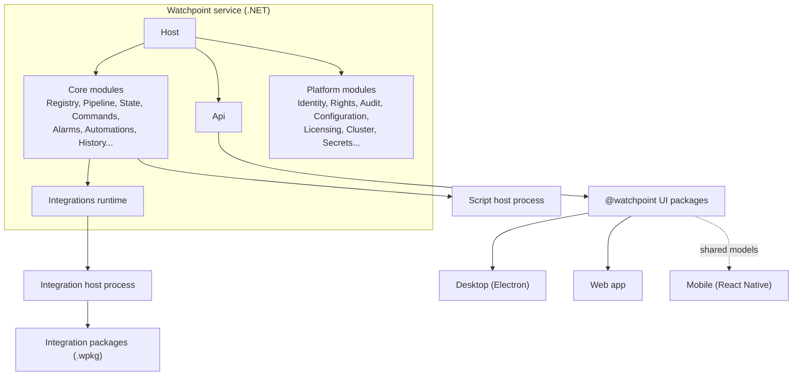

# Module and Class Catalogue

> One-page reference of every module of Watchpoint, the main classes/components inside it,
> what they are used for, and the suggested technologies. Names are **suggestions** to give
> the team a shared vocabulary; the detailed behaviour is in the linked documents.

## 1. How the code is organised

| Area | Form | Naming | Main technologies |
|---|---|---|---|
| **Service** (runs on each node) | .NET solution, one project per module | `Watchpoint.<Module>` (e.g. `Watchpoint.Alarms`) | .NET 10, C#, ASP.NET Core, EF Core, Npgsql |
| **Shared contracts** | Small, stable .NET assemblies | `Watchpoint.*.Abstractions` | .NET 10 (netstandard-free, no heavy dependencies) |
| **Helper processes** | Separate .NET executables started by the service | `watchpoint-integration-host`, `watchpoint-script-host` | .NET 10, gRPC, ClearScript (V8) |
| **Bundled third-party processes** | Supervised binaries | `nats-server`, `go2rtc` | NATS JetStream, go2rtc |
| **User interface** | TypeScript monorepo (pnpm workspaces) | `@watchpoint/<package>` | React 19, TypeScript, Vite |
| **Desktop shell** | Electron app wrapping the UI | `watchpoint-desktop` | Electron, electron-builder |
| **Mobile app** | React Native app | `watchpoint-mobile` | React Native, Expo (builds in our own CI) |
| **Integration packages** | One .NET project per integration, packed as `.wpkg` | `Watchpoint.Integration.<Vendor>` | .NET 10, `Watchpoint.Integration.Abstractions` |
| **Company-side services** | Separate products operated by the company | Licensing portal, push relay | ASP.NET Core, React, PostgreSQL |

## 2. Service — platform modules

| Module | Used for | Main classes / components | Technologies | Details |
|---|---|---|---|---|
| **Watchpoint.Host** | Starts the node as a Windows service, systemd unit or container; loads modules; supervises helper processes | `NodeHost` (start-up sequence), `ModuleLoader` (registers modules), `ProcessSupervisor` (starts/restarts NATS, go2rtc, hosts), `NodeSettings` (local settings) | .NET Generic Host, `UseWindowsService`, `UseSystemd` | [Core runtime §1](../modules/core-runtime.md#1-the-service) |
| **Watchpoint.Api** | REST endpoints and live stream for all clients | `RestEndpoints` (per module), `LiveHub` (SignalR hub), `SubscriptionManager` (what each client watches), `StreamSequencer` (sequence numbers, resume), `ProblemDetailsMapper` (errors as translation keys), `RateLimiter` | ASP.NET Core minimal APIs, OpenAPI 3.1, SignalR + MessagePack | [API and live protocol](../modules/api-and-protocol.md) |
| **Watchpoint.Identity** | Sign-in, MFA, sessions, tokens, maintenance-mode gate | `SignInService`, `LocalPasswordProvider` (Argon2id), `LdapProvider`, `OidcProvider`, `MfaService` (TOTP, WebAuthn), `TokenService` (JWT + refresh rotation), `SessionRegistry`, `LockoutPolicy`, `BreakGlassAccount` | ASP.NET Core Identity primitives, Novell.Directory.Ldap / System.DirectoryServices.Protocols, Fido2NetLib, Konscious Argon2 | [Users and rights](../modules/users-and-rights.md) |
| **Watchpoint.Rights** | Decide what each user may see and do; filter every list and live message | `User`, `UserGroup`, `RightGrant` (permission × scope × schedule × constraints), `PermissionCatalogue`, `ScopeResolver` (scopes → visible device sets), `RightsEvaluator`, `RightsCopyService` (copy/compare/re-apply/undo), `RightsDriftDetector` | .NET, PostgreSQL | [Users and rights](../modules/users-and-rights.md) |
| **Watchpoint.Audit** | Immutable journal of all security-relevant actions | `AuditWriter`, `AuditRecord`, `HashChain` (tamper detection), `AuditQuery` | PostgreSQL / TimescaleDB | [Users and rights §7](../modules/users-and-rights.md#7-audit-trail) |
| **Watchpoint.Configuration** | Drafts, validation, atomic publish, versions, rollback, import/export | `Draft`, `ChangeSet`, `ConfigurationVersion`, `Validator` (plain-language problems), `Publisher`, `RollbackService`, `SoftLockService`, `ImportExportService` | EF Core, JSON Schema validation (JsonSchema.Net), ClosedXML (XLSX) | [Configuration management](../modules/configuration-management.md) |
| **Watchpoint.Secrets** | Encrypted vault for passwords, keys and certificates | `SecretVault`, `MasterKeyProvider` (DPAPI, TPM, key file, KMS), `SecretAccessAudit`, `SiteCertificateAuthority` | .NET cryptography (AES-GCM), DPAPI, TPM 2.0 | [Security](../operations/security.md#secrets-vault) |
| **Watchpoint.Licensing** | Footprint, licence verification, quotas, restricted mode, activation requests | `FootprintCollector`, `LicenceVerifier` (Ed25519), `QuotaCounter` (device units, seats), `ActivationRequestBuilder` (online/offline `.wprq`), `LicencePortalClient`, `EnforcementPolicy` | .NET cryptography (Ed25519 via NSec), WMI / `/sys` readers | [Licensing](../modules/licensing.md) |
| **Watchpoint.Cluster** | Node membership, leases with fencing tokens, work placement | `ClusterMembership`, `LeaseManager`, `FencingToken`, `PlacementEngine` (connections and partitions to nodes), `DrainService` | NATS JetStream KV, gRPC | [Redundancy and multi-site](../modules/redundancy-and-multi-site.md) |
| **Watchpoint.Federation** | Links between sites, alarm handover, remote commands | `SiteLink` (mTLS gRPC), `LinkFilter`, `ResumeCursor`, `FederationIdentity`, `HandoverScheduler`, `RemoteQueryProxy` | gRPC, mTLS | [Redundancy §4](../modules/redundancy-and-multi-site.md#4-multi-site-federation) |
| **Watchpoint.Files** | Replicated file store (plans, symbols, snapshots, packages, client updates) | `FileStore`, `FileReplicator`, `FileReference` | NATS JetStream Object Store or file replication | [System architecture §2](system-architecture.md#2-data-stores-and-what-lives-where) |
| **Watchpoint.Scheduling** | Calendars, holidays, time triggers for all modules | `Calendar`, `HolidaySet` (ICS import), `TimeTriggerService`, `SiteClock` (time zones) | .NET, NodaTime (IANA time zones) | [Core runtime §4](../modules/core-runtime.md#4-scheduler-and-calendars) |
| **Watchpoint.Health** | System health dashboard and metrics | `HealthCollector`, `ThresholdMonitor` (raises system events), `CapacityAdvisor`, `DiagnosticBundle` (redacted) | OpenTelemetry, Prometheus exporter, Serilog | [Core runtime §6](../modules/core-runtime.md#6-system-health) |
| **Watchpoint.Localisation** | Server-side translation of reports, e-mails, notifications | `MessageCatalogue`, `IcuFormatter`, `LocaleResolver` | .NET resources, ICU (MessageFormat.NET or equivalent) | [Localisation](../modules/localisation.md) |

## 3. Service — supervision modules

| Module | Used for | Main classes / components | Technologies | Details |
|---|---|---|---|---|
| **Watchpoint.Model** (type catalogue) | Definitions of capabilities and device types; schema validation | `Capability`, `PropertyDefinition`, `CommandDefinition`, `EventDefinition`, `DeviceType`, `TypeCatalogue` (loads standard library + packages), `TypeMigration`, `StateSummaryRules` | JSON Schema, .NET | [Servers and devices §5–6](../modules/servers-and-devices.md#5-device-types) |
| **Watchpoint.Registry** | Servers, devices, locations, tags, links | `Server`, `Device`, `DeviceLink`, `Location` (tree), `Tag`, `TagFamily`, `CustomFieldDefinition`, `InventoryReconciler` (rediscovery by native id, orphans), `RegistryQuery` | EF Core, PostgreSQL (JSONB, materialised paths) | [Servers and devices](../modules/servers-and-devices.md) |
| **Watchpoint.Pipeline** | Ingest every observation in order per device, durably | `Observation`, `IngestService` (validation, units, dedup, deadband), `Enricher` (location, tags, links), `PartitionRouter`, `PartitionWorker`, `EventLogWriter`, `BackPressureController`, `SideEffectDispatcher` | NATS JetStream, `System.Threading.Channels` | [Core runtime §2](../modules/core-runtime.md#2-event-pipeline) |
| **Watchpoint.State** | Current value of everything; fast queries; crash recovery | `PropertyValue` (value, quality, timestamps, origin), `LiveStateStore`, `AggregateCounters` (per location/tag/server), `Snapshotter`, `StateRecovery` (snapshot + replay), `ChangeFeed` (since sequence S) | In-memory immutable collections, PostgreSQL snapshots | [Core runtime §3](../modules/core-runtime.md#3-live-state-store) |
| **Watchpoint.Commands** | Typed commands with lifecycle, priority, results and verification | `Command`, `CommandValidator` (schema, rights, schedule, state), `ApprovalService` (four-eyes), `ConnectionCommandQueue` (priority), `CommandDispatcher`, `CommandResult`, `Verifier`, `GroupCommand` | .NET, NATS JetStream (durable queue) | [Commands](../modules/commands.md) |
| **Watchpoint.Events** | Event model, event journal queries, operator notes | `Event`, `EventTypeRegistry`, `OperatorNote`, `EventQuery` | TimescaleDB | [Events and alarms §1](../modules/events-and-alarms.md#1-events) |
| **Watchpoint.Alarms** | Alarm rules, lifecycle, procedures, escalation, audience, handover | `AlarmRule`, `RuleIndex` (fast matching), `CompositeWindow` (sequences in time), `Alarm`, `AlarmStateMachine`, `Procedure` / `ProcedureStep`, `EscalationTimer`, `AudienceResolver`, `Incident`, `AlarmActionRunner` (snapshots, pop-ups, notifications) | .NET, CEL evaluator, TimescaleDB | [Events and alarms](../modules/events-and-alarms.md) |
| **Watchpoint.Expressions** | Safe CEL expressions for rules, synoptics and automations | `ExpressionCompiler` (parse + type-check against the model), `ExpressionEvaluator` (cost-limited), `ExpressionDiagnostics` (plain-language errors) | CEL; one TypeScript evaluator run in V8 server-side and in browsers | [Technology stack §2.6](technology-stack.md#26-why-cel-for-expressions) |
| **Watchpoint.Automations** | No-code flows: trigger → conditions → actions | `Automation` (flow document), `TriggerBinder`, `AutomationRun` (persisted step state), `StepExecutor` (one per block kind), `OperatorTask`, `ConcurrencyPolicy`, `DryRunExecutor` | .NET, NATS JetStream (run state) | [Automations](../modules/automations.md) |
| **Watchpoint.Scripting** (in the service) | Manage scripts, identities, deployment to the script host | `Script` (files, version), `ScriptIdentity`, `ScriptDeployment`, `ScriptHostClient` (gRPC), `ScriptApiGateway` (executes API calls on behalf of scripts, with rights) | gRPC, TypeScript compiler (server-side check) | [Scripting](../modules/scripting.md) |
| **watchpoint-script-host** (process) | Run TypeScript scripts in sandboxes | `IsolatePool`, `ScriptIsolate` (memory/CPU limits), `ApiBindings` (typed API exposed to scripts), `TestRunner` (simulated events, dry-run commands), `InspectorBridge` (debugging) | V8 via Microsoft ClearScript, gRPC | [Scripting §1](../modules/scripting.md#1-language-and-runtime) |
| **Watchpoint.Notifications** | E-mail, SMS, push, webhooks with templates, quotas, retries | `NotificationRouter`, `Recipient` / `OnCallRoster`, `Template` (per channel and language), `EmailChannel`, `SmsProviderChannel`, `GsmModemChannel`, `PushRelayChannel`, `WebhookChannel`, `DeliveryQueue`, `FloodSummariser` | MailKit, HTTP clients, serial port (System.IO.Ports) | [Notifications](../modules/notifications.md) |
| **Watchpoint.History** | Long-term storage and queries | `HistoryWriter` (batched COPY from the event log), `RetentionPolicy`, `ContinuousAggregates`, `HistoryQuery`, `ArchiveExporter` (Parquet), `PrivacyPurger` | TimescaleDB, Npgsql binary COPY, Parquet.Net | [History and reports](../modules/history-and-reports.md) |
| **Watchpoint.Reports** | Report templates, rendering, scheduling | `ReportTemplate`, `ReportRenderer` (HTML → PDF), `SpreadsheetExporter`, `ReportScheduler` | PuppeteerSharp (headless Chromium), ClosedXML, a template engine (Scriban) | [History and reports §4](../modules/history-and-reports.md#4-reports) |
| **Watchpoint.Video** | Stream tickets, rights for video, gateway control, exports | `StreamRequest`, `StreamTicket` (one-time), `MediaGatewayController` (go2rtc API), `PlaybackSession`, `PtzArbiter` (PTZ priority), `ExportJobTracker` | go2rtc (WebRTC, MSE/HLS), HTTP API | [Video](../modules/video.md) |
| **Watchpoint.Synoptics** (service side) | Store and serve synoptic documents and their files | `SynopticDocument`, `SynopticSchemaMigrator`, `BindingValidator` (orphaned devices), `SymbolLibrary` | JSON Schema, file store | [Synoptics](../modules/synoptics.md) |
| **Watchpoint.Maintenance** | System maintenance mode (suspend operation) and device maintenance | `MaintenanceModeService` (scope, reason, auto-end), `SessionGate` (with Identity), `DeviceMaintenanceFlag` | .NET | [Desktop client §6](../clients/desktop-client.md#6-suspending-operation-maintenance-mode) |

## 4. Service — integration modules

| Module | Used for | Main classes / components | Technologies | Details |
|---|---|---|---|---|
| **Watchpoint.Integration.Abstractions** | The contract every connector implements (published, versioned) | `IConnector` (initialise, test, start/stop, describe), feature interfaces: `IDiscovery`, `ILiveObservation`, `IStateRefresh`, `ICommandExecutor`, `IEventCatchUp`, `IVideoProvider`, `ITimeSync`, `ILookup`, `IDiagnostics`; `IConnectorContext` (services given to connectors) | .NET (minimal dependencies) | [Integrations §4](../modules/integrations.md#4-the-connector-contract) |
| **Watchpoint.Integration.Sdk** | Helpers so connectors stay small | `ObservationSink`, `DeviceMap`, `PollingScheduler`, `ResiliencePolicies`, `ConnectionStore` (cursors), `SecureHttpClientFactory` (TLS pinning), `InboundEndpointRegistry`, `RedactingLogger`, `ConnectorMetrics` | Polly, Serilog, OpenTelemetry | [Integrations §4.3](../modules/integrations.md#43-the-connector-context--what-watchpoint-gives-every-connector) |
| **Watchpoint.Integrations** (runtime) | Find, verify and run packages and connections | `PackageWatcher` (folder), `PackageVerifier` (signature, hashes), `ManifestReader`, `PackageCatalogue`, `PackageLoadContext` (one `AssemblyLoadContext` per package version), `ConnectionManager`, `Connection` (state machine), `ConnectionWatchdog`, `HostManager` (in-process / isolated / remote), `PackageUpgradeService` (canary, rollback), `SettingsFormSchema` | .NET `AssemblyLoadContext`, gRPC, file watcher | [Integrations](../modules/integrations.md) |
| **watchpoint-integration-host** (process) | Run connections outside the service (native SDKs, isolation, remote machines) | `HostAgent` (gRPC server/client), `HostedConnection`, `ResourceGuard` (Job Objects / cgroups), `PairingClient` (remote hosts) | .NET, gRPC over named pipes / Unix sockets / mTLS | [Integrations §6](../modules/integrations.md#6-integration-hosts-and-isolation) |
| **Watchpoint.Integration.Testing** | Shared quality checks for every connector | `ConformanceSuite` (start/stop, resync, commands, back-pressure, redaction…), `ProtocolSimulatorBase`, `DeviceSimulator` (load tests) | xUnit, Testcontainers | [Integrations §11](../modules/integrations.md#11-developing-a-connector-for-the-watchpoint-team) |

### 4.1 Integration packages

| Package | Used for | Main classes | Technologies |
|---|---|---|---|
| `Watchpoint.Integration.Simulator` | Demos, training, tests | `SimulatorConnector`, `ScenarioPlayer` | .NET |
| `Watchpoint.Integration.Ping` | Reachability of hosts and URLs | `PingConnector`, `HttpCheck` | .NET `Ping`, HttpClient |
| `Watchpoint.Integration.Modbus` | Modbus TCP points | `ModbusConnector`, `RegisterMap`, `MappingTemplate` | NModbus (MIT) |
| `Watchpoint.Integration.Mqtt` | MQTT topics as points | `MqttConnector`, `TopicMapping` | MQTTnet (MIT) |
| `Watchpoint.Integration.Snmp` | SNMP polling and traps | `SnmpConnector`, `MibImporter` | Lextm.SharpSnmpLib (MIT) |
| `Watchpoint.Integration.Bacnet` (phase 4) | BACnet/IP objects | `BacnetConnector`, `CovSubscriptionManager` | Open-source BACnet stack (to select) |
| `Watchpoint.Integration.OpcUa` (phase 4) | OPC UA servers | `OpcUaConnector`, `AddressSpaceBrowser` | **open62541** (C library, MPL-2.0) through a thin native wrapper, run in an isolated integration host |
| `Watchpoint.Integration.Salto` | Salto Space access control | `SaltoSpaceConnector`, `ShipClient`, `ShipMessageSerializer`, `DoorStatusPoller`, `AuditTrailReader`, `SaltoCommandMapper`, `SaltoErrorMapper` | .NET, XML serializer, TCP/HTTPS | [Salto Space](../integrations/salto-space.md) |
| `Watchpoint.Integration.Milestone` | Milestone XProtect video | `XProtectConnector`, `XProtectConfigurationReader`, `XProtectEventSubscriber`, `XProtectStreamProvider`, `XProtectPtzController`, `XProtectExportClient` | .NET, Milestone REST/API Gateway and/or MIP SDK (isolated, Windows) | [Milestone XProtect](../integrations/milestone-xprotect.md) |
| `Watchpoint.Integration.VanderbiltSpc` | Vanderbilt SPC intrusion | `SpcPanelConnector`, `SpcEventReceiver`, `SpcCommandClient`, `SpcStateMapper` | .NET, interface per vendor documentation | [Vanderbilt SPC](../integrations/vanderbilt-spc.md) |

## 5. User interface (TypeScript monorepo)

| Package | Used for | Main components | Technologies |
|---|---|---|---|
| `@watchpoint/api-client` | Typed access to REST and live stream | Generated REST client, `LiveConnection` (subscriptions, resume, resync), `SubscriptionHooks` | openapi-typescript (generation), @microsoft/signalr + MessagePack, TanStack Query |
| `@watchpoint/model` | Shared TypeScript types and rules (also used by mobile) | Device/type/capability types, state-summary helpers, permission helpers | TypeScript |
| `@watchpoint/expressions` | CEL evaluator shared with the server sandbox | `parse`, `check`, `evaluate`, diagnostics | TypeScript (CEL library or own interpreter) |
| `@watchpoint/i18n` | Translations, RTL, formats | `I18nProvider`, `Direction` handling, date/number/unit formatters, pseudo-locales | i18next + ICU, Intl API |
| `@watchpoint/ui` | Design system | Buttons, forms (generated from JSON Schema), dialogs, `DataGrid` (virtualised), trees, state badges and colours, icons, themes (dark control-room, light, high contrast) | shadcn/ui (Radix + Tailwind CSS), TanStack Table/Virtual, Lucide icons, react-hook-form + JSON Schema forms |
| `@watchpoint/operation` | Operation side | `AlarmConsole`, `AlarmDetails`, `ProcedureRunner`, `EventJournal`, `DeviceExplorer` (by location/server), `DevicePage` (generated from type), `CommandButton` (inline status), `CommandJournal`, `ShiftNotes` | React, Zustand |
| `@watchpoint/synoptics` | Synoptic viewer and editor | `SynopticViewer` (viewport subscriptions, level of detail), `SynopticEditor` (canvas, layers, snapping, undo), `SymbolRenderer`, `BackgroundImporter` (PDF/DXF/SVG/images), `MapSynoptic`, `DashboardGrid` | Konva / react-konva, pdf.js, dxf-parser, MapLibre GL JS |
| `@watchpoint/video` | Video tiles, layouts, playback, PTZ | `VideoTile` (WebRTC player), `VideoLayout`, `Timeline`, `PtzControls`, `JoystickBinding` | WebRTC (browser), Gamepad API |
| `@watchpoint/charts` | History charts and dashboards widgets | `TimeSeriesChart`, `Counters`, `Gauge` | Apache ECharts |
| `@watchpoint/configuration` (**desktop build only**) | Configuration side | `IntegrationsCatalogue`, `ConnectionWizard` (generated forms, test, discovery), `DeviceEditor`, `LocationTreeEditor`, `AlarmRuleEditor`, `ProcedureEditor`, `AutomationEditor`, `ScriptIde`, `UsersAndGroups`, `RightsEditor`, `RightsCopyWizard` (source → targets → options → preview → apply), `DraftBar` (validation + publish), `LicencePanel`, `ClusterPanel`, `MaintenanceModeDialog`, `SystemHealth` | React Flow (automations), Monaco Editor + TypeScript language service (scripts), CEL editor on Monaco |
| `@watchpoint/web` | Web client entry (operation only) | App shell, routing, sign-in | Vite build, no configuration package included |
| `watchpoint-desktop` | Desktop client (Electron) | Main process: `WindowManager` (multi-monitor workspaces), `SecureTokenStore` (OS keychain), `NodeDiscovery` (mDNS), `AutoUpdater` (from the site's nodes), `WorkstationIdentity` (certificate), `KioskMode`; preload bridge; renderer = UI packages | Electron, electron-builder, bonjour-service, Electron safeStorage |

## 6. Mobile app

| Package | Used for | Main screens / components | Technologies |
|---|---|---|---|
| `watchpoint-mobile` | Alarms and events on iOS and Android | `SignInScreen` (QR enrolment, SSO, MFA), `AlarmListScreen`, `AlarmDetailsScreen` (procedure, comments, snapshots), `EventsScreen`, `NotificationSettingsScreen`, `ProfileScreen`, `PushRegistration`, `BiometricLock` | React Native, Expo, Expo Notifications, expo-secure-store, shared `@watchpoint/api-client`, `@watchpoint/model`, `@watchpoint/i18n` |

## 7. Tools

| Tool | Used for | Technologies |
|---|---|---|
| `wpctl` | Local administration: status, logs, backup/restore, reset admin, maintenance mode, diagnostics, certificate renewal | .NET console app (System.CommandLine) |
| Setup wizard | First-run configuration | Part of the UI (`@watchpoint/configuration`) + local-only setup endpoint |
| Package builder (`wppack`) | Build, sign and validate `.wpkg` integration packages | .NET tool, Ed25519 signing via KMS/HSM |
| Installers | MSI, .deb/.rpm, OCI images, Helm chart, client installers | Inno Setup, nfpm, Docker/Podman, Helm, electron-builder (NSIS, MSIX) |
| Load test kit | Device simulator + scenarios | .NET device simulator + k6 |

## 8. Company-side services (outside the product)

| Service | Used for | Main components | Technologies |
|---|---|---|---|
| **Licensing portal** | Customer/partner accounts, orders, activation requests, review queue for the licensing team, signed licence issuance, renewals | `AccountService`, `OrderImporter` (from ERP), `ActivationRequestService`, `ReviewQueue`, `LicenceIssuer` (signing key in HSM/KMS), `RenewalReminders`, `SiteCheckInApi` (online sites, online-validated licences) | ASP.NET Core, React, PostgreSQL, cloud KMS or HSM |
| **Push relay** | Forward minimal alarm notifications to Apple/Google for mobile apps | `SiteRegistration`, `PushForwarder` (APNs, FCM), rate limiting | ASP.NET Core, APNs/FCM APIs |
| **Update repository** | Distribute signed releases, APT/YUM repositories, client updates for sites with internet | Static signed artefacts, repository metadata | Object storage + CDN |

## 9. Cross-cutting libraries used everywhere in the service

| Concern | Library |
|---|---|
| Logging with redaction | Serilog |
| Metrics and traces | OpenTelemetry .NET |
| Resilience | Polly |
| Validation of documents | JsonSchema.Net |
| Time zones | NodaTime |
| Testing | xUnit, Shouldly, Testcontainers (PostgreSQL, NATS), Playwright (UI), Vitest |
| Static analysis | .NET analyzers, Semgrep Community Edition, ESLint, TypeScript strict mode |

All licences must be re-checked by legal before the first commercial release (see
[Technology stack](technology-stack.md)).
