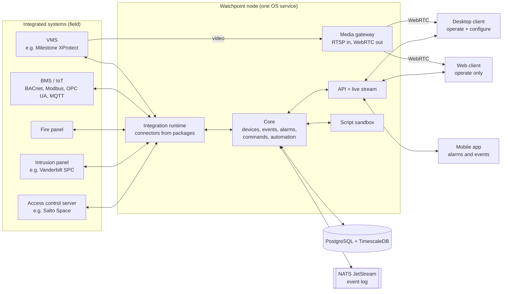

# Watchpoint — Product and Architecture Overview

> Status: draft v0.1 · Audience: founders, architects, developers, product and sales

## 1. What Watchpoint is

Watchpoint is a **security hypervision platform** (PSIM — Physical Security Information
Management). It connects to the security and building systems already installed on a site
(access control, video, intrusion, fire, intercom, building management, smart-city
equipment, IT infrastructure) and gives operators **one place** to:

- see the live state of every device on plans, maps and lists;
- receive, handle and document **alarms** with procedures;
- send **commands** to devices (open a door, arm an area, move a camera) and see whether
  they succeeded;
- watch **video** linked to what is happening;
- automate reactions with **automations** (no-code) and **scripts** (code);
- keep a complete, searchable **history** and produce reports.

### What Watchpoint is not

Watchpoint **does not replace** the systems it integrates. It is not an access control
system (no cardholder database of its own), not a VMS (it does not record video), not an
intrusion or fire panel. It **supervises and commands** those systems through
integrations. Personal data it handles (for example a cardholder name in an access event)
is received from the integrated system and kept only as event history.

## 2. Design principles

| # | Principle | What it means in practice |
|---|---|---|
| P1 | **Integration-only** | All field knowledge comes from integrations. The core knows *servers*, *devices*, *capabilities*, *events* and *commands*, never a vendor protocol. |
| P2 | **One universal, typed device model** | Every device of every vendor is described by a device type built from reusable capabilities. Adding a device type is data, not core code. |
| P3 | **Commands are first-class** | Every command has an id, an issuer, a timeout and a result that comes back to whoever sent it. Nothing is fire-and-forget. |
| P4 | **Safety first** | A licence problem, a faulty integration, a bad script or a configuration mistake must never stop alarms reaching operators. |
| P5 | **Behaviour is data** | Screens (synoptics), automations and alarm rules are stored as validated documents, not compiled code. Scripts exist, but run sandboxed. |
| P6 | **No code errors for non-developers** | Users who are not developers never see a compiler error. Editors validate as you go and explain problems in plain language. |
| P7 | **One client, rights decide** | A single desktop client does both operation and configuration; what a user sees depends only on their rights. The web and mobile clients are operation-only. |
| P8 | **Secure by default** | TLS everywhere, short-lived tokens, secrets in a vault, signed packages and updates, full audit trail. |
| P9 | **Cross-platform** | The service runs on Windows, Linux and in containers; the desktop client runs on Windows, Linux and macOS. |
| P10 | **Scales out, fails over** | From a 50-device single machine to multi-node clusters and multi-site federations, with the same software. |
| P11 | **Built for every market** | Multi-language from day one, including right-to-left (Arabic), time zones and local formats. |

## 3. The big picture

- A **Watchpoint node** is a single operating-system service (Windows service, Linux
  systemd unit or container). There is no separate "server application" to start by hand.
- **Integrations** are packages of DLLs dropped into a folder. The node discovers them,
  offers them in the *Integrations* menu, and runs one **connection** per integrated
  server.
- The **core** turns what integrations report into device states, events and alarms,
  executes commands, runs automations and keeps history.
- **Clients** connect outbound to the node over one authenticated, resumable stream.
- **Video** never passes through the core: the media gateway converts camera/VMS streams to
  WebRTC for the clients.

## 4. Vocabulary in one minute

Full definitions are in the [glossary](glossary.md).

| Term | Meaning |
|---|---|
| **Server** | Any external system that hosts devices: a Salto Space server, a Milestone management server, an intrusion panel, a fire panel, a BACnet controller. Servers can contain sub-servers. |
| **Device** | Anything a server hosts that Watchpoint can observe or command: door, reader, camera, zone, area, detector, output, sensor… Devices can contain sub-devices. |
| **Capability** | A reusable behaviour a device has: *Openable*, *Armable*, *VideoSource*, *Pan-Tilt-Zoom*, *Measurement*… Capabilities bring their properties, commands and events. |
| **Device type** | A named combination of capabilities (Door = Openable + Lockable + DoorPosition + Health…). |
| **Integration package** | A signed folder/archive of DLLs plus a manifest, adding support for a family of systems. |
| **Connector** | The class inside a package that knows how to talk to one kind of server. |
| **Connection** | A configured, running instance of a connector, bound to one server on a site. |
| **Node** | One running Watchpoint service. Several nodes form a **cluster** (one site). Several sites form a **federation**. |
| **Location** | The physical tree (site → building → floor → room) devices are placed in. |
| **Synoptic** | An interactive screen (plan, map or diagram) showing devices and their states. |
| **Automation** | A no-code flow: trigger → conditions → actions. |
| **Script** | TypeScript code run in a sandbox, for what automations cannot express. |

## 5. What we keep from the PSIM tradition, and what we change

Watchpoint follows the proven ideas of the PSIM market and fixes its known weaknesses.

| Proven idea we keep | How Watchpoint does it |
|---|---|
| A universal model for everything supervised | Servers, devices, typed capabilities (instead of untyped "points" with naming conventions) |
| Physical location tree used for navigation and rights | Location tree + tags, rights scoped by location, server, device category |
| Rich alarm lifecycle (raise, acknowledge, report, close, mask, escalate) | Separate alarm-rule entity, procedures, escalation, handover between sites |
| Integrations isolated from the core | Integration runtime with optional isolated host processes, managed by the node |
| Storage split by lifetime | Configuration, live state, history (time-series), event log |
| Origin tracked on every change | Every event, command and configuration change carries who/what/where |

| Common weakness in the market | Watchpoint answer | Where |
|---|---|---|
| Commands are blind writes with no answer | Typed commands with id, timeout, result, verification | [Commands](../modules/commands.md) |
| One processing thread, in-memory state saved every few minutes | Partitioned pipeline, bounded queues, durable event log | [Core runtime](../modules/core-runtime.md) |
| Clients host inbound listeners; full database copied on each client | One outbound resumable stream per client, server-side filtering | [API and live protocol](../modules/api-and-protocol.md) |
| Screens compiled into code, errors only at build time | Declarative screens, validated as you edit | [Synoptics](../modules/synoptics.md) |
| Unsandboxed scripts in the server process | TypeScript in a sandboxed process with limits and a modern IDE | [Scripting](../modules/scripting.md) |
| Plugins loaded by path from parameters | Signed packages, allow-listed folder, isolation option | [Integrations](../modules/integrations.md) |
| Redundancy without fencing (split brain) | Lease-based leadership with fencing tokens | [Redundancy and multi-site](../modules/redundancy-and-multi-site.md) |
| Windows desktop lock-in | .NET + PostgreSQL + web technologies, Windows/Linux/macOS | [Technology stack](technology-stack.md) |
| Profiles hard-wired into users | Users with their own rights, groups to organise, a rights-copy tool | [Users and rights](../modules/users-and-rights.md) |
| Separate configurator and operator clients | One desktop client, rights decide what is shown | [Desktop client](../clients/desktop-client.md) |

## 6. Product scope for version 1

**In v1**

- Core: servers, devices, capabilities, locations, tags, events, alarms, commands, history.
- Integration runtime and three reference integrations: **Salto Space** (access control),
  **Milestone XProtect** (video), **Vanderbilt SPC** (intrusion); plus generic protocol
  integrations (Modbus TCP, MQTT, SNMP, ping) to cover simple I/O.
- Users, user groups, rights, rights-copy tool, local + LDAP/Active Directory + OpenID
  Connect sign-in, multi-factor authentication.
- Desktop client (Windows, Linux, macOS): operation and configuration.
- Web client: operation only.
- Mobile app: alarms and events only.
- Synoptics editor and viewer, video live/playback through the media gateway.
- Automations (no-code) and scripting (TypeScript IDE).
- Licensing with machine footprint, online and offline activation.
- Redundancy (active/standby with automatic failover), scale-out of integrations across
  nodes, multi-site federation.
- English, French, Arabic (right-to-left).

**Later**: video wall management, 3D/BIM views, more languages (Spanish, German, Turkish,
Chinese), mobile video, third-party integration SDK, analytics and dashboards builder.

## 7. Document map

See the [documentation index](../README.md) for the full list and reading order.
