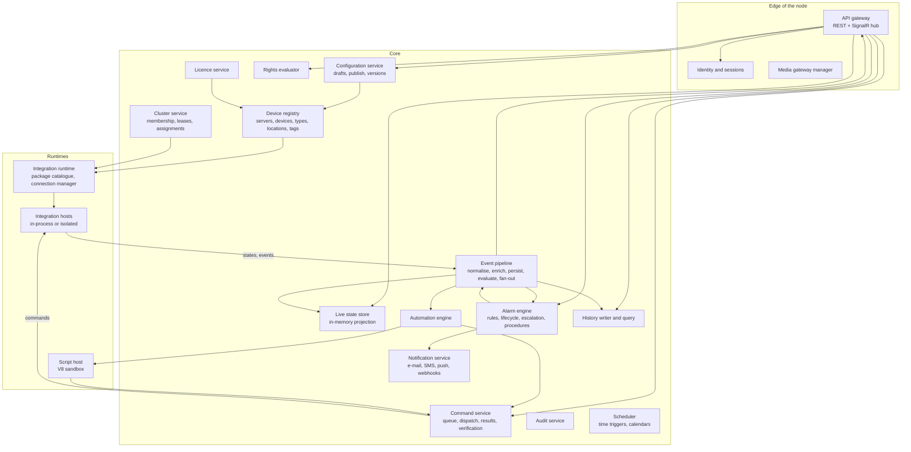
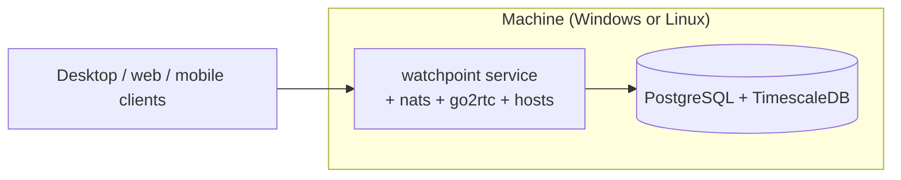
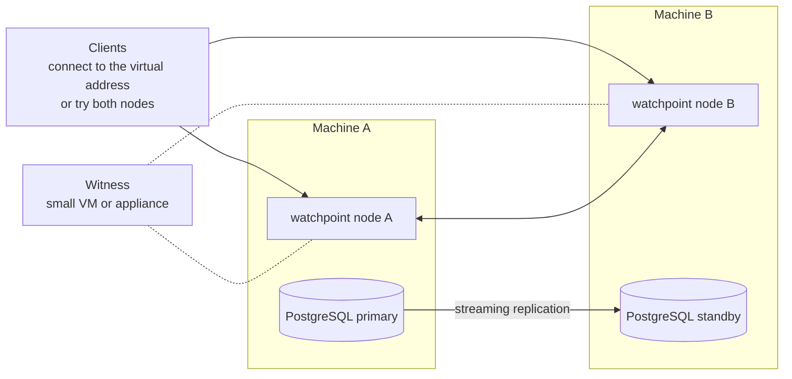
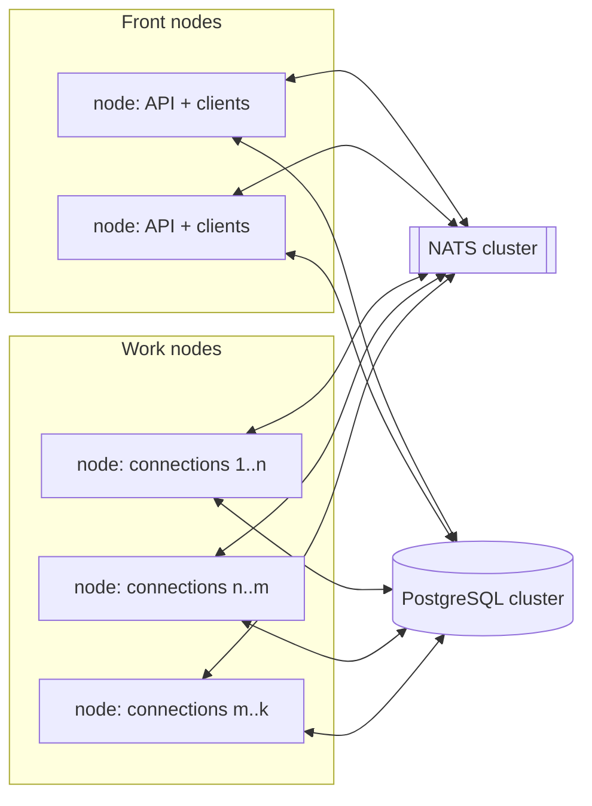
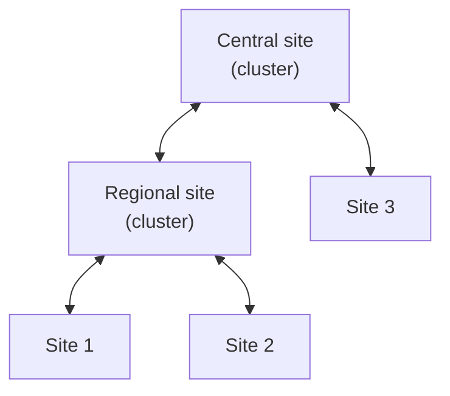
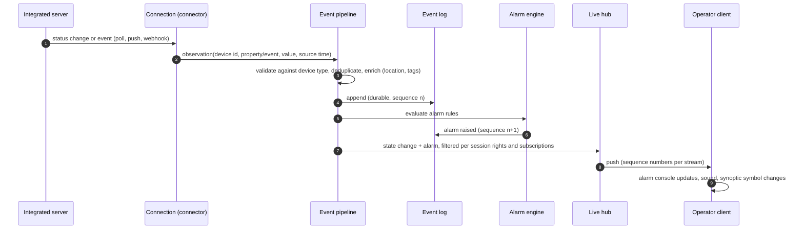
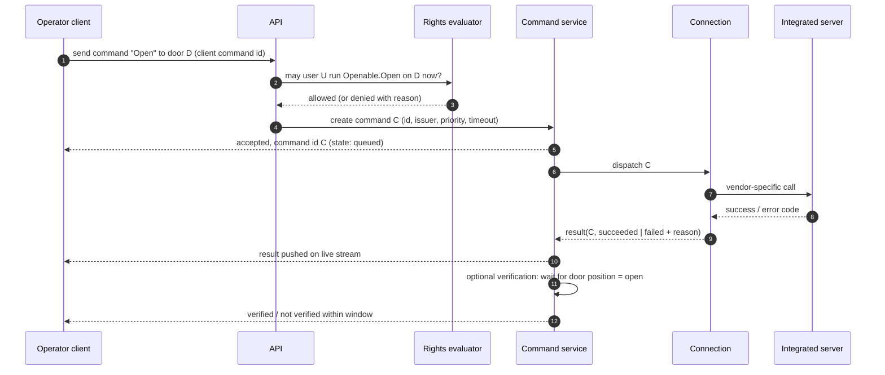
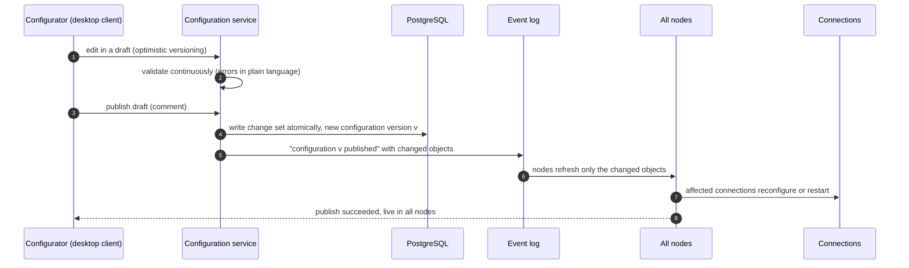

# System Architecture

This document describes the building blocks of Watchpoint, how they are deployed, and how
the main flows cross them. Each module has its own detailed document under
[`docs/modules`](../modules).

## 1. Logical components of a node

| Component | Responsibility | Detailed in |
|---|---|---|
| API gateway | REST endpoints, SignalR live hub, authentication of every call, rate limiting, request audit | [API and live protocol](../modules/api-and-protocol.md) |
| Identity and sessions | Sign-in (local, LDAP/AD, OIDC), MFA, tokens, session registry, maintenance-mode gate | [Users and rights](../modules/users-and-rights.md) |
| Rights evaluator | Answers "may user U do action A on object O now?" and filters every list and live stream | [Users and rights](../modules/users-and-rights.md) |
| Configuration service | Drafts, validation, publish, versions, rollback, import/export | [Configuration management](../modules/configuration-management.md) |
| Device registry | Servers, devices, device types, capabilities, locations, tags | [Servers and devices](../modules/servers-and-devices.md) |
| Integration runtime | Package catalogue, connections, hosts, health, discovery | [Integrations](../modules/integrations.md) |
| Event pipeline | Every observation goes through it; ordered per device; durable | [Core runtime](../modules/core-runtime.md) |
| Live state store | Current value of every property, rebuilt from snapshot + event log | [Core runtime](../modules/core-runtime.md) |
| Command service | Typed commands, queues, priorities, results, verification | [Commands](../modules/commands.md) |
| Alarm engine | Alarm rules, lifecycle, procedures, escalation, handover | [Events and alarms](../modules/events-and-alarms.md) |
| Automation engine | No-code flows | [Automations](../modules/automations.md) |
| Script host | TypeScript sandbox | [Scripting](../modules/scripting.md) |
| Notification service | E-mail, SMS, mobile push, webhooks | [Notifications](../modules/notifications.md) |
| History | Time-series storage, queries, reports, retention | [History and reports](../modules/history-and-reports.md) |
| Media gateway manager | Supervises go2rtc, issues stream tickets | [Video](../modules/video.md) |
| Licence service | Footprint, licence verification, quotas | [Licensing](../modules/licensing.md) |
| Cluster service | Membership, leader leases, fencing, work assignment | [Redundancy and multi-site](../modules/redundancy-and-multi-site.md) |
| Audit service | Immutable audit trail | [Users and rights](../modules/users-and-rights.md) |

## 2. Data stores and what lives where

Storage is split by **lifetime and access pattern**. Databases are reached only through the
[storage module](../modules/data-storage.md), which supports several database technologies;
the table shows the default (bundled PostgreSQL + TimescaleDB):

| Store | Technology | Content | Written by | Lifetime |
|---|---|---|---|---|
| Configuration | PostgreSQL schema `config` | Users, groups, rights, servers, devices, connections, locations, tags, alarm rules, synoptics, automations, scripts, settings, configuration versions | Configuration service (publish) | Long-lived, versioned |
| Event log | NATS JetStream streams | Every observation, event, command, alarm transition, configuration publication, as an ordered stream per partition | Pipeline, command service, alarm engine | Short (7–30 days, configurable), for replay and recovery |
| Live state snapshot | PostgreSQL schema `state` | Last known value of every property, active alarms, pending commands, with the event-log sequence they reflect | Snapshotter (every few seconds and on shutdown) | Overwritten |
| History | TimescaleDB hypertables in schema `history` | Events, alarm lifecycles, commands, property changes, audit trail | History writer (consumes the event log) | Months to years, compressed, retention per category |
| Files | Node file store (replicated across the cluster) | Plan backgrounds, symbols, snapshots, report outputs, integration packages, client update packages | Configuration service, alarm actions | Per policy |
| Secrets | Encrypted vault table + OS-protected master key | Passwords and keys for integrated servers, SMTP, LDAP, certificates | Configuration service | Long-lived, rotated |

Rules:

- The **event log is the source of truth for what happened**; state and history are
  projections of it. If a node crashes, it reloads the last state snapshot and replays the
  log from the snapshot's sequence number: nothing is lost.
- Each store can be placed on another supported database (e.g. the customer's SQL Server),
  see [Data storage](../modules/data-storage.md).
- Only nodes access the database and NATS. Clients, integration hosts and the script host go
  through the node's APIs.
- Each integrated server's personal data (cardholder names, photos) reaching Watchpoint in
  events is stored only in history, under retention and privacy rules.

## 3. Deployment shapes

The same software covers every size. The installer proposes a shape; it can grow later
without reinstalling.

### 3.1 Single machine (from 50 to a few thousand devices)

Everything on one machine. Recommended baseline: 8 vCPU, 16 GB RAM, SSD.
Final sizing comes from load testing (see [Performance and capacity](../operations/performance-and-capacity.md)).

### 3.2 Redundant pair

Two nodes and a lightweight **witness** (a third vote to avoid split brain). NATS runs as a
three-member cluster (A, B, witness). PostgreSQL uses streaming replication with automatic
failover. Connections run on the active node and move to the other one within seconds if
it fails. See [Redundancy and multi-site](../modules/redundancy-and-multi-site.md).

### 3.3 Scale-out cluster (large sites)

Every node runs the same software; **roles** decide what each does (API/clients,
connections, history writing, media). Connections are spread across work nodes and
rebalanced on failure. This is how a site grows beyond the capacity of one machine without
splitting it into separate systems.

### 3.4 Multi-site federation

Each site is autonomous (keeps working if the WAN is down). A central site subscribes to
selected events, alarms and states from its child sites and can send commands down, within
the rights granted. Links resume from the last acknowledged sequence number after an outage.

### 3.5 Remote integration host

When an integration needs Windows (vendor SDK) but the cluster runs on Linux, or when an
integrated server sits on an isolated network segment, an **integration host** runs on a
machine near that system and connects outbound to the cluster over mTLS. From the user's
point of view it is still configured in the Integrations menu, not a separate product.

## 4. Main flows

### 4.1 Field event to operator

- Ordering is guaranteed **per device**; different devices are processed in parallel.
- Side effects (camera snapshots, e-mails, scripts) run **after** the event is durable and
  never block the pipeline.

### 4.2 Operator command to field

The operator always gets an outcome: success, failure with a readable reason, refusal by
rights, or timeout. See [Commands](../modules/commands.md).

### 4.3 Configuration change

No polling: configuration changes reach every node through the event log within
milliseconds. Every version can be compared and rolled back.

## 5. Cross-cutting concerns

| Concern | Approach | Document |
|---|---|---|
| Security | TLS everywhere, mTLS between nodes and hosts, secrets vault, signed packages and updates | [Security](../operations/security.md) |
| Localisation | i18next/ICU, RTL, per-site time zones | [Localisation](../modules/localisation.md) |
| Observability | Structured logs without secrets, OpenTelemetry metrics, built-in health dashboard | [Deployment and operations](../operations/deployment-and-operations.md) |
| Licensing | Signed licence file bound to machine footprints, grace periods, never stops supervision | [Licensing](../modules/licensing.md) |
| Performance | Partitioned processing, bounded queues, coalescing of state updates, load-test targets | [Performance and capacity](../operations/performance-and-capacity.md) |
| Time | Everything stored in UTC with source and received timestamps; displayed in the site's or user's time zone | [Core runtime](../modules/core-runtime.md) |
