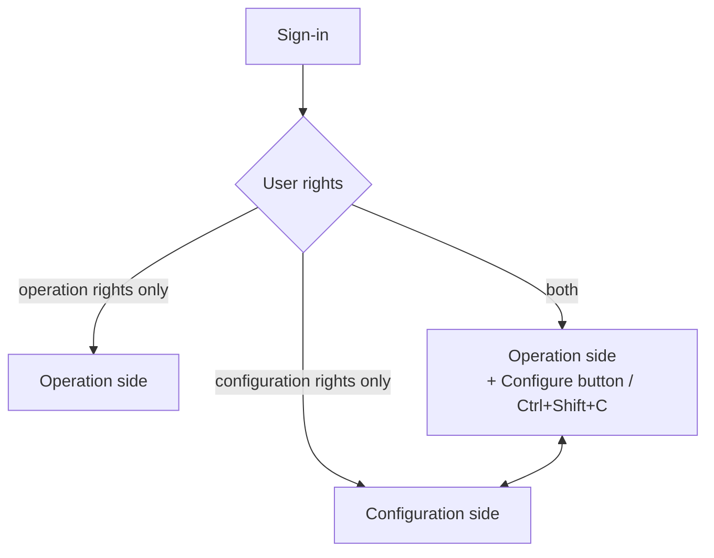

# Desktop Client — One Application for Operation and Configuration

> Requirements: one client instead of two. Configuration menus are shown only to users who
> have configuration rights. Users with configuration rights can suspend the operation side
> for everyone (operators can no longer use the clients) while configurators keep working
> and applying changes.

## 1. Technology

- **Electron** shell (Windows, Linux, macOS) hosting the shared **React + TypeScript** UI.
- Main process (Node.js) handles: windows and monitors, workstation identity (certificate),
  secure token storage (OS keychain: Windows Credential Manager/DPAPI, macOS Keychain,
  libsecret on Linux), server discovery, auto-update, OS notifications, joystick access,
  kiosk mode.
- Renderer processes run the UI with context isolation, sandboxing, no Node integration, a
  strict Content Security Policy, and only a narrow IPC bridge exposed by a preload script.
- Same UI code as the web client; configuration modules are **only bundled in the desktop
  build**.

## 2. Two sides, one application



| Side | Content |
|---|---|
| **Operation** | Alarm console, event journal, synoptics, device explorer (by location / by server), device pages with commands, video (live, playback, layouts), automations panel (manual runs), command journal, reports viewing, shift notes, personal workspaces |
| **Configuration** | Integrations (packages, connections, hosts, discovery), servers and devices, locations and tags, device links, alarm rules and procedures, notifications, synoptic editor, automation editor, script IDE, users/groups/rights (with the rights-copy tool), calendars, reports templates, system (licence, cluster, backups, retention, certificates, federation, maintenance mode, health) |

- The configuration side appears **only if** the user holds at least one configuration
  permission; inside it, each section appears only if the user has its view permission,
  and editing controls only with edit/publish permissions.
- Hiding is a convenience; **the server enforces every permission** (see
  [API](../modules/api-and-protocol.md#2-rest-conventions)).
- Users with both rights switch sides with one button; each side keeps its windows.
  Configuration can also open in a separate window on another monitor while operation
  continues.
- While editing, a configurator still receives critical alarm pop-ups if they hold alarm
  rights (configurable), so a site with a single person on duty stays safe.

## 3. Operation side — layout and features

### 3.1 Main window

```
┌──────────────────────────────────────────────────────────────────────────┐
│ Site ▾  🔍 Search devices, locations, alarms…     ⚠ 3 Critical  🔔  👤  │  top bar
├────────────┬─────────────────────────────────────────────┬───────────────┤
│ Navigator  │                                             │ Context panel │
│ • Locations│        Main area (tabs)                     │ (selected     │
│ • Servers  │        synoptic / video layout /            │  device or    │
│ • Favorites│        device page / journal                │  alarm:       │
│ • Screens  │                                             │  state,       │
│            │                                             │  commands,    │
│            │                                             │  video,       │
│            │                                             │  procedure)   │
├────────────┴─────────────────────────────────────────────┴───────────────┤
│ Alarm console (dockable, resizable)                                      │
└──────────────────────────────────────────────────────────────────────────┘
```

- All panels dockable/undockable; any panel can be moved to another monitor.
- Tabs with back/forward history; breadcrumbs by location.
- Global search (devices by name/native id/tag, locations, alarms, events, commands).

### 3.2 Workspaces and multi-monitor

- A **workspace** = set of windows, their monitors, positions, panels and content (e.g.
  monitor 1: alarm console + plan; monitor 2: 3×3 video layout; monitor 3: site map).
- Personal workspaces and shared workspaces (published by configurators); a default
  workspace per user/user group/workstation.
- Workstation profiles (e.g. "Control room desk 2" always opens with its workspace in kiosk
  mode).

### 3.3 Operator comfort and safety

- Alarm sounds per priority, pop-up rules, "bring to front" for critical alarms.
- Keyboard shortcuts for everything frequent (acknowledge next, open video, go to plan).
- USB joystick/keyboard for PTZ (Gamepad API / HID).
- Idle lock and quick unlock (password or PIN + workstation certificate).
- Large-screen/touch mode; high-contrast themes; dark theme default for control rooms.
- **Connection banner**: if the node is unreachable, a red banner, last update time on
  every view, and automatic reconnection with resync; nothing displayed stale without a
  marker.

### 3.4 Server connection and discovery

- Connection profiles (site name, node addresses, certificate fingerprint pinning on first
  connection with a clear trust prompt, or CA-validated certificates).
- Discovery of nodes on the local network via **mDNS/DNS-SD** (`_watchpoint._tcp`), with
  manual entry always available.
- Several sites can be saved; one session per window (federation centres use a central
  site instead of many sessions).

## 4. Configuration side — principles

- Each section uses **drafts and publish** (see
  [Configuration management](../modules/configuration-management.md)); a persistent bar shows
  the current draft, its validation status and the *Publish* button.
- Forms generated from schemas (connections, device attributes, command parameters) keep
  the UI consistent.
- Editors: synoptics (canvas), automations (flow), scripts (Monaco IDE), procedures (step
  list), rights (tree + scopes + copy tool), rules (form + CEL condition editor).
- Contextual help panel with documentation (including integration package docs) in the
  user's language.

## 5. Installation and updates

- Installers: NSIS setup and MSIX (Windows), `.deb`/`.rpm`/AppImage (Linux), `.dmg` notarised
  (macOS), built with electron-builder, all code-signed.
- **Auto-update from the site's own nodes** (no internet needed): nodes host the client
  update packages matching their version; clients check at sign-in and download signed
  updates (signature verified before install); compatible client versions are allowed
  during rolling upgrades; administrators can defer updates per workstation group.
- Silent install options and configuration file for mass deployment (GPO, Intune, Ansible).

## 6. Suspending operation (maintenance mode)

Configurators sometimes need to stop operators from using the system (major migration,
re-commissioning, a site not yet handed over). Watchpoint provides a **system maintenance
mode**.

### 6.1 Behaviour

| Aspect | In maintenance mode |
|---|---|
| Operation side of desktop clients | Closed for users without configuration rights: they see a full-screen message ("Supervision suspended for maintenance by S. Benali — reason — expected end 14:00") |
| Web client and mobile app | Sign-in refused with the same message; existing sessions closed |
| Configuration side | Fully available to configurators; changes can be published and applied |
| Configurators' operation side | Available to them only if they hold an explicit *operate during maintenance* permission (for testing) |
| **Event processing** | **Continues**: connections stay up, events and states are recorded, history is complete |
| **Alarms** | Continue to be raised and recorded; configurable: (a) notifications continue (default, recommended), (b) notifications suppressed, (c) only Critical alarms notified |
| Automations and scripts | Configurable: keep running (default) or pause non-safety automations |

### 6.2 Safety rules

- Activation requires the *maintenance mode* permission, a **reason**, an **expected end
  time**, and a confirmation that explicitly states who will be locked out and what still
  runs.
- Optional automatic end at the expected time (default on), with reminders to the
  initiator before it ends.
- Banner on every configurator's screen while active; system event + notification to a
  chosen group (e.g. security manager).
- Scope: whole site, or **per location** (e.g. only Building C under re-commissioning:
  operators lose access to Building C devices and alarms, the rest keeps working).
- Recorded in the audit trail; maintenance periods are visible in reports.

### 6.3 Variant: device maintenance

Not to be confused with **device maintenance** (a flag on devices that suppresses their
alarms during works, see [Servers and devices](../modules/servers-and-devices.md)), which
does not affect users.
