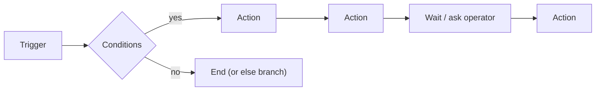

# Automations (No-Code)

Automations let configurators define reactions without writing code: *when something
happens, if some conditions hold, do these actions*. They cover most needs; scripts cover
the rest.

## 1. Model

| Part | Options |
|---|---|
| **Triggers** | Event (type + scope + payload filters), property change, alarm transition (raised, acknowledged, closed — filtered by rule, priority, location), command result, schedule (time, calendar, sunrise/sunset), system mode change, manual (button on a synoptic, in the alarm procedure, in the client menu), called by a script or another automation, inbound webhook |
| **Conditions** | Device state, time/calendar, site mode, alarm state, counters, CEL expression; combined with AND/OR groups |
| **Actions** | Send command (single or group, with result handling), raise/update/close an alarm, add comment, notify (template + recipients), show something on operator screens (open synoptic, show camera, pop-up message) on selected workstations or user groups, set a virtual device value, start another automation, call a script function (typed parameters and return), HTTP request (allow-listed), create a VMS bookmark, take snapshots |
| **Flow control** | If/else, switch on a value, wait (duration), wait until (condition with timeout), repeat (bounded count), parallel branches, try/on-failure (what to do if a command fails) |
| **Operator tasks** | Ask an operator (or group) to confirm/choose/enter text, with timeout and default — e.g. "Confirm evacuation of Building A?" |

Automations run as their own **script identity** with explicit rights.

## 2. Execution engine

- Each run is an **instance** with an id, trigger origin, current step, variables and log.
- **State is persisted after each step** (in the event log), so after a failover or restart
  the run **continues at the step it reached** instead of restarting from zero and
  repeating side effects.
- Concurrency policy per automation: allow parallel runs, queue, skip if running, or
  replace the running one.
- Each step has a timeout; failed steps follow the automation's failure policy.
- Runs are visible live (*Operation → Automations* for operators with the right: running
  instances, current step, pause/resume/cancel).

## 3. Editor

- Visual flow editor (React Flow) in the desktop client configuration side: palette of
  triggers, conditions and actions; forms for each block; drag to connect.
- Same safety rules as synoptics: references use ids, validation in plain language, no
  code generated.
- **Test run** with a simulated trigger: commands are shown, not sent (dry-run), with an
  option to run for real on selected test devices.
- Templates: "Lockdown building", "Fire alarm: unlock doors and show cameras", "Door forced:
  snapshot + notify guard", "Night arming check".
- Versions, publish, rollback like any configuration.

## 4. Typical examples

| Name | Trigger | Steps |
|---|---|---|
| Fire evacuation | Fire alarm in Building A | Emergency-open all doors of Building A (group command) → show cameras of exits on video wall workstation → notify security team → if any door not verified open within 15 s, raise Critical alarm "Exit door not open" |
| Forced door | Door forced (not after a valid access) | Snapshot linked cameras → raise alarm with snapshot → if area armed, priority Critical |
| End of day | Calendar 20:00 working days | Check all intrusion areas of the site → if any disarmed, ask operator "Arm Building B?" with 10 min timeout → arm if confirmed |
| Visitor parking full | Parking occupancy ≥ 95 % | Set variable message sign text → notify reception |
