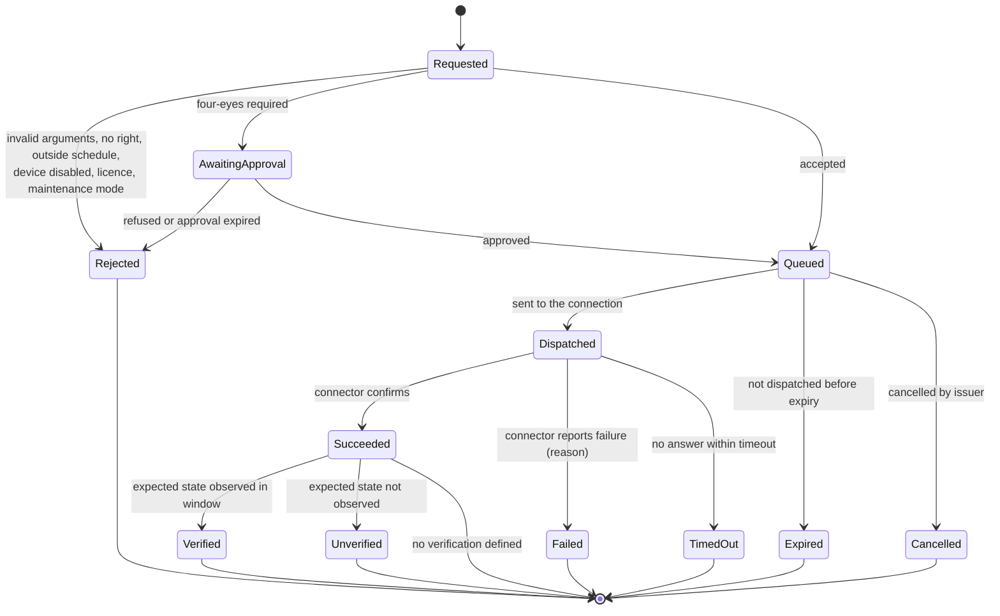
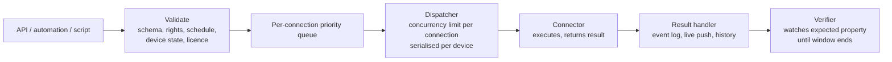

# Commands

> Principle: every action sent to the field is a **command object** with an identity, an
> issuer, a lifecycle and a result that comes back to whoever sent it. Nothing is
> fire-and-forget.

## 1. What a command is

| Field | Meaning |
|---|---|
| `id` | UUID generated by the node; the client also sends its own `clientCommandId` so retries never execute twice (idempotency key) |
| `target` | One device, a list of devices, or a selector (location + type + tags, resolved at send time and recorded) |
| `command` | Capability command id: `openable.open`, `armable.arm`, `ptz.gotoPreset`… |
| `arguments` | Typed values validated against the command's parameter schema |
| `issuer` | User (with session, workstation, client kind), script identity, automation, alarm action, federation link |
| `reason` | Free text or predefined reason; mandatory for sensitive/critical commands (configurable) |
| `approval` | For four-eyes commands: approver identity and time |
| `priority` | `critical` (life safety, lockdown), `high` (operator action), `normal`, `background` (automation housekeeping) |
| `timeout` | Max time to get a result from the connection (default from the command definition) |
| `notBefore` / `expiresAt` | Optional scheduling and expiry (a command not dispatched before expiry fails as *expired*) |
| `verification` | Expected effect and window (from the definition, overridable) |
| `correlation` | Alarm id, automation run id, or parent group command id |

## 2. Lifecycle

Every transition is an event in the event log, pushed to the issuer's live stream and
stored in history (`history.commands`).

### 2.1 Failure reasons (standard categories)

| Category | Example message shown to the operator |
|---|---|
| `not-authorised` | "You are not allowed to open doors in Building B." |
| `outside-schedule` | "Your rights allow this command only between 07:00 and 20:00." |
| `device-offline` | "Main entrance is offline; the command cannot be delivered." |
| `connection-down` | "The connection to Salto — Building A is not available." |
| `refused-by-system` | "The access control system refused the command: door is in emergency mode." (vendor detail attached) |
| `invalid-state` | "Area cannot be armed: 2 zones are open (Lobby PIR, Front door contact)." |
| `not-supported` | "This door model does not support remote opening." |
| `timeout` | "No answer from the access control system within 10 s. The door state will be checked." |
| `conflict` | "Another command on this device is in progress." |
| `internal-error` | "Unexpected error (reference 7F3A…). Support can trace it." |

Messages are translation keys with parameters; vendor-specific details are attached as
structured data, not concatenated text.

## 3. Risk levels and safeguards

Each command definition has a default risk; sites can raise it per device/type/location.

| Risk | Default safeguard | Examples |
|---|---|---|
| `normal` | None, single click | Go to camera preset, acknowledge a panel buzzer |
| `sensitive` | Confirmation dialog stating target and effect; reason optional | Open a door, disarm an area, bypass a zone |
| `critical` | Confirmation + mandatory reason + optional **four-eyes** (second user approves within N minutes) + optional re-authentication (password/MFA) | Unlock all doors of a building, disable a fire zone, emergency open |

Rights can grant a command **without** the four-eyes requirement to specific supervisors.

## 4. Dispatch

- **Priority queue per connection**: critical > high > normal > background. Polls and
  discovery run in the background class, so an operator's command is never stuck behind a
  status poll.
- **Serialisation per device**: two commands on the same device are executed in order;
  commands on different devices run concurrently up to the connection's limit.
- **Idempotency**: a retried request with the same `clientCommandId` returns the existing
  command instead of creating a new one.
- **Failover**: if the node running the connection fails, queued commands are taken over
  by the new owner (the queue is in the event log); commands already dispatched without a
  result are marked *unknown outcome* and, if the definition is idempotent, retried once.

## 5. Group commands

Sending one command to many devices ("lock down Building A": 120 doors) creates a **group
command** with child commands per device.

- The connector receives them as a batch when the command is `batchable` and the vendor
  supports bulk operations; otherwise one by one under the concurrency limit.
- The operator sees a progress panel: 117 succeeded, 2 failed (with reasons), 1 timed out;
  "retry failed" button.
- Group commands have their own risk level (usually one level higher than the single one).

## 6. Verification

Verification answers "did it really happen?":

- Defined per command (`openable.open` → `doorPosition.position becomes open within 10 s`,
  or `lockState becomes unlocked`).
- The verifier watches the live state stream; a match marks the command *verified*;
  otherwise *unverified* after the window, shown as a warning ("Door reported success but
  did not open").
- Verification can trigger alarm rules (e.g. "lockdown not verified on 3 doors" →
  high-priority alarm).

## 7. Commands in clients

- Command buttons and forms are generated from the device type; the client greys out what
  the user may not do (rights are evaluated server-side and cached per session; the server
  check remains authoritative).
- After clicking, the button shows the command state inline: *sending → done ✓ → verified
  ✓✓* or *failed ✗ (reason)*.
- A **command journal** panel lists the user's recent commands with outcomes; supervisors
  can see everyone's.
- Keyboard shortcuts and joystick bindings (PTZ) map to commands too.

## 8. History and audit

`history.commands` stores every command with its full lifecycle timestamps, issuer,
arguments, results, verification and correlation. Reports: commands per operator, failure
rates per connection, average latency per server, unverified commands.
