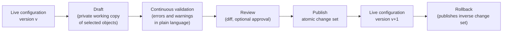

# Configuration Management

> Goals: several configurators can work safely at the same time; mistakes are caught
> before they reach the live system; every change is traceable and reversible; live
> operation is never disturbed by half-finished work.

## 1. Drafts, validation and publishing

- **Draft**: configurators edit in a draft. A draft can contain any objects (devices,
  rules, synoptics, users…). Nothing in a draft affects live operation.
- **Quick edit**: for simple changes (rename a device, change a rule priority) the editor
  offers "apply now", which is a draft + publish in one step — still validated, versioned
  and audited.
- **Validation** runs continuously as the user edits (see §3).
- **Publish** applies the change set atomically: either everything applies or nothing.
  Publishing requires the *publish* permission for every object type in the change set.
- **Approval** (optional per site): publishing certain object types (rights, alarm rules,
  automations, scripts) requires a second configurator's approval.
- **Versions**: each publish creates a configuration version with author, time, comment,
  and the full diff. Versions can be compared and **rolled back** (rollback is itself a new
  version).
- **Scheduled publish**: a change set can be scheduled (e.g. new night rules from Monday
  00:00).

## 2. Concurrency between configurators

- Every object carries a version number. Saving a draft object based on an outdated
  version triggers a **merge view** (field-level, with "keep mine / keep theirs" per
  field) instead of silently overwriting.
- **Soft locks** for large documents (synoptics, scripts, procedures): opening one for
  editing shows "being edited by Sara since 10:42" to others, who can still open it
  read-only or request the lock.
- Live presence: the configuration side shows who is editing what.

## 3. Validation — errors people can understand

Validation is part of each editor, not a build step. Every problem has:

- a **severity**: error (blocks publish) or warning (allowed with confirmation);
- a **plain-language message** in the user's language;
- a **link** to the faulty field, with a suggested fix when possible.

| Examples of checks | Message style |
|---|---|
| A rule references a deleted device | "The rule *Night intrusion* uses *Back door*, which no longer exists. Choose another device or remove it from the rule." |
| A synoptic symbol bound to an orphaned device | "This symbol shows *Door B12*, which disappeared from the access control system. It will appear grey until you bind it to another door." |
| Invalid expression | "This condition compares a temperature with a word. Use a number, e.g. `> 30`." |
| Connection settings | "The port must be between 1 and 65535." |
| Rights | "This user would have no right to see any alarm." (warning) |
| Licence | "Publishing would use 1,040 device units; your licence allows 1,000." |

## 4. Configuration objects

| Area | Objects |
|---|---|
| Organisation | Sites, locations, tags, calendars, holidays, contacts |
| Integrations | Packages (installed), connections, hosts, servers, devices, links, mapping templates |
| Supervision | Alarm rules, procedures, notification channels and templates, escalation policies, handover schedules |
| Presentation | Synoptics, symbols, workspaces (shared), map settings, themes |
| Automation | Automations, scripts, script identities |
| People | Users, user groups, rights, templates, authentication providers |
| System | Node settings, retention, backups, certificates, licence, federation links, maintenance mode |

## 5. Import, export and bulk editing

- **Export/import** of any selection as JSON (complete, with references) or CSV/XLSX (for
  table-like objects: devices, users, locations), with a dry-run report before import.
- **Bulk edit** in grids: change location/tags/maintenance flag of 500 devices at once.
- **Copy configuration between sites** (federation or templates): export a building's
  rules, synoptics and procedures, import into another site with a mapping step.
- **Configuration templates** for repeated projects (e.g. "standard bank branch"):
  locations, rules, procedures, synoptic layouts with placeholders.

## 6. Propagation

Publishing writes the change set to PostgreSQL in one transaction, then appends a
*configuration published* event to the event log with the list of changed objects. Every
node updates only those objects in memory. Connections affected by a change restart or
reconfigure. Clients receive the change on their live stream and refresh affected views.
No polling, no full reloads.

## 7. Backup and restore of configuration

- Automatic configuration snapshots before every publish (cheap, kept N days).
- Scheduled full backups (database + files + secrets encrypted with a backup password).
- Restore wizard in the desktop client (configuration side) and `wpctl restore` for disaster
  recovery.
