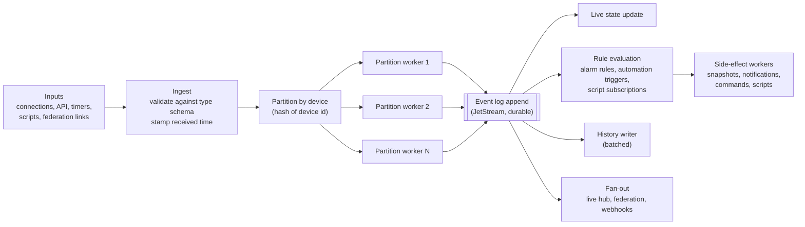

# Core Runtime — Service Host, Event Pipeline and Live State

## 1. The service

A Watchpoint node is a single .NET 10 application hosted with the .NET Generic Host:

| Platform | Hosting |
|---|---|
| Windows | Windows service (`UseWindowsService`), automatic start, recovery actions (restart on failure) |
| Linux | systemd unit (`UseSystemd`, `Type=notify`, watchdog), automatic start, `Restart=always` |
| Containers | Foreground process, health endpoints for liveness/readiness, graceful shutdown on SIGTERM |

There is no interactive server window. Everything an administrator needs is in the desktop
client (configuration side) or in the local command-line tool `wpctl` (status, logs,
backup, restore, reset admin password, export diagnostics) for emergencies.

### 1.1 Start-up sequence

1. Load local node settings (`watchpoint.json` + environment variables): node id, data
   folder, database connection, cluster seeds, ports, TLS certificates.
2. Open the secrets vault with the OS-protected master key.
3. Start supervised helper processes: NATS (or connect to the cluster), go2rtc.
4. Connect to PostgreSQL; apply pending **versioned migrations** (EF Core migrations,
   reviewed SQL, run under a cluster-wide migration lock; never ad-hoc DDL).
5. Verify the licence (see [Licensing](licensing.md)). Licence problems never prevent
   start-up; they change what is allowed.
6. Load the configuration version and the type catalogue; scan the packages folder.
7. Rebuild live state: load the latest state snapshot, replay the event log from the
   snapshot's sequence.
8. Join the cluster: announce roles, obtain leases (see [Redundancy](redundancy-and-multi-site.md)).
9. Start the API and the live hub. Report *ready*.
10. Start the connections assigned to this node; each resyncs with its server.

Readiness is reported only after step 9, so load balancers and clients never reach a node
that has stale state.

### 1.2 Module system inside the node

The core is organised in modules (not plugins — they ship with the product). Each module:

- registers its services, API endpoints, live-stream topics, permissions, event types,
  configuration entities, migrations and translations;
- depends only on the published interfaces of other modules (no reaching into their
  tables);
- can be enabled/disabled by licence (e.g. federation, scripting).

Modules: Identity, Rights, Configuration, Registry (servers/devices/locations/tags),
Integrations, Pipeline & State, Commands, Alarms, Automations, Scripting, Notifications,
History & Reports, Video, Licensing, Cluster, Federation, Audit, System health.

## 2. Event pipeline

Everything that happens enters the core through the pipeline: observations from
connections, operator actions, alarm transitions, command results, configuration
publications, system events.

### 2.1 Processing guarantees

| Guarantee | How |
|---|---|
| **Order per device** | All inputs for a device go to the same partition; a partition is processed sequentially |
| **Parallelism across devices** | N partitions (default = CPU cores × 2), each its own worker; in a cluster partitions are shared among nodes |
| **Durability before effects** | An input is appended to the event log (acknowledged by JetStream, replicated in a cluster) before state, alarms or clients see it |
| **At-least-once with idempotency** | Each observation has a unique id; consumers deduplicate, so replays after a crash produce no duplicates |
| **No hot-path side effects** | Snapshots, e-mails, scripts, HTTP calls run in side-effect workers with their own queues and timeouts; a slow mail server or script never delays alarm processing |

### 2.2 Normalisation and enrichment

- Values are validated and converted to the property's type and unit; invalid
  observations are rejected with a diagnostic event for the connection (not silently
  dropped).
- **Deduplication**: an unchanged property value only refreshes its timestamp (no history
  row, no push) unless the property's policy says otherwise.
- **Deadband and rate limiting** for analog values per property policy.
- **Enrichment**: location path, tags, device and server names, links (e.g. cameras
  viewing this door), so downstream consumers and history do not need joins and history
  stays readable after renames.
- **Time handling**: source time (from the vendor system, converted from the server's time
  zone to UTC) and received time are both kept. Clock drift between a server and the node
  beyond a threshold raises a *clock-drift* health fault.

### 2.3 Back-pressure and overload

The core must degrade gracefully, never "drop everything".

| Situation | Behaviour |
|---|---|
| A connection floods state changes | Per-connection ingest quota; above it, **state updates are coalesced** (keep only the latest value per property) while **events are never dropped** (they wait in the durable log). A *flooding* fault is raised on the connection |
| A partition falls behind | Bounded in-memory channel per partition; when full, ingest pauses that partition's producers (back-pressure to connectors) while the log keeps the data |
| History database slow | History writer lags behind the log (the log retains days of data); a *history lag* health warning appears; live operation is unaffected |
| A client is slow | Its live stream coalesces state updates per device and keeps all alarm/event messages; beyond a limit the client is asked to resync |
| Side-effect queue full | New side effects of low priority are deferred; alarm notifications have priority; queue lengths are visible in the health dashboard |

Every queue in the system is **bounded** and **measured**.

## 3. Live state store

### 3.1 Content

- Current value (with quality and timestamps) of every property of every device and server.
- Overall state of every device, aggregated states of locations, servers and tags
  (counts per state).
- Active alarms, pending commands, connection states, session presence.

### 3.2 Implementation

- In-memory, partitioned like the pipeline, using immutable records and lock-free reads so
  API queries never block processing.
- **Snapshots** written to PostgreSQL (`state` schema) every few seconds (configurable,
  default 5 s) and at shutdown, each tagged with the event-log sequence it reflects.
- **Recovery**: load snapshot, replay the log from its sequence. The log retains enough
  history (days) that recovery never depends on the snapshot interval: **no data is lost on
  a crash**, unlike periodic write-behind designs.
- **Aggregations** (location and tag counters) are maintained incrementally, not recomputed.

### 3.3 Queries

The store answers:

- get device(s) with properties;
- list by location/server/type/tag/state with paging and sorting;
- counts per state for any scope (for dashboards and trees);
- "what changed since sequence S" (used by clients to resync after reconnecting).

All queries pass through the rights evaluator, which turns a user's scopes into an
efficient filter (pre-computed sets of visible devices per user, updated on configuration
or rights changes).

## 4. Scheduler and calendars

- **Calendars** (configuration objects): weekly schedules with time ranges, exceptions
  (public holidays per country/site, special days), time zone of the site.
- Used by: rights (when a right applies), alarm rules (active hours, different priority at
  night), automations (time triggers), notifications (who is on duty), escalation.
- Holiday sets for each market can be imported (ICS) and edited.

## 5. Internal events catalogue (system events)

Besides device events, the core emits system events, all typed and translated:

| Family | Examples |
|---|---|
| Identity | user signed in, sign-in failed, account locked, password changed, MFA reset |
| Configuration | draft published, version rolled back, package installed, connection added |
| Cluster | node joined/left, leadership changed, connection moved, failover completed |
| Licence | licence installed, quota near limit, grace period started, maintenance expiring |
| System health | queue lag, history lag, disk space low, certificate expiring, helper process restarted |
| Operation | maintenance mode on/off, operator workstation locked, alarm handover |

System events can raise alarms through the same alarm rules as device events.

## 6. System health

The node exposes, and the desktop client shows in *System → Health*:

- nodes, roles, versions, uptime, CPU/RAM/disk, helper processes;
- connections and hosts with states and metrics;
- pipeline throughput (inputs/s per partition), queue lengths, log lag, history lag;
- database size and replication lag, NATS cluster state;
- licence usage vs quotas;
- certificate expiries;
- live sessions per client kind.

Metrics are also exported via OpenTelemetry/Prometheus for customers who run their own
monitoring. Health thresholds produce system events (and therefore alarms).
