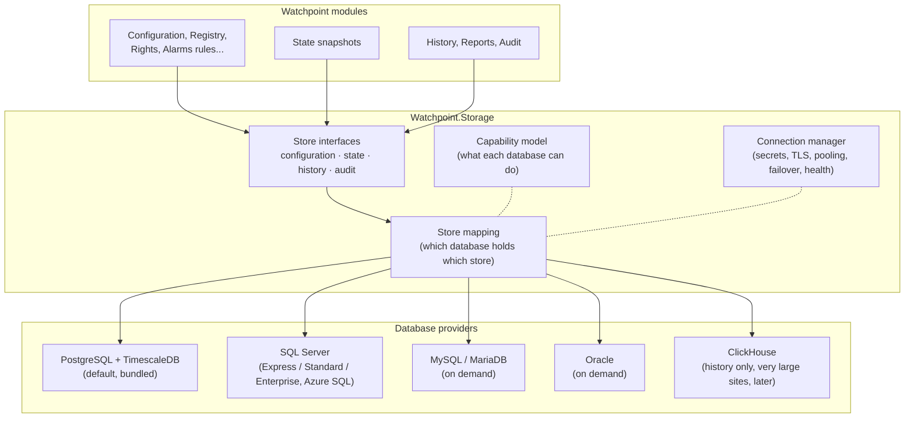

# Data Storage — Pluggable Database Providers

> Requirements: be compatible with the popular database servers customers already use (not
> only the one we prefer), through a database module that can evolve over time. Default
> to a free database with no size limits; support SQL Server, which is very common in the
> security market.

## 1. Approach

All database access goes through one module, **`Watchpoint.Storage`**. The rest of the
product never talks to a database directly: modules use **store interfaces**, and a
**database provider** implements them for one database technology.

Two things are deliberately **not** part of the database module, because they are not
databases a customer chooses:

- the **event log** (NATS JetStream), which Watchpoint ships and runs itself;
- the **file store** (plans, snapshots, packages), which is replicated by Watchpoint.

## 2. Stores

Watchpoint's data falls into four stores with very different needs. Each store can be
placed on a different database, even a different database technology.

| Store | Content | Access pattern | Needs |
|---|---|---|---|
| **Configuration** | Users, rights, servers, devices, locations, rules, synoptics, automations, scripts, versions | Small, relational, transactional; read mostly | Transactions, foreign keys, JSON columns |
| **State** | Snapshots of live state, active alarms, pending commands | Overwritten every few seconds | Fast upserts |
| **History** | Events, alarms, commands, property changes | Append-only, very large, queried by time | Bulk insert, time partitioning, compression, retention, aggregates |
| **Audit** | Audit trail (hash-chained) | Append-only, long retention | Bulk insert, immutability, separate retention |

**Store mapping** examples:

| Situation | Mapping |
|---|---|
| Standard installation | All four stores in the bundled PostgreSQL + TimescaleDB |
| Customer IT requires SQL Server | All four stores in the customer's SQL Server |
| Customer IT requires SQL Server but the site is large | Configuration, state and audit in the customer's SQL Server; history in a bundled PostgreSQL + TimescaleDB (no history size limits) |
| Very large site (later) | Configuration/state/audit in PostgreSQL or SQL Server; history in ClickHouse |

## 3. Supported databases — tiers

| Tier | Meaning | Databases |
|---|---|---|
| **Tier 1 — default** | Bundled by the installer, all features, tested on every build, recommended | **PostgreSQL 16+ with TimescaleDB** (self-hosted on Windows, Linux, containers) |
| **Tier 1 — managed PostgreSQL** | Same provider without TimescaleDB features (most cloud services don't offer them) | AWS RDS / Aurora PostgreSQL, Azure Database for PostgreSQL, Google Cloud SQL for PostgreSQL |
| **Tier 2 — supported** | Full support, tested on every release, delivered in phase 2 | **SQL Server 2019+** (Express, Standard, Enterprise; Windows and Linux), Azure SQL Database, Azure SQL Managed Instance |
| **Tier 3 — on demand** | Implemented when a customer project requires it; must pass the same certification suite before release | **MySQL 8.4+ / MariaDB 10.11+**, **Oracle 19c+** |
| **Tier 3 — history only (later)** | For very large history volumes | **ClickHouse** |
| **Not planned** | Doesn't fit Watchpoint's relational configuration and rights model | Document stores (MongoDB), key-value stores; SQLite only for automated tests and local buffering in remote integration hosts |

Adding a database later is a matter of writing a provider and passing the certification
suite (§7). No other module changes.

### 3.1 How each database covers Watchpoint's needs

| Need | PostgreSQL + TimescaleDB | PostgreSQL (managed cloud) | SQL Server | MySQL / MariaDB | Oracle |
|---|---|---|---|---|---|
| Time partitioning of history | Hypertables (automatic) | Native partitioning, managed by Watchpoint | Partitioned tables (all editions since 2016 SP1) | Native partitioning | Partitioning is a **paid option** of Enterprise Edition; otherwise Watchpoint uses table-per-period |
| History compression | Native compression (~90 %) | None (larger storage) | Columnstore indexes | Page compression (InnoDB) | Advanced Compression is a paid option |
| Aggregates for reports | Continuous aggregates | Aggregation jobs run by Watchpoint | Aggregation jobs run by Watchpoint | Aggregation jobs | Aggregation jobs |
| Bulk insert | Binary COPY | Binary COPY | SqlBulkCopy | Multi-row insert / LOAD DATA | Array binding |
| JSON columns | JSONB (indexed) | JSONB | JSON functions (native JSON type in 2025) | JSON type | JSON type |
| High availability | Patroni / pg_auto_failover (free) | Cloud provider HA | Always On availability groups (Basic AG in Standard, full in Enterprise), failover cluster instances | InnoDB Cluster / Galera | Data Guard / RAC (paid) |
| Size limits | None | None | Express: 10 GB per database (to confirm whether SQL Server 2025 raises it) and limited CPU/RAM | None | Free edition limited; paid editions none |
| Cost to the customer | Free | Cloud price | Express free; Standard/Enterprise paid | Free (community) | Paid (except limited Free edition) |

When a capability is missing, Watchpoint **compensates** (e.g. its own aggregation jobs,
its own partition management) or **warns** (e.g. size limits). The provider declares its
capabilities, and the product adapts.

## 4. The provider contract

A provider is a .NET assembly implementing:

| Part | Responsibility |
|---|---|
| **Capability declaration** | Partitioning, compression, JSON querying, bulk insert method, HA awareness, size limits, supported versions |
| **Configuration store** | EF Core model and versioned migrations for this database |
| **State store** | Fast upsert of snapshots, read for recovery |
| **History store** | Batched insert, time-range queries with filters and paging, retention (drop old partitions), aggregates (native or computed), archive export |
| **Audit store** | Append-only insert, hash-chain verification queries |
| **Schema management** | Create and upgrade schema; expand/contract migrations for rolling cluster upgrades |
| **Health and metrics** | Connectivity, replication lag (when visible), size and growth, slow queries, space left before limits |
| **Backup integration** | Native backup method or guidance (pg_dump/pgBackRest, SQL Server BACKUP, mysqldump…), used by Watchpoint's backup scheduler |

Technologies per provider (all free to use in a closed-source product):

| Provider | Data access libraries |
|---|---|
| PostgreSQL | Npgsql + Npgsql EF Core provider (PostgreSQL licence) |
| SQL Server | Microsoft.Data.SqlClient + EF Core SQL Server provider (MIT) |
| MySQL / MariaDB | Pomelo EF Core provider + MySqlConnector (MIT). Oracle's own MySQL connector is avoided (GPL licence) |
| Oracle | Oracle EF Core provider and ODP.NET managed driver (free Oracle licence) |
| ClickHouse | ClickHouse.Client (MIT) |

### 4.1 Rules that keep the code portable

- Modules use the store interfaces and EF Core LINQ; no database-specific SQL outside
  providers.
- Database-specific features (JSONB operators, hypertables, columnstore) live only inside
  the provider that offers them.
- Identifiers are UUIDs generated by Watchpoint (no reliance on database sequences).
- All timestamps are stored in UTC with explicit precision.
- Text is Unicode everywhere (Arabic and other scripts), with case-insensitive comparisons
  defined explicitly (collations differ between databases).

## 5. Connection management

| Feature | Detail |
|---|---|
| Settings | Server, port, database name per store; chosen in the setup wizard or *System → Storage* |
| Credentials | Stored in the secrets vault. SQL Server also supports Windows integrated authentication (Kerberos on Linux); cloud databases support managed identities where available |
| TLS | Required by default, with certificate validation or pinning |
| Pooling and limits | Connection pools sized per store; history queries run with time limits so reports cannot slow down live operation |
| Failover awareness | Multi-host connection strings (PostgreSQL), availability group listeners with fast failover (SQL Server), cluster routers (MySQL); automatic reconnection with retries |
| Read replicas | Reports and history queries can use a read replica when the database offers one |
| Health | Shown in *System → Health*; alerts on disconnection, replication lag, low space, and approaching edition limits (e.g. SQL Server Express) |

## 6. Moving between databases

Customers can change databases later, e.g. start on the bundled PostgreSQL and move to the
corporate SQL Server, or move history out of SQL Server Express when it fills up.

- **`wpctl storage migrate`** (and a wizard in *System → Storage*) copies a store from one
  provider to another in a neutral format, verifies row counts and checksums, then switches
  the store mapping.
- History can be migrated in the background while the site keeps running: new history goes
  to the new database immediately, and old history is copied progressively.
- The migration is recorded in the audit trail.

## 7. Provider certification suite

Every provider must pass the same automated suite before it is released or updated:

- schema creation and every migration from the oldest supported Watchpoint version;
- functional tests of all four stores (Testcontainers runs each database in CI);
- concurrency tests (parallel publishers, alarm transitions);
- history volume and query performance tests against published targets;
- failover tests where the database offers HA;
- Unicode, time zone and collation tests;
- backup and restore tests.

Tier 1 and tier 2 providers run the suite on every build; tier 3 providers on every
release.

## 8. In the setup wizard and the client

- **Setup wizard**, *Database* step: *Use the bundled database (recommended)* or *Connect to
  an existing database server* → choose type (PostgreSQL, SQL Server…), connection details,
  test, capability report ("SQL Server Express detected: history limited to about N months
  with your expected volume — consider placing history in the bundled database").
- **System → Storage** (configuration side): store mapping, connection health, sizes and
  growth forecast, retention per store, migration wizard.
