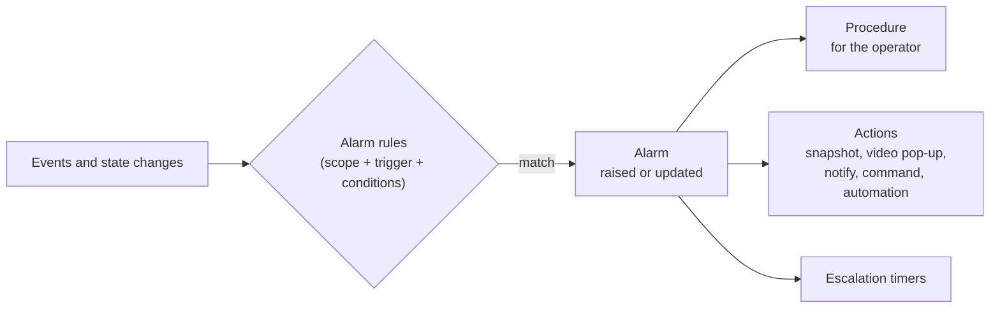
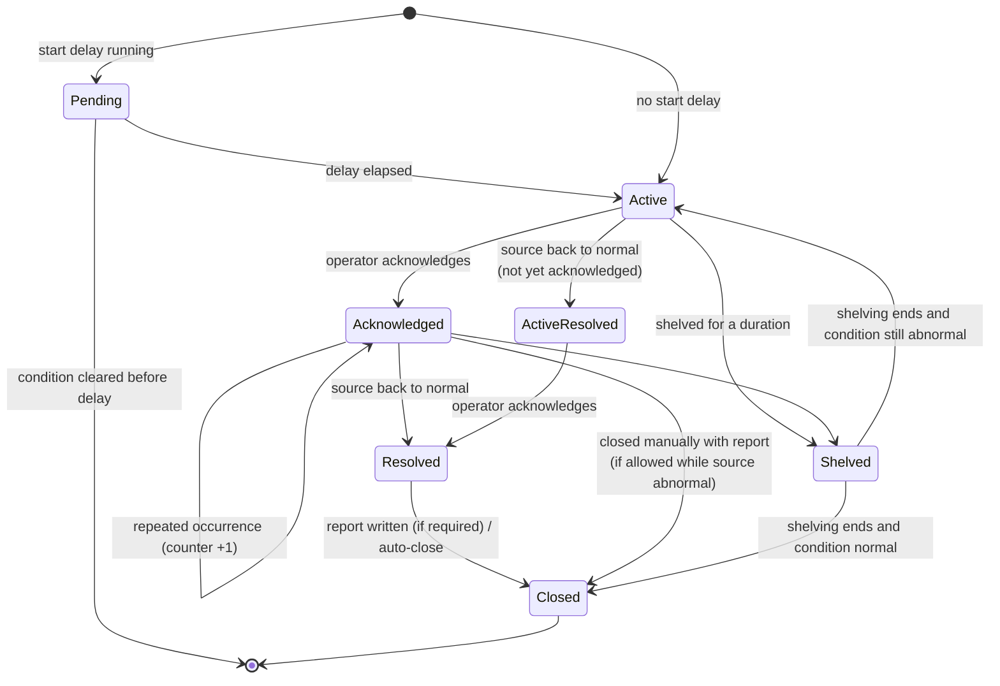

# Events and Alarms

## 1. Events

An **event** is an immutable fact: something happened at a time, somewhere.

| Field | Meaning |
|---|---|
| `id` | UUID |
| `type` | Capability event (`accessEvents.denied`), health event (`health.wentOffline`), system event (`identity.signInFailed`), user event (`operator.note`) |
| `source` | Device or server (with names, location path and tags copied at the time — *snapshot*) or system component |
| `sourceTime`, `receivedTime` | See [Core runtime](core-runtime.md) |
| `severity` | Semantic: info, notice, warning, alarm, critical |
| `payload` | Typed per event type (credential, cardholder display name, reason, plate, image reference…) |
| `origin` | Connection, user + session, script, automation |
| `correlation` | Command id, alarm id, parent event |
| `personalData` | Flags which payload fields are personal data |

Events are stored in `history.events` and visible in the **event journal** (live and
history), filterable by time, type, location, server, device, tag, severity, person.

### 1.1 Operator events

Operators can add events: notes in the journal ("Guard checked the car park"), photos,
shift handover reports. They are stored and searchable like any other event.

## 2. Alarms — concepts

An **alarm** is a situation requiring human attention. Alarms are created by **alarm
rules** that watch events and states. Separating rules from devices gives flexibility:
several rules per device, rules applying to many devices at once, different behaviour by
time of day, and no limit on thresholds.

## 3. Alarm rules

| Field | Meaning |
|---|---|
| `name`, `description` | Translatable |
| `scope` | Which sources: one device; device types; locations (with sub-locations); servers; tags; or system components. Combinations with AND/OR |
| `trigger` | **Event-based** (event types, optionally with payload conditions), **state-based** (a property enters a value/range, with hysteresis for analog), **health-based** (offline, fault codes), **composite** (sequence or combination within a time window — e.g. "door forced and no access granted in the previous 10 s", "3 denied badges on the same reader within 1 min"), **expression** (CEL expression on properties) |
| `conditions` | Additional CEL conditions, calendar (active only nights/weekends), system mode (e.g. only when the site is armed) |
| `priority` | 1–1000, displayed via named bands; can depend on calendar (higher priority at night) |
| `delays` | Start delay (condition must persist N s before raising — avoids flicker), end delay (condition must be normal N s before resolving) |
| `lifecycle policy` | Acknowledge required? Report (closing comment) required? Auto-close when resolved and acknowledged? Re-raise behaviour (new alarm vs counter increment on repetition)? |
| `procedure` | Steps the operator follows (see §6) |
| `actions` | On raise/acknowledge/resolve/close: snapshot from linked cameras, open linked video on operator screens, show plan, send notifications, run an automation or script, send commands (e.g. turn on lights), create a bookmark in the VMS |
| `escalation` | Time-based rules (see §7) |
| `audience` | Which operators see it (in addition to rights): user groups, workstations, sites; handover schedules (see §8) |
| `display` | Sound (per priority by default), colour override, pop-up behaviour |
| `enabled`, `version` | Rules are versioned configuration objects |

### 3.1 Default rules

Each device type ships default alarm rules (in its package) — e.g. "door forced → High",
"door held open > 60 s → Medium", "zone alarm while area armed → Critical", "fire alarm
→ Critical", "device offline > 2 min → Medium". When a device is added, these become
active **without configuration**. Sites can change, disable or override them at any level
(per type globally, per location, per device).

### 3.2 Evaluation

- Rules are compiled at publish time into an index by event type, property and scope, so
  each incoming event is checked only against rules that can match (no linear scan of all
  rules).
- Expression conditions use CEL with a cost limit; an invalid expression cannot be
  published (validated in the editor, explained in plain language).
- Composite rules keep small per-rule windows in memory, rebuilt from the event log after a
  restart.

## 4. Alarm lifecycle

| State | Meaning |
|---|---|
| **Pending** | Condition met, start delay running (visible only in diagnostics) |
| **Active** | Raised; waiting for an operator |
| **Acknowledged** | An operator has taken it (owner = that operator); others see who is handling it |
| **Active-resolved** | Source returned to normal before anyone acknowledged — still needs acknowledgement (nobody may miss it) |
| **Resolved** | Acknowledged and source normal; waiting for report/close |
| **Shelved** | Temporarily silenced (with mandatory reason and maximum duration per right); reappears automatically |
| **Closed** | Finished; moved to history |

Additional operations:

- **Assign / transfer** to another operator or group (with a message).
- **Take ownership** of an alarm acknowledged by someone who left.
- **Comment** at any time; comments, procedure answers and attachments form the alarm's
  **timeline**.
- **Link** alarms together (manual or by rule) into an **incident** for a bigger situation;
  closing the incident can close the children.
- **Repeated occurrences** increment a counter (with first/last time) instead of flooding
  the console, unless the rule says each occurrence is a new alarm.

Every transition records user, time, workstation and client kind, and is concurrency-safe:
alarm transitions are processed in the alarm's partition, so two operators acknowledging
at the same time get a clear "already acknowledged by X" result.

## 5. Alarm console (all clients)

- Virtualised list sorted by priority then time; colour band and icon per priority band;
  counters per state.
- Columns configurable per workspace (priority, time, source, location, state, owner,
  counter, custom fields).
- Filters: priority range, state, location, type, "mine", "unassigned", site (federation).
- Actions: acknowledge (one, selection, or "next most urgent"), open details, show on
  plan, show video, comment, transfer, shelve, close.
- Sounds per priority band (looping for critical until acknowledged, configurable); visual
  flashing; OS notification when the client is in the background.
- **Details view**: summary, live state of the source, procedure, linked cameras (live and
  "replay from 10 s before the alarm"), snapshot gallery, plan centred on the device,
  timeline, contacts (from the location), actions.

## 6. Alarm procedures

Procedures guide operators step by step and document what they did.

| Step kind | Example |
|---|---|
| Instruction | "Check the camera of the main entrance." |
| Checklist item | "☐ Guard dispatched" |
| Question with choices | "Was the intrusion confirmed? Yes / No / Unknown" — answers can branch |
| Input | Text, number, choice list, photo |
| Call | Shows a contact (from location contacts or a directory) with call button (intercom/SIP or phone number) |
| Action button | Runs a predefined command or automation ("Lock down floor 1") with rights checks |
| Wait | "Wait for the guard's report" with timer |

- Mandatory steps must be completed before closing.
- Procedures are versioned; the alarm stores the version used.
- Procedures can be shared by many rules and translated.
- Editor: visual list/flow editor in the desktop client, no code.

## 7. Escalation

Escalation rules on an alarm rule, evaluated on timers:

| Trigger | Action |
|---|---|
| Not acknowledged within T | Raise priority, notify supervisor group, play louder sound, push notification to mobile on-call |
| Acknowledged but not resolved within T | Notify owner and supervisor |
| Not closed within T | Add to shift report, notify manager |
| Repeated N times in T | Raise priority, create incident |

Escalations are recorded in the alarm timeline.

## 8. Alarm audience and handover

- **Audience**: an alarm is visible to operators whose rights include its source scope and
  priority range, *and* who are in the rule's audience (if defined).
- **Handover schedules** (multi-site): e.g. alarms of site A are handled locally 08:00–18:00
  and by the central monitoring room outside those hours. If the local site does not
  acknowledge within T, the central site takes over automatically. Ownership changes are
  recorded.
- **Workstation targeting**: some alarms pop up only on specific workstations (e.g.
  reception desk).

## 9. Notifications from alarms

Alarm actions can notify people outside the clients — e-mail, SMS, mobile push, webhooks —
with templates and quotas. See [Notifications](notifications.md).

## 10. Storage

| Table | Content |
|---|---|
| `state.active_alarms` (snapshot) | Current active alarms |
| `history.alarms` | One row per alarm with final state, all lifecycle timestamps, priority (initial, final), source snapshot, owner, counter |
| `history.alarm_timeline` | Every transition, comment, procedure answer, escalation, action result |

Statistics derived for reports: alarms per location/type/priority, time to acknowledge,
time to close, top 10 noisy devices, false-alarm ratio (from procedure answers),
operator workload.
