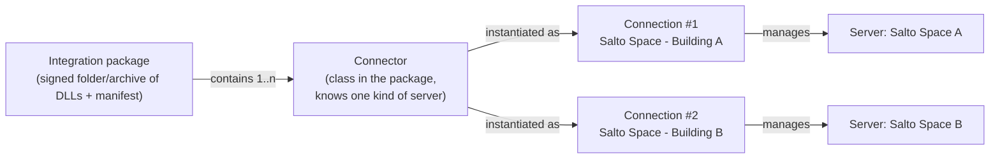
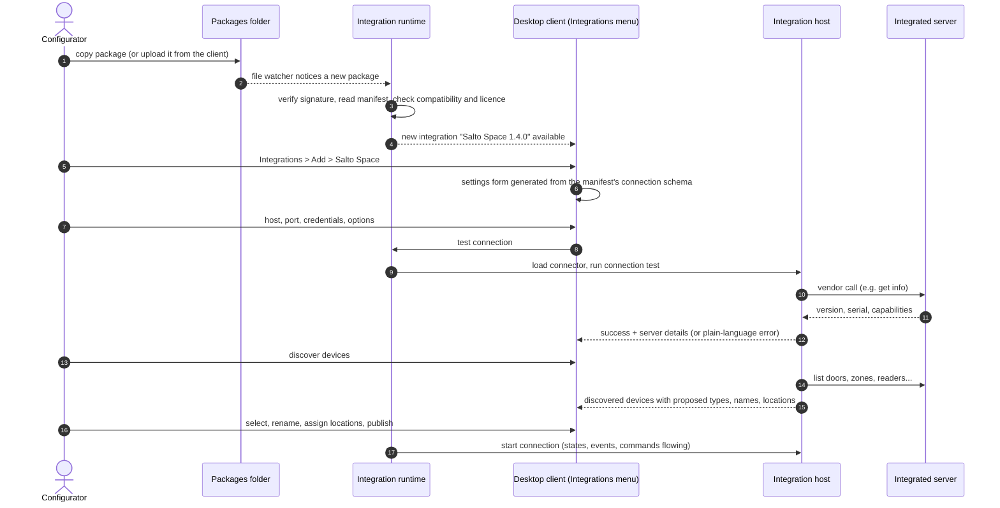
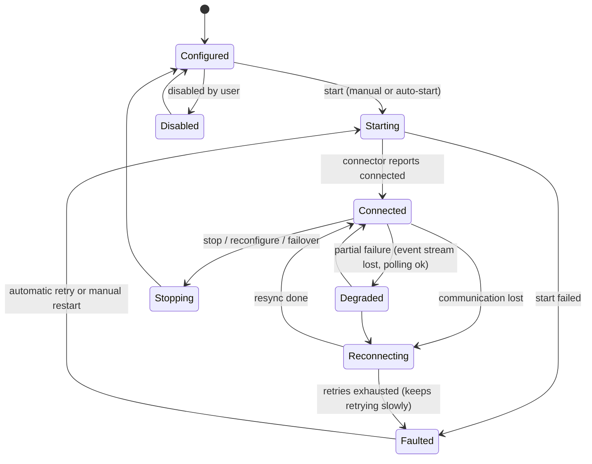

# Integrations — Packages, Connectors and Connections

> Requirement: integrations are not separate programs talking to Watchpoint over HTTP.
> They are modules inside Watchpoint. The user drops the DLLs of an integration into a
> folder; Watchpoint detects them, offers the integration in the *Integrations* menu, and
> each configured instance talks to one integrated server (or one part of it). The design
> must make any kind of server easy to integrate.

## 1. Concepts



| Concept | What it is | Example |
|---|---|---|
| **Integration package** | A signed unit of delivery: connector DLLs, vendor SDK DLLs, native libraries, manifest, device type definitions, translations, symbols, default rules, documentation | `Watchpoint.Integration.Salto 1.4.0` |
| **Connector** | A class implementing the Watchpoint integration contract for one kind of server | `SaltoSpaceConnector` (server type `salto.space`) |
| **Connection** | A configured, running instance of a connector, bound to one server, with its own settings, secrets, health and logs | "Salto — Building A" at `10.0.1.20` |
| **Integration host** | The process where connections run: the node itself, an isolated worker on the same machine, or a remote host on another machine | "in-process", "isolated", "remote: WIN-GW-01" |
| **Integration runtime** | The part of the node that finds packages, validates them, hosts connections and provides them with common services | — |

A package may contain several connectors (e.g. a Milestone package with one connector for
XProtect management servers and one for standalone Milestone Husky recorders). A connector
may handle a whole tree of servers (management server + recording servers).

## 2. From DLLs in a folder to a running connection



### 2.1 The packages folder

| Platform | Default location |
|---|---|
| Windows | `C:\ProgramData\Watchpoint\integrations\` |
| Linux | `/var/lib/watchpoint/integrations/` |
| Container | volume mounted at `/var/lib/watchpoint/integrations/` |

- Each package is either a **`.wpkg`** archive (a zip with a fixed layout) or an unpacked
  folder of the same layout. The runtime unpacks archives into a versioned cache
  (`integrations/.cache/<package-id>/<version>/`) so several versions can coexist during an
  upgrade.
- In a cluster, the folder is **replicated**: a package uploaded to one node (or through the
  client) is distributed to all nodes and remote hosts by the runtime, so the user installs
  once.
- Packages can also be **uploaded from the desktop client** (*Configuration → Integrations
  → Install package*) for users with the right, which avoids file access to the server.

### 2.2 Package layout

```
watchpoint.integration.salto-1.4.0.wpkg
├── manifest.json            ← identity, compatibility, connectors, schemas (see §3)
├── signature.sig            ← signature of the manifest + file hashes (see §8)
├── lib/
│   ├── Watchpoint.Integration.Salto.dll   ← connector code
│   ├── Salto.Ship.Client.dll              ← own protocol library
│   └── (managed dependencies)
├── native/
│   ├── win-x64/...          ← native vendor SDK libraries per platform, if any
│   └── linux-x64/...
├── types/                   ← device type and capability documents added by the package
├── rules/                   ← default alarm rules, automations templates
├── symbols/                 ← SVG symbols for synoptics, one per state
├── i18n/                    ← en.json, fr.json, ar.json…
├── docs/                    ← user guide shown in the client (Markdown)
└── assets/                  ← icon, vendor logo
```

### 2.3 How "new DLLs" become "new integrations"

The user requirement was: *whenever new DLLs bring methods to talk to a system or protocol,
Watchpoint should use them and propose the integration*. To do this **safely and
predictably**:

1. **The manifest is the entry point, not reflection over arbitrary DLLs.** Scanning every
   DLL for classes would execute untrusted code just to list integrations, would be slow,
   and would make "what is installed" ambiguous. The manifest declares which connectors
   exist, their server types and settings, so the runtime can list them **without loading
   any code**.
2. Connector classes are still discovered in code to **double-check** the manifest: when
   the package is first activated, the runtime loads it in an isolated, collectible load
   context and verifies each declared connector class exists and implements the contract
   version it claims. Mismatches mark the package as invalid with a clear message.
3. **Adding a protocol library alone** (e.g. a generic BACnet DLL) is done by a package too:
   the generic protocol integrations (Modbus, BACnet, OPC UA, MQTT, SNMP) are themselves
   packages whose connectors expose user-mappable points (see §10).
4. Once validated, a package appears in *Integrations → Available*, with its icon, vendor,
   version, supported server versions, licence status (licensed / not licensed / trial) and
   its documentation.

## 3. The manifest

The manifest is a JSON document validated against a published JSON Schema. Main sections:

| Section | Content |
|---|---|
| `id`, `version`, `displayName`, `vendor`, `category` | Identity (`watchpoint.integration.salto`, `1.4.0`, "Salto Space", "Salto Systems", access control) |
| `contract` | Integration contract version required (`2.x`) and minimum Watchpoint version |
| `platforms` | Supported OS/architectures (`win-x64`, `linux-x64`, `linux-arm64`); whether native code is present |
| `isolation` | `in-process-allowed`, `isolated-recommended`, `isolated-required` (mandatory when native vendor SDKs are present, or when the SDK is known to be unstable) |
| `licence` | Licence feature key (`int.salto`), licence class (standard, advanced) |
| `connectors[]` | For each connector: class name, `serverType`, display name, supported vendor versions, settings schema, secrets schema, capabilities declared (see §4), discovery support, default polling intervals |
| `serverTypes[]` | Server types created by the connectors (with their capabilities: e.g. *synchronise clock*) |
| `deviceTypes[]` | References to standard types used + new types defined in `types/` |
| `settingsUi` | Optional layout hints for the generated settings form (sections, order, help texts, advanced fields) |
| `wizard` | Optional guided steps (e.g. "1. connection, 2. event source, 3. discovery") |
| `limits` | Recommended maximums (devices per connection, commands per second) used for warnings |
| `privacy` | Personal data the integration may bring (cardholder names, photos, plates) |

### 3.1 Settings and secrets schemas

Connection settings are **typed** (JSON Schema): host, port, TLS on/off, polling periods,
event source (polling / push / webhook), language of the vendor system, time zone of the
panel, etc. Secrets (passwords, API keys, certificates) are declared separately and stored
in the [secrets vault](../operations/security.md#secrets-vault), never in the connection
settings, never in logs, never on command lines.

The desktop client generates the settings form from the schema: field types, validation,
dependencies ("show port only if mode = TCP"), defaults, help texts in the user's language.

## 4. The connector contract

The contract is a set of .NET interfaces published in `Watchpoint.Integration.Abstractions`
(a small, stable, versioned assembly). A connector implements the **base contract** and the
**optional features** it supports. The runtime discovers features by interface, and the
manifest declares them so the UI knows in advance.

### 4.1 Base contract (every connector)

| Responsibility | Description |
|---|---|
| **Initialise** | Receives its settings, a secrets accessor, and the *connector context* (services below). Validates settings; returns plain-language errors |
| **Test** | Performs a short connectivity test and returns server identity (model, version, serial) or a categorised error (unreachable, authentication failed, incompatible version, licence of the vendor missing, TLS problem) |
| **Start / Stop** | Opens/closes communication. Must be cancellable and stop within a declared time |
| **Report health** | Pushes the connection's and servers' health (connected, degraded, disconnected, with reason) through the context — one standard way, replacing ad-hoc "comm" variables |
| **Describe** | Returns the server tree and the device inventory it currently manages (native ids, types, names, attributes, links) |

### 4.2 Optional features

| Feature | Purpose | Examples |
|---|---|---|
| **Discovery** | Browse the integrated server and propose servers/devices to import, with suggested types, names and links | List doors and readers; list cameras with their streams |
| **Live observation** | Deliver property changes and events through the context sink. The connector chooses how (polling, push subscription, webhook, event stream) | Door status, zone states, access events |
| **State refresh** | Re-read the full state on demand (after reconnection, on operator "refresh") | Read all door statuses |
| **Command execution** | Execute typed commands and return a typed result | Open door, arm area, go to preset |
| **Event history catch-up** | Fetch events that happened while disconnected, from a persisted cursor | Read audit trail from last id |
| **Video provider** | Provide stream sources (RTSP URL with short-lived credentials, or a frame/packet feed) for live and playback, plus export jobs | Milestone, NVRs, cameras |
| **Time synchronisation** | Read/set the server clock; report drift | Intrusion panels |
| **Lookup** | Read-only queries to the integrated system to enrich events or for operators (cardholder details and photo by id, plate list membership) | Show cardholder photo next to an access event |
| **Configuration push** | Write limited configuration to the integrated system when explicitly part of the integration's purpose (e.g. door names) | Rarely used; Watchpoint is not an access control system |
| **Diagnostics** | Expose integration-specific diagnostic data and actions (re-sync, clear cache, protocol trace on for 10 min) | Shown in the connection's *Diagnostics* tab |

### 4.3 The connector context — what Watchpoint gives every connector

To keep connectors small and consistent, the runtime provides common services. A
connector only writes the vendor-specific mapping.

| Service | What it does |
|---|---|
| **Observation sink** | `report property`, `report event`, `report health`, `report inventory change`. Batches, timestamps, sequence numbers and back-pressure are handled by the runtime |
| **Device map** | Resolves native id ↔ Watchpoint device id and gives each device's type, attributes and settings |
| **Command queue** | Delivers commands to the connector **by priority** (critical commands first, then normal, then background polls/discovery), with per-connection concurrency limits, timeouts and cancellation |
| **Scheduler** | Polling loops with jitter, back-off on errors, pause when disconnected; one place to configure intervals |
| **Resilience helpers** | Retry policies with exponential back-off, circuit breaker, rate limiter, request timeouts (built on Polly) |
| **Persistent store** | Small key/value store per connection (e.g. last audit-trail id, event-stream cursor), replicated in the cluster so failover continues where it stopped |
| **Secrets accessor** | Read secrets declared in the manifest; never exposed to logs |
| **HTTP/TCP/TLS helpers** | Pre-configured clients that honour the connection's TLS policy (certificate pinning, custom CA), proxies and timeouts; certificate errors are never silently ignored |
| **Inbound endpoints** | Request an inbound HTTP route (webhooks) or TCP listener; the runtime hosts it with authentication, TLS and the right firewall guidance |
| **Logger** | Structured logging scoped to the connection, with automatic redaction of declared secret fields; protocol trace mode with time limit |
| **Metrics** | Counters and timings (requests, errors, latency, queue length) exported to the health dashboard and OpenTelemetry |
| **Clock** | Server-time conversion helpers (panel local time → UTC) |
| **Localisation** | Access to translation keys of the package for messages shown to users |

### 4.4 Rules connectors must respect (checked in review and tests)

- Never block: all I/O is asynchronous and cancellable.
- Report health through the context only; never invent extra "communication" devices.
- Commands always return a result (success, failure with a categorised reason and a
  user-readable message key, or "not supported").
- Never log secrets or personal data beyond what the privacy section declares.
- Never ignore TLS errors; expose pinning/custom CA as settings instead.
- Escape and validate everything sent to the vendor system.
- Use logical vendor identifiers as native ids, never descriptions or names.
- Support several connections of the same connector in the same host (no static state).
- Bounded loops: every "read until done" loop has a page limit and a delay on empty pages.

## 5. Connection lifecycle and states



- **Reconnection** always ends with a **resync**: full state refresh + event catch-up from
  the persisted cursor, so the live state is correct after any outage. Devices are marked
  *stale* (grey) while their state is unknown — never shown with an old value as if it
  were current.
- **Health alarms**: connection faulted, server offline, device offline are standard events
  with default alarm rules, configurable like any other.
- **Restart policy**: the runtime restarts a crashed or hung connection (watchdog on
  heartbeats and command queue progress) with back-off, and raises a fault after repeated
  failures.
- **Reconfiguration**: publishing new settings restarts only that connection; the runtime
  keeps commands queued during the restart (or fails them clearly if they expire).

## 6. Integration hosts and isolation

Running integrations inside Watchpoint (instead of separate programs) is simpler for users,
but a faulty integration — especially native vendor SDKs — could crash or freeze the node.
Watchpoint therefore supports three hosting modes **with the same connector code**:

| Mode | How | When |
|---|---|---|
| **In-process** | Connector loaded in its own `AssemblyLoadContext` inside the node | Pure .NET connectors written by the Watchpoint team, tested and signed. Lowest latency and resource use |
| **Isolated (local)** | The node starts a `watchpoint-integration-host` worker process; connectors run there; the node talks to it by gRPC over a named pipe / Unix socket | Packages with native SDKs, packages declared `isolated-required`, or any connection a user chooses to isolate. A crash kills only that host, which is restarted |
| **Remote** | An integration host installed on another machine connects **outbound** to the cluster over mTLS gRPC | Vendor SDK that only runs on Windows while the cluster is Linux; integrated system on an isolated network; distant site with poor WAN (host buffers events) |

Details:

- **Dependency isolation**: each package version gets its own load context, so two
  packages can use different versions of the same library.
- **Grouping**: several connections can share one isolated host (per package by default),
  or each can have its own host for maximum isolation (configurable).
- **Resource limits** for isolated hosts: memory limit and CPU priority (Job Objects on
  Windows, cgroups on Linux); runaway hosts are restarted.
- **Architecture mismatch**: if a vendor SDK is x86-only, the package ships an x86 host
  build and runs isolated.
- **Remote host installation**: a small installer (MSI/.deb) and a one-time **pairing
  code** generated in the desktop client; the host then appears in *Integrations → Hosts*
  with its health. All packages are pushed to it automatically.
- **Failover**: in a cluster, connections assigned to a failed node or host are restarted
  elsewhere (see [Redundancy](redundancy-and-multi-site.md)). Connections pinned to a
  remote host can have a backup host.

## 7. Upgrades of packages

1. A new version is installed next to the old one (versioned cache).
2. *Integrations → Updates* shows which connections use the old version and the release
   notes.
3. The user upgrades one connection first (canary) or all at once. The runtime stops the
   connection, migrates its settings (manifest declares settings migrations), starts it on
   the new version, and runs a health check.
4. If health fails within a window, it **rolls back** automatically to the previous version.
5. Old versions are removed once no connection uses them.

Device type changes in a package follow the versioning rules in
[Servers and devices §6.5](servers-and-devices.md#65-extending-the-model).

## 8. Trust: signing and licensing of packages

- Every package is **signed** by the Watchpoint release key (Ed25519 over the manifest,
  which contains SHA-256 hashes of every file). The runtime refuses unsigned or tampered
  packages. This protects sites against modified DLLs even though only the Watchpoint team
  writes integrations.
- Development mode (for the team only) allows unsigned packages on machines with a
  developer licence, clearly flagged in every client.
- A package is usable if the site licence includes its feature key (see
  [Licensing](licensing.md)). Unlicensed packages appear as *available — not licensed*,
  with a trial option where allowed.

## 9. Integrations menu (desktop client, configuration side)

| Screen | Content |
|---|---|
| **Available** | Installed packages: name, vendor, version, category, licence status, supported versions, documentation, "Add server" button |
| **Connections** | All connections: status (with colours of the health model), host, server, number of devices, events/s, command latency, last error; start/stop/restart; filter by category, status, host |
| **Connection details** | Tabs: *Settings* (generated form), *Servers and devices* (tree, discovery, orphaned devices review), *Health* (timeline, metrics), *Diagnostics* (connector-specific actions, protocol trace for N minutes), *Logs* (filtered, redacted), *History of changes* |
| **Hosts** | Node, isolated and remote hosts: state, version, CPU/memory, connections on each; pairing of remote hosts |
| **Updates** | Packages with newer versions, connections affected, upgrade/rollback |
| **Install package** | Upload a `.wpkg`, see verification result |

## 10. Generic protocol integrations

Some systems are not "products" but protocols. Watchpoint ships generic packages whose
connections expose **user-defined points** mapped onto generic device types:

| Package | Server | Mapping |
|---|---|---|
| Modbus TCP | Modbus device/gateway | Registers/coils → generic binary/analog/multistate devices, with scaling, byte order, polling groups |
| BACnet/IP | BACnet device | Objects (AI, AO, BI, BO, MSV…) discovered via Who-Is/Read-Property-Multiple; COV subscriptions |
| OPC UA | OPC UA server | Browse the address space; subscriptions with monitored items; methods as commands |
| MQTT | MQTT broker | Topics with JSON paths → properties; publish templates → commands |
| SNMP | SNMP agents | OIDs polled; traps received as events; MIB import |
| Ping/HTTP check | Hosts and URLs | Reachability, latency, HTTP status |

Mapping templates (e.g. "Socomec UPS over Modbus") can be saved and reused, turning a
generic mapping into a reusable device definition without writing code.

## 11. Developing a connector (for the Watchpoint team)

- **Template project** with the abstractions package, a sample manifest, and a test
  harness.
- **Simulator first**: every integration ships with a simulator of the vendor protocol
  (recorded traffic or a fake server) used in automated tests and demos.
- **Conformance test suite**: a shared suite every connector must pass — start/stop
  behaviour, reconnection and resync, command results and timeouts, back-pressure,
  multi-instance, secret redaction, cancellation, no unbounded loops.
- **Release checklist**: manifest review, device type review, translations (en, fr, ar),
  symbols, default alarm rules, user documentation, signing.

## 12. Why not separate driver programs, and what we keep from that idea

| Concern with separate executables | Answer in Watchpoint |
|---|---|
| Hard to install and manage for users | Packages are installed once in the client/folder, distributed automatically |
| Command lines leak passwords; HTTP between processes | Secrets vault; gRPC over local pipes or mTLS |
| No typed contract | Typed .NET contract, versioned, with conformance tests |
| Crash isolation (the good part of separate executables) | Kept through **isolated** and **remote** hosts, chosen per package/connection |
| Can run near the device on another machine (good part) | Kept through **remote hosts** |
