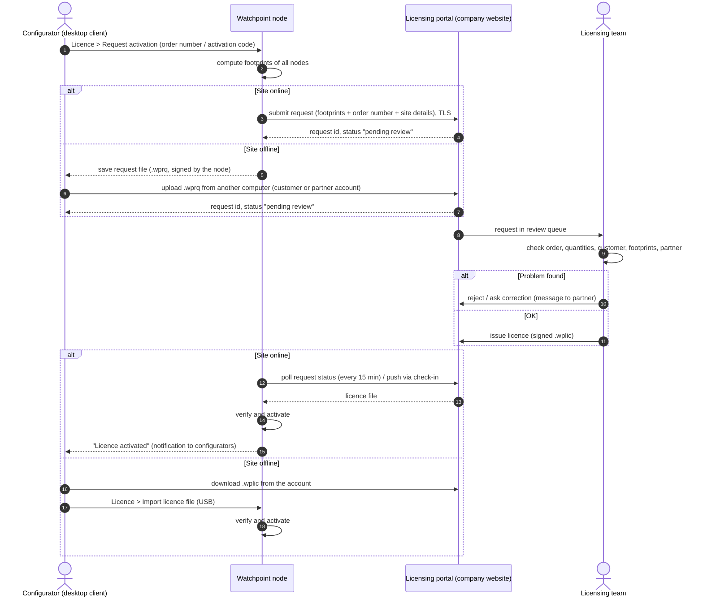

# Licensing

> Requirements:
> - Licences are bound to the machine through a **footprint**, as is customary in this
>   market.
> - Activation works **online and offline** from the configuration side of the desktop
>   client.
> - Issuing is **never automatic**: the company's licensing team reviews every activation
>   request, then issues the licence, which the customer downloads from their account, or
>   which is downloaded and activated automatically on online sites.
> - Three sales models: **perpetual + yearly maintenance**, **subscription**, and
>   **customer-hosted cloud** (customers run Watchpoint on their own cloud).
> - The integration model (packages) must be reflected in what is licensed.

## 1. What is licensed

| Licensed item | Unit | Notes |
|---|---|---|
| **Edition** | Per site (cluster) | Essentials, Professional, Enterprise — sets limits and available modules |
| **Device units** | Per unit | Each device type has a licence class: **full** = 1 unit (door, camera, intrusion area, fire zone, intercom station, BMS equipment), **light** = 0.1 unit (zone/detector, input, output, sensor point, reader that is not a door), **free** = 0 (sub-components and health-only devices, servers themselves) |
| **Integration packages** | Per package, per site | Feature keys (`int.salto`, `int.milestone`, `int.spc`…). Two price classes: *standard* and *advanced* (VMS and complex integrations). Generic protocol packages (Modbus, MQTT, SNMP, ping) are included in every edition |
| **Client seats** | Concurrent sessions | Desktop seats (operation and/or configuration), web seats; **mobile** licensed per named user |
| **Nodes** | Per additional node | Redundancy (standby) node and scale-out nodes |
| **Options** | Per site | Federation (central and per linked site), scripting, advanced reports, remote integration hosts beyond N |

Why device units: customers understand "how many doors and cameras", integrators can
quote quickly, and the light class avoids penalising sites with thousands of detectors and
inputs (common in intrusion, fire and BMS). Free sub-components avoid counting a door's
reader, lock and sensor separately.

Disabled devices and devices in *orphaned* state do not consume units.

## 2. Editions

| | **Essentials** | **Professional** | **Enterprise** |
|---|---|---|---|
| Target | Small sites, single building | Medium/large sites | Large sites, critical infrastructure, multi-site groups |
| Max device units | 250 | 5,000 | Unlimited |
| Nodes | 1 | Up to 2 (redundancy option) | Unlimited (redundancy, scale-out) |
| Included seats | 2 desktop, 2 web | 5 desktop, 5 web | 10 desktop, 10 web |
| Included integrations | 2 standard | 5 (standard or advanced) | 10 |
| Alarms, procedures, synoptics, automations | ✓ | ✓ | ✓ |
| Scripting | — | ✓ | ✓ |
| Redundancy | — | Option | Option (included N+1 for scale-out) |
| Federation | Can be a **child** site | Child site; central option | Central and child |
| Remote integration hosts | 1 | 5 | Unlimited |
| Reports | Standard | Standard + scheduled | All + custom templates |

An edition upgrade is a licence re-issue on the same footprint (no reinstall).

## 3. Indicative price list (to validate with a market study)

Prices are list prices in **USD**, with an **EUR** list at parity rounded per market (EUR
list ≈ USD × 0.92, rounded). Partners (distributors, integrators) get discounts by tier
(typically 25–45 %), which also absorbs regional price levels (North Africa, Middle East,
Asia). These figures are positioned against the PSIM and unified-platform market, where
door/camera licences commonly sit in the USD 100–300 range for VMS/ACS platforms and PSIM
projects are often priced per project; they are a starting point, not a final policy.

### 3.1 Perpetual licences

| Item | Essentials | Professional | Enterprise |
|---|---|---|---|
| Base (per site, includes 1 node) | $2,500 | $9,000 | $24,000 |
| Device unit (full = 1 unit) — volume tiers | $45 | $40 (1–1,000) · $32 (1,001–5,000) | $35 (1–1,000) · $28 (1,001–10,000) · $20 (> 10,000) |
| Standard integration package | $900 | $1,500 | $1,500 |
| Advanced integration package (VMS, etc.) | $1,800 | $3,000 | $3,000 |
| Additional desktop seat | $700 | $700 | $600 |
| Additional web seat | $350 | $350 | $300 |
| Mobile user (perpetual) | $90 | $90 | $75 |
| Redundancy node | — | 50 % of base | 40 % of base |
| Scale-out node | — | — | $6,000 |
| Federation central | — | $12,000 | $12,000 |
| Federation link (per child site) | — | $1,200 | $1,000 |

### 3.2 Yearly maintenance (perpetual model)

- **SUP — Software Update Plan**: **18 %** of the licence list value per year, first year
  included in the purchase. Gives access to all new versions released during the plan,
  integration package updates, and standard support.
- **Premium support** option: +7 % (24/7 support line, faster response times).
- Lapsed SUP: the software keeps running forever; versions **released after** the SUP end
  date cannot be installed. Re-instatement requires paying the missed years (capped, e.g. 3
  years) or a re-instatement fee — standard industry practice that keeps customers on plan.

### 3.3 Subscription

- **Yearly subscription ≈ 35 % of the equivalent perpetual list price per year**, maintenance
  and updates included (break-even with perpetual at about 3 years, the market norm).
- Monthly billing possible at +10 %, minimum term 12 months.
- Seats, devices and integrations can be added during the term (pro-rata).
- Subscription ends → 30-day grace → **restricted mode** (see §8).

### 3.4 Customer-hosted cloud

- Same price as subscription; the customer runs Watchpoint on their own cloud (AWS, Azure,
  OVH…), which Watchpoint does not provide.
- Uses the **online-validated** licence type (see §5.3) because cloud VM identifiers change.

### 3.5 Trial and demo

- Built-in **30-day trial** on first install: Professional features, 50 device units, 2
  integrations, no footprint request needed; once per installation; clearly watermarked.
- **Demo licences** (for partners, 90 days, renewable) and **NFR licences**
  (not-for-resale, training labs) issued by the licensing team.
- **Developer licence** for the internal team (allows unsigned packages).

### 3.6 Worked example

Professional site: 300 doors, 120 cameras, 2 intrusion panels with 400 zones, 20 BMS points.

| Line | Units/qty | Price |
|---|---|---|
| Base Professional | 1 | $9,000 |
| Device units: 300 doors + 120 cameras + 4 intrusion areas (full) + 400 zones × 0.1 + 20 points × 0.1 = 466 units | 466 × $40 | $18,640 |
| Integrations: Salto (standard), Milestone (advanced), SPC (standard) | | $1,500 + $3,000 + $1,500 = $6,000 |
| Extra desktop seats (8 total → 3 extra) | 3 × $700 | $2,100 |
| Mobile users | 10 × $90 | $900 |
| Redundancy node | 50 % × $9,000 | $4,500 |
| **Total perpetual (list)** | | **$41,140** |
| SUP from year 2 (18 %) | | $7,405 / year |
| Or subscription (≈ 35 %) | | ≈ $14,400 / year |

## 4. Licence file

A licence is a **signed JSON document** (Ed25519 signature by the company's licensing key;
the public key is embedded in Watchpoint).

| Section | Content |
|---|---|
| Identity | Licence id, customer, site name, partner, issue date, licence version (re-issues increment it) |
| Type | `hardware-bound` or `online-validated` |
| Nodes | Allowed node footprints (one per node of the cluster) |
| Model | Perpetual (SUP end date) or subscription (term end date) or trial/demo/NFR (expiry) |
| Edition and quotas | Edition, device units, seats per kind, mobile users, nodes, remote hosts |
| Features | Integration feature keys, options (scripting, federation central, …) |
| Constraints | Max version (for perpetual without SUP), country restrictions if required by export rules |

Watchpoint verifies the signature, the footprint match, the dates and the quotas at start
and periodically (every 10 minutes), and stores the licence in the database replicated to
all nodes.

## 5. Machine footprint

### 5.1 Composition (physical and virtual machines)

The footprint is a set of hashed identifiers (never raw serial numbers, for privacy) with a
**tolerance**: a licence stays valid if at least **3 of 5** components match, so replacing
a disk or a network card does not break the licence.

| Component | Physical machine | Virtual machine |
|---|---|---|
| Machine/board id | SMBIOS system UUID / board serial | VM UUID |
| CPU | CPU model + id | vCPU model |
| OS installation id | Windows `MachineGuid` / Linux `/etc/machine-id` | same |
| Primary disk | Disk serial | Virtual disk id |
| Network | MAC of the primary NIC (stable choice rule) | vNIC MAC (should be static) |

The footprint file also records non-identifying context (OS, Watchpoint version, node
role) to help the licensing team spot mistakes.

### 5.2 Containers

Containers have no stable hardware identity. For Docker/Podman/Kubernetes deployments the
node uses a **host-bound** footprint: a small `watchpoint-hostid` file generated on the
host and mounted read-only into the container, combined with the host's machine id when
accessible. Kubernetes and auto-scaling environments should use **online-validated**
licences instead.

### 5.3 Online-validated licences (cloud, highly virtualised)

- The licence is bound to the **installation id** (generated at install, stored in the
  database) rather than hardware.
- The site checks in with the licensing service every 24 h; the licence remains valid for
  **30 days** without check-in (tolerates outages), then enters restricted mode.
- Duplicate installation ids checking in from different places are detected and reported
  to the licensing team.

### 5.4 Clusters

- One licence per site lists **every node's** footprint. Adding a node or replacing a server
  requires a **licence modification request** (same flow as activation).
- If a node with a non-matching footprint joins, it runs in **standby-only** mode for 14
  days (so an emergency hardware replacement works immediately), with a banner asking for a
  licence update.

## 6. Activation flow

- The **activation code / order number** links the request to the commercial order, so the
  licensing team sees what was sold and can catch errors (wrong edition, missing
  integration, wrong quantity).
- The node never sends personal data in requests; only footprints, site name, versions and
  usage counts.
- Every request, issue and activation is in the site's audit trail and in the portal's
  history.

## 7. Licensing portal (company side)

A separate web application operated by Watchpoint (the company). Main functions:

| Area | Functions |
|---|---|
| Accounts | Customers, partners (distributors, integrators), end-customer sites; partner can manage its customers' sites |
| Orders | Orders from sales/ERP with items (edition, units, integrations, seats, SUP/subscription terms) generating activation codes |
| Requests | Activation, modification (add units/seats/integrations/nodes), re-host (hardware change), renewal; upload of offline request files |
| Review queue | Licensing team view: request vs order comparison, anomalies highlighted (quantity mismatch, footprint already used elsewhere, too many re-hosts), approve/reject with message |
| Issuance | Generate signed licence with an HSM-protected or offline-protected signing key; licence history per site |
| Download and delivery | Licence files in the account; automatic delivery to online sites |
| Renewals | SUP and subscription renewals, reminders 90/30/7 days before expiry to partner and customer |
| Reporting | Installed base, versions, renewals pipeline, usage statistics (opt-in from sites) |

## 8. Enforcement — safety first

**A licence problem never stops supervision.** Alarms keep being received, displayed,
acknowledged and notified in all cases.

| Situation | Behaviour |
|---|---|
| Quota reached (devices, seats) | Cannot publish configuration exceeding the quota (clear message with numbers); existing devices keep working |
| Temporary overuse (e.g. failover of a site into a central) | 30-day grace with banner |
| SUP expired | Everything works; newer versions cannot be installed |
| Subscription / trial / online-validation expired | 30-day grace with daily banners and notifications to configurators, then **restricted mode**: supervision continues (alarms, events, video live, commands), but configuration changes are blocked except licence import, history older than 7 days is not viewable, and a permanent banner is shown |
| Footprint mismatch (hardware change) | 14-day grace in full mode, then restricted mode |
| Licence missing or tampered | Restricted mode with banner (after the trial period for new installs) |
| Clock manipulation detected (time moved back significantly) | Treated as expired after grace; logged |

## 9. In the desktop client (configuration side)

*Configuration → System → Licence*:

- current licence: edition, model, dates, nodes and their footprint match, features;
- usage vs quotas (device units by class and category, seats in use, mobile users) with
  forecast ("you will exceed device units if you publish the current draft");
- request activation / modification / renewal (online or offline file);
- import licence file;
- request history and status.
