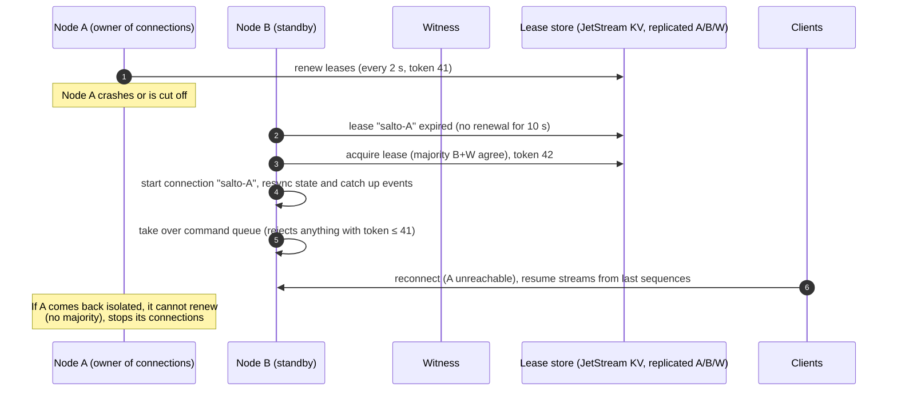

# Redundancy, Scale-Out and Multi-Site Federation

> Requirements: redundancy and multi-server deployments in v1; multi-site supervision
> (a head office watching several sites); a site that outgrows one machine is split across
> several servers without becoming two systems.

## 1. Vocabulary

| Term | Meaning |
|---|---|
| **Node** | One Watchpoint service on one machine |
| **Cluster** | Nodes of one site, sharing one PostgreSQL database (replicated) and one NATS cluster |
| **Witness** | A lightweight third member (NATS + vote only) that lets a two-node cluster decide who is alive |
| **Lease** | Time-limited ownership of a task (e.g. running a connection, being the alarm-timer owner) |
| **Fencing token** | A number increasing with each lease grant; actions carrying an old token are refused |
| **Federation** | Links between autonomous sites |

## 2. Redundancy inside a site

### 2.1 Goals

- Automatic failover in **under 30 seconds** for connections and alarm processing; no lost
  events; clients reconnect by themselves.
- **No split brain**: two nodes can never both act as owner of the same connection or send
  conflicting commands.
- Same software and configuration on every node; adding a node is a matter of installing,
  pairing and licensing.

### 2.2 Components and how each is made redundant

| Component | Redundancy mechanism |
|---|---|
| Event log (NATS JetStream) | 3-member NATS cluster (two nodes + witness, or three nodes); streams replicated ×3 with RAFT consensus — writes are acknowledged only once a majority has them |
| Database (PostgreSQL) | Streaming replication primary → standby; automatic failover by a supervisor: Patroni (needs an etcd cluster, which can run on the same three members) or pg_auto_failover (a monitor process on the witness). The choice will be confirmed in a technical spike; both are free |
| Connections | Each connection is owned by one node through a **lease** in the event log's key-value store (JetStream KV, consensus-backed). The owner renews the lease every 2 s; if it stops for 10 s the lease expires and another eligible node acquires it with a **higher fencing token**, starts the connection and resyncs |
| Commands | Queued in the event log; the new connection owner continues the queue; commands carry the owner's fencing token, the dispatcher refuses tokens older than the current one |
| Partitions of the pipeline | Partition ownership by lease, like connections; state rebuilt from snapshot + log replay |
| Alarm timers, escalations, schedules | Run by the owner of the related partition; on takeover, timers are restored from the log |
| API and live hub | Active on all nodes; clients connect to any node; live streams resume with sequence numbers |
| Media gateway | On every node; streams re-requested on failure |
| File store | Replicated between nodes (object store in JetStream or rsync-like replication), checksummed |
| Script host, automations | Automation instances persist their step state in the log and resume on the new owner |

### 2.3 Failover sequence (two nodes + witness)

- A node that loses contact with the majority **stops acting** (stops connections, refuses
  commands) — this is what prevents split brain.
- Leases can also be **moved manually** (maintenance of a node) from *System → Cluster*:
  drain a node, upgrade it, bring it back.

### 2.4 Client connectivity

- Clients know all nodes of a cluster (list received at sign-in, kept up to date) and
  reconnect to another node automatically.
- Optional **virtual IP** or DNS name with health-checked load balancer for web clients.
- Sessions survive failover: tokens are validated by any node (shared signing keys).

## 3. Scale-out — when a site outgrows one machine

All nodes run the same software; **roles** decide where work happens:

| Role | Work |
|---|---|
| `front` | API, live hub, web client hosting |
| `integration` | Runs connections |
| `pipeline` | Owns pipeline partitions, alarm engine, automations |
| `history` | History writer, reports |
| `media` | Media gateway |

A node can hold several roles (small clusters: all roles on all nodes).

- **Connections are spread** across integration nodes by a placement algorithm (balanced by
  device count and observed load; constraints such as "this connection needs Windows" or
  "pin to node X"); rebalanced when nodes join/leave, with minimal moves.
- **Pipeline partitions** are spread across pipeline nodes; adding nodes increases
  throughput roughly linearly because devices are independent.
- The **database** scales vertically first (most load is history writing, batched); for very
  large sites history can move to a dedicated PostgreSQL/Timescale server (multi-node
  options evaluated later).
- Capacity planning is based on measured limits (see
  [Performance and capacity](../operations/performance-and-capacity.md)): when a node
  approaches its limits, the health dashboard recommends adding a node rather than
  splitting the site.

## 4. Multi-site federation

### 4.1 Principles

- Each site is a complete, **autonomous** Watchpoint system (its own cluster, licence,
  configuration and history). It keeps working if the WAN fails.
- A **central** site (head office, regional monitoring centre) links to **child** sites.
  Federation can have several levels (country → region → site).
- The link is a **mTLS gRPC connection** initiated by whichever side the network allows
  (child → central is the common case through firewalls).

### 4.2 What flows on a link

| Direction | Content | Filtering |
|---|---|---|
| Child → central | Selected alarms (with full lifecycle), events, device states and aggregates, health, configuration summary (servers, devices, locations, types) for browsing | Configured per link: locations, categories, priority ranges, event types |
| Central → child | Commands (subject to rights on **both** sides), alarm actions (acknowledge, comment, transfer, close), on-demand queries (history, device details), video stream requests (proxied or direct) | Rights of the central user, mapped to the child's federation identity |

- Messages carry sequence numbers; after a WAN outage the link **resumes** from the last
  acknowledged sequence (the child's event log retains days of data), so the central site
  receives everything that happened, in order, with original timestamps.
- Bandwidth controls: state updates coalesced, video only on demand, history queries
  paginated.

### 4.3 Rights across sites

- Central users have rights on federated sites through **site scopes** in their rights
  (see [Users and rights](users-and-rights.md)).
- The child site grants the link a **federation identity** with explicit rights (e.g. "may
  acknowledge alarms of priority ≤ 200, may open doors of the lobby only"). A command from
  the central site must pass both the central user's rights and the federation identity's
  rights.
- Audit records include the original user ("M. Fati @ HQ via federation link").

### 4.4 Alarm handling ownership

| Mode | Description |
|---|---|
| Local | Child handles; central observes |
| Central | Central handles; child observes (unmanned sites) |
| Handover schedule | Local during opening hours, central outside |
| Fallback | Central takes over automatically if the child does not acknowledge within T |

Ownership changes are visible in both consoles and recorded in the alarm timeline.

### 4.5 Central consoles

- Federated alarm console with a **site column** and site time zones.
- Site map (MapLibre) with aggregated state per site; drill-down to the child's locations,
  devices and synoptics (synoptics fetched from the child on demand).
- Site health: link status, lag, child cluster health, licence status.

## 5. Disaster recovery

- Scheduled backups (database, files, secrets encrypted) to local disk and/or remote share.
- Point-in-time recovery possible with PostgreSQL WAL archiving (optional).
- A cold-standby site can be restored from backups; with federation, a central site keeps
  a copy of children's alarm history received over links.
