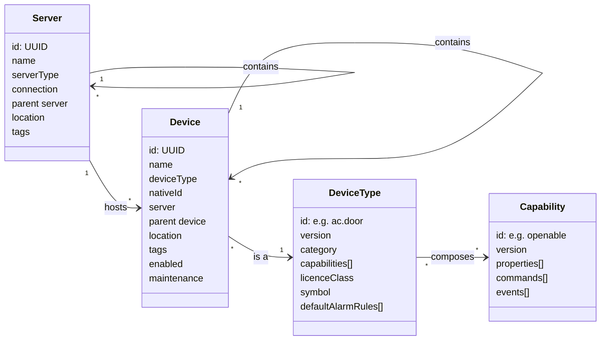

# Servers and Devices — the Universal Model

> This is the heart of Watchpoint. Every integration, screen, rule, script, report and
> right speaks this model.

## 1. Goals

1. Describe **any** security or building system of **any** vendor with **one** model.
2. Make adding a new kind of device a matter of **data** (a type definition in an
   integration package), never a change to the core or the clients.
3. Be **typed**: every value, command and event has a declared shape, so editors can
   validate, clients can render automatically, and nothing is parsed from free text.
4. Let clients show a sensible screen for a device **with zero configuration**: the type
   says how to display it, what commands it has and what is an alarm by default.

## 2. The four building blocks



| Block | Defined by | Lives in |
|---|---|---|
| **Capability** | Watchpoint (standard library) or an integration package (extension) | Type catalogue (code-free JSON schema) |
| **Device type** | Watchpoint (standard library) or an integration package | Type catalogue |
| **Server** | Created by the user through an integration (wizard/discovery) | Configuration |
| **Device** | Discovered by the connection or created manually | Configuration |

## 3. Servers

A **server** is any external system that hosts devices. Examples:

| Category | Examples of servers |
|---|---|
| Access control | Salto Space server, Genetec Synergis, Lenel OnGuard, a standalone door controller |
| Video | Milestone management server, Milestone recording server (child), NVR, standalone camera acting as its own server |
| Intrusion | Vanderbilt SPC panel, Honeywell Galaxy panel, Aritech ATS panel |
| Fire | Fire panel (Esser, Siemens Cerberus, Notifier…) or its network gateway |
| Building management | BACnet/IP controller, Modbus gateway, OPC UA server, MQTT broker |
| Communication | SIP server / intercom server, PA system |
| IT | SNMP agent (switch, UPS), any host monitored by ping |

Properties of a server:

- **Identity**: Watchpoint id (UUID, never changes), name (editable, translatable display
  name), server type (declared by the package, e.g. `salto.space`), native id when the
  vendor has one.
- **Connection link**: the [connection](integrations.md) that talks to it. A connection
  normally manages one root server and may expose child servers (Milestone management
  server → recording servers; a fire panel network → panels).
- **Hierarchy**: servers can contain servers. A child server inherits the connection of its
  parent unless declared otherwise.
- **Location and tags**: where it physically is; free labels.
- **Health**: every server has the standard *Health* capability (see §6.3), reported by its
  connection: online, offline, degraded, unknown; faults list; last contact time.
- **Server-level commands and events**: some servers have commands (e.g. "synchronise
  clock", "acknowledge panel buzzer") and events (e.g. "database changed"). Servers are
  modelled with capabilities exactly like devices, so the same UI and rules apply.

> Internally a server is a special kind of device (with role "server") so that rules,
> rights, synoptics and history work identically for both. Users still see them as two
> distinct concepts, as requested.

## 4. Devices

A **device** is anything a server hosts that Watchpoint can observe or command.

### 4.1 Device properties

| Field | Meaning |
|---|---|
| `id` | Watchpoint UUID, stable forever, used by everything internally |
| `nativeId` | The identifier in the vendor system (door external id, camera GUID, zone number). Used by the connection; unique within its server |
| `name` | Display name; can be renamed in Watchpoint without breaking anything; optional translations |
| `deviceType` + `typeVersion` | What it is (see §5) |
| `server` | The server hosting it |
| `parent` | Optional parent device (a door contains its readers, lock, door-position sensor and exit button) |
| `location` | Node of the location tree (site → building → floor → room) |
| `tags` | Free labels: `vip`, `perimeter`, `lobby`, `phase-2` |
| `enabled` | Disabled devices are kept in configuration but not supervised (no alarms, no licence consumption) |
| `maintenance` | Under works: states are still shown, alarms are suppressed or downgraded (configurable), clearly flagged in every client |
| `attributes` | Typed, type-specific static settings (camera field of view, reader direction in/out, door opening time). Declared by the type |
| `links` | Typed relations to other devices: *camera views door*, *reader belongs to access zone*, *detector covers area*. Used for automatic video on alarm and for navigation |
| `geometry` | Optional position on plans/maps, orientation, field of view (cameras) |
| `customFields` | Site-specific fields defined by the configurator (typed: text, number, date, list) — e.g. asset number, maintenance contract |

### 4.2 Device identity and rediscovery

- When a connection re-discovers its server, devices are matched by **native id**, not by
  name. Renaming a door in the vendor system updates the vendor name shown in Watchpoint
  (if the user has not overridden it) without creating a duplicate.
- Devices that disappear from the vendor system are **not deleted automatically**. They
  become *orphaned* (flagged, shown in a review list) so rules and screens referencing them
  are never silently broken.
- Devices can be **moved** to another server (e.g. vendor system migration) by remapping
  native ids, keeping history.

### 4.3 Device hierarchy — guidance

Integrations should model what operators think about:

```
Salto Space server
└── Door "Main entrance"           (ac.door)
    ├── Reader "Main entrance IN"  (ac.reader)
    ├── Lock                        (ac.lock)       — only if separately addressable
    └── Door position sensor        (generic.binary-input) — only if separately visible
Vanderbilt SPC panel
├── Area "Ground floor"            (intrusion.area)
│   ├── Zone 1 "Lobby PIR"         (intrusion.zone)
│   └── Zone 2 "Front door contact"(intrusion.zone)
├── Output 1 "Siren"               (generic.output)
└── Keypad 1                       (intrusion.keypad)
```

Intrusion zones belong to areas logically, but a zone may be in several areas. The *tree*
follows one primary parent; other memberships are **links** (`zone memberOf area`).

## 5. Device types

A device type is a **declarative document** (JSON, validated by a JSON Schema) with:

| Field | Meaning |
|---|---|
| `id` | Namespaced identifier: `ac.door`, `video.camera`, `intrusion.zone`, `fire.detector`, `vendor.salto.locker` |
| `version` | Semantic version; types evolve compatibly (add properties/commands) |
| `category` | Access control, video, intrusion, fire, intercom & audio, perimeter, building management, smart city, IT infrastructure, generic |
| `extends` | Optional base type: `vendor.salto.hotel-room` extends `ac.door` |
| `capabilities` | List of capability ids with optional constraints (e.g. *PanTiltZoom* without *zoom*) |
| `attributes` | Static, typed settings of devices of this type |
| `licenceClass` | `full`, `light` or `free` (see [Licensing](licensing.md)) |
| `display` | Icon, default symbol for synoptics, primary property (shown in lists), summary template |
| `stateSummary` | How to compute one overall state (normal, warning, alarm, fault, offline, unknown) from properties — used for colours everywhere |
| `defaultAlarmRules` | Rules created automatically when a device of this type is added (editable/disable-able) |
| `defaultLinks` | Suggested relations (a door suggests "camera views door") |
| `translations` | Labels of the type, its properties, values, commands and events in every supported language |

### 5.1 Standard type library (v1)

Types are grouped by category. Integrations may extend them or add vendor-specific types.

**Access control**

| Type | Capabilities |
|---|---|
| `ac.door` | Health, DoorPosition, Lockable, Openable (momentary access), DoorMode (normal, office/unlocked, locked-down, emergency open), AccessEvents, Tamper |
| `ac.reader` | Health, AccessEvents, Tamper, ReaderMode (card, card+PIN, disabled) |
| `ac.lock` | Health, Lockable, Battery |
| `ac.turnstile` | Health, Openable (per direction), Counter, AccessEvents |
| `ac.barrier` | Health, Openable, Position (open/closed/moving), Obstacle |
| `ac.elevator-floor` | Health, AccessControlled (secure/free), Openable (grant once) |
| `ac.locker` | Health, Lockable, Openable, Occupancy |
| `ac.access-zone` | Occupancy (count, list), ZoneMode (normal, lockdown), anti-passback status |
| `ac.controller` | Health, Tamper, PowerSupply, Battery |
| `ac.encoder` | Health (card encoder) |

**Video**

| Type | Capabilities |
|---|---|
| `video.camera` | Health, VideoSource (live streams), Recording (recording status, playback, export, bookmarks), Snapshot, PanTiltZoom (optional), Presets, Patrol, Privacy mask, Analytics events, Tamper (video loss, defocus) |
| `video.encoder` | Health; channels are `video.camera` children |
| `video.analytics-rule` | Health, AnalyticsEvents (line crossing, intrusion, loitering, object left), Armable (enable/disable) |
| `video.lpr-camera` | extends `video.camera` + PlateRecognition events |
| `video.monitor` | VideoOutput (show camera on a physical monitor/decoder) |
| `video.audio-source` | Health, AudioSource (microphone of a camera or standalone) |

**Intrusion**

| Type | Capabilities |
|---|---|
| `intrusion.area` | Health, Armable (disarmed, armed full, armed partial/night, arming, exit delay, entry delay, alarm), AlarmMemory, Reset |
| `intrusion.zone` | Health, ZoneInput (normal, active, tamper, short, open circuit, masked), Bypassable (inhibit/isolate), Tamper, Soak test |
| `intrusion.keypad` | Health, Tamper |
| `intrusion.expander` | Health, Tamper, PowerSupply, Battery |
| `intrusion.siren` | Health, Switchable, Tamper |
| `intrusion.communicator` | Health, PathStatus (IP/GSM) |

**Fire**

| Type | Capabilities |
|---|---|
| `fire.detector` | Health, FireInput (normal, pre-alarm, fire, fault, disabled), Disableable, Test mode, Contamination level (Measurement) |
| `fire.call-point` | Health, FireInput, Disableable |
| `fire.zone` | Health, FireZoneState, Disableable, Reset |
| `fire.sounder` | Health, Switchable (silence/resound), Disableable |
| `fire.extinguishing-zone` | Health, ExtinguishingState (normal, pre-discharge, released, blocked), Disableable |
| `fire.door-holder` | Health, Switchable (release) |
| `fire.loop` | Health (open/short circuit) |
| `fire.panel-output` | Health, Switchable |

**Intercom and audio**

| Type | Capabilities |
|---|---|
| `comm.intercom-station` | Health, Call (call states, answer, hang up), Openable (door release), VideoSource (optional), Tamper |
| `comm.pa-zone` | Health, Announcement (play message, live page), Volume |
| `comm.emergency-point` | Health, Call |
| `comm.speaker` | Health, Announcement, Volume |

**Perimeter**

| Type | Capabilities |
|---|---|
| `perimeter.fence-zone` | Health, ZoneInput, Bypassable, Tamper |
| `perimeter.radar` | Health, Detection events with position (geo), Armable |

**Building management, energy, IoT** (mostly through generic protocols)

| Type | Capabilities |
|---|---|
| `bms.hvac-unit` | Health, Measurement (temperatures, humidity), Setpoint, Switchable, Mode |
| `bms.meter` | Health, Measurement (energy, power, water, gas), Counter |
| `bms.lighting-zone` | Health, Switchable, Dimmable |
| `bms.lift` | Health, Position (floor), Mode (normal, out of service, fire recall), Fault |
| `bms.pump` / `bms.fan` | Health, Switchable, Speed, Fault |
| `env.sensor` | Health, Measurement (temperature, CO₂, noise, air quality, water leak), Battery |

**Smart city**

| Type | Capabilities |
|---|---|
| `city.traffic-controller` | Health, Mode (normal, flashing, off, manual), Plan selection, Fault |
| `city.bollard` | Health, Position (up/down/moving), Openable |
| `city.parking-sensor` | Health, Occupancy, Battery |
| `city.parking-area` | Occupancy (counts), Display |
| `city.smart-pole` | Health, Switchable (lighting), child devices (camera, sensor, emergency point) |
| `city.variable-message-sign` | Health, DisplayText (set message) |

**IT infrastructure**

| Type | Capabilities |
|---|---|
| `it.host` | Health (reachability, latency), Measurement (CPU, disk via SNMP) |
| `it.switch-port` | Health, Switchable (PoE on/off — reboot a camera), Link status |
| `it.ups` | Health, PowerSupply, Battery, Measurement (load, autonomy) |

**Generic** (for protocols like Modbus, BACnet, OPC UA, MQTT, SNMP where meaning is
configured by the user)

| Type | Capabilities |
|---|---|
| `generic.binary-input` | Health, BinaryValue (with configurable meaning of true/false and alarm state) |
| `generic.binary-output` | Health, BinaryValue, Switchable, Pulse |
| `generic.analog-input` | Health, Measurement (unit, range, thresholds) |
| `generic.analog-output` | Health, Measurement, Setpoint |
| `generic.multistate` | Health, Enumerated value (configurable states with meaning and severity) |
| `generic.counter` | Health, Counter |
| `generic.text` | Health, Text value |

The generic types are what make Watchpoint able to supervise *anything* even before a
dedicated device type exists: an integrator maps a Modbus register to a
`generic.multistate` and gives each value a label, a colour and whether it is an alarm.

## 6. Capabilities

A capability is a reusable, versioned contract made of **properties**, **commands** and
**events**. Clients, rules, scripts and the integration contract all understand
capabilities, so supporting a new device type requires no new UI code.

### 6.1 Properties

| Field | Meaning |
|---|---|
| `id` | e.g. `position` in capability `doorPosition` → full path `doorPosition.position` |
| `valueType` | `boolean`, `integer`, `decimal`, `enum`, `string`, `timestamp`, `duration`, `geo-point`, `object` (with a JSON schema), `list` |
| `unit` | For numbers: SI/UCUM code (`Cel`, `%`, `kW.h`, `s`) — converted for display per locale |
| `enumValues` | For enums: each value has a stable code (`open`, `closed`, `forced`, `held-open`), a **semantic severity** (normal, info, warning, alarm, fault) and translated labels |
| `range` | Min/max for numbers; used by UI widgets and validation |
| `writable` | Whether a command `set` exists for it |
| `history` | Default history policy: every change, deadband (for analog), periodic sampling, none |
| `stale after` | Duration after which a value not refreshed is marked *stale* |

**Every property value** carries:

- `value`
- `quality`: `good`, `uncertain`, `bad`, `stale` (and a reason code)
- `sourceTime`: when the integrated system says it happened (if known)
- `receivedTime`: when Watchpoint received it
- `origin`: connection id + optional correlation (e.g. the command that caused it)
- `sequence`: position in the event log

### 6.2 Commands

| Field | Meaning |
|---|---|
| `id` | e.g. `openable.open`, `armable.arm`, `ptz.gotoPreset` |
| `parameters` | Typed parameter list with JSON schema (e.g. `mode: full | partial`, `duration: 5..3600 s`) |
| `risk` | `normal`, `sensitive`, `critical` — drives confirmation, reason and four-eyes rules (see [Commands](commands.md)) |
| `expectedEffect` | Optional verification: which property should reach which value within which window (open → `doorPosition.position == open` within 10 s) |
| `timeout` | Default dispatch timeout |
| `idempotent` | Whether resending is safe after a lost answer |
| `batchable` | Whether it can be sent to many devices at once efficiently (e.g. "lock all doors of zone") |

### 6.3 Events

| Field | Meaning |
|---|---|
| `id` | e.g. `accessEvents.granted`, `accessEvents.denied`, `doorPosition.forced`, `analytics.lineCrossing` |
| `payload` | Typed fields (credential, cardholder reference and display name, reason code, direction, plate number, bounding box…) |
| `severity` | Default semantic severity |
| `personalData` | Which payload fields are personal data (for privacy retention and masking) |

### 6.4 Standard capabilities (v1)

| Capability | Properties | Commands | Events |
|---|---|---|---|
| **Health** (on every device and server) | connectivity (online, offline, degraded, unknown), faults (list of standard fault codes: tamper, battery-low, power-fail, comm-fail, hardware-fault, config-error, clock-drift…), lastContact | refresh | wentOffline, cameOnline, faultRaised, faultCleared |
| DoorPosition | position (closed, open, forced, held-open, unknown) | — | forced, heldOpen, closedAgain |
| Lockable | lockState (locked, unlocked, unknown) | lock, unlock | — |
| Openable | — | open (momentary grant, duration) | opened |
| DoorMode | mode (normal, unlocked, locked-down, emergency-open, emergency-close) | setMode(mode, until?) | modeChanged |
| AccessEvents | lastAccess (object) | — | granted, denied (reason), doorForcedAfterGrant, duress, antipassback |
| Armable | armState (disarmed, partial, full, arming, entry-delay, exit-delay, alarm, unknown) | arm(mode), disarm, cancelArming | armed, disarmed, armFailed (reasons: open zones…) |
| ZoneInput | state (normal, active, tamper, short, open-circuit, masked, fault) | — | activated, restored |
| Bypassable | bypassed (bool) | bypass, unbypass | — |
| AlarmMemory | inMemory (bool) | reset | — |
| FireInput | state (normal, pre-alarm, fire, fault, disabled, test) | — | fireAlarm, preAlarm, restored |
| Disableable | disabled (bool) | disable, enable | — |
| Switchable | on (bool) | switchOn, switchOff, toggle | — |
| Pulse | — | pulse(duration) | — |
| Dimmable | level (0–100 %) | setLevel | — |
| Measurement | value (decimal + unit), thresholds | — | thresholdCrossed |
| Setpoint | setpoint | setSetpoint | — |
| Counter | count | reset | — |
| Occupancy | count, occupied (bool), occupants (list, optional) | — | changed |
| VideoSource | streams (list of profiles: resolution, codec, bitrate), live available | — (stream requests go through the media API) | videoLost, videoRestored |
| Recording | recording (bool), retention | startRecording, stopRecording, bookmark(text), export(range) | — |
| Snapshot | — | takeSnapshot | — |
| PanTiltZoom | position (pan, tilt, zoom), moving | move(direction, speed), stop, absoluteMove, zoom, focus, iris | — |
| Presets | presets (list) | gotoPreset(id), savePreset | — |
| Patrol | active patrol | startPatrol(id), stop | — |
| AnalyticsEvents | — | — | detection(kind, object class, confidence, region, image ref) |
| PlateRecognition | — | — | plateRead(plate, country, confidence, list match) |
| Call | callState (idle, ringing, connected, on-hold) | answer, hangUp, call(target) | callStarted, callEnded, missedCall |
| Announcement | — | playMessage(id), startLivePage, stop | — |
| Battery | level (%), low (bool) | — | low, restored |
| PowerSupply | mains (ok/fail), output (ok/fault) | — | mainsLost, mainsRestored |
| Tamper | tampered (bool) | — | tamper, tamperRestored |
| Position | position (enum or numeric) | moveTo | — |
| Mode | mode (enum declared by type) | setMode | — |
| Text / DisplayText | text | setText | — |

### 6.5 Extending the model

- **New device type**: an integration package adds a type document composing existing
  capabilities (e.g. `vendor.salto.hotel-room` = `ac.door` + Occupancy + DoNotDisturb).
  Clients render it immediately; nothing else changes.
- **New capability**: a package can declare a capability not in the standard library. The
  generic UI renders its properties (by value type), commands (forms generated from the
  parameter schema) and events. Once a capability proves generic (several vendors), it is
  promoted into the standard library in a later version.
- **Versioning**: types and capabilities use semantic versions. Minor versions only add;
  major versions require a migration declared in the package (mapping old properties to
  new ones). Configuration and history keep the version they were recorded with.
- **Governance**: since only the Watchpoint team writes integrations, a type registry
  review is part of the release checklist: naming rules, reuse of standard capabilities
  first, translations in all supported languages, symbol for every state.

## 7. State summary — one colour language everywhere

Each device computes an **overall state** from its properties, using the type's
`stateSummary` rules (semantic severities of enum values, thresholds of measurements,
health):

| Overall state | Meaning | Default colour |
|---|---|---|
| `alarm` | Something needs attention now | red |
| `fault` | Device or communication fault | orange |
| `warning` | Abnormal but not alarming (door held open, battery low) | yellow |
| `normal-active` | Normal but active (door open legitimately, area armed) | blue |
| `normal` | Normal | green / neutral |
| `disabled` / `maintenance` | Not supervised or under works | grey with hatching |
| `offline` / `unknown` | No reliable data | grey |

Lists, trees, synoptics, maps and the mobile app all use this. Colours are a site theme
setting, and colour is never the only cue (icons and text for accessibility).

## 8. Locations and tags

### 8.1 Location tree

A physical hierarchy, independent of the technical server/device tree:

```
Organisation
└── Site "Paris HQ"
    ├── Building A
    │   ├── Floor -1 (parking)
    │   ├── Floor 0
    │   │   ├── Lobby
    │   │   └── Security office
    │   └── Floor 1
    └── Outdoor perimeter
```

- Levels are free (site, building, floor, room, zone, outdoor sector…), each with a kind
  for icons and filtering.
- Each location can carry a **plan** (default synoptic), a **geo-position or polygon**
  (maps), a **time zone** (sites in different countries), and **contacts** (on-site
  guard, facility manager) used in alarm procedures.
- Every device and server has one location. Bulk assignment: drag a set of devices onto a
  location, or assign by rule ("all doors whose name starts with `B-`").
- Locations aggregate states: a floor shows the worst state of its devices, with counters
  (3 alarms, 1 fault).

### 8.2 Tags

Free, typed-less labels (`vip`, `perimeter`, `critical`, `contractor-x`) on servers,
devices and locations, used for filtering, rights scopes, alarm rule scopes, automation
triggers and reports. Tags can be grouped in **tag families** (e.g. family "Risk" with
tags `low`, `medium`, `high`) to keep them tidy.

## 9. Persistence

| Data | Table/stream | Notes |
|---|---|---|
| Type catalogue | `config.device_types`, `config.capabilities` (JSON documents + version) | Loaded from packages at start; stored to keep history interpretable after uninstall |
| Servers, devices | `config.servers`, `config.devices` | Relational columns for identity, hierarchy, location; `attributes` and `customFields` as validated JSONB |
| Links | `config.device_links` | Typed relation, both ends, validity |
| Locations | `config.locations` (tree with materialised path) | Fast "all devices under building A" queries |
| Tags | `config.tags`, `config.tag_assignments` | |
| Current values | in-memory store + `state.property_values` snapshot | See [Core runtime](core-runtime.md) |
| History of values | `history.property_changes` hypertable | Policy per property |

Unlike string-encoded parameters, every field is typed, validated against the type's
schema at publish time, and referentially consistent (foreign keys everywhere).

## 10. What clients get for free from the model

- **Device page**: header (name, type icon, overall state, location), properties grouped by
  capability with labels and units, command buttons with generated forms, recent events,
  active alarms, linked cameras, history charts for measurements — all generated from the
  type, no configuration.
- **Lists and trees**: by server or by location, with overall state colours and counters.
- **Synoptic symbols**: default symbol per type with one appearance per summary state.
- **Search**: by name, native id, type, tag, location, state ("all doors forced now").
- **Bulk actions**: select many devices of compatible capabilities and send a batchable
  command, with per-device results.
