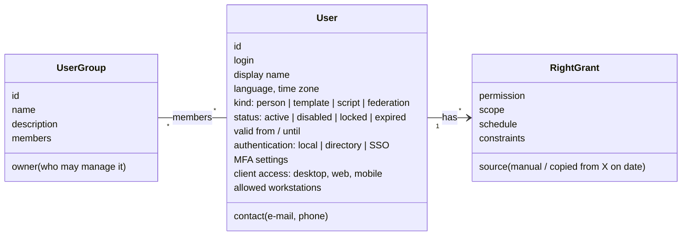
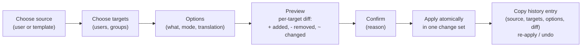

# Users, User Groups and Rights

> Requirements: no profiles. Users carry their own rights. **User groups** organise users.
> A **rights-copy tool** copies all rights and access of one user to another user, to
> several users, or to every member of a group.

## 1. Model

- A **user** owns a list of **right grants**. There is no profile in between.
- A **user group** is a named set of users. Groups do **not** hold rights; they are used to:
  - organise and find users ("Night shift", "Contractor X", "Building A guards");
  - apply rights in bulk with the rights-copy tool;
  - target alarms, notifications, handover and escalation ("notify the Supervisors group");
  - bulk actions (disable all, extend validity, force password change, sign out).
- A user can belong to several groups.

### 1.1 User kinds

| Kind | Purpose |
|---|---|
| `person` | A human operator, configurator or administrator |
| `template` | A reference set of rights ("Standard operator — Building A"). **Cannot sign in.** Used only as a copy source. This keeps the convenience of profiles without the coupling: changing a template changes nobody until rights are re-applied |
| `script` | Identity a script or automation runs as; rights limit what it can do |
| `federation` | Identity a remote site uses through a federation link |

### 1.2 Account properties

- Login, display name, e-mail, phone, photo, language, time zone, notes.
- Validity window (temporary contractors), status, last sign-in, password age.
- Authentication method: local password, directory (LDAP/Active Directory), single sign-on
  (OpenID Connect: Microsoft Entra ID, Keycloak, Okta, Google…), with MFA.
- **Client access**: which clients the user may use (desktop, web, mobile) — e.g. a manager
  only on mobile.
- **Allowed workstations** (optional): desktop client machines the user may sign in from.
- **Session policy**: concurrent sessions allowed, idle lock time, maximum session length.

## 2. Rights

A **right grant** = **permission** × **scope** × **schedule** × **constraints**.

### 2.1 Permissions catalogue

Permissions are registered by modules; the catalogue is shown as a tree in the rights
editor. Main families:

| Family | Permissions (examples) |
|---|---|
| **Operation — view** | View devices and states; view events journal; view history; view synoptics; view reports |
| **Operation — alarms** | View alarms (with **priority range**); acknowledge; comment; transfer; shelve (max duration); close; close without report; manage incidents |
| **Operation — commands** | Per capability command: `openable.open`, `armable.arm`, `armable.disarm`, `bypassable.bypass`, `ptz.*`, `recording.export`… Grouped by category in the UI (Access control commands, Intrusion commands…) with "all commands of this category" shortcuts; approve four-eyes commands |
| **Operation — video** | Live; playback (max look-back); export; PTZ (with PTZ priority level); snapshots; privacy-mask unmask |
| **Operation — personal data** | See cardholder names/photos in events; see plates; export personal data |
| **Operation — workspace** | Save personal workspaces; publish shared workspaces |
| **Configuration** | Per area: users and groups; rights (see §2.4); integrations and connections; servers and devices; locations and tags; alarm rules and procedures; synoptics; automations; scripts; notifications; reports templates; calendars; system settings; licence; backups; maintenance mode; federation |
| **Administration** | Audit trail view; system health; sessions management (sign out users); diagnostics export |

Each configuration permission exists as **view** and **edit**, and **publish** where drafts
apply (see [Configuration management](configuration-management.md)).

### 2.2 Scopes

A scope says **on what** the permission applies. One or more of:

| Scope kind | Example |
|---|---|
| Everything | All devices of the site |
| Locations | Building A (including sub-locations) |
| Servers | Salto — Building A |
| Device categories / types | Access control; intrusion areas |
| Tags | `perimeter`, `vip` (with include/exclude) |
| Specific devices | Server room door |
| Sites (federation) | Site Lyon |

Scopes combine (e.g. *access control devices in Building A, excluding tag `vip`*). Scopes
are evaluated server-side for **every** read, list, live push and command. A user never
receives data outside their scope.

### 2.3 Schedules and constraints

- **Schedule**: a calendar during which the grant is valid (e.g. night-shift rights
  22:00–06:00).
- **Constraints** on sensitive permissions:
  - require confirmation / reason;
  - require four-eyes approval (by users holding the *approve* permission);
  - require re-authentication (password or MFA) for this action;
  - maximum (e.g. shelving ≤ 30 min, playback ≤ 7 days back);
  - client kind restriction (e.g. command allowed on desktop only, not on web/mobile).

### 2.4 Protection against privilege escalation

- A user can only grant rights **they hold themselves**, within **their own scope**.
- A user cannot modify their own rights (except an initial super-administrator path,
  audited).
- **Administrator** flag: full rights; at least one active administrator must always
  exist; only administrators can create administrators.
- Rights changes take effect immediately on live sessions (rights are re-evaluated, the
  live stream is re-filtered, now-forbidden screens close with an explanation).

## 3. The rights-copy tool

The core productivity feature replacing profiles.

### 3.1 Operations

| Operation | Description |
|---|---|
| **Copy user → user** | Copy all grants (and optionally access settings) of A to B |
| **Copy user → several users** | Same, to a selection |
| **Copy user → group** | Apply to every current member of a group |
| **Copy template → …** | Same, with a template user as source (recommended practice) |
| **Compare** | Side-by-side diff of two users' rights (or one user vs a template) |
| **Re-apply** | Re-run a previous copy (e.g. after the template changed), from the copy history |

### 3.2 Options

| Option | Choices |
|---|---|
| What to copy | Rights grants (always) · client access · allowed workstations · session policy · group memberships · alarm audience memberships · notification subscriptions · default workspace and home screen · language |
| Mode | **Replace** (target ends with exactly the source's rights) · **Merge** (add missing grants, keep the target's extra ones) · **Remove** (remove from targets the grants the source has — to revoke a bundle) |
| Scope translation | Optional mapping when copying across buildings: "replace location Building A by Building B in all scopes" — so one template serves many buildings |
| Exclusions | Skip administrators, skip disabled users, skip users with manual overrides on certain permissions |

### 3.3 Workflow

- **Preview** shows exactly what will change for each target, with warnings (e.g. "this
  would give Ahmed the right to disable fire zones", "the source has rights you cannot
  grant — they will be skipped").
- The operation is **atomic** (one change set) and **undoable** from the copy history.
- Each copied grant records its **source** ("copied from Template Operator A on
  2026-11-02 by M. Fati"), so the rights editor can show where a user's rights came from
  and highlight manual changes made afterwards.
- **Drift indicator**: a user list column shows, for users whose rights were copied from a
  template, whether they still match the template ("in sync", "template changed — re-apply
  available", "manually modified").

### 3.4 Why this instead of profiles

- Rights are explicit on each user: what you see is what they have.
- No hidden effect: editing a template changes nobody until you re-apply, with a preview.
- Exceptions are easy (one user gets one extra right) without creating a new profile.
- The drift indicator and re-apply give back the "update many users at once" benefit of
  profiles.

## 4. Authentication

| Method | Details |
|---|---|
| Local | Password hashed with Argon2id; policy (length, classes, history, expiry optional, breached-password list check offline); lockout after N failures with progressive delay |
| Directory | LDAP/LDAPS bind (Active Directory, OpenLDAP); optional auto-provisioning on first sign-in with a **default template** chosen by directory group mapping (directory group → Watchpoint template + user group) |
| Single sign-on | OpenID Connect (authorization code + PKCE); Windows integrated sign-in via Entra ID / AD FS through OIDC; SAML supported through an OIDC broker (e.g. Keycloak) rather than custom SAML code |
| MFA | TOTP (authenticator apps), WebAuthn/passkeys and FIDO2 security keys; enforcement per user/group/permission (e.g. MFA required for configuration) |
| Workstation sign-in | Desktop client can be bound to a workstation identity (certificate issued at enrolment), enabling workstation restrictions and kiosk mode |

Emergency access: a sealed **break-glass** local administrator account, usable even when the
directory/IdP is unreachable, with mandatory reason and loud audit + notification.

## 5. Sessions and tokens

- Sign-in returns a **short-lived access token** (JWT, 10 minutes) and a **refresh token**
  bound to the client instance (rotated on each use, revocable).
- The node keeps a session registry: user, client kind, workstation, IP, start, last
  activity. Administrators can sign out any session.
- Password change, rights reduction, account disable or maintenance mode revoke affected
  sessions immediately (live stream closed with reason).
- Idle lock in clients (screen locked, re-enter password/PIN/biometrics on mobile).
- Limits on concurrent sessions per user (configurable) and by licence seats.

## 6. Maintenance mode gate (operation suspended)

When the system is in maintenance mode (see [Desktop client §6](../clients/desktop-client.md#6-suspending-operation-maintenance-mode)),
the identity module refuses operation sessions (web, mobile, desktop operation side) and
closes existing ones with a message; users with configuration permissions can still sign in
to the configuration side.

## 7. Audit trail

Every security-relevant action is recorded, immutable (append-only table with hash
chaining so tampering is detectable):

- sign-in/out, failures, lockouts, MFA events, token revocations;
- all configuration changes (who, what, before/after, change-set, reason);
- rights changes and rights-copy operations with full diffs;
- commands and alarm handling (also in their own histories);
- exports of personal data and video;
- maintenance mode changes, licence changes, package installs.

The audit viewer (with the *Audit trail view* permission) filters by user, action, object,
time; exports to CSV/PDF. Audit retention is configured separately from other history.

## 8. Privacy (GDPR and similar laws)

- Personal data of **users** (operators) and of **people in events** (cardholders,
  visitors, plates) is flagged in the model.
- Retention per data category; automatic purge or pseudonymisation after the period.
- Masking: users without the *personal data* permission see "Cardholder #4821" instead of
  the name.
- Subject access/erasure support: search all history for a person reference and export or
  pseudonymise, with audit.
