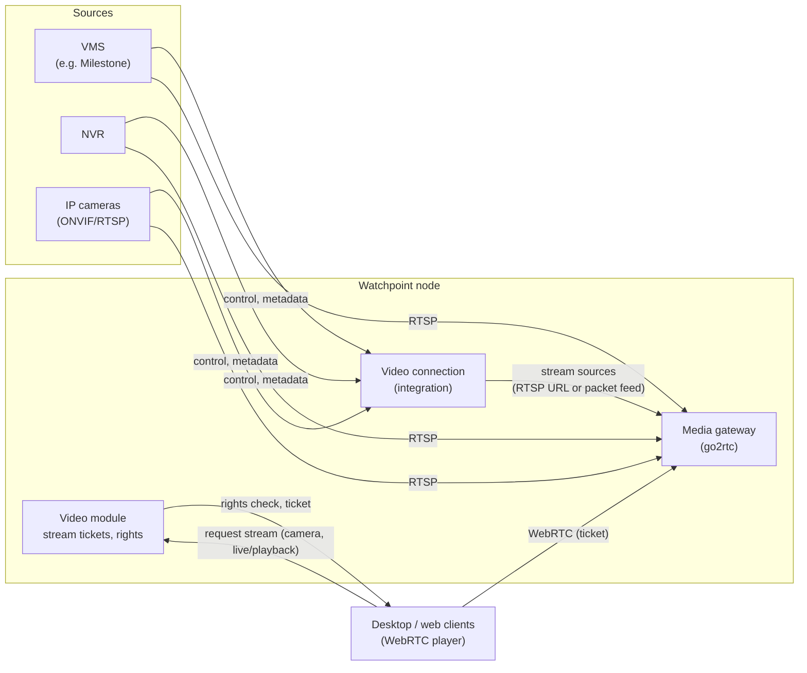

# Video

> Watchpoint does not record video. It shows live and recorded video **from the integrated
> VMS, NVRs and cameras**, controls them (PTZ, presets, recording, export, bookmarks), and
> links video to devices, alarms and synoptics.

## 1. Architecture

1. A client asks the video module for camera C (live, or playback from time T).
2. The video module checks rights (live / playback with look-back limit), asks the camera's
   connection for a **stream source** (short-lived RTSP URL, or a packet feed when the
   vendor SDK delivers frames), and registers it with the media gateway.
3. The client receives a **one-time stream ticket** and connects to the gateway by WebRTC.
4. The gateway passes H.264/H.265 through **without transcoding** where the client supports
   the codec; it falls back to MSE/HLS, or to transcoding (with hardware acceleration when
   available) only if required.

Video never flows through the core process. Gateways can run on every node, on dedicated
"media" nodes, or on **edge gateways** near cameras (remote sites) to save WAN bandwidth.

## 2. Features (v1)

| Feature | Detail |
|---|---|
| Live view | Single view, layouts 1/4/9/16/custom tiles, multi-monitor (desktop), full screen, digital zoom |
| Stream selection | Automatic: sub-stream for small tiles, main stream when enlarged; manual override |
| Playback | Timeline with recording and motion/bookmark marks from the VMS; play, pause, speed, step, go to time, synchronised playback of several cameras |
| Instant replay | "Back 10/30 s" from live; "play from alarm time − 10 s" from an alarm |
| PTZ | On-screen controls, click-to-centre, area zoom (if supported), presets, patrols; USB joystick in the desktop client; PTZ priority between operators |
| Snapshots | Manual, or automatic by alarm action; stored as alarm/event attachments |
| Export | Request an export from the VMS (time range, cameras, format, password); job progress and download link when the VMS supports it |
| Bookmarks | Create in the VMS with text (manual or by automation) |
| Linked video | Device links ("camera views door") → automatic video in alarm details, device panels and synoptics |
| Privacy | Respect VMS privacy masks; permission for unmasking where the VMS supports it |
| Audit | Live views, playback ranges, exports logged per user |

## 3. Codec and latency notes

- WebRTC gives the lowest latency (typically under 500 ms) and is supported natively by
  Electron and browsers.
- H.265 support varies by browser and hardware; the gateway falls back automatically.
  The desktop client (Electron/Chromium) is the most predictable environment.
- Audio from cameras is optional (permission + browser/autoplay rules).
- If transcoding is ever needed, go2rtc calls FFmpeg; only an **LGPL** build of FFmpeg is
  bundled (a GPL build would conflict with a closed-source product).

## 4. Video walls (later)

A later module: physical monitor walls driven by desktop clients in "wall" mode, with
layouts pushed from operator consoles. The v1 workspace and multi-monitor features are
designed so this can be added without changes to the video pipeline.
